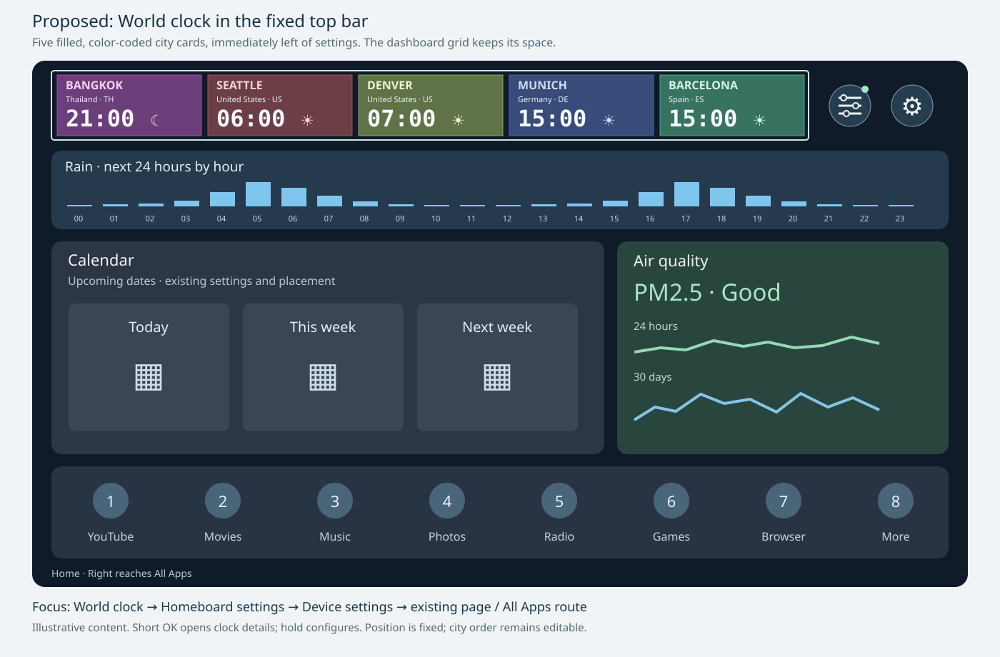
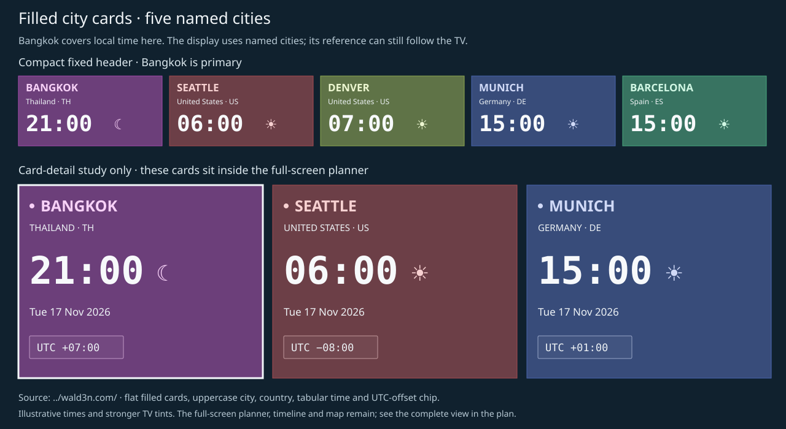
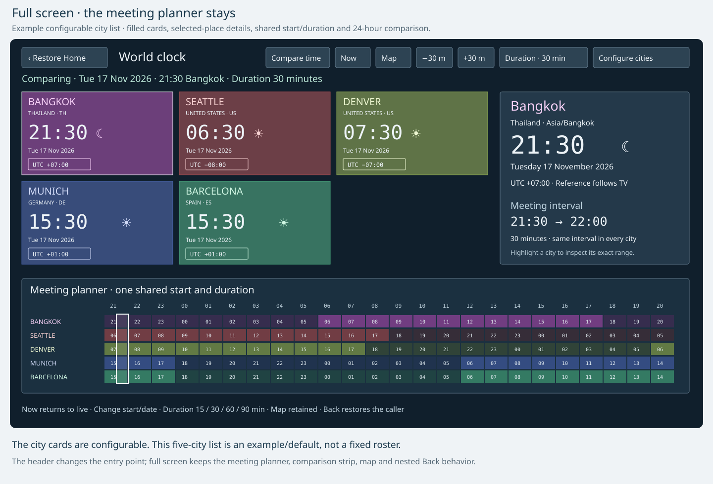
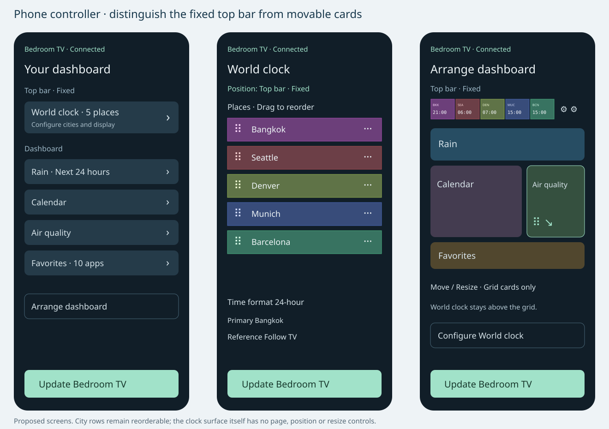
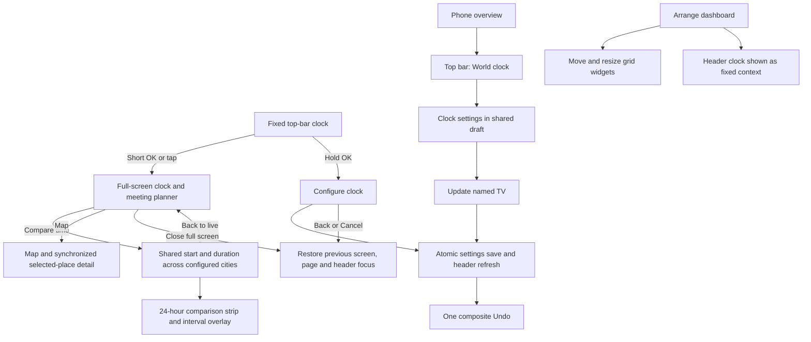
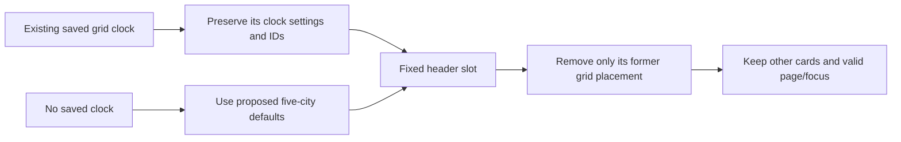

# World clock in the fixed top bar

Status: implemented and deployed as 0.1.52 to Cast1 and Cast2; Cast1 native checks passed. This updates the
[World clock plan](2026-11-17-world-clock-widget.md) following Will's request to put
the clock **immediately left of the settings buttons**, with its position fixed
like those buttons. Version 0.1.47 is the historical saved 8×1 grid baseline;
this implementation replaces that placement while retaining its clock settings.

## Recommended layout

Use the existing reserved top band for one compact World clock surface, followed
by **Homeboard settings** and **Device settings**. The clock uses the available
space to their left. It does not occupy a dashboard cell, add another dashboard
row, or push Rain, Calendar, Air quality or Favorites down.

- **Default list:** Bangkok, Seattle, Denver, Munich and Barcelona, in that order.
  Bangkok is the default primary; use 24-hour format and Follow TV as reference.
  For Will's captured clock, remove the redundant Local entry and move primary
  to its saved Bangkok record if Local was primary. User-configured lists,
  primary/reference choices and named cities' saved IDs remain authoritative.
- Recommend a **60 dp high** header clock, vertically centered with the existing
  52 dp settings buttons: approximately 16 dp from the top. Use the existing
  32 dp side inset and end at least 12 dp before Homeboard settings. The current
  Home and All Apps grid top offsets remain unchanged.
- Hardcode the **anchor and slot**, while calculating width from the actual safe
  area and settings-button bounds. Do not hardcode 1080p pixel coordinates.
- Show five compact city/time pairs at normal TV sizes. Prefer full city names;
  shorten a label only when needed. Omit the full date in this glance view; keep
  useful relative-day indicators when a place differs from the reference date.
- Use **individual, flat, filled city cards** with small gaps and thin borders,
  close to the original world-clock design. Their full backgrounds carry the city
  colors, with readable uppercase names, a smaller country line, large tabular
  time and a sun/moon alongside. Respect existing UI opacity.
- At narrow widths or enlarged text, keep the primary clock visible, fit other
  places without overlap, and show **+N** for the remainder. Short OK opens all
  places. Do not add a scrollbar, marquee or automatic horizontal scrolling.
- Reserve settings hitboxes and focus clearance first. The clock text, overflow
  indicator and focus border must never cover either settings button.
- Relocate the existing top-left **Phone connected** banner to a compact,
  accessibly labeled settings-area status badge so it cannot cover the clock.

**Recommended visibility:** keep the same clock beside the same buttons on every
Home page and on All Apps, because those controls already share that top band.
The dashboard and app grids keep their existing space. Expanded widget views
continue using the existing full-screen overlay and Back behavior.

## Card design from the actual source

Will explicitly requested colored cards closer to the original. The source was
read directly in `../wald3n.com/` (checkout HEAD `32ee637`): `src/pages/world-clock.astro` city-card markup,
`src/styles/global.css` `.glass-card`, `src/lib/city-colors.ts` and the card repaint
logic in `src/scripts/world-clock.ts`.

| Original implementation | TV adaptation |
|---|---|
| Full city-colored background using a 14% mix with the source surface color | Keep a full, visibly colored card fill. Mockups strengthen the tint for Homeboard's darker TV background; tune it against actual TV contrast. |
| Flat rectangular card, 1 px border and zero corner rounding | Flat compact cards with fine borders and small gaps. A clear group focus outline retains one remote stop. |
| Colored uppercase city name and separate smaller country line | Keep that hierarchy; use verified airport/country codes when width requires it, with the complete name in details/accessibility. |
| Large monospaced time with a nearby day/night symbol | Preserve tabular digits and the adjacent symbol. |
| Full date and UTC-offset chip in the larger card | Keep both in full screen; compact header cards prioritize place, country and time. |
| One longitude-ranked rainbow shared by cards, pins and hourly blocks | Retain the same shared city identity in every presentation. |

Keep explicitly named cities even when their clocks currently match, such as
Munich and Barcelona. This is removal of the redundant Local entry, not a rule
that merges different cities by UTC offset.

The same filled-card direction applies to the detailed city cards. Card shape,
background and typography provide the reference character; borders and names
supplement the color fill. The placement proposal and saved city configuration
remain as described above.

## City list remains configurable

**The position is fixed; the city list is editable.** Bangkok, Seattle, Denver,
Munich and Barcelona are the proposed initial/default list, not a hardcoded roster.
Retain the current 1–12-place limit and independent saved settings per TV.

TV and phone configuration must retain:

- Add a city or named time zone, remove a place, and rename its display label.
- Reorder places directly on the phone, with accessible move actions; retain TV
  reorder controls and Manual / West → east modes.
- Choose primary and reference clocks, time format and full-screen seconds.
- Keep Follow TV as the reference without requiring a duplicate Local card.
  Users can explicitly add Local again if that is useful to them.
- When a primary/reference place is removed, select a valid remaining primary and
  the normal TV reference fallback. Keep saved IDs attached to their places.

Header overflow, full-screen cards, the map and **every meeting-planner row** use
the configured list. Preserve explicitly named cities even when their current
times match. Removing the redundant default Local entry is not a general rule
that prunes custom lists by offset or time zone.

## Full-screen meeting planner stays

The latest design edits change the header presentation and card styling. The
existing full-screen clock remains a **meeting planner**, with:

- Colored city cards and persistent selected-place details.
- **Compare time**, a shared start/date, and **15 / 30 / 60 / 90 minute** duration.
- The **24-hour multi-city comparison strip**, day/night blocks and one interval
  overlay spanning every configured city's row.
- Future paging and exact per-city interval values, plus **Now** to return live.
- The geographic **Map** view and synchronized place selection.
- Nested Back: close place details, exit comparison to live, then restore the
  calling Home/All Apps screen, page and header focus.

The enlarged card study above shows card styling only. This complete mockup shows
the surrounding planner that remains part of the full-screen experience.

## Remote and touch behavior

Treat the whole header clock as **one focus stop**. Its city ordering remains
configurable in settings.

| Action | Result |
|---|---|
| Short OK or tap on the clock | Open the detailed World clock view, including comparison, map and highlighted-place detail. A city-card tap highlights that place; remote OK opens the primary/retained selection. |
| Hold OK on the clock | Configure its places, order, format, primary/reference and full-screen seconds. |
| Left from Homeboard settings | Focus the header clock. |
| Right from the header clock | Focus Homeboard settings, then Device settings. |
| Right beyond the final settings button | Preserve the current next-page / All Apps behavior, including an empty dashboard. |
| Down from the top bar | Return to the appropriate dashboard/app content with a sensible retained focus. |
| Back through clock details, comparison or configuration | Return through nested states first, then restore the calling Home/All Apps screen, page and header-clock focus. |

An empty Home retains its blank surface focus when a grid tile disappears: one
Right opens All Apps. Up reaches Settings, then Left reaches the clock. Explicit
header/settings focus keeps the top-bar navigation in the table above.

The header clock has no Move, Resize or Remove tile action. Its layout is fixed;
its **clock data remains configurable**. Preserve reduced-motion behavior and the
existing immediate expansion feedback, using the header's real bounds as the
zoom source. Minute/time-zone refreshes run only while the launcher is visible;
do not announce every tick through accessibility.

## Phone controller

- Show **Top bar · Fixed** separately from **Dashboard** on the overview. Include
  a named **World clock · 5 places** row so the compact diagram is not the only
  way to open it.
- Tapping it opens the existing meaningful clock settings and directly reorderable
  place list. Show **Position: Top bar · Fixed**; do not show page, column, row,
  width or height fields for this clock.
- Arrange dashboard shows the top bar as locked context above the editable grid.
  The clock has no drag or resize grips there. A Configure World clock link opens
  its settings. The grid still contains Rain, Calendar, Air and Favorites.
- Add widget offers grid widgets; it does not create another copy of the standard
  header clock. The top-bar row and TV hold action are its normal entry points.
- Keep one shared draft and **Update [TV name]**. A clock change can be combined
  with Favorites or other widget edits and restored by the same composite Undo.
- Preserve field-aware rebase, atomic places/primary/reference conflict handling,
  stable TV identity and unknown-result receipt recovery. An open native clock
  configuration dialog counts as busy, just like other TV configuration menus.

## Move the existing clock safely

Cast1 currently has one saved World clock. Move its named-city configuration to
the header, applying Will’s explicit removal of the redundant Local card. The
proposed new-header default is the five named cities above; the installed 0.1.47
six-place preset remains the historical baseline until implementation.

1. For Will's captured standard list, preserve the five named-city records and
   IDs, remove the redundant Local entry, and move primary to the saved Bangkok
   record only if it pointed at Local. Retain the independent TV reference.
   Preserve other custom lists and their primary/reference settings; relocation
   must not prune arbitrary user data. Local remains available as an explicit
   add-place choice.
2. Remove only that clock's former grid placement. Keep all other widget settings,
   positions, Favorites, artwork and wallpaper as saved.
3. If the old clock occupied the final page by itself, remove that empty trailing
   page and restore a valid page/focus. Do not repack other user-arranged cards.
4. Preserve any additional existing grid clock instances rather than silently
   deleting them; only the selected standard clock moves into the header. Do not
   add a new additional-clock creation workflow in this change.
5. Handle saved Undo snapshots explicitly: undoing another setting must not
   resurrect the old grid position or reset the header clock. Cover this with
   saved-layout and composite-Undo tests.
6. Keep a deliberately empty dashboard empty. The fixed clock is a top control,
   so it must not affect grid page counts or block Right to All Apps.

## Implementation boundaries

Extend the existing native top-control layout, clock renderer/models and
full-screen contract. Model the header slot separately from movable grid cells;
backend validation must reject attempts to move it. Share native default settings
with the phone as today. This does not need a generic pinning framework, a second
clock engine, new providers or a legacy protocol compatibility layer.

Primary areas: `MainActivity` top controls, focus routing and busy state;
`HomeLayout` persistence/page counts and data transition; compact header rendering;
full-screen restoration; phone state/validation and the dashboard-first editor.
Update English/Thai interface copy and the widget/full-screen documentation.

## Acceptance before deployment

- On Cast1 and Cast2, the five-city clock sits left of both settings buttons with
  clear focus and no overlap; the four dashboard panels retain their geometry.
- Check normal and 200% text, narrow/720p and larger/4K layouts. Overflow retains
  readable clocks, the primary place and +N; settings remain fully reachable.
- Verify Home, another Home page, All Apps, and empty Home navigation. The header
  is never counted as a grid tile and never recreates an empty-page trap.
- Retain the meeting planner: test shared start/date, all duration choices, the
  24-hour strip, interval overlay, Now and Map with both shorter and longer
  user-configured city lists.
- Short OK, hold, comparison/map, nested Back, activity recreation and return from
  another app restore the correct header focus and original screen/page.
- Phone overview/settings distinguish fixed position from city order. No geometry
  controls appear for the header, and a mixed update plus Undo restores all data.
- Pairing/connected status and enlarged text do not obscure the clock. An open
  native clock editor prevents a competing phone update.
- Read the existing configuration before/after the transition; verify original
  place IDs, other widgets, Favorites and saved Undo behavior are preserved.
- Run container checks and coordinator-owned acceptance; deploy one newly numbered
  frozen APK to both TVs, keeping installed-hash proof separate from deferred
  foreground checks during Personal use.

Approval: Will requested implementation. See the [validation record](../testing/2026-11-17-world-clock-header.md) for frozen versions, native checks and remaining limits.
