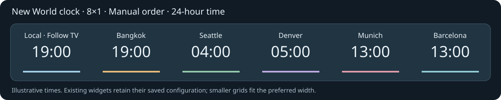
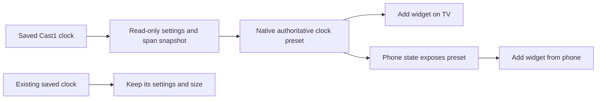

# World clock: use Will's saved configuration as the new-widget preset

Status: implemented and deployed as 0.1.47 to Cast1 and Cast2. Follow-up to the implemented
[World clock widget](2026-11-17-world-clock-widget.md). Will confirmed that the
clock edits on Cast1 are his and requested them as the default for this widget,
rather than the entire dashboard.

## Captured preset

Read-only debug snapshot from Cast1, coordinator job J‑0af778d27555, recorded
17 November 2026. It includes only World clock settings and its saved span.
Existing household settings were not changed.

| Setting | New default |
|---|---|
| Size | 8 columns × 1 row; fit within smaller grids |
| Places, in order | Local · Follow TV, Bangkok, Seattle, Denver, Munich, Barcelona |
| Ordering | Manual |
| Time format | 24-hour |
| Primary place | Local · Follow TV |
| Reference clock | Follow TV |
| Seconds | Off |
| Widget title | Empty, allowing the normal World clock heading |

Named city zones, country/airport codes and city-center map coordinates match the
saved catalog selections. New cards use deterministic place IDs; existing cards
retain their saved IDs, settings and dimensions. Do not copy app favorites, other
widget settings or a TV identifier into the preset.

The times are illustrative for a shared winter instant with the TV in Bangkok.
Local continues to follow the TV's actual system zone.

The native constructor owns the default settings and preferred span. The phone
receives that same preset from the approved TV state rather than maintaining a
second hardcoded list. New widgets receive independent copies; editing one does
not change the preset or another widget. The phone fits the preferred span to its
grid and finds a free placement, including later pages when needed.

## Verification

- Check native and phone creation, independent copies, small-grid fitting and
  preservation of an existing one-place/custom-sized clock.
- Keep the debug nine-place ClockProbe fixture explicit so a changing product
  preset cannot silently change its test setup.
- Run container checks/browser acceptance and deploy one newly numbered frozen
  APK to Cast1 and Cast2. Record native acceptance and installed hashes separately
  from any foreground check deferred during personal use.

## Completed validation

- 459 JVM tests passed, with 603 paired English/Thai resources and Android lint
  reporting zero errors (349 warnings).
- Chromium and WebKit passed creation from the approved TV preset, six-place data,
  8×1 placement, small-grid fitting, independent copies and retained existing drafts.
- Cast1 native HTTP job J‑3a3df2eee894 created the new six-place 8×1 clock together
  with Rain/Air/Calendar/Favorites edits, retried idempotently, previewed, and undid
  the complete update. Its final report is `PHONE_PASS`.
- A second read-only snapshot matches the original household clock settings,
  saved IDs and dimensions exactly.
- Frozen APK SHA-256:
  `05ee706dac93bd8caf301d70aaf8094e67a3c35001ba9f0da6d2fd56eb1d88fb`.
- Cast1 install/launch: J‑c33fa731b555 passed. Cast2 install J‑16b48e69a71b verified
  the identical installed hash; its foreground launch check remains deferred
  during Personal use.

Private evidence is under `artifacts/deployments/0.1.47/`. Version 0.1.45 supplied
read-only capture and isolated API acceptance. Version 0.1.46 stopped during test
compilation, before packaging; its number was consumed and not reused. These
checks do not claim a physical phone browser connected over the household LAN;
see the [controller validation limits](../testing/2026-11-17-phone-controller-design.md).
