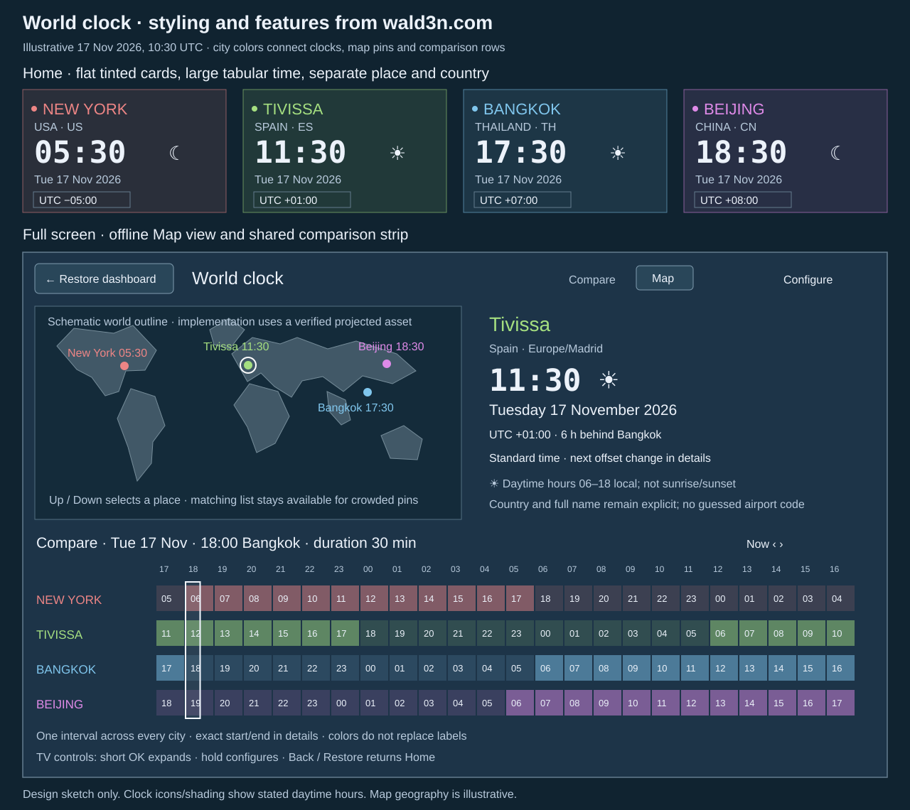
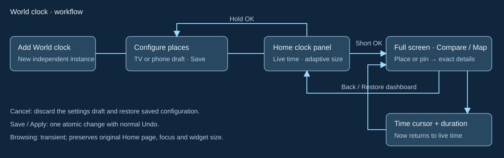

# World clock widget

**Status: implemented and pushed in `01eb586`. Native and phone container checks
pass. Cast1 0.1.44 map, selection, dashboard restoration and hold checks passed;
selected timeline rows can still remain outside the viewport.**

**Proposed placement update:** [Fixed top-bar clock left of settings](2026-11-17-world-clock-header.md).
This moves the standard clock out of the dashboard grid, uses filled colored city
cards, and omits the redundant Local entry in favor of five named cities with
Bangkok primary. It awaits approval; the current shipped preset is documented below.

The first isolated container run passed **456 JVM tests** with zero failures,
including twelve clock tests, English/Thai parity for **603** resources and Android
lint. The native APK assembles. These checks do not establish TV interaction or
visual acceptance; those require the combined deployment and coordinator evidence.
See the [validation record](../testing/2026-11-17-world-clock.md) for scope and
the final installation/evidence status.

TL;DR: Add a native **World clock** widget containing an ordered list of places.
Show readable local times, dates and day differences on Home. Short OK opens a
richer full-screen comparison with a shared time cursor; hold OK opens settings.
Use the Android clock and named time zones, with offline configuration on the TV
and through the existing phone editor.

## Design reference: wald3n.com World Clock

Reviewed the neighboring project's actual implementation (`32ee637`) on 17 November 2026,
including `src/pages/world-clock.astro`, `src/scripts/world-clock.ts`,
`src/lib/city-colors.ts`, `src/lib/cities.ts`, `src/scripts/clock-format.ts` and
the subsequent card/picker plans. These implementation files take precedence
over older plans where the reference has evolved.

| Reference feature | Homeboard decision |
|---|---|
| City-specific rainbow color repeated on map pins, names, card tints and hourly blocks | Adopt. Rank known longitudes west-to-east over a 0–300° hue range; one place's color is shared by every presentation. Recompute only after the configured place set changes, not on each tick or DST change. Unknown coordinates use a palette accent. Color supplements names and focus outlines. |
| Flat cards, thin borders, large monospaced times, colored city name, country on its own smaller line and UTC-offset chip | Adopt the hierarchy with native views, tabular digits, subtle city tints and Homeboard's existing palette/opacity. Use the usual Homeboard focus geometry; do not import website fonts or CSS dependencies. Will’s later correction calls for clearly filled colored cards; see the updated header/card mockups. |
| Very narrow cards show airport code, country code, large hour and smaller colored minutes | Offer compact codes when a verified catalog code or explicit user abbreviation exists. Never invent an airport code from the zone ID or replace Tivissa with a nearby airport's name. Keep the full place name in accessibility text and highlighted details. Stack hour/minute only when width makes it useful. |
| Outline world map with color-matched city pins and live times | Include an offline **Map** view in full screen, synchronized with the selected-place pane. The default **Compare** view keeps the dense clocks and timeline prominent. Known catalog coordinates give pins; manually labeled zone-only entries remain usable without a guessed map location. |
| Sun/moon immediately beside its time, with matching subdued night accents and hourly strip shading | Adopt with an explicit initial meaning: **Daytime hours 06:00–18:00 local**, not sunrise/sunset. Keep time digits at readable contrast. The source now uses a latitude/season approximation centered on local noon; do not describe that as exact solar timing or silently copy its assumptions about longitude/DST. Validated solar calculations can replace the approximation later. |
| West-to-east / UTC-offset ordering | Offer **Manual** (default) and **West → east** sorting. In geographic mode, known longitudes lead; zone-only places follow in saved order. Keep the same order across cards and timeline. Do not reorder under the remote while the expanded view is open. |
| 24-hour strip, day/night block shading, selected start and duration outlined across all rows | Adopt in the expanded comparison. Start with a 30-minute interval and offer 15/30/60/90 minutes. An overlay represents exact elapsed start/end instants, including sub-hour starts; it is clipped or hidden correctly outside the visible window. |
| Future-only meeting picker, visibly disabled earlier paging, explicit window date | Adopt for the initial comparison workflow: show the current hour for context but disable past starts, start Compare at the next half hour, and prevent paging before the live window. Make the displayed window date and **Now** action obvious. Historical conversion can be a later option. |
| Searchable add-city suggestions and manual-zone fallback | Adopt the interaction with an offline catalog on TV and phone. Selecting a suggestion populates its label, zone and available metadata in the draft; Save/Apply still commits the whole change. Remote typing can be avoided through the phone editor. |
| Automatic browser geolocation, account-saved cities, calendar links and .ics download | Keep account and browser-location dependencies out of the TV widget. Follow TV means its system zone. Calendar export belongs in a later explicit phone workflow; showing a comparison must not create or publish an event. |

The reference's seeds are Bangkok, Seattle, Denver, Munich and Barcelona. Offer
them as a **Studio cities** add-place preset, alongside the dashboard-oriented
suggestions below. All entries remain removable and editable; no account sync
with wald3n.com is proposed.

The map in this design sketch is schematic. Implementation requires a properly
projected, attributed world outline. The reference component declares CC BY-SA
4.0 attribution: review those terms before reusing that asset, or select a
verified public-domain Natural Earth outline and record provenance. Avoid a
network tile service for this small world overview.

## Scope and proposed defaults

Add **Home settings → Widgets / Restore → Add widget → World clock**. It is an
optional new type; adding it must preserve the existing dashboard and favorites.
Support multiple independent instances, each containing 1–12 ordered clocks.
Start new widgets with Will’s captured **8×1** preset: **Local · Follow TV,
Bangkok, Seattle, Denver, Munich and Barcelona**, in manual order and 24-hour
format. Local is primary, the reference follows the TV, and seconds are off.
Existing saved cards keep their settings and size. See the
[saved-preset follow-up](2026-11-17-world-clock-saved-preset.md). Add place remains
available for further customization.

Provide convenient offline choices for Bangkok, Tivissa, Beijing and New York;
these are editable suggestions drawn from the dashboard's geographic interests,
not a mandatory list or a claim about the user's preferred US city. Tivissa uses
`Europe/Madrid`. Keep display labels separate from the saved zone ID, so a person,
town or office name can label the same zone without changing its clock rules.

First version uses digital clocks. Analog faces, alarms, countdowns, sunrise/sunset,
holiday overlays and automatic meeting scheduling can follow separately.

The [original layout sketch](2026-11-17-world-clock-widget.svg) records the initial
structure; the reference-inspired sketch above supersedes its neutral card styling.

The mockup uses illustrative times for a November instant. Daylight-saving changes
must come from zone rules at the displayed instant; sample offsets are not constants.

## Home: dense and adaptive

| Available shape | Presentation |
|---|---|
| 1×1 | One primary place: large time, short place name and local date/day difference. A count indicates additional configured places; OK opens all of them. |
| Wide, one row | A horizontal strip of compact clocks, prioritizing time and place. Additional places are indicated without automatic cycling. |
| Taller panel | A grid of clocks, using the available width and height. Retain readable text and focus clearance at larger font sizes. |
| Full-screen | All configured places, exact selected-place details and an aligned comparison timeline. More content is available through deliberate navigation. |

Each clock shows place, time and a concise local weekday/date. Show **Yesterday**
or **Tomorrow** relative to the reference clock's date where applicable; dates
remain explicit so the day difference cannot be mistaken for a holiday marker.
Default reference is Follow TV; a configured place may be chosen as reference.
Compute its current offset from every other place at the same instant.

Prefer typography, city colors and a small clock icon. Do not use national flags to identify
time zones: one country may have several zones and cities may share a zone.
Use the current palette and surface opacity. Sun/moon icons sit immediately beside
the time they describe; the same local daytime-hours rule shades the map accents
and timeline. State its 06:00–18:00 meaning in details/legend. These are clock-hour
cues, not weather or actual solar conditions.

Home focus remains on the widget as a whole. No automatic paging, moving seconds
hand or flashing colon. Compact clocks update together on minute boundaries.
Show seconds is off by default and, when enabled, applies to the selected clock
in full screen; it does not require second-by-second dashboard redraws.

## Full screen: compare places and times

Use the existing `WidgetExpansion` shell and the
[full-screen contract](2026-11-17-widget-full-screen.md).

1. Short OK/click on the widget opens full screen with the primary clock selected.
   Show all configured clocks in a dense list/grid, scrolling when necessary.
2. Highlighting a place updates its detail pane immediately: full local date/time,
   zone ID, UTC offset at the selected instant, difference from the reference,
   and daylight-saving status. Show the next offset transition and its local
   before/after times when the platform supplies a future transition.
3. Show an aligned **24-hour comparison timeline**, starting at the current
   reference hour. Each row is a configured place; local hour labels and date
   boundaries share the same underlying instants. Mark the current instant and
   shade daytime-hours blocks with each place's color. Show a selected interval
   across all rows and a clear window date; changing dates must visibly change it.
4. A visible **Compare time** action enters timeline navigation. Left/Right moves
   the shared cursor by 30 elapsed minutes; every place and its details update.
   Start at the next half hour, with 15/30/60/90-minute duration controls (30 default).
   Show exact local start/end in every place, including end-date changes.
   Highlight the resulting reference date/time and label the view **Comparing**.
   The compact dashboard always continues to represent now.
5. **Now** restores live time. Back first leaves comparison mode, then any nested
   detail, then restores Home. **Restore dashboard** always closes the expansion
   directly. Preserve the original page, widget focus and saved dimensions.

Keep the initial timeline at 24 real hours; next-day actions move the window by
24 elapsed hours and Previous stops at the current live window with a disabled
button. Past starts in its partial first hour are visibly unavailable. Revalidate
a proposed comparison if time has advanced past its start, with a visible updated
selection rather than a silent clamp. Around a DST
transition, a local hour can repeat or be absent. Repeated labels include their
UTC offset; the timeline does not invent a nonexistent local time. A fixed instant
cursor avoids requiring ambiguous free-text local-time input in the first version.
Changing the highlighted place retains the selected instant; it must not silently
reinterpret the same time digits in a different zone.

The **Map** view adds a bundled 2:1 world outline, labeled color-matched place pins
and time badges. Fit the whole world; there is no street-map zoom requirement.
Remote Up/Down selects a place in a companion list, highlights its pin and updates
details. Pointer selection is equivalent. Handle overlapping pin labels without
losing list access. A missing-coordinate entry says **No map position**, while its
clock and timeline remain active. Restore and Back follow the same shared contract.

Selecting a place, browsing dates or comparing times is transient. It must not
reorder clocks, alter saved settings or create an Undo entry. Opening Configure
and returning must retain the selected place when it still exists.

## Settings on TV and phone

Hold OK opens the existing widget action menu: Configure, Move, Resize and Remove.
The expanded header also exposes Configure. Keep menu screens compact and remote
friendly, using existing navigation patterns rather than one long settings menu.

| Setting | Behavior |
|---|---|
| Widget title | Optional editable label; default World clock. |
| Places | Add, edit label/zone, remove and reorder. Require at least one place; cap at 12 with a clear limit message. |
| Ordering | Manual, or West → east. Explicit primary/reference remain independent of the displayed order. |
| Zone picker | Search a bundled city/zone catalog offline. Offer common places and all supported named zone IDs, plus Follow TV. Display zone ID and current local time before saving. |
| Primary place | Determines the 1×1 display and initial full-screen selection. Reordering must not silently change the explicit primary choice. |
| Reference clock | Follow TV by default, or any configured place. Used for day differences and comparison offsets. |
| Time format | 24-hour by default, following the reference; also Follow device or 12-hour with a visible AM/PM marker. Applies per widget. |
| Full-screen seconds | Off by default. One-second updates only while that expanded view is active. |

Use existing Save/Back and Undo behavior. Draft changes are atomic; cancel leaves
the prior configuration intact. Removing the primary/reference place requires a
visible replacement choice or explicit confirmation of the replacement in the
same draft. Duplicate zone IDs are valid when labels differ, such as two people
in the same city. Identify entries with stable IDs, not their labels or indices.

Expose the same settings in the **phone widget editor**: correct instance, add
place, zone search, labels, order, primary/reference and format. Reuse draft,
Preview on TV, Apply, conflict checks and whole-change Undo. Phone previews use
the TV's reported reference zone and clock snapshot; they must not silently use
the phone's zone as Follow TV. Final rendering and ticking belong to the TV.

The phone's ordered place list uses direct drag grips, keyboard Alt+Up/Down and
explicit movement actions, following the shared phone-controller design. Preserve
open place details, primary/reference IDs and focus after a move. Pointer cancel
does not change order; rerender/navigation disposes active ghosts. A draft Undo
restores both the prior order and its Manual/West setting. Places and their
primary/reference selections form one atomic group during conflict recovery.

## Workflow

## Time model and lifecycle

Use Java `Instant`, `ZoneId`, `ZonedDateTime` and localized formatters already
available to the native launcher. Store named zones rather than current UTC
offsets. Derive all visible clocks from **one sampled instant per update** so
midnight/minute boundaries do not disagree between places. Use an injectable
clock in the pure model for deterministic checks.

Follow TV resolves the current system zone on each relevant change; fixed places
keep their configured zones. Recompute on resume, time/date/time-zone changes and
configuration/locale changes. Schedule the next visible minute boundary from
wall time, not by accumulating 60-second delays. Stop callbacks and unregister
receivers when inactive; full-screen seconds must not keep a background task alive.

No external time API, location permission, geocoding service or dedicated server
is required. Accuracy depends on the TV's system clock and installed time-zone
rules. Identify the basis as **TV system clock** in details; do not claim the time
has been independently network verified. A time-zone rules update remains an
Android/platform responsibility in this version.

Validate IDs against available zone rules before Apply. If a stored zone becomes
unavailable, show that entry as **Time zone unavailable** with Configure available;
do not silently display UTC or drop its custom label. Format date labels using
the app's selected language. Keep English/Thai resource parity, readable digits,
AM/PM and offsets, and explicit Gregorian dates in detailed comparisons.

## Implementation stages

| Stage | Deliverable |
|---|---|
| 1. Model and persistence | `WorldClockSettings`, stable place IDs, optional catalog coordinates/country/code, per-instance JSON in `HomeLayout`, validation, ordering, primary/reference handling and deterministic conversion model. |
| 2. Registration and Home | Register WORLD_CLOCK in `WidgetKind`, add picker/title/icon, instance identity and layout serialization, adaptive native `WorldClockWidgetView` with shared city colors and reference-inspired cards, Move/Resize/Remove and Undo. Preserve default Home arrangement. |
| 3. Configuration | Native searchable city/zone picker and settings, Studio cities preset; phone protocol/schema, supported options, form, preview and atomic Apply/Undo. Audit exhaustive type switches and hard-coded widget identity validators. |
| 4. Expanded content | `WorldClockExpanded`, selected-place detail, offline map and accessible pin/list selection, next transition, colored 24-hour timeline with duration overlay, future-only compare/Now controls and shared restoration/lifecycle. No placeholder enlargement as a substitute. |
| 5. Documentation and acceptance | Update how-to, quick start and widget inventory; run container checks, deploy one newly numbered frozen APK to both TVs, and verify remote behavior on Cast1 through the coordinator. |

Keep settings as the existing typed JSON configuration. A multi-stage external
data download pipeline is unnecessary: this widget has no downloaded provider feed.
Do not add compatibility layers for an unreleased settings schema.

## Acceptance checks

- [ ] Named zones, half-/quarter-hour offsets, date-line differences and midnight
  conversion are correct for a single instant. Include fixed test instants with
  known spring gap/autumn repeat rules; compare offsets at the displayed instant.
- [ ] A repeated local hour remains two distinct cursor positions with offset
  labels; a skipped local hour is not fabricated. Next-transition detail matches
  its before/after values. Zones without future transitions render plainly.
- [ ] Format Follow device / 12 / 24, custom labels, ordering, primary/reference,
  multiple instances, serialization, invalid zones and complete Undo are covered.
- [ ] TV and phone use the same settings constraints; the phone's time zone does
  not change Follow TV. Preview/cancel/conflict handling preserves saved settings.
- [ ] Map, card and timeline colors agree; city/country lines and tabular times
  remain readable in every palette. Sun/moon is beside the time; night accents
  never dim time digits below readable contrast. The clock-hour legend is visible.
- [ ] Map projection/known pins, crowded labels, no-coordinate entries and remote
  list selection work offline. Asset provenance and any attribution are recorded.
- [ ] Comparison duration/start/end is consistent across rows and DST; fractional
  selection overlays clip correctly. Previous visibly stops at the live window,
  and date paging changes the window label. Expired comparisons update visibly.
- [ ] 1×1, one-row and larger panels remain legible; all saved places are reachable
  in full screen. Larger text and Thai labels do not hide the time or AM/PM.
- [ ] Real short OK opens the richer full screen; hold opens settings and its
  release does not also expand. Pointer click follows the same short-click path.
- [ ] Highlight changes details immediately; Compare advances all places at one
  instant; Now returns live. Back and Restore return the original Home page,
  focus and dimensions. Browsing creates no Undo entry.
- [ ] Resume and system clock/zone changes refresh promptly. Stopped views have
  no continuing tick callbacks; no network or location dependency appears.
- [ ] Run `task check` and `task build` in containers. Use the shared coordinator
  devices/queue/complete job/watch/evidence workflow for device acceptance, with
  Cast1 as the default foreground target. Preserve data on both deployments.

## Later ideas

Analog presentation; validated solar day/night calculations; configurable
working-hour bands and overlap suggestions; arbitrary minute-level meeting input
with explicit DST ambiguity handling; optional calendar/holiday context; phone
calendar links/.ics export. These are separate follow-ups,
not prerequisites for a useful clock and comparison widget.
