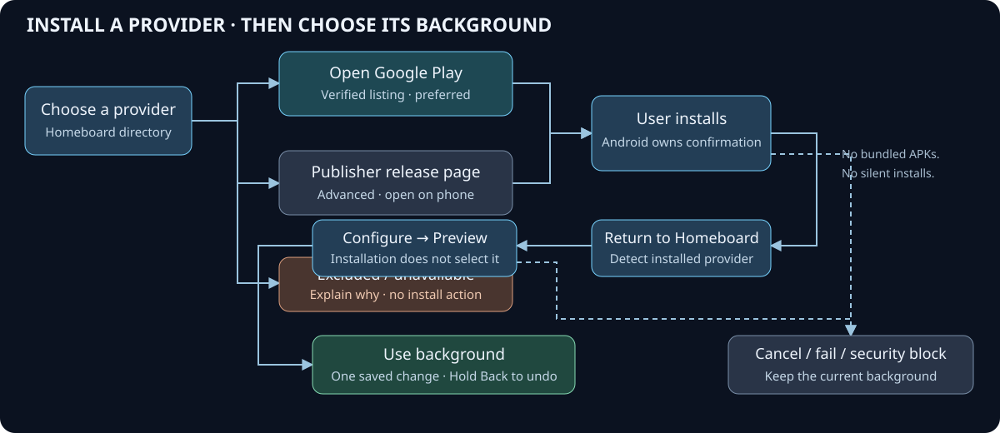
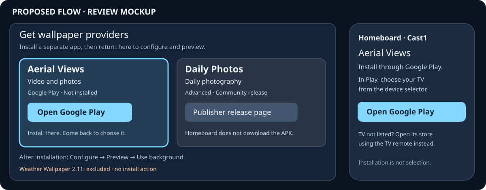
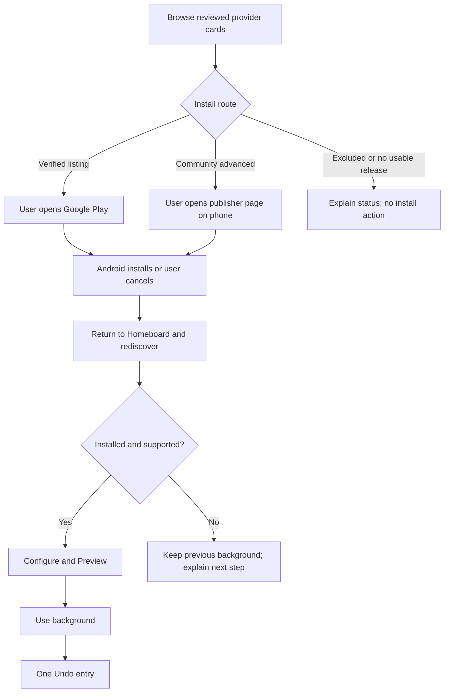
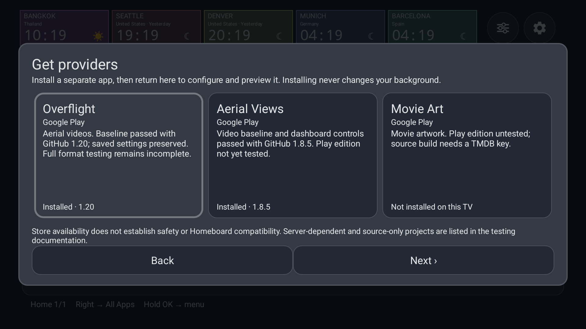

# Spike: test every known provider and settle how users install them

**Status: implemented in 0.1.59; seven Cast1 screenshot checks passed, authorized by Will.** This is the current plan. It replaces
the execution sequence in the [earlier inventory plan](2026-11-18-wallpaper-provider-compatibility.md),
while retaining the [test evidence already collected](../testing/2026-11-18-provider-compatibility.md).
Implementation includes the TV/phone directory and the timeboxed testing spike.

## Visuals and install links

**[Open the workflow diagram](2026-11-18-provider-installation-flow.svg)** ·
**[Open the TV and phone mockups](2026-11-18-provider-installation-mockup.svg)**

Verified public Google Play listings:

- [Overflight](https://play.google.com/store/apps/details?id=tv.projectivy.plugin.wallpaperprovider.overflight)
- [Aerial Views](https://play.google.com/store/apps/details?id=com.neilturner.aerialviews)
- [Movie Art](https://play.google.com/store/apps/details?id=com.danielkorgel.projectivy.plugin.cinemaglow)

The full 18-provider table below links to publisher pages and identifies community,
testing-program, source-only and excluded entries. These mockups propose future
screens; the buttons inside the drawings are illustrations, not working controls.

## Recommended decision

**Keep providers as separate apps. Prefer Google Play links. Do not bundle their
APKs, silently install them, or add an APK downloader/updater to Homeboard.**

Homeboard supplies the wallpaper host and a small reviewed directory of links.
The provider's publisher supplies its app, permissions, updates and support.
Users install only the sources they want. This keeps Homeboard smaller, avoids
taking ownership of third-party updates and redistribution, and leaves Android's
installation protections intact. The existing licensed API library remains part
of Homeboard; that is different from bundling provider apps.

| Choice | Decision for this spike |
|---|---|
| Bundle every provider in Homeboard | Reject: unnecessary size, redistribution and update responsibilities. |
| Download/install provider APKs inside Homeboard | Reject: duplicates Android's installer/store responsibilities. |
| Link to verified Google Play listings | **Default for ordinary users.** Google Play owns install, device eligibility, purchases and updates. |
| Link to the publisher's release page | Advanced community option after review; not an automatic download. |
| Build a provider from source | Developer test route only; never quietly substitute it for the publisher's app. |

A store listing is a distribution route, not a security guarantee or a Homeboard
compatibility result. A GitHub APK test does not automatically certify the Play
edition: versions, signatures, features and update behavior can differ.

## What the spike must answer

1. Which providers actually work with Homeboard's package identity and public v1 API?
2. Which features work: images/video, refresh, configuration and normal TV controls?
3. Can a user install, configure, select and later update each provider without a computer?
4. Which entries should be recommended, marked experimental, blocked or excluded?
5. What small host fixes are justified by observed failures, and what should stay unsupported?

**Timebox:** two engineering days of work, plus coordinator queue/device wait time.
Give each provider one controlled install/setup attempt, a baseline and controls
run when prerequisites are available, and at most 15 minutes of initial failure
diagnosis. Cap a new source-build attempt at 20 minutes and a disposable backend
setup at 45 minutes before documenting a blocker. These caps stop the spike turning
into eighteen integration projects; they do not turn an incomplete check into a pass.

## Scope: all 18 inventory entries get a disposition

The scope is the ten entries in the
[official wallpaper catalog](https://github.com/spocky/miproja1/blob/master/installPackages/wallpaper-plugin.json)
plus the eight additional projects/leads already found. Refresh this list at the
start and record the snapshot date. Newly discovered forks go in a follow-up list,
unless they replace a renamed entry. No claim to cover every Android screensaver.

| Provider | User installation route to evaluate | Specific test or blocker |
|---|---|---|
| Overflight | [Google Play](https://play.google.com/store/apps/details?id=tv.projectivy.plugin.wallpaperprovider.overflight) | HD/SDR and supported higher formats, feeds, bad-item fallback; preserve existing preferences. |
| Daily Photos / Bing Wallpaper | [Publisher releases](https://github.com/spocky/projectivy-plugin-wallpaper-bingwallpaper/releases); no public Play listing verified | Daily image, credits, refresh and update route. |
| Aerial Views | [Google Play](https://play.google.com/store/apps/details?id=com.neilturner.aerialviews) | Moving video, timer, resume, settings access; wallpaper and screensaver roles recorded separately. |
| Weather Wallpaper v2.11 | **Excluded. No install action.** | Play Protect block and [security review](../testing/2026-11-18-weather-wallpaper-security-review.md). A different release requires a separate review. |
| Sofadrop | [Publisher's Play testing instructions](https://github.com/rfmarcos/sofadrop#-google-play-test), otherwise reviewed publisher releases | Verify enrollment/TV eligibility; test public lists before account-backed modes. Do not enroll Will automatically. |
| Immich Wallpaper | [Publisher releases](https://github.com/raizer88/immich-projectivy-provider/releases) | Disposable album/server; Homeboard content-URI permissions, refresh and denied access. |
| Movie Art | [Google Play](https://play.google.com/store/apps/details?id=com.danielkorgel.projectivy.plugin.cinemaglow) | Actual Play edition; fallback/app-focus modes. Program-focus support remains a separate gap. Source build currently requires a TMDB key. |
| Trakt Wallpapers | [Publisher releases](https://github.com/johnneerdael/traktlistbackdrops/releases) | Test-account authorization, first generation, expiry and image access; no household login. |
| Core Motion | [Publisher release](https://github.com/brevityA/CoreBuildsApps/releases/tag/motion) | Baseline passed on 0.1.59 (J‑eaf00a2dbd46), returned animated loop. Feed/bundled modes, mute, reduced motion and format coverage remain separate checks. |
| Booru Wallpaper | [Publisher releases](https://github.com/Kurocon/projectivy-booru-wallpaper-provider/releases) | Controlled general-rated query, empty results, rate limiting and credits. |
| Jellyfin — Mikescher | [Publisher source/releases](https://github.com/Mikescher/projectivity-jellyfin-wallpaper) | Source build available; disposable server, plain and composed images. Settings UI must support entering test configuration. |
| Jellyfin — z9m | [Publisher releases](https://github.com/z9m/ProjectIvy-Plugin-Wallpaper-Jellyfin/releases) | Composition and selection modes; package/UUID collisions with sample-based forks. |
| Jellyfin — jfchenier | Developer-only [source](https://github.com/jfchenier/projectivy-plugin-wallpaper-provider-jellyfin) | Current source is a sample provider, not a working Jellyfin integration. Classify accordingly. |
| TV Background Suite | [Publisher releases](https://github.com/z9m/projectivy-tvbgsuite-plugin/releases) | Disposable backend, filters, refresh and action links; a stub pass is distinct from real-backend integration. |
| Wallpaparr | [Publisher releases](https://github.com/iManunator/wallpaparr/releases) | Demo backend, stills and motion; URL compatibility with Homeboard's network policy. |
| Random Wallpapers | [Publisher releases](https://github.com/Mars-Wave/projectivy-random-wallpapers-plugin/releases) | Shuffle/return-to-Home; first resolve coordinator installation of an app with no activity. |
| Unsplash / Splashing | Developer-only [source](https://github.com/adrianjost/Projectivy-Plugin-Splashing-Wallpaper-Provider) | No public APK found; source has a placeholder API key. Record blocked unless a legitimate test credential/build becomes available. |
| m3u8 Wallpaper | Experimental [publisher source](https://github.com/Stremiouser666/projectivy-plugin-wallpaper-m3u8wallpaper) | Source build available; controlled HTTPS stream, startup, interruptions and decoder limits. |

Only the three public Google Play listings linked above were verified as readable
during this review. Daily Photos' listing could not be verified. Sofadrop's
maintainer documents a testing program, not general availability. Other rows link
to primary publisher pages without implying that a Play listing exists. Recheck
availability on the actual TV/account/region before exposing a store button.

Projectivy's built-in Reddit/files/folders/theme/program sources are not standalone
provider APKs. Android DreamService-only screensavers are also outside this host
contract. Inventory those separately; do not call them failed wallpaper plugins.
Do not change the TV's system screensaver or default launcher in this spike.

## How a user will install and select a provider

Proposed entry: **Homeboard Settings → Appearance → Background → Get providers**,
beside the existing list of installed providers. Use a small set of reviewed cards
with visible focus and paged remote navigation, without a scrollbar.

See the [TV and phone installation mockups](2026-11-18-provider-installation-mockup.svg)
at the top of this plan.

**From the TV:** select a provider → **Open Google Play** → install through the
store → return to Homeboard → detect the installed package → **Configure** if
available → **Preview** → **Use background**. The store opens only after the user's
explicit action. Cancellation returns to the same card; installing does not select
the provider, change the default Home app or change the system screensaver.

**From the phone controller:** show the selected TV's name and the same verified
HTTPS store link. Google Play lets the user choose an eligible TV associated with
their Google account. Homeboard pairing does not provide Google-account access or
silently select a TV inside Play. If Cast1/Cast2 is not offered, use the TV store
route; do not imply that installing on the phone installs on the TV.
[Google's cross-device installation instructions](https://support.google.com/googleplay/answer/14274288).

**For a community-only provider:** place **Publisher release page** under an
Advanced/community section, with its prerequisites and test status. Open it on
the phone or through a TV QR link; the user chooses whether to obtain/install the
app using Android's normal mechanisms. Homeboard does not fetch or install the
APK. Source-only and backend-dependent projects belong in documentation until
they have a usable installation path. Excluded versions have an explanation and
no install link/button.

On return, rediscover providers and refresh installed/version state, including
when a plugin has no app-launcher icon. Already installed cards offer configuration
and preview instead of another install action. Handle unavailable stores, missing
TV browsers, restricted accounts and removed listings with a phone link or clear
unavailable state. Use package identity, not a matching app display name.

Use the publisher's verified package ID and Google's
[documented listing link](https://developer.android.com/distribute/marketing-tools/linking-to-google-play).
Resolve a store handler on TV; use the HTTPS listing/phone fallback when absent.
Test the full round trip rather than assuming an Android intent opened correctly.

Google Play manages Play-installed updates. Community users follow the publisher's
update process. Homeboard only rediscovers/revalidates compatibility after package
changes. Never uninstall an existing app to switch signing keys/channels: report
the conflict and preserve data. Do not recommend disabling Play Protect or selecting
Install anyway. Homeboard's API host does not require Projectivy Launcher, but the
spike must check each provider's own licensing/host assumptions; do not bypass them.

## Test procedure and evidence

| Stage | Required evidence / acceptance |
|---|---|
| Intake | Exact package/version, source channel, APK/signing hashes where obtainable, API metadata, permissions, prerequisites and security disposition. A security block excludes that version immediately. |
| Installation | Store/release link matches the publisher and actual package. Test install/cancel/return and update path. A coordinator artwork check or verified APK install alone is not a rendering pass. |
| API/rendering | Bind the unmodified provider as Homeboard; render three items when available. Images visibly decode. Video requires first-frame readiness and changing-frame evidence, plus mute and reduced-motion checks. |
| TV controls | Home and All Apps: visible Preview, Back cancels, Apply saves one change, Hold Back undoes it without navigating. Widget opacity 0/75/100% leaves wallpaper brightness independent. |
| Refresh/lifecycle | Real timer rotation, settings-update notifications, foreground return and motion-resource release while hidden. Exercise declared supported app-focus/idle modes. Record actual cache-expiry coverage separately. |
| Failure handling | Empty list, denied URI, failed download and bad item followed by good item; UI stays usable. Inject faults into disposable fixtures/backends, not a household provider. |
| Installation UX | TV/phone link, correct target TV selection, cancellation, missing store, already installed, package update and signing conflict. An external-launch test needs a coordinator workflow supporting the cross-app transition. |
| Cleanup | Original foreground and household settings restored, provider settings restored if changed, normal MainActivity catalog registration restored, complete receipt/log/captures exported. |

Use the existing native baseline and real-menu probes. Reuse existing results only
when provider version/channel, host code and test configuration match. Daily Photos
has baseline and menu evidence; Aerial Views has baseline evidence. Check the menu
job's final receipt before claiming its result. Both were tested from frozen GitHub
APKs; the Google Play installation path is still a separate acceptance check.

Run on Cast1 through **devices → queue/support → complete job → watch → evidence**.
The coordinator owns installation, navigation, cleanup and admission during personal
use. No raw ADB/direct fallback or ad-hoc cross-app control. Classify coordinator
failures separately, preserve their evidence, and stop repeated automatic retries.
Do not change coordinator safety rules to force an install through.

Use synthetic photos/media and disposable containerized Immich/Jellyfin/backends.
Keep credentials out of source, screenshots and logs. Account-dependent tests use
test accounts only when available; no automatic account creation, enrollment or
household login. Source-only builds and all checks/packaging run in containers.
Stub-backed and patched-provider results never become unmodified-provider passes.
For public providers whose endpoints cannot be configured, record fault cases as
host-fixture coverage or not run; do not claim fault injection into the real provider.

After Cast1 passes, repeat baseline/controls on Cast2 when reachable. Report Cast2
blocked while it is offline; do not infer its result from Cast1. Any new Homeboard
APK uses `task deploy`: a fresh version number, one frozen APK for both TVs, preserved
data, and separate install versus foreground acceptance records.

## Work order and stop rules

1. Reconcile already collected receipts and restore any test registration/settings.
2. Finish the Play-route checks for Overflight, Aerial Views and Movie Art; finish
   remaining baseline/control cases for already installed providers.
3. Evaluate reviewed community providers: Daily Photos, Core Motion, Sofadrop,
   Booru and Random Wallpapers. A testing-program requirement is a blocker if no
   appropriate test account is enrolled.
4. Exercise server/account providers with disposable prerequisites; inspect source
   candidates and record source/key/tooling limitations explicitly.
5. Run one 30-minute soak per distinct working video path, within coordinator
   duration limits, then write the recommendation and host-fix list.

For **Harmful app blocked**, stop that provider, record the version/hash, and keep
the protection enabled. Weather v2.11 stays excluded; no rebuilt/re-signed variant
is installed to evade the block. An unknown-app/security prompt is also recorded
for review rather than clicked through automatically. If the installer remains
unresolved, let the coordinator recover; do not start another install while it is
uncertain. One bounded coordinator retry is enough before recording a tool blocker.

## Deliverables and approval boundary

- One matrix row per inventory entry: **pass / partial / blocked / excluded /
  not applicable**, with separate install, API, rendering, controls, lifecycle,
  refresh and external-action results. Missing checks stay explicit, not green.
- Version/channel/device-specific receipts, screenshots/video, native reports and
  cleanup evidence. No blanket “all providers work” claim.
- A short user-facing recommended list, verified installation links, prerequisites
  and any version exclusions. Compatibility is not advertised as malware clearance.
- A concrete list of small host fixes, provider changes or coordinator gaps, each
  tied to an observed failure. Do not expand into a new dashboard/bridge system.
- A decision on the installation UX mockup and the directory's initial entries.

**Will subsequently authorized implementation of the directory and this bounded spike.**
Bundling providers, building an in-app APK installer, implementing new program/now-
playing integrations, enrolling accounts, changing defaults, contacting maintainers
or publishing to an app store remain outside it. The native TV and phone directory
uses the reviewed links and version-specific evidence from this spike.

The spike is complete when every scoped entry has an evidence-backed disposition
and a usable installation recommendation or a named blocker—not when every provider
has been made to work. The implementation follows the standing container-build and two-TV deployment workflow.

## Required screenshot proof (added at Will’s request)

Screenshots are acceptance evidence, not optional illustrations. Keep the SVG mockups as
expected designs; retain actual captures separately and compare both before marking
an interface check passed.

| Step | Required screenshot and assertions |
|---|---|
| TV directory | Cast1 capture of each page: readable cards, visible remote focus, paging wedges, no scrollbar, correct installation/version state. |
| Provider details | Installed provider Configure/Preview actions; missing provider QR/link and store action (decode the QR from the actual capture to verify the destination); excluded Weather explanation with no install action. |
| Store round trip | Before leaving, actual store listing, and return to the same provider with refreshed installed status. Prove canceled installation does not activate or save a background. If the coordinator cannot supervise cross-app work, mark this step blocked, never passed from a mocked intent. |
| Phone directory | Real Chromium and WebKit renders at phone sizes, selected TV name, Play versus publisher links, installed state, and Weather without a link. Capture English and Thai and check text clipping. |
| Rendering/controls | Actual provider media on Cast1, plus Preview/Apply/Undo outcomes with matching native assertions. A screenshot alone cannot prove motion, undo persistence, or network fault handling. |
| Failure states | Capture unavailable store fallback where feasible; otherwise retain the tested failure assertion and label actual-device proof pending. |
| Final dashboard | Capture after restoring the dashboard; compare its layout and settings with the saved pre-test state. |

Use only coordinator `capture`/job screenshots for TVs. Browser screenshots run in the
container. Each capture must have its build/version, device or browser, timestamp,
coordinator job (TV), evidence path and assertion result recorded in the testing
record. Never use an SVG mockup, an old build capture, or a screenshot from a different
provider as proof for a new result. Cast2 screenshots remain deferred while unavailable
or in personal use; its installation status is reported separately. Do not crop away
warnings or fabricate a store success. Keep private pairing/session codes and account
details out of committed screenshots; retain restricted originals where necessary.

### Fresh-install regression found by screenshot preparation

The first native screenshot probe starts with fresh isolated Homeboard preferences.
It exposed a first-launch crash: widget identity tracking parsed a missing layout
as `{}`, which lacks `widgets`. Treat absence as an empty prior dashboard, while
retaining errors for malformed saved layouts. Add a JVM regression for first-save
identity generation and rerun the actual fresh-preferences TV probe. This fix
requires a newly numbered build on both TVs; 0.1.58 is superseded.

Actual screenshots, native assertions and remaining limits are recorded in the
[verification record](../testing/2026-11-18-provider-directory.md).

## Actual implementation capture

Cast1, **0.1.59**, coordinator job `J‑1af746d716eb`, fresh isolated test preferences.
This is a real TV capture, separate from the proposed SVG mockups above.

[Open all TV and phone screenshot proof, native results and remaining checks](../testing/2026-11-18-provider-directory.md).
