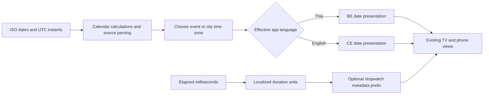

# Thai Buddhist Era years and consistent time presentation

**Status: implemented; container/browser checks passed; native visual acceptance remains open.**
The reference build before this change is 0.1.59. This plan covers native TV UI and its phone controller.

## Requested outcome

When Homeboard's effective interface language is Thai, human-readable dates show
Buddhist Era years: **2026 CE → 2569 BE**. English continues to show CE years.
This follows the app language, including Follow device when it resolves to Thai;
it does not depend on the event's country or the clock city's time zone.

Adopt the existing projects' distinction between clock time and elapsed time.
Use **clock/timestamp icons on supporting timestamp metadata**, and **stopwatch
icons on supporting duration/relative-age labels**. **Do not put them on every
time value, the clock face, city clock cards, time axes or calendar dates.**

## Cross-project references inspected

These are references to existing conventions, not proposed runtime dependencies.
Paths below are relative to this plan's directory.

| Project/source | Existing convention | Homeboard application |
|---|---|---|
| [Parking Space backup age](../../../parking-space/mobile/parkingspace_app/lib/presentation/admin/pages/admin_database_page.dart) | Timer icon; minutes, then hours/minutes, then days/hours; localized “ago” | Data-age metadata, using the same unit boundaries |
| [Parking Space active-session durations](../../../parking-space/mobile/parkingspace_app/lib/presentation/shared/widgets/active_session_card.dart) | Explicit hour/minute units | Meeting duration and elapsed values; no ambiguous clock-style duration |
| [Parking Space English strings](../../../parking-space/mobile/parkingspace_app/lib/l10n/app_localizations_en.dart) / [Thai strings](../../../parking-space/mobile/parkingspace_app/lib/l10n/app_localizations_th.dart) | `1h 5m`, `2d 3h`; Thai `1 ชม. 5 น.`, `2 วัน 3 ชม.`; localized “ago” | Native resource strings, rather than hardcoded English `min` |
| [Python TUI theme](../../../python-tui-lib/tuilib/ui/theme.py) / [configuration](../../../python-tui-lib/tuilib/ui/config.py) | `⏲` identifies time of day; `⏱` identifies duration/elapsed time | Reuse those semantic symbols selectively; request monochrome/text presentation |
| [Python TUI precise elapsed values](../../../python-tui-lib/tuilib/ui/llm_picker/dialogs.py) | Explicit units, e.g. `5m51s` | Preserve the distinction from a clock; keep seconds for precision-sensitive uses, not minute-level weather age |
| [wald3n clock preference](../../../wald3n.com/src/scripts/clock-format.ts) | Default 24-hour time, explicit 12-hour preference | Keep existing World clock format choices; do not silently override a saved choice |
| [wald3n pipeline formatting](../../../wald3n.com/src/lib/trello-pipeline-render.ts) | Unit-based durations and a separate “ago” wrapper | Reuse the concept, with localized TV copy |

The references have slightly different precision/spacing for different tasks.
Homeboard should follow Parking Space's minute-level age formatting, rather than
copying the TUI's seconds-level progress timer into weather/station labels.

## Exact display rules

### Calendar years

Use a shared Java presentation formatter with explicit chronology:

- Effective language `th`: `ThaiBuddhistChronology`.
- Effective language `en`: ISO/Gregorian chronology.
- Apply the chronology during formatting, after choosing the relevant time zone.
- Do not replace numeric substrings or manually add 543 to serialized dates.
- Do not add a second CE year beside BE; preserve compact layouts and month names.
- Yearless labels may remain yearless. This request changes displayed year values,
  rather than adding a year to every hourly tick or data timestamp.

| Surface | Thai result / behavior |
|---|---|
| Calendar compact month heading | November 2026 becomes a Thai month heading with **2569** |
| Calendar full screen / event details | Localized full dates use **2569**, including international holidays |
| Flower preparation/selling date ranges | Format each endpoint; do not append raw ISO dates |
| Calendar source coverage | Format coverage endpoints using the same policy |
| World clock details and meeting planner dates | BE date for the selected city's local day |
| Next daylight-saving transition | Localized BE dates, rather than raw `LocalDateTime.toString()` |
| Air-quality full-screen timestamps | BE when a year is displayed; source time zone remains explicit |
| Favorites app-update date | BE in Thai, CE in English |
| Rain human-readable dates | Use effective app locale; apply the same chronology wherever a year is shown |
| Phone World clock preview | Explicit Intl calendar: `buddhist` for Thai and `gregory` for English |

### Clock versus duration

Clock readings remain clock readings: `14:05`, or the saved 12-hour alternative.
A signed UTC/time-zone difference, such as `+05:45`, remains a signed offset;
it is not a “time ago” value or a stopwatch duration. Relative day labels such as
Yesterday/Tomorrow still come from actual zoned dates.

For elapsed/age labels, use completed minutes, with two meaningful units above
an hour. Clamp negative elapsed values to zero for this label only; retain existing
future-data/staleness validation independently.

| Elapsed value | English body | Thai body |
|---|---|---|
| Less than one minute | `0m` | `0 นาที` |
| 5 minutes | `5m` | `5 นาที` |
| 65 minutes | `1h 5m` | `1 ชม. 5 น.` |
| 24 hours | `1d 0h` | `1 วัน 0 ชม.` |
| 51 hours | `2d 3h` | `2 วัน 3 ชม.` |

An “ago” wrapper is separate: `⏱ 1h 5m ago` or
`⏱ 1 ชม. 5 น. ที่แล้ว`. A meeting duration has no “ago” suffix. Exact diagnostic
or countdown precision remains appropriate to that control; it is not necessary
to convert every timeout or refresh interval to this minute-level age formatter.

### Selective icon placement

| Use an icon | Keep clean / do not add an icon |
|---|---|
| Updated/measured timestamp metadata: `⏲ 18 Nov 2569 14:05` (with localized month) | Header World clock time and city clock cards |
| App's updated-date detail | Main date headings and calendar event dates |
| Data age / last-refresh age: `⏱ … ago` | Hourly Rain ticks and forecast timestamps serving as chart data |
| Meeting duration control: `⏱ 1h 0m` | Meeting timeline hour cells, UTC offsets and zone differences |
| Next-offset-change timestamp metadata | Every mention of hours/days in menus or forecast ranges |

Retain textual labels and units; an icon must not be the only accessible
explanation. Prefer text-style symbols matching the existing TUI convention;
if TV font fallback is missing or distracting, use equivalent small native
clock/stopwatch drawings at those same metadata locations. Do not add icons to
[WorldClockModel.time](../../launcher/app/src/main/java/com/gathin/tvhome/WorldClockModel.java).

## Before/after presentation sketch

This is a content mockup, not a new navigation workflow. Thai examples use the
same real date and instant as the English equivalents.

```text
CLOCK CARDS                          unchanged clean clock face
Bangkok          Seattle             Bangkok          Seattle
14:05            23:05               14:05            23:05

THAI CALENDAR / DETAILS
พ.ย. 2026                        →   พ.ย. 2569
2026-11-21 — 2026-11-22          →   localized Thai dates, both in 2569

SUPPORTING METADATA
Updated: 18 Nov 2026 14:05        →   อัปเดต: ⏲ 18 พ.ย. 2569 14:05
Age 65 min                       →   ⏱ 1 ชม. 5 น. ที่แล้ว
Meeting duration: 60 min         →   ⏱ 1 ชม. 0 น.
```

## Implementation scope

1. Introduce one shared native date/timestamp/duration presentation helper.
   Keep locale and zone explicit, and localize duration templates in English/Thai
   resources. Keep clock and stopwatch prefixes opt-in at call sites.
2. Route Calendar month/detail/coverage dates, World clock detail/DST dates,
   Air full-screen timestamps, Favorites update dates and Rain display formatting
   through it. Audit raw dates appended to user-visible strings.
3. Change supporting timestamp/age/duration call sites only for icon decoration.
   Preserve the fixed header clock, its layout, city cards and clock time formatter.
4. Explicitly choose the phone preview's calendar from the controller language;
   do not change its TV time-zone snapshot or 12/24-hour preference handling.
5. Document Thai BE years and the metadata icon distinction in the user quick
   start, World clock and language guides.

Data boundary:



Do not alter AirBKK request formats, rain API parameters, snapshot JSON, holiday
calculation years, ISO saved state, receipt timestamps, cache keys or stored
World clock instants. No data migration or compatibility layer is needed.

## Verification and screenshot proof

### Container checks

- Unit-test `2026 → 2569`, English `2026`, Thai language tags and chronology
  extensions, including an English locale carrying a Buddhist calendar extension.
- Cover New Year across zones (Bangkok may already be 2570 while Seattle is still
  2569), leap-day conversion and restoration of CE after changing back to English.
- Prove formatting leaves the original ISO dates/instants unchanged.
- Cover duration thresholds at 59/60 minutes and 23/24 hours, zero/negative age,
  and localized unit order. Verify offsets retain their distinct signed form.
- Browser-check phone previews in Chromium and WebKit: Thai **2569**, English
  **2026**, the same TV zone/instant, and no mutation of the configuration draft.
- Run `task check`, translation parity and the relevant phone checks in containers.

### Cast1 acceptance

Use isolated preferences and locale contexts for repeatable debug probes; do not
change Will's saved language, cities, widgets or provider settings to test this.
Use complete coordinator jobs and keep the activity registration pinned until
that job is terminal, then restore MainActivity.

Required actual screenshots, with build/version, device, timestamp and job ID:

1. **Thai dashboard:** Calendar month shows 2569; header clock cards have no added
   clock/stopwatch decorations. Check enlarged-text clipping where practical.
2. **Thai full-screen Calendar:** selected date, window range and flower details
   use BE; no raw CE/ISO endpoints leak into the human-readable range.
3. **Thai full-screen World clock / comparison:** local date uses BE, metadata
   and duration icons have the correct meanings, and actual clock faces/timeline
   hour cells stay undecorated.
4. **English equivalent:** CE date and English duration units after locale change.
5. **Air/Favorites metadata:** inspect timestamp icon, BE year where displayed,
   localized age units and correct source zone. Preserve explicit staleness cues.
6. **Phone preview screenshots:** Thai and English in Chromium/WebKit, demonstrating
   BE/CE and retained TV-zone time; mark browser fixture proof separately from a
   physical paired-phone check.
7. **Restore dashboard:** Back and the visible restore action return to the
   original page, focus and saved size. Native assertions also verify unchanged
   household preferences; a screenshot alone cannot prove that persistence fact.

Build and deploy one newly numbered APK to **both Cast1 and Cast2** with
`task deploy`. Use Cast1 for routine foreground checks. Let the coordinator queue
Cast2 installs when unreachable and defer foreground checks during personal use.
Do not infer Cast2 acceptance from Cast1 screenshots or a submitted installation.

## Current draft and completion criteria

Implementation edits touch a shared formatter, native date/metadata call sites,
localized duration resources and the phone clock calendar choice. Verification results will be recorded with the deployment and screenshot evidence. The video-vendoring investigation remains
separate and is not part of this language change.

Complete when the container checks pass, the actual screenshots demonstrate the
BE/CE and selective-icon rules, the original data and user settings are preserved,
and deployment outcomes for each TV are recorded honestly. Any missing device or
browser acceptance remains explicit in the testing record.

## Accepted follow-up: default widget background 65%

Will requested **65%** as the default while this update was being implemented.
Use one shared default for new layouts, missing saved values, initial widget fills
and the opacity control’s Reset action/label. Explicit saved values (including
75%, 0% and 100%) remain unchanged. Wallpaper dimming stays at its separate 35%
default and pie controls retain 95%. Calendar day-card styling is unchanged:
Will confirmed those entries already have filled backgrounds.

Add a regression proving that saved 75% remains 75%, a missing value selects 65%,
and Reset selects 65%. Native screenshot probes use fresh 65% layouts and assert
that value while preserving household preferences. Build 0.1.60 was already frozen
before this follow-up, so the combined update requires another new version.

## Verification checkpoint: 0.1.61

478 JVM tests and Android lint passed in the build container. Chromium and WebKit
BE/CE checks passed with screenshots. Cast1 installation is hash verified, but the
first native probe left foreground before producing a report or screenshot. Cast2
installation remains queued while unreachable. Native visual and Restore checks
remain open; see the [verification record](../testing/2026-11-18-thai-years.md).

## Follow-up: 0.1.62

Cast1 installation, Thai Home and expanded Calendar checks passed, with BE years,
Thai weekday labels and stronger date-card contrast visible in reviewed captures.
See the [Calendar verification record](../testing/2026-11-18-calendar-weekdays-and-contrast.md).
Other native screenshot cases remain open.
