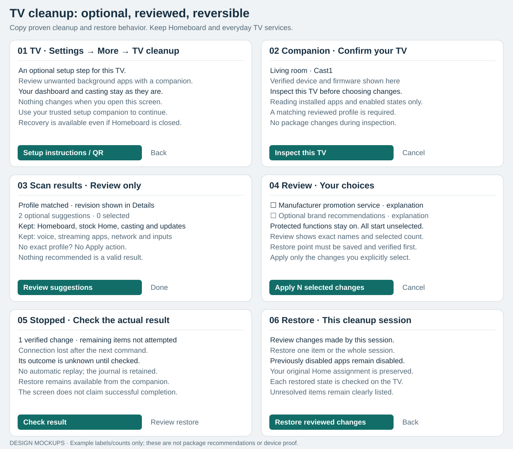
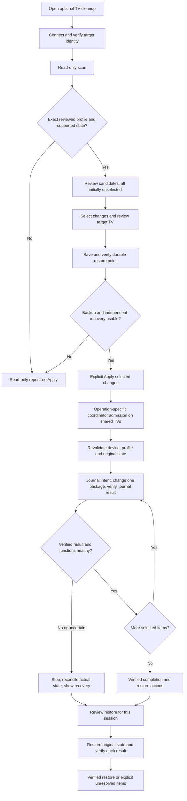

# Optional TV cleanup with a tested way back

**Status: read-only inspection milestone implemented and verified on Cast1 in 0.1.64. Full cleanup/restore implementation remains open. Real package cleanup still requires review of the concrete device-specific selection.**

TL;DR: offer an optional cleanup setup step that keeps Homeboard and services the
household uses. Copy reviewed cleanup/restore code and tests from existing
projects, pin the source, begin with read-only analysis, and prove restoration
before enabling real cleanup. Use a companion for privileged operations; keep the
TV launcher and its current phone settings editor focused on the dashboard.

Will's constraints: **be very safe; copy from existing projects.** This plan follows
the [community-project investigation](../investigations/2026-11-18-cleanyourtv-community-projects-and-cleanup.md).

## Intended outcome and initial scope

Someone already using Homeboard can choose **Clean up this TV**, inspect a small
set of explained recommendations, keep anything they use, and apply only the
reviewed choices. They can put back one change or the entire cleanup session
without needing Homeboard to be running. Cleanup is optional; opening its entry
point, scanning or installing Homeboard never disables another package.

The first supported targets are the independently identified Cast1 and Cast2
devices, each with its own tested profile and results. An unknown model, unmatched
firmware, missing dependency information or ambiguous profile produces a report
with no Apply action. A brand match alone does not qualify a TV for cleanup.

V1 only considers a small reviewed allowlist of nonessential manufacturer
promotions/telemetry, if any qualify on that exact device. A valid result can be
**“Nothing recommended for this TV.”** Package names and selection counts in the
mockups are illustrative, not an approved disable list.

## Reuse decision: copy the working core and its tests

Do not write a new generic debloater or generate a package list from names. Start
with these existing implementations, resolving commit SHAs during source review:

| Candidate/source | What to reuse | Review needed before use |
|---|---|---|
| [CleanYourTV disable tools](https://github.com/Gathin23/cleanyourtv/blob/main/tools/disable.sh) | Package protections, preflight behavior and per-package execution semantics. | Complete dependency/transport call graph; preserve protections without importing direct-device control into Homeboard tooling. |
| [CleanYourTV recovery core](https://github.com/Gathin23/cleanyourtv/blob/main/tools/recovery.py) and [restore entry point](https://github.com/Gathin23/cleanyourtv/blob/main/tools/restore.sh) | Existing durable records and restore behavior, plus their upstream tests. | Verify exact original-state restoration and behavior after interrupted commands, changed addresses and partially completed sessions. |
| CleanYourTV model profiles and their supporting device notes | Reviewed package knowledge and reasons. | Pin one source revision, confirm exact Cast identities/firmware and reduce the enabled scope to our reviewed allowlist. A published list is input to review, not automatic permission. |
| [CleanMyTV cleanup core](https://github.com/wingedpanther/cleanmytv/blob/main/src/main/debloat.ts) and [documented recovery compatibility](https://github.com/wingedpanther/cleanmytv#credits-and-upstream) | A second reuse candidate for existing state tracking, review/restore behavior and tests. | Inspect actual code and license at the pinned revision; exclude its launcher replacement and unrelated management features. |

**Preferred order:** use an existing companion's cleanup-only integration if it
can meet this plan while preserving Homeboard. Otherwise copy the smallest
complete reviewed upstream cleanup/recovery module set and its tests into a
focused companion. Choose one execution core at the first gate; do not combine
two journals or partially reimplement both engines.

Keep copies substantially intact. Put Homeboard-specific allowlists, transport
adapters and exclusions outside the imported core where practical. If an upstream
guard cannot run through the adapter, Apply stays unavailable until the guard is
implemented and tested; do not remove it to make a script work.

For each imported file retain source repository, exact commit, original path,
SHA-256, license/copyright and a small local-diff record. Copy the relevant tests
and fixtures as well as runtime code. Record upstream update/review steps. No live
branch execution, automatic profile upgrades or silent network-downloaded scripts.
The existing launcher import remains pinned independently. Candidate links above
locate code for review; they are not yet an approved vendoring manifest.

## Boundaries that make the initial scope conservative

| Area | V1 behavior |
|---|---|
| Homeboard and launchers | Preserve Homeboard, its data and settings, enabled states of all launchers, and the existing default Home assignment. No launcher swap or accessibility-helper changes. |
| Casting and everyday functions | Keep casting/AirPlay/Miracast components, streaming apps, voice assistant, firmware updates, remote/Bluetooth, Wi-Fi/network ownership, keyboards, inputs/tuner/HDMI services and screensaver providers. |
| Android essentials | Retain upstream's protected-package and dependency checks, with no force switch or UI override. Protect installers, permission management, system UI, settings, providers and core services. |
| Uncertain packages | Keep enabled and explain why no recommendation is made. Shared UID, dependency or active-use ambiguity blocks that candidate. |
| Mutation | Reversible per-user disabling only, using the copied reviewed engine. No uninstall, data clear, factory reset, root, flashing or factory/test-menu launch. |
| User control | Every candidate starts unselected. No bulk “disable everything,” hidden advanced override or background repeat cleanup. |
| TV updates | A later scan reports differences; it does not automatically disable packages re-enabled by an update. |
| Debugging | Preserve the user's existing authorized debugging/connection state on our shared TVs. Public setup documents finishing a temporary connection; no automatic transport shutdown that prevents recovery or coordinator access. |

These are product requirements for the adapter and profile filter, in addition
to upstream protections. If the reviewed source cannot satisfy one, record the
gap and keep the corresponding feature unavailable.

## User journey and mockups

The mockups describe the intended integrated companion experience. Existing
companion screens should be reused when they provide the same controls; document
any equivalent presentation rather than replacing good existing behavior solely
to match these drawings. Labels are examples, not findings from either TV.

1. **Enter:** TV Settings → More → TV cleanup. Show what the feature does, that it
   uses a trusted setup companion, and a computer/phone instruction link. Back
   returns to the invoking settings item. It is not a dashboard widget.
2. **Connect and inspect:** name the target TV and confirm its identity through the
   approved connection. A phone shortcut or IP address alone is not identity proof.
   Inspect performs no state changes. The companion explains the next action.
3. **Review:** show matching profile, scope, each suggested package's plain-language
   purpose, current state and what keeping it means. Technical package names are
   available under Details. Show protected functions as “Kept,” with no off switch.
4. **Confirm concrete choices:** show only selected changes, their count and target
   TV. Save and verify the restore point before enabling **Apply N changes**.
   Cancel returns without changing the TV. This confirmation is the final step
   before the first real package mutation, not a request to approve an unseen list.
5. **Apply:** update one item at a time, checking the actual result. Stop safely
   after the current command when requested. A lost connection or unknown command
   outcome becomes **Check result**; it never becomes a success toast or a fresh
   blind retry. Keep the durable restore controls reachable.
6. **Restore:** review changes made by this session and their original states.
   Restore one item or the session. Show changed, already restored, not changed
   and unresolved separately. Finish with verified results, not an optimistic
   “everything restored” message after a failed command.

Use English and Thai, visible labels and accessible buttons. The phone review
list can scroll by touch; TV navigation uses bounded pages and wedges. TV status
and restore entry must work with the remote, but recovery must also be available
on the companion when Homeboard is closed or unavailable. Device identity,
connection credentials and backups remain private.

## Execution and persistence design

The companion owns a durable session record and recovery entry independent of the
TV-hosted phone editor. Avoid keeping the only backup in a browser tab, the TV
app's cache or a directory that an app update can replace. Verify a second
recoverable copy/export before real mutations. If exact upstream recovery-format
compatibility is claimed, prove it with the copied engine's existing restore
tool against our record; otherwise name and document the actual supported format.

Use stable verified device identity plus a profile revision, package inventory
digest, selected Android user and original Home assignment. Store for each item
its original enabled-setting value, observed package/version identity, intended
change and verified outcome. “Disabled before this session” stays disabled after
restoration. Preserve Android's default-enabled state as distinct from explicitly
enabled. Do not restore by enabling every entry in the source package list.

Before each change persist intent, then execute and verify the resulting state,
then persist the outcome. A missing response is an unknown outcome until the TV
can be inspected. On reconnect, recheck identity and reconcile before offering
resume/restore. Do not replay a pending destructive action automatically. Detect
changed firmware, removed/updated packages and concurrent user changes; require
a new reviewed plan for changed assumptions. An external change during cleanup
must not be silently overwritten by restoration.

Use the upstream engine's proven transaction boundaries and recovery behavior.
Add missing durability/state handling as narrow patches with fault tests and
review. Discovery of an unjournaled mutation path is a release blocker. Local
backup-write, flush, disk-full and permission failures must prevent the next
mutation. Cancellation closes only owned resources and preserves the pending
record; connection-loss recovery does not depend on the TV launcher restarting.

## Device coordination and public distribution

On our shared devices, add separately reviewed **inspect, apply and restore**
workflows to the coordinator through a scoped integration. All transport calls
inside copied code must use that workflow's owned transport. Importing an
upstream ADB helper is not permission to run it directly against a shared TV.
Code/test/build/packaging work remains containerized, and host dependencies stay
within the established tooling. No ordinary widget endpoint gains a shell API.

Use devices → queue → complete submitted job → watch → evidence. Read the
[operation policy matrix](../../../chromecast-coordinator/docs/plans/2026-11-16-nondisruptive-work-during-personal-use-command-matrix.md)
for the actual stage: authorized install-only work remains independent of
foreground testing, and personal use/reservations are not blanket bans. Cleanup
apply changes state; its job must be explicitly admitted under its own reviewed
effect contract. Do not clear holds to run it. Passive scans/captures follow their
own conditions. Preserve existing enrolled identities and connection keys.

Cast1 is the initial foreground acceptance target. Only after restoration and
every retained-function check pass there should the same reviewed logic be tested
on Cast2 with its separately matched profile. Let the coordinator schedule any
foreground stage during personal use. Preserve app data. Any launcher build uses
`task deploy` with a fresh version and the identical frozen APK for both TVs;
companion and coordinator revisions are recorded separately.

The public feature must not assume every user runs our coordinator. Gate public
release on a tested supported companion connection and standalone restore path,
with installation instructions and a clear OS/device support table. A documented
existing companion may satisfy that requirement after cleanup-only compatibility
is demonstrated. Requiring a new service or native phone app is a separate design
decision, not an implicit prerequisite for using the dashboard.

## Implementation order and gates

- [ ] **1 — Copy/reuse audit:** identify a reviewed upstream commit and suitable
  existing companion; inspect cleanup-only behavior and Homeboard preservation.
  Produce a file/test/license manifest and choose one existing execution core.
  Record every local patch and reject implicit launcher handover.
- [ ] **2 — Recovery before cleanup:** copy the selected recovery code and tests.
  Prove exact baseline restoration, durable intent/outcome records and independent
  restore entry against controlled fake TVs. No physical package changes yet.
- [ ] **3 — Read-only integration:** implement connection, identity, profile matching,
  inventory, protected-package filtering and review screens. Unknown devices and
  stale plans remain read-only. Record an empty-recommendation path.
- [ ] **4 — Coordinator integration:** implement the narrow adapter and stage
  contracts in a separately reviewable change, with admission and cancellation
  coverage. Validate all setup and cleanup effects, not just command bodies.
- [ ] **5 — Restore rehearsal with a fixture:** use a disposable test package and
  complete coordinator jobs to exercise enable-state changes, interruption and
  restoration on Cast1. Never select a system package merely to test the plumbing.
- [ ] **6 — Concrete Cast1 proposal:** scan exact hardware/firmware, prepare a small
  named package list with reasons and proven recovery. Present that actual list
  and before-state for Will's confirmation before the first real cleanup. The
  present plan is not that confirmation. Zero eligible packages is acceptable.
- [ ] **7 — Cast1 cleanup and restore:** apply the approved selection serially;
  verify each change and the retained functions. Restore and prove original
  state before marking the target supported. Leaving selected cleanup active
  requires Will's explicit choice after reviewing the result.
- [ ] **8 — Cast2 acceptance:** prepare its own scan and selection review, then
  repeat the same evidence and restore checks when admitted by the coordinator.
  Cast1 results do not establish Cast2 compatibility.
- [ ] **9 — User release:** finish public companion packaging, English/Thai docs,
  recovery instructions and supported-device limits. Update project provenance
  and credits. Advertise cleanup only for the tested scope.

## Acceptance and screenshot proof

| Case | Required result and evidence |
|---|---|
| Open, inspect, Back, Cancel | No package/Home/settings changes; original layout and focus retained. Capture entry, scan and canceled review, with before/after state comparison. |
| Wrong device/profile or changed firmware | Apply absent/disabled with a specific explanation; no model guessing. Capture the read-only result. |
| Protected or active dependency | Blocked independently of UI selection; no force flag. Tests cover names, package identity, shared UID/dependencies and upstream guards. |
| Review and confirmation | Capture named TV, candidate reasons, kept functions, selected count and exact final changes; verify nonselected and already disabled packages stay unchanged. |
| Restore point unavailable | Apply disabled; fake-TV faults prove no package call follows failed persistence. Capture the recovery-storage error. |
| Apply one fixture change | Coordinator receipt plus actual enabled-state readback; UI progress screenshot alone is insufficient. |
| Process/network loss at each boundary | Intent, dispatched command and missing acknowledgement reconcile correctly after restart; no duplicate mutation or false completion. Tests begin with controlled faults, not deliberate network shutdown of a shared TV. |
| Stop/cancel after partial progress | No further package disabled; journal and independent recovery remain usable. Capture stopped state and remaining work. |
| Restore original baseline | Verify all changed enabled states and Home assignment, including original default/disabled values. Capture restored summary and native Home. Unknown outcomes remain visibly unresolved. |
| Real retained functions | User-confirmed physical remote, casting from a second device, streaming, HDMI/input, keyboard, Wi-Fi, screensaver and reboot/Home behavior. Record actual tests and limits; screenshots alone cannot prove these. |
| English/Thai and accessibility | Review/restore labels, counts, focus, touch/keyboard controls and errors render correctly. Capture both languages; keep technical package details discoverable. |

Store a private evidence bundle per device/session: source/profile revision,
frozen artifact hashes, coordinator job/receipt, initial/final state digests,
native assertions and timestamped screenshots. Copy reviewed, redacted screenshots
and a concise verification record to `docs/testing/`. Redact serials, account
details, addresses and network names before publishing; never commit backups,
credentials, debugging keys or raw household package inventories. Mark images as
mockups, browser fixtures or real device captures accurately.

## Completion and scope limits

The deliverable is a tested optional cleanup-and-restore integration, retaining
Homeboard and the household's working TV features. Completion requires both
mutation and restoration evidence, not just imported scripts or a passed scan.
No promise of blocking ads inside streaming content, eliminating all telemetry,
supporting every Android TV, or recovering a disconnected TV without a usable
authorized recovery channel. If a target lacks a credible recovery route, it
remains scan-only. Do not deliberately break Wi-Fi, boot, casting or updates to
demonstrate recovery.

Existing-source reuse reduces new implementation but does not establish safety
on our hardware. Preserve protections, test the copied code with its dependencies,
and treat an inability to prove restoration as a reason to withhold Apply.

## Implementation checkpoint · 0.1.64

The implementation deliberately stops at the first operational safety gate:

| Part | Current result |
|---|---|
| Copied source and tests | CleanYourTV subset pinned to `3ece7766ad5d6af79a2c4dd73e77b4b9623dfeca`; original license, hashes and 34 unchanged recovery tests retained. No upstream transport copied. |
| Runtime reuse | Upstream package/Home validation, core protections and atomic record writing; strict Homeboard policy/session adapter around those primitives. No complete third-party cleanup application has been imported. |
| Recovery foundation | Fake-TV tests for exact enabled-state values, two private recovery copies, lost command responses, cancellation and process restart; no real-device restoration claim. |
| Computer companion | Loopback-only English/Thai UI requests complete coordinator inspection jobs and shows model, firmware and package count. No mutation or shell HTTP route exists. |
| TV entry | Settings → More → TV cleanup · Inspect only; instructions and Back return path. |
| Real profiles | None approved. Copied Chromecast lists are reference data only. The prospective new Android TV must be enrolled and inspected first. |
| Apply/restore execution | Not exposed on real devices. Coordinator mutation workflows, fixture rehearsal, concrete package approval and physical restoration acceptance remain open. |

Verification: 52 cleanup/recovery tests, 478 JVM tests, Android lint and
639 English/Thai resource checks passed in containers. Chromium/WebKit report
captures and real Cast1 English/Thai instructions captures are saved in the
verification record. A live Cast1 inspection completed with foreground unchanged.
The identical 0.1.64 APK installed on Cast1; Cast2's separately admitted install
failed `personal-install-in-use`, so its installation remains unconfirmed.

Two source findings justify additional adapter controls: the copied restore code
has a no-record blanket-enable fallback, and its record uses coarse enabled/
disabled states and address-based lookup. Homeboard does not expose that fallback
or claim interchangeability. Its additional journal uses exact Android enabled
settings and verified stable device identity. These differences are explicit local
integration code; the vendored originals remain unchanged and hash checked.

The earlier six-screen mockup describes the eventual full workflow. The shipped
milestone contains the TV instructions and read-only companion screens; candidate
selection, real progress and interactive restore screens remain future gated work,
not hidden working features. [User guide](../how-to/tv-cleanup.md) and
[verification record](../testing/2026-11-18-tv-cleanup.md).

## November 19 execution integration

Will authorized autonomous implementation, tests and disposable-app rehearsals;
real TV app cleanup still waits for a concrete reviewed selection. The existing
review/apply/stop/restore mockups above define the workflow. Extend standalone
connections with exact user-0 package inventory, Home providers and active-process
protection, then wire the already-tested Session journal through authenticated
review/confirmation and recovery screens. All fresh dependency facts remain
unknown unless an exact reviewed profile establishes eligibility. Use stable TV
serial identity in recovery records, not the ephemeral connection identifier.

Coordinator capability inspection on November 19 reports inspect and
reactivate-package but no cleanup apply/restore workflow. The latter cannot be
substituted for disable/restore rehearsal or bypassed with raw device access.
A narrowly reviewed coordinator workflow is required before the Cast1 rehearsal.
The standalone implementation and controlled tests can proceed independently.
