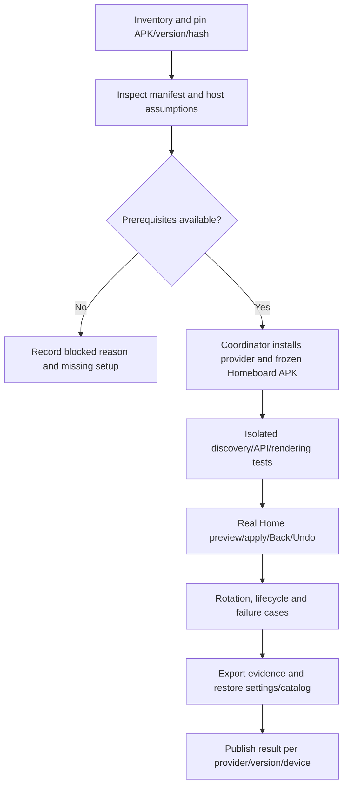

# Wallpaper provider inventory and compatibility testing

**Current review proposal:** [Provider testing spike and user installation](2026-11-18-provider-testing-spike-and-installation.md).
That plan replaces this document's execution sequence and adds the installation
decision, mockup, timebox and security stop rules. This inventory remains background research.

Researched 18 November 2026. Status: inventory and proposed test workflow; no new
third-party compatibility results claimed by this document.

The complete current [official external-provider catalog](https://github.com/spocky/miproja1/blob/master/installPackages/wallpaper-plugin.json)
contains ten entries. The [Projectivy plugin page](https://projectivylauncher.com/plugins.html)
links to that catalog. Eight additional projects/leads are recorded below. This
is a dated inventory of published providers found, not a guarantee that every
private, unindexed or future plugin is included. Refresh the catalog and search
before each compatibility campaign. Count renamed projects once: Daily Photos
is the Bing Wallpaper project; Sofadrop's old repository redirects to its new one.

These are wallpaper providers for Homeboard's existing Projectivy API host.
Android DreamService screensavers are a separate integration. Aerial Views offers
both roles; passing one role does not establish the other.

## Official catalog: all ten entries

Only Overflight has existing independent-provider rendering evidence in this
repository. All remaining entries are **untested in Homeboard**. The test column
describes proposed cases, not verified functionality. Setup details must be
checked against the exact pinned release before execution.

| Provider / primary source | Content | Proposed distinctive test |
|---|---|---|
| [Overflight](https://github.com/spocky/projectivy-plugin-wallpaper-overflight) | Aerial video and custom feeds | Recheck HD/SDR playback; image/video feed, rotation, bad item followed by good item; retain existing 4K/HDR preferences. |
| [Daily Photos / Bing Wallpaper](https://github.com/spocky/projectivy-plugin-wallpaper-bingwallpaper) | Daily photography | First image, credits, source/settings changes, cache expiry and failed network refresh. |
| [Aerial Views](https://github.com/theothernt/AerialViews) | Video; also an Android screensaver | Test its wallpaper service separately from DreamService, HD video, rotation and settings-update notifications. |
| [Weather Wallpaper](https://github.com/shortusername/projectivy-weather-wallpaper) | Rendered weather scenes | Set a fixed test city; static scene, animation/Lottie/video modes when available, stale weather, and text visibility behind dashboard cards. |
| [Sofadrop](https://github.com/rfmarcos/sofadrop) | Movie/show compositions | Start with public lists; generated image/content URI, multi-item rotation and update notification. Account-backed modes get separate results. |
| [Immich Wallpaper](https://github.com/raizer88/immich-projectivy-provider) | Self-hosted photographs | Disposable album, image access as Homeboard's actual package, refresh, portrait images, expired credentials and unreadable URI. |
| [Movie Art](https://play.google.com/store/apps/details?id=com.danielkorgel.projectivy.plugin.cinemaglow) | Movie/show artwork | Inspect event mask; app-card fallback/random modes if offered; program-focus dependency explicitly reported rather than simulated as a supported Homeboard feature. |
| [Trakt Wallpapers](https://github.com/johnneerdael/traktlistbackdrops) | Locally rendered media artwork | Test-account OAuth, generated image access, initial generation delay, rotation and expired/revoked login. |
| [Core Motion](https://github.com/brevityA/CoreBuildsApps/blob/main/motion-plugin/README.md) | Motion loops | Bundled loops and network feed separately; actual moving frames, looping, mute, reduced motion and decoder fallback. |
| [Booru Wallpaper Provider](https://github.com/Kurocon/projectivy-booru-wallpaper-provider) | Imageboard sources | Controlled test collection, explicit query/filter, image loading, empty results, rate limits and credits. |

Catalog package IDs identify distinct installations; acquire the APK from the
maintainer's release/store, then record its actual manifest/version/signature.
The catalog's Aerial Views and Trakt URLs are version-pinned while other URLs may
float. Resolve and freeze every artifact before testing; “latest” is not a result.

## Additional published projects and discovery leads

| Project / primary source | Evidence and proposed test |
|---|---|
| [Jellyfin Wallpapers — Mikescher](https://github.com/Mikescher/projectivity-jellyfin-wallpaper) | Maintainer documents direct Jellyfin backdrops and composed cards. Test both with a disposable server, filters, empty library, image access and refresh broadcasts. |
| [Jellyfin Wallpaper — z9m](https://github.com/z9m/ProjectIvy-Plugin-Wallpaper-Jellyfin) | Separate beta plugin. Test movie compositions, random/latest modes and configuration. Check package/UUID collisions before co-installing forks. |
| [Jellyfin provider fork — jfchenier](https://github.com/jfchenier/projectivy-plugin-wallpaper-provider-jellyfin) | README still describes the upstream template. Candidate only: inspect implementation and release availability before calling it a functional Jellyfin provider. |
| [TV Background Suite](https://github.com/z9m/projectivy-tvbgsuite-plugin) | Requires its backend. Use an isolated backend or protocol stub for deterministic tests; real backend integration is a separate result. Test filters, refresh and action-link handling. |
| [Wallpaparr](https://github.com/iManunator/wallpaparr) | Server plus plugin; maintainer documents demo mode. Start with demo stills, then generated motion and a disposable library. Check returned URL scheme against Homeboard's HTTPS policy. |
| [Random Wallpapers — Mars-Wave](https://github.com/Mars-Wave/projectivy-random-wallpapers-plugin) | Listed in [GitHub's Projectivy topic](https://github.com/topics/projectivy); repository/README retrieval failed during this research. Acquisition pending. Verify source contract, then test returning Home, shuffle and non-repetition with known images. |
| [Unsplash plugin — Adrian Jost](https://adrianjost.dev/projects) | Creator's portfolio confirms the project, but this research did not establish a downloadable release/repository. Acquisition pending; once obtained, test source/key requirements, credits, rate limits and refresh. |
| [m3u8 Wallpaper](https://github.com/Stremiouser666/projectivy-plugin-wallpaper-m3u8wallpaper) | Experimental streaming plugin. Inspect returned descriptor before testing a controlled HTTPS HLS feed; check startup, interruption, live/finite playback and decoder errors. Existing MP4 success does not establish HLS support. |

## Built-in sources and Android screensavers

Projectivy documents built-in sources such as Reddit, files/folders, dynamic
colors, program artwork, now-playing and theme sources in its
[API documentation](https://github.com/spocky/projectivy-plugin-wallpaper-provider)
and [release notes](https://github.com/spocky/miproja1/releases).
They are not separately installable provider APKs and do not automatically appear
in Homeboard. The [4.73 release](https://github.com/spocky/miproja1/releases/tag/4.73)
also announces a new default source without naming it in those release notes;
verify the installed launcher's full built-in list before promising equivalents.
Treat implementing any equivalent source in Homeboard as separate product work.

For other Android screensaver apps, discovery should enumerate installed
DreamService services through a coordinator-supported inspection job and record
which also export the wallpaper-provider action. There is no finite catalog of
every Android screensaver. DreamService-only apps are outside this host's contract;
do not label them broken wallpaper providers or change the system screensaver to
test wallpaper support.

## A repeatable test system

Extend the existing isolated native wallpaper probe into a provider-parameterized
debug probe. Proposed inputs: provider component/UUID, expected event support,
media expectations, time budgets, and test configuration reference. Proposed
outputs: a machine-readable report, per-case log and screenshots/video. Keep
provider configuration separate from household layout preferences.

1. **Inspect before installing.** Record repository revision or official APK URL,
   package/version, APK SHA-256/signing certificate, API version, UUID, event mask,
   settings activity, ABI/min-SDK and content URI grants. Search for hard-coded
   Projectivy package names, explicit update broadcasts and Premium/host checks.
   Inspect forks for shared package names/UUIDs; test collisions sequentially.
   Compile any source-only dependency inside a container.
2. **Exercise the real provider.** Discover/bind the unmodified release and call
   its API with actual supported events. Record capabilities, item counts, media
   types and credits, never credentials. Test empty/error responses and timeouts.
   A successful bind is not successful rendering. Keep the offline fixture as a
   renderer/host regression suite, not a substitute for each independent plugin.
3. **Prove display.** Show images after decoding; require video first-frame
   readiness plus captures a few seconds apart to establish motion. Sample a
   known moving scene to avoid false failure on static portions. Verify mute,
   looping and reduced-motion behavior. Check at least three returned items when
   available, and describe mixed supported/unsupported media explicitly.
4. **Exercise launcher controls.** In isolated launcher preferences, Preview must
   expose media; Back restores the original dashboard. Apply saves one change;
   Hold Back Undo restores the prior source. Check Home/All Apps, widget opacity
   0/75/100%, independent dimming, text readability, remote focus and source credits.
5. **Exercise lifecycle and refresh.** Test one scheduled rotation, actual cache
   expiry or a documented test configuration, settings-update broadcast, app-focus
   and idle where declared. Background/foreground must stop/resume playback safely.
   Test provider process failure/restart and package replacement only on disposable
   test installations. Do not force-stop a household provider as a fault injection.
6. **Exercise network/account failures.** Use local HTTPS fixtures and disposable
   Immich/Jellyfin/backend containers with synthetic photos/media and test accounts.
   Simulate empty lists, 401/403/429, unreachable service, malformed media and a bad
   item before a valid one through those test endpoints. No household credentials
   or photos are required. Keep test secrets outside source/evidence. An HTTP-only
   media endpoint is a policy incompatibility to report, not a reason to silently
   weaken Homeboard's network rules.
7. **Record and restore.** Assert household layout/preferences unchanged, restore
   any provider setting temporarily changed, and restore MainActivity catalog
   registration after the complete job. Store job receipt, installed hash,
   native report, captures, log and explicit per-case outcome together.

Immich's current README describes grants specifically to Projectivy's package
and also contains older conflicting URL/cache notes. Inspect the pinned APK and
test Homeboard's real package identity: this is a concrete compatibility risk,
not a confirmed failure. Likewise, a broadcast addressed only to Projectivy may
prevent refresh even when initial rendering works. Report original-release and
patched-source results separately if a fix is needed.

Action links need a coordinator workflow that supports leaving Homeboard and
restoring it. Existing in-app input helpers have rejected cross-app transitions.
Until such a workflow is available, inspect links and test intent construction in
the isolated probe, but mark actual external launch as unverified. Homeboard's
current browsable-link policy may reject provider-specific media-client schemes;
do not count such rejection as full action compatibility.

## Execution order and acceptance

Run on Cast1 first. Use coordinator devices/queue/support, then one complete
submitted job per provider/configuration; watch to completion and export evidence.
No raw ADB or manual device-control fallback. Pin catalog registration for the full
job. Provider settings activities may require a supported multi-app workflow; if
unavailable, record setup blocked instead of bypassing the coordinator.

Suggested batches:

- **First:** Daily Photos, Aerial Views, Core Motion, Weather, plus Overflight
  regression. These cover public images, independent video and rendered scenes.
- **Second:** Sofadrop public sources, Booru controlled collection, Movie Art's
  supported modes, Random Wallpapers if acquired, and experimental m3u8.
- **Third:** Immich, the distinct Jellyfin plugins, TV Background Suite and
  Wallpaparr using disposable services; Trakt with a test login. Resolve Unsplash
  acquisition separately. Template-only forks remain candidates until inspected.

Budget roughly 3–5 minutes for baseline discovery/render/control checks per
configured plugin, plus 10–15 minutes for rotation/lifecycle and a 30-minute soak
for each distinct video path. Actual cache expiry may require a longer job;
respect the coordinator's granted duration and split sessions when needed.

Results must be one of **pass**, **partial**, **fail**, **blocked** or **not run**,
with separate discovery, rendering, configuration, refresh, lifecycle and actions
columns. Unsupported program-focus/now-playing modes remain partial/unavailable;
never fabricate those events and call the production feature supported.

After Cast1 passes, repeat baseline rendering/control checks on Cast2 when the
coordinator can reconnect. Installation and foreground acceptance remain separate.
Any new Homeboard build uses `task deploy`, advances its version and submits the
identical frozen APK to both TVs. This document alone requires no build/deployment.

Proposed result fields: provider ID/version/hash, Homeboard version/hash, device,
configuration ID, prerequisites, capability mask, case outcomes, job IDs, evidence
paths, cleanup verification and remaining limitations. A completed coordinator
job without app-level/rendering evidence cannot become a compatibility pass.
