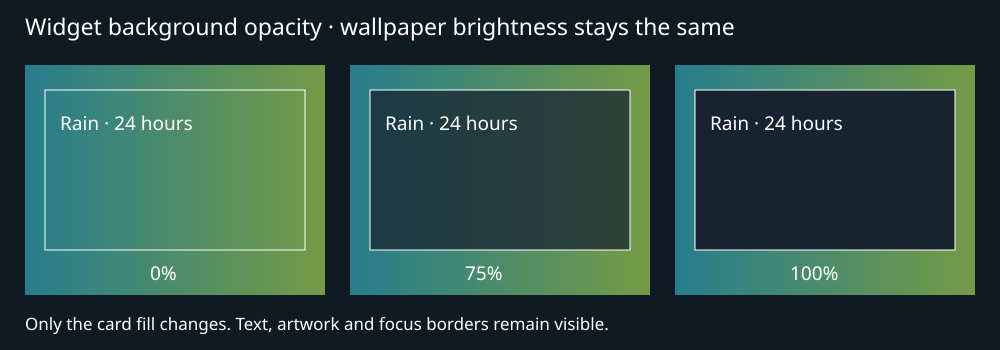
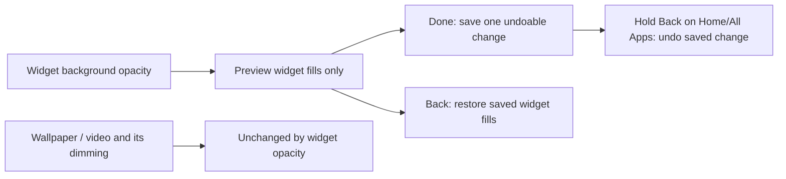

# Opacity belongs to widget backgrounds

Status: implemented in 0.1.55; Cast1 pixel/alpha and menu checks passed. Cast2 installation is queued pending connection. See the [testing record](../testing/2026-11-18-hold-back-undo-and-widget-opacity.md).

Status: implementation requested. Will clarified that opacity should change
widget card backgrounds, while the wallpaper may be playing video.

Use **Appearance → Widget background opacity**. Its 0–100% range changes widget
fills only: Rain, Calendar, Air quality, Favorites and World clock (including the
fixed clock). Keep text, artwork and focus borders fully visible. Settings buttons
and All Apps artwork keep their existing normal rendering. At 100%, cards are
opaque but wallpaper remains visible between them. At 0%, wallpaper is visible
through card interiors too.

Remove the full-screen palette backdrop currently tied to this slider. Do not
change the selected wallpaper, provider/video playback, rotation or independent
wallpaper dimming. Preserve the saved percentage; reinterpret its intended scope
cleanly, without a new legacy setting or migration layer. Preview, cancel and Undo
continue using the same saved widget-opacity preference and atomic layout Undo.
Rename English/Thai menu and detail labels to identify widget backgrounds.

Update the native opacity probe: compare uncovered wallpaper pixels at 0/75/100%
on Home and All Apps; they must be identical. Inspect actual Favorites/card fills
and the header clock for the requested alpha. Settings fills, labels, artwork and
focus strokes stay opaque. Verify saved settings remain unchanged during the
probe, and keep wallpaper-preview regression checks valid after removing the
obsolete backdrop layer. Deploy together with Hold Back Undo in one frozen APK
for Cast1 and Cast2 through the coordinator.
