# Opt-in ads that pay the user (Homeboard Rewards)

Status: **proposed, 2026‑11‑19. Plan only.** No application code, no accounts, no affiliate applications and no external contact. TODO entry: `## Open`, "Opt-in ads that pay the user" (T4). Will decides the marker.

**TL;DR**

- **Rewards is the only advertising-related feature Homeboard may ever have.** It is off by default and compiled out of the no-commerce build. Anyone who does not opt in keeps an ad-free product, and this plan defines that as a testable guarantee, not a promise.
- **Stage 1 pays users without any ads.** The household gets half of the affiliate commission Homeboard receives on purchases it started itself from a Homeboard shopping button. Only offers whose written terms allow cashback or incentivised traffic qualify: Shopee Thailand reportedly does, Lazada Thailand reportedly does not.
- **Stage 2 is a second payout rail, not a funding source.** GrabRewards points would be paid for by Homeboard out of the user's share, and they need a Grab deal.
- **Stage 3, sponsored offers, is the only real advertising.** Each offer is pulled by the user, shown to every household alike, labelled, capped and paid at a fixed rate, and it converts by QR code on the phone. It waits for scale and for counsel. **Network rewarded ads (AdMob) are rejected.**
- **Homeboard never holds a wallet.** Earnings are a ledger of rebates Homeboard owes the household, payable only after the network has actually paid Homeboard. Payouts go to the household's PromptPay through a licensed payment provider: THB 100 threshold, monthly runs, an annual payout of any amount, and a final payout of any amount when the household stops.
- **Honest economics:** about THB 12 a month for a household that shops through Homeboard, and much less on average. The plan carries two pre-code gates and a kill criterion; see [Economics and kill criteria](#7-honest-economics-and-the-kill-criteria).

## Context

Will, 2026‑11‑19: "add TODO for ads which pay user. i don't otherwise want to have ads". Homeboard comes from CleanYourTV, a community that strips ads off TVs, so this exception has to be narrow enough that it never touches anyone who did not ask for it.

The research is finished and is not repeated here:

- the [widget monetization investigation](../investigations/2026-11-19-widget-monetization.md), in particular [Ads that pay the user](../investigations/2026-11-19-widget-monetization.md#ads-that-pay-the-user), the ground rules, the [privacy-first handoff](../investigations/2026-11-19-widget-monetization.md#privacy-first-handoff) with its Off / Plain / Tagged / Shared commerce setting, the rules table and the earnings illustration;
- [user-paid ads and policy](../investigations/2026-11-19-widget-monetization/research-notes/user-paid-ads-and-policy.md), covering Brave, AdMob, Play, Android TV, PDPA, the Gambling Act, e-money and tax;
- [Thai affiliates and direct sellers](../investigations/2026-11-19-widget-monetization/research-notes/thai-affiliates-and-direct-sellers.md), with the incentive and cashback rules for each offer;
- [Grab deep dive](../investigations/2026-11-19-widget-monetization/research-notes/grab-deep-dive.md), covering the GrabRewards Points Earning API.

Today Homeboard has no commerce code, no tagged links, no server and no user accounts. The phone controller is a local page that the TV serves over a temporary, TV-approved pairing session ([phone editor plan](2026-11-17-phone-widget-editor.md)). The [Groceries plan](2026-11-19-grocery-list-widget.md) keeps retailer ordering out of Phases 1 and 2. This plan therefore **depends on** two pieces of work that have no plan yet: the commerce setting (Off, Plain, Tagged) and tagged shopping links, which are steps 3 and 4 of the investigation's sequence. Here it defines only **Shared** (the user's share) and **Sponsored**, and it pins the contract those two build on.

## Approach

### 1. Funding sources and their order

**Recommendation: confirm the investigation's order (commission share first) with two corrections.** GrabRewards moves from funding source to payout rail, and network rewarded ads are dropped rather than ranked.

| Order | Source | Is it an ad? | Verdict |
|---|---|---|---|
| **1** | **Commission share** on the household's own tapped purchases | No: a rebate on a purchase the user started | **Build first, as a capped pilot**, once both pre-code gates pass ([section 7](#7-honest-economics-and-the-kill-criteria)). Only on offers whose terms allow cashback or incentivised traffic in writing. It needs no ad content, and its revenue cannot be faked by bots, since every baht comes from a real, validated order. |
| **2** | **Partner points** (GrabRewards Points Earning API) | No | **A payout rail, not a funding source.** The Grab PDF does not say who pays for the points, and the research infers that the partner does ([Grab notes](../investigations/2026-11-19-widget-monetization/research-notes/grab-deep-dive.md)), so Homeboard would buy them out of the user's share. It suits households that would rather have points than give a PromptPay number. It needs a Grab partnership and usage numbers, so it comes after the pilot. |
| **3** | **Direct-sold sponsor slots** with a revenue share | **Yes** | **Stage 3, gated on scale and review:** at least 2,000 households in Shared, a sponsor who has actually asked, and counsel plus Play review done. This is the only real advertising Homeboard would ever carry; the rules are in [section 4](#4-where-anything-sponsored-may-appear). |
| — | **Network rewarded ads** (AdMob and similar) | Yes | **Rejected.** AdMob bans cash and gift cards "under any circumstance" and allows only rewards inside the app. Homeboard has nothing in the app worth unlocking, and gating features behind ads would make the product worse for people who never watch them, which breaks the guarantee. It would also put an ad-tracking SDK into the APK, and whether AdMob serves Android TV home screens at all is unknown. |

**Rejected design: a Homeboard wallet** that users top up, spend or transfer. It is the e-money path that the Payment Systems Act licenses (the research cites THB 100 million minimum capital). **Rejected targeting model: Brave-style ad matching on the device.** It is private, but nothing here needs targeting, and one untargeted catalogue for every household is simpler and leaks nothing.

The flow from each funding source to the household:

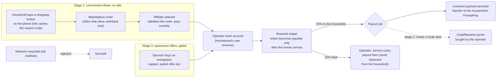

### 2. User share and payout in Thailand

**Share.** The household gets **50% of the net commission Homeboard actually receives** for that household's orders, after any network fee such as Shopee's affiliate service fee. Payout fees come out of Homeboard's half, never the household's. The alternative is Brave's 70%. 50% is recommended until real payout fees are known, with a review after the pilot. That choice is Will's ([decisions](#decisions-only-will-can-make)).

**No stored balance.** The household's "earnings" are a ledger of **rebates Homeboard owes**, not stored value:

- They cannot be topped up, spent inside Homeboard or transferred to anyone else.
- They can only be paid out to the payee's own confirmed account.
- They become payable **only after the network has paid the operator**, so Homeboard never fronts money.
- Nothing payable waits more than about 12 months: an annual run pays any amount.

Whether a payable rebate ledger like this is outside the Payment Systems Act's e-money definition is the first question for counsel ([section 6](#6-legal-and-policy-checklist)). If counsel says it is e-money, cash payouts stop and only the points rail stays in play.

**Recommended rail:**

| Rail | Verdict | Why |
|---|---|---|
| **PromptPay transfer through a licensed Thai payment service provider's disbursement service** | **Stage 1** | Thai households already use PromptPay, and the provider holds the payment licence and makes the transfer. The provider is not chosen yet and was not researched: Opn Payments (Omise), 2C2P, Xendit and a bank's bulk-payment service are the candidates to price, along with their per-transfer fees. |
| GrabRewards points | Stage 2 | Needs a partnership. Grab sets the points formula, and the payee enrols with a Grab phone number or email instead of a PromptPay number. |
| Google Play credit (gift codes) | **No** | It is closed-loop and only useful inside Play. Buying and handing out codes means handling stored-value instruments, and Google's terms for reselling or giving away codes as promotions were not researched. |
| Donating the share to a charity | Not in v1 | A pleasant option for tiny balances, but it adds receipt and tax questions. Will may decide to add it. |

**Threshold, cadence and failure handling:**

| Rule | Value |
|---|---|
| Threshold | **THB 100** confirmed and received |
| Regular run | Monthly, once the networks' monthly payments have reached the operator's account |
| Annual run | In December: every payable amount, whatever its size; Homeboard pays the fee |
| Final payout | When the household stops Rewards: any amount, once the last pending order resolves |
| Clawback | **Never.** If a network reverses an order after the household was paid, Homeboard absorbs it |
| Double payment | Each transfer carries an idempotency key of reward code and run, so repeating a run is safe |
| Rejected transfer (number deregistered, name mismatch, provider error) | The amount returns to payable and the phone and TV Rewards pages say why. It is retried automatically on the next 3 runs, then held as "action needed" until the payee updates the number. What happens to an amount unclaimed for 12 months after the last notice is a counsel question; the default is to keep owing it |
| Network pays late or not at all | Nothing becomes payable, and the household sees "waiting for Shopee to pay Homeboard" rather than a promise |

**Data needed (KYC):**

- The payee's PromptPay-registered **mobile number** only, never the citizen ID.
- The masked account name returned by the provider's name check, which the payee confirms.
- A statement that the payee is at least 20, the Thai age of majority.
- The consent records and the payout history.

If counsel finds that withholding tax applies and needs a withholding certificate, which carries the payee's tax ID (the citizen ID for a Thai individual), Will chooses between two options: collect the citizen ID only from payees above an annual amount, or move to points only.

**Tax.** The research found 5% withholding on prizes and 3% on "rewards or discounts resulting from sales promotion", and nothing on a deterministic rebate. The design treats the payment as a **rebate on the household's own purchase**, which is a price reduction rather than income. Counsel must confirm this before launch.

**Withdrawal.** "Stop rewards" is one press on the TV or the phone:

1. Links stop carrying the reward code straight away; the code is removed on the device first.
2. Pending orders still resolve, within the network's validation window. Homeboard then makes the final payout at any amount.
3. The payout number and the provider's name snapshot are deleted after the final payout. The only exception is accounting records, kept for as long as law requires; counsel confirms the period.

### 3. Consent

The consent ladder extends the investigation's commerce setting. **Every step up is a separate, explicit act with its own text. Every step down takes one press. Nothing is ever offered unprompted.**

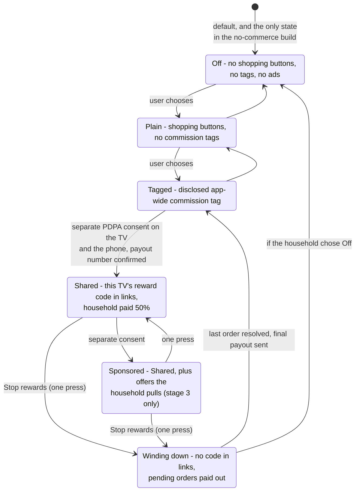

Rules:

- **Off by default.** A fresh install starts at Off. Plain is first offered when someone opens a Groceries shopping panel. Shared is offered **only** from Settings, under Commerce and rewards, and through one quiet "How rewards work" link beside the Tagged disclosure. There is no modal, badge, notification, Home card or widget-picker entry for it.
- **Separate.** Shared and Sponsored each have their own consent text, checkbox and record, and neither is bundled with installation, pairing or the commerce setting. A consent record stores the text version, the time (UTC, ISO 8601), the TV's name and which consent was given. A material change of terms needs fresh consent; until it is given, the household drops back to Tagged.
- **Two-device confirmation.** Turning on Shared needs the TV remote (the person is in the room with this TV) and then the phone (consent text, payout number). That fits the PDPA's "clear affirmative action" and proves the consent belongs to the household that owns the TV.
- **Decline is the default.** On the TV offer, **Not now** holds the initial focus. On the phone, **No thanks** is as prominent as Agree, and Agree stays disabled until the consent box is ticked.
- **Withdrawable.** Stop rewards sits on the TV Rewards full screen, in TV Settings and on the phone Rewards page. Under the PDPA's direct-marketing rule, Sponsored has its own one-press off, kept for as long as Sponsored processing continues.
- **Per TV, not per phone.** Rewards state lives on the TV. Every phone paired to that TV mints links with **that TV's** reward code, so purchases count toward this household and are paid to its one payee. A phone that is opted in on another TV carries nothing over. This is disclosed in the consent text.
- **No-commerce build flavour.** The Gradle product flavours are `commerce` and `nocommerce`. Commerce, Rewards and (later) Sponsored code lives in `src/commerce/` behind an interface in `main`, and `src/nocommerce/` holds no-op implementations. The phone controller's Rewards assets are left out of the `nocommerce` APK. `task build` and `task bundle` produce both APKs in the container. The About dialog states "Build: no-commerce", and the CleanYourTV gallery listing uses that build. A check proves the absence ([verification](#verification), step 2).

### 4. Where anything sponsored may appear

| Surface | Commission share (stage 1) | Sponsored offer (stage 3) |
|---|---|---|
| Phone shopping buttons | A disclosure next to the button: "Homeboard earns a commission; you get half" | Never |
| Phone **Rewards** page (Shared households) | Earnings, payouts, settings | An **Offers** tab: offers appear only when opened, each labelled "Sponsored", with the sponsor's name and the fixed amount paid. Links open on the phone |
| TV **Rewards** widget card (placed by the household; listed in the picker only while Shared is on) | Only the household's own figures, never sponsor content | Never sponsor content: "3 offers available" at most |
| TV **Rewards** full screen | Earnings, history, Stop rewards and a QR code to manage on the phone | "Show an offer", pressed deliberately, then one offer full screen with a **QR code**. There is no click-through on the TV. Back returns to the Rewards full screen |
| Every other widget, list item, Home card, wallpaper, app row, screensaver, notification, boot screen, audio or interstitial | Never | **Never** |
| A TV whose household has not opted in, including a phone that is opted in elsewhere and paired to that TV | Never | **Never** |

Sponsored rules for stage 3:

- **No chance elements.** Every offer pays the same fixed amount for a deliberate view. There are no draws, streaks, multipliers or "mystery" rewards, which keeps the scheme out of the Gambling Act's lot-drawing rules.
- **A cap of 5 paid views per household per day.** The cap stops farming, and it limits what anyone could earn by staring at ads.
- **One catalogue for everyone.** The full offer catalogue downloads to the device and is the same for every household. Nothing about the household chooses or orders it.
- **Sponsors see aggregate counts only.** The service records reward code, offer ID and date for payment, and sponsors receive totals per offer per day.

**The Rewards widget meets the AGENTS.md full-screen rule.** Click or short OK opens the full screen, which shows the earnings breakdown, history, payout status and management QR code. Back, or a visible **Restore dashboard** action, returns to the original Home page with the same widget focus and saved size. See the [full-screen widget plan](2026-11-17-widget-full-screen.md) and [verification](#verification), step 9.

**Play Ads policy, if a Play build is ever made:**

| Rule | Commission share | Sponsored offers |
|---|---|---|
| Ads only inside the serving app, and no "widgetized ad units" | Affiliate links on physical goods are not ads, and Play Billing exempts groceries and travel | The widget card never shows sponsor content, so it is not an ad unit. Offers appear only in the app's own full screen and phone page |
| Rewarded ads must be explicitly opted in | Not applicable | Opt-in twice over: Sponsored consent, then a press for each offer |
| TV-AU, TV-AA, TV-AN (no URL or app links from ads; convert off the screen) | Links open on the phone; the TV shows a QR code | A QR code only |
| Advertising ID | Never read | Never read |
| Residual risk | Low | **Real.** A launcher with any sponsored content may be read as system-like UI. **Recommendation:** a Play build ships without Sponsored compiled in until a counsel and policy review clears it |

### 5. The data boundary

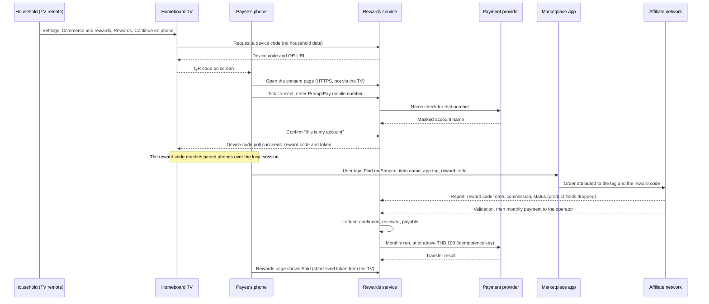

The TV pairing step follows the OAuth device-authorization pattern ([RFC 8628](https://www.rfc-editor.org/rfc/rfc8628)). Homeboard's local, unencrypted pairing session never carries the payout number, which goes straight from the phone to the service over HTTPS.

| Data | Where it stays | What leaves, to whom, and when |
|---|---|---|
| List contents, staples and stock | TV (and the phone page while it is open) | **Never**, except the single item name in a link the user taps, which goes to the marketplace the user chose |
| What is watched, apps launched, the layout, Calendar, location, presence (who is home, when) | TV | **Never**, in every state, including Shared and Sponsored |
| Advertising ID, device IDs, Wi-Fi and network names | Not read | **Never** |
| App-wide commission tag | In the code | Inside tapped links (Tagged and above) |
| Reward code (random 128-bit, never derived from a device ID, new on each enrolment) | TV, and paired phones while in session | Inside tapped links (Shared and above), so the network and the marketplace see it. The marketplace can link it to its own shopper account, which is unavoidable for cashback and disclosed |
| Network conversion report | — | Network to service. The service keeps reward code, merchant name, date, commission and status. **Product names, categories and order contents are dropped on ingest** |
| PromptPay number and masked name snapshot | Service only | Service to the payment provider, for the name check and the transfers |
| Consent records and payout history | Service | Nowhere else |
| Sponsored view (stage 3) | Service: reward code, offer ID, date | Sponsors receive totals per offer per day |
| Service request logs (IP address) | Service | Kept 7 days for security, then deleted |

**Where the service runs.** It handles the payout number and the ledger, so it is kept small and kept in Thailand:

- **Region:** AWS Asia Pacific (Thailand), `ap-southeast-7`. Holding Thai payees' data there avoids a cross-border transfer for storage. Lambda, DynamoDB and SSM availability in that region must be checked before committing to it; Singapore is the fallback and would need a PDPA transfer basis.
- **Shape:** a stateless function design with no single-instance state: Lambda handlers for the device-code flow, the earnings API, scheduled ingest per network and the payout run.
- **Data and secrets:** DynamoDB for the ledger, using conditional writes so concurrent runs cannot double-post. Network and provider credentials go in SSM `SecureString` under `/hb-rewards/*`.
- **Infrastructure as code:** a Terraform module `infrastructure/aws/modules/rewards`, with a per-project `hb-terraform` IAM user.

The cross-border question remains for the reward code: Involve Asia is Malaysian.

**Cost (pilot scale, up to 200 payees):**

| Item | Unit price | Monthly |
|---|---|---|
| Lambda | Always-free tier: 1 million requests | US$ 0 at pilot scale |
| DynamoDB | Always-free tier: 25 GB, provisioned mode | US$ 0 at pilot scale |
| SSM standard parameters | Free | US$ 0 |
| Route 53 hosted zone (if a new zone is needed) | US$ 0.50 per zone | US$ 0.50 |
| Payment-provider transfer fees | **Unknown; to price** | Fee × about 20 transfers |
| Legal review before launch | **Unknown** | One-off, and likely more than a year of pilot payouts |

Prices are AWS's published global free-tier terms; confirm them for `ap-southeast-7`. Nothing runs today, so there is no current cost to save against.

### 6. Legal and policy checklist

| # | Question | Design default until answered | Counsel before launch? |
|---|---|---|---|
| L1 | Is a payable rebate ledger, with no top-up, spending or transfer and payable only after receipt, outside the Payment Systems Act's e-money definition? | Ledger as designed; no wallet | **Yes: gate 1** |
| L2 | Tax: is the share a purchase rebate (a price reduction) or income? Is withholding due (3% on promotion rewards, 5% on prizes), and is a certificate with the payee's tax ID needed? | Treated as a rebate; no citizen ID collected | **Yes: gate 1** |
| L3 | PDPA: the lawful basis for the reward code, payout number and consent records; the privacy notice; consent wording in Thai and English; data retention | Consent; the data minimised as in section 5 | **Yes** |
| L4 | PDPA cross-border transfer: the reward code to a foreign network (Involve Asia, Malaysia), and the service region if not `ap-southeast-7` | Service in Thailand; code only, no personal details | **Yes** |
| L5 | Which legal entity is the operator? It receives commission, pays households and holds the accounting and withholding duties | Not decided: **Will** | **Yes** |
| L6 | Affiliate terms: does each offer allow cashback or incentivised traffic, and the sub-ID parameter, **in writing**? | Only such offers carry the reward code; others stay Tagged | Human check: **gate 0** (needs approved accounts, which this plan does not open) |
| L7 | Gambling Act: confirm that fixed-rate payments with no chance element need no lot-drawing permit | No chance mechanics, ever | Yes, a quick confirmation |
| L8 | OCPB affiliate-disclosure draft (consultation 2026‑09‑09 to 2026‑10‑10, enactment unknown) | Disclose next to every tagged button and in Rewards anyway | Check its status at launch |
| L9 | ETDA Digital Platform Services decree: do tagged links and Rewards make Homeboard an "intermediary"? Is a small-platform notification due? | Assume a notification may be needed | **Yes** |
| L10 | Consumer protection: the terms of the Rewards programme, notice before changes, ending the programme and owed amounts on shutdown | Terms page; owed amounts always paid out at shutdown | Yes |
| L11 | Unclaimed amounts after repeated failed payouts | Keep owing them | Yes |
| L12 | Age: the payee must be at least 20 (Thai majority) | A statement at consent | Yes, a quick confirmation |
| L13 | Play Ads policy and TV quality review (only if a Play build exists) | Play build without Sponsored | Before any Play submission |
| L14 | Sponsored (stage 3): the advertising content rules, and whether the ETDA's 2024 digital-platform ad guidelines apply | Stage 3 not started | Before stage 3 |

### 7. Honest economics and the kill criteria

Using the investigation's own inputs:

| Case | Arithmetic | Household receives |
|---|---|---|
| A household that shops through Homeboard | 2 orders × THB 600 × 2% effective commission = THB 24 a month; 50% share | **About THB 12 a month**, first payout after about 8 months, **about THB 144 a year** |
| The average across 1,000 households | 20% shop × THB 24 = THB 4,800 a month in commission. **Assumption:** half of it is on offers that allow cashback (Shopee yes, Lazada no), so THB 2,400 is eligible | THB 1,200 a month shared, **about THB 1.20 per household** |
| Sponsored, under this plan's rules | The research's generous US$ 2 eCPM × 5 capped views a day × 30 days = US$ 0.30; 50% share | **About US$ 0.15 (roughly THB 5) a month.** The research's US$ 4 figure assumed 100 views a day, which is an always-on ad screen and is ruled out |

What this says: **no household will notice the money**. The case for Rewards is fairness, giving back part of what a household's own purchases earn, not income. Counsel's fee could exceed several years of pilot payouts. Will should decide with that in view.

**Gates and the kill criterion:**

1. **Gate 0 (before any code), affiliate terms.** At least one offer that households would use for groceries or staples must allow cashback or incentivised traffic and a sub-ID **in writing**. If none does, stop: Rewards stays unbuilt and Tagged remains the most Homeboard does.
2. **Gate 1 (before any code), counsel.** Counsel must give a written view on L1 to L5. If the ledger is e-money or needs a licence, cash payouts are dropped; points only (stage 2) is the fallback, or Rewards stops. If citizen IDs are required, Will decides (see [decisions](#decisions-only-will-can-make)).
3. **Pilot, capped at 200 payees and reviewed after 6 months.** Stop Shared, make the final payouts and close the service if **any** of these holds:
    - fewer than 25 households opt in;
    - the median payee's received earnings are below THB 50 over the 6 months;
    - Homeboard's half fails to cover payout fees plus service costs for 3 consecutive months;
    - a network issues a compliance warning about incentivised traffic;
    - a PDPA complaint is upheld.
4. **Guarantee breach: stop at once.** If any household that is not in Shared ever sees sponsor content, or ever sends a link carrying a reward code, Shared is switched off remotely by refusing new reward codes. Shopping links then fall back to Tagged until the defect is fixed and has a regression test.
5. **Stage 3 gate.** Sponsored work starts only when at least 2,000 households are in Shared, a sponsor has asked, and L13 and L14 are answered.

## Decisions only Will can make

1. **What counts as "ads which pay user".** Is a commission rebate (stage 1, no ads) the feature he meant, or should the TODO wait until there are sponsors to pay users for? The plan recommends stage 1, because it pays users and shows no ads.
2. **The household's share:** 50% (recommended until fees are known) or 70% (Brave's figure).
3. **The operator entity and the counsel budget:** who receives commission and pays households, and whether a legal review is worth paying for, given [section 7](#7-honest-economics-and-the-kill-criteria).
4. **The public default build:** whether `commerce` or `nocommerce` is the main download, and whether a Play build carries commerce at all.
5. **Citizen ID**, if counsel requires withholding certificates: collect it above an annual amount, or use points only.
6. **Optional extras:** a charity payout option, and whether the Rewards card may show amounts on Home. It is the household's own money, but visitors can see it.
7. **The kill-criterion thresholds** in section 7: 25 households, THB 50 median, 3 months, a 200-payee cap and 2,000 households for stage 3.

## Mockups

All mockups are self-contained HTML on a 1440×900 canvas. They use the phone controller's colours (`launcher/app/src/main/assets/phone/editor.css`). The names, numbers and the "Example Coffee Co." sponsor are illustrative, and the QR codes are placeholders.

**TV consent offer.** **Not now** holds the initial focus. The ladder shows where the household stands, and the screen states what leaves the house and what never does. The payout number is entered on the phone, never with the remote.

[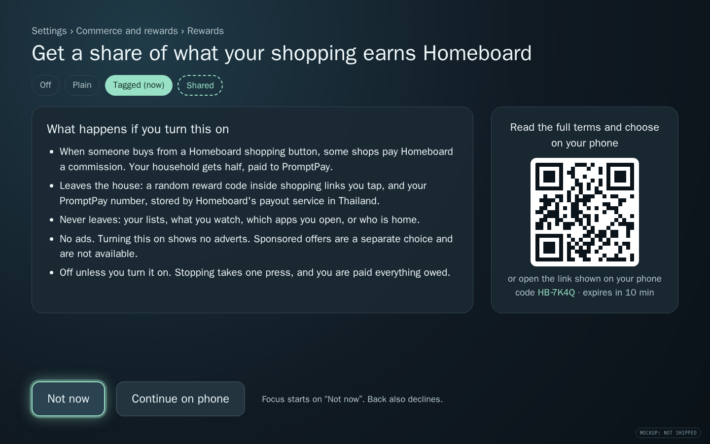](2026-11-19-ads-that-pay-the-user/tv-consent.html)

**TV opted out, with the guarantee.** On the left, the full build with Commerce set to Off and the no-ads guarantee in plain words. On the right, the About dialog of the no-commerce build.

[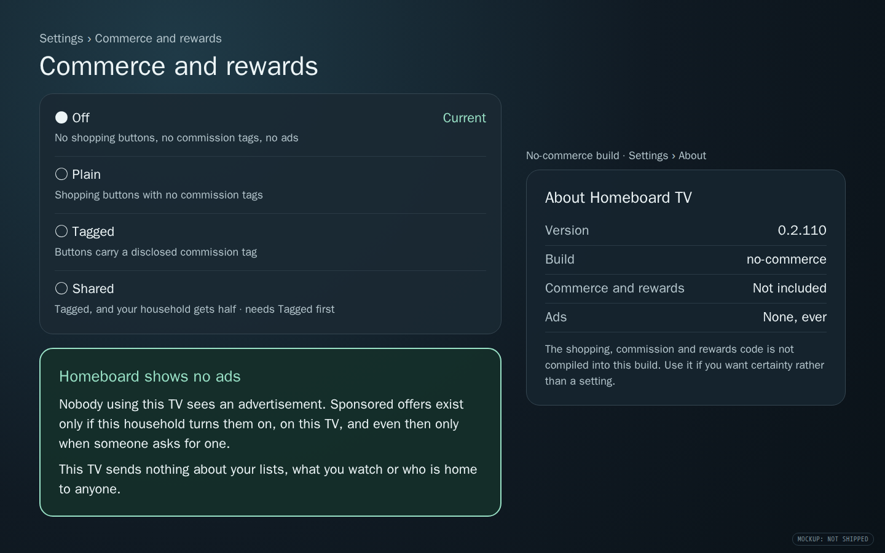](2026-11-19-ads-that-pay-the-user/tv-opted-out.html)

**Phone consent, in three steps:** what the household agrees to, where to pay it, and done. Sponsored appears as "not available", with its own separate consent later.

[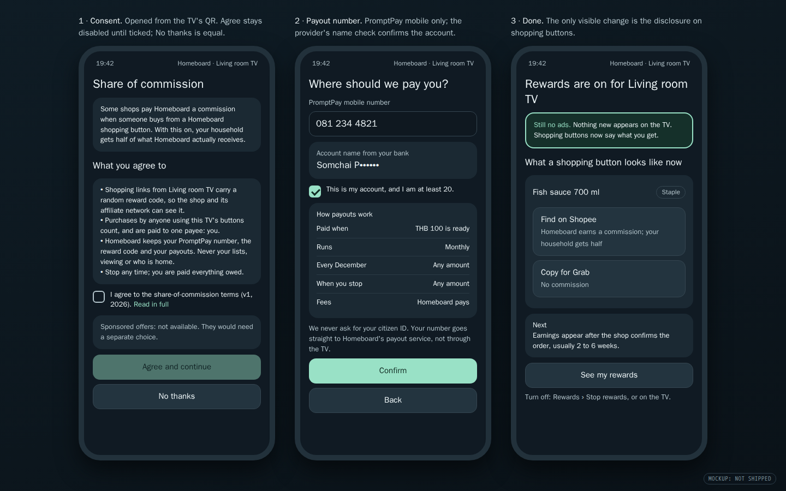](2026-11-19-ads-that-pay-the-user/phone-consent.html)

**Phone opted out.** Three states: commerce Off with the guarantee; Tagged, showing the commission disclosure without a share; and a phone that is opted in on another TV, paired to a TV that is not, where nothing carries over.

[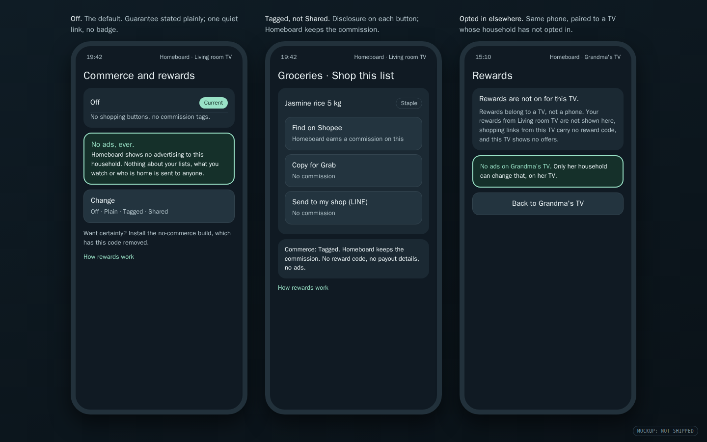](2026-11-19-ads-that-pay-the-user/phone-opted-out.html)

**Phone earnings and payouts** for a household in Shared: confirmed, waiting and received amounts, progress to the threshold, payout history, and Stop rewards.

[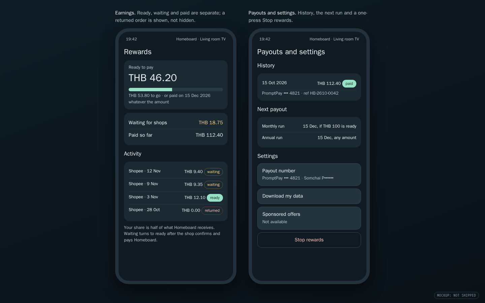](2026-11-19-ads-that-pay-the-user/phone-earnings.html)

**Phone payout problems.** Three states: below the threshold, a rejected transfer ("still owed to you", with automatic retries), and winding down after Stop rewards.

[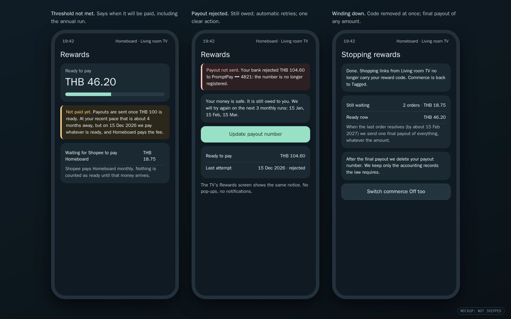](2026-11-19-ads-that-pay-the-user/phone-payout-problems.html)

**Narrow phone.** The earnings and payout-error pages at 320 CSS px width, without horizontal scrolling.

[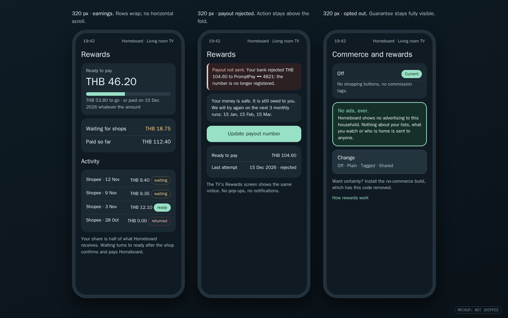](2026-11-19-ads-that-pay-the-user/phone-narrow.html)

**TV Rewards card and full screen.** The 2×1 Home card and its full screen: earnings, history, Stop rewards and the management QR code, with Back and a visible **Restore dashboard**.

[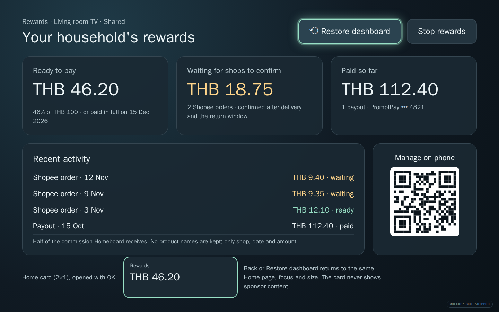](2026-11-19-ads-that-pay-the-user/tv-rewards-full-screen.html)

**Stage 3 sponsored offer (gated, not in the pilot).** The household pulled it, it is labelled, it pays a fixed amount within the daily cap, it converts only by QR code, and it is the same for every household.

[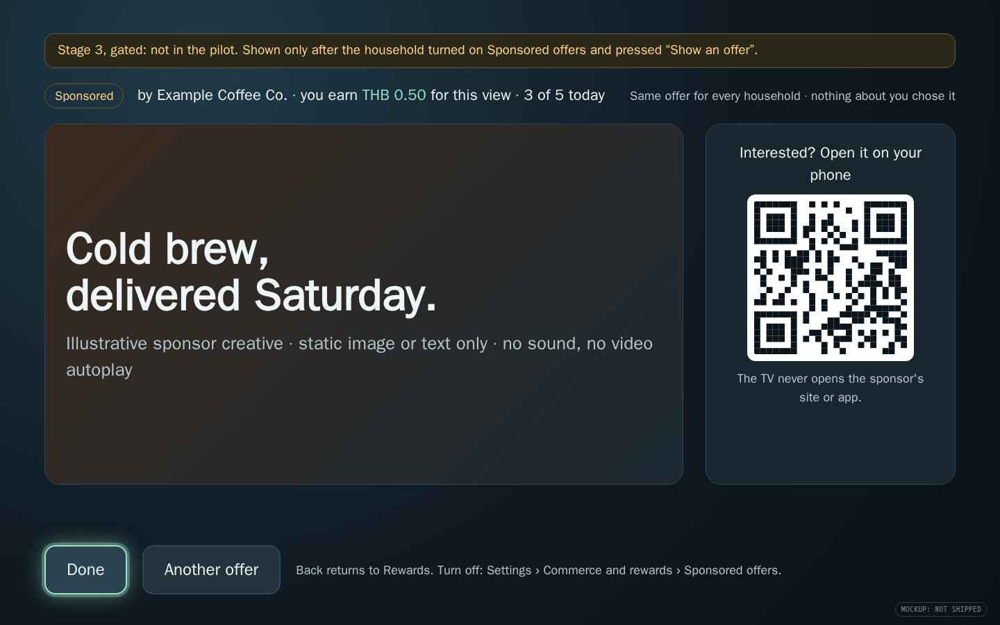](2026-11-19-ads-that-pay-the-user/tv-sponsored-offer.html)

The PNGs were captured in the project's Playwright container, as the other plan bundles were, at a 1440×900 viewport. The host has no browser tooling.

## Out of scope

- **The commerce setting (Off, Plain, Tagged) and tagged shopping links.** They are a prerequisite and need their own plan, covering the investigation's steps 3 and 4 and Groceries Phase 2 links.
- **Any ad SDK, AdMob included.** Rejected in section 1.
- **GrabRewards integration.** Stage 2; it needs a Grab partnership, which is not to be sought without Will's authorization.
- **Sponsor sales, an ad server and sponsor reporting tools.** Stage 3, gated.
- **Targeting of any kind**, including contextual targeting from lists or widgets. Ruled out, not deferred.
- **Google Play credit or gift-code payouts.** Rejected in section 2.
- **SMS one-time-code checks of the payout number.** The provider's name check plus the payee's confirmation is the v1 control; add OTP if misdirected payouts occur.
- **A charity payout option.** Will's decision.
- **Opening affiliate accounts, applying to networks, choosing a payment provider and engaging counsel.** These are human tasks that gate 0 and gate 1 need.

## Verification

These steps are the acceptance spec for the implementation. Nothing is implemented by this plan, so nothing here has been run yet.

1. **Gates recorded.** `docs/investigations/` holds dated evidence of gate 0 (offer terms allowing cashback and a sub-ID) and gate 1 (counsel's written view on L1 to L5) before any Rewards code is merged.
2. **No-commerce build is clean.** `task build` produces both flavours. A new `task check:nocommerce` runs `apkanalyzer dex packages` on the `nocommerce` APK inside the build container and finds 0 classes under the commerce and rewards packages, 0 occurrences of the Rewards service hostname, and no phone Rewards assets.
3. **Opted-out households send nothing.** A Playwright check in `mcr.microsoft.com/playwright:v1.59.1-noble`, extending `task phone:check`, loads the phone controller fixture in the Off, Plain and Tagged states. It records 0 requests to the Rewards service, 0 links containing a reward code, and the guarantee text present.
4. **Decline is the default.** A container unit test asserts that the TV Rewards offer opens with focus on **Not now**, and that the phone's Agree button is disabled until the consent box is ticked.
5. **Withdrawal is immediate.** After Stop rewards, the next minted shopping link carries no reward code (unit test), and the service rejects new conversions for a withdrawn code after the validation window.
6. **State is per TV.** A two-fixture browser check pairs one phone to TV A (Shared), then to TV B (Off). On TV B it shows no Rewards page, no reward code in links and the "not on for this TV" notice.
7. **Ledger and payouts are correct.** Service tests with a fake network and a fake provider check that:
    - only received money becomes payable;
    - a reversal after payment never claws back;
    - running the payout twice for one run makes exactly one provider call;
    - a rejected transfer returns the amount to payable and retries on the next 3 runs;
    - the annual and final runs pay below the threshold.
8. **Data is dropped at ingest.** A service test feeds a network report containing product names and categories, and asserts that the stored record holds only reward code, merchant, date, commission and status.
9. **The Rewards widget restores the dashboard.** On Cast1, through the coordinator workflow in the [Chromecast how-to](../how-to/chromecast.md): open the Rewards full screen from the card with short OK, then check that Back and **Restore dashboard** each return to the original Home page, widget focus and saved size. Screenshots go in the testing record.
10. **The Play build has no Sponsored code.** If a Play flavour exists, the same `apkanalyzer` check as step 2 finds 0 Sponsored classes.
