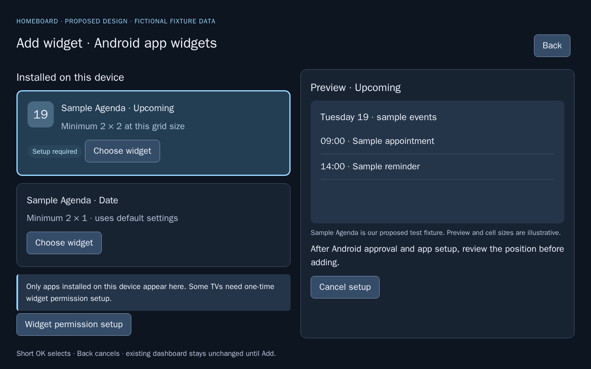
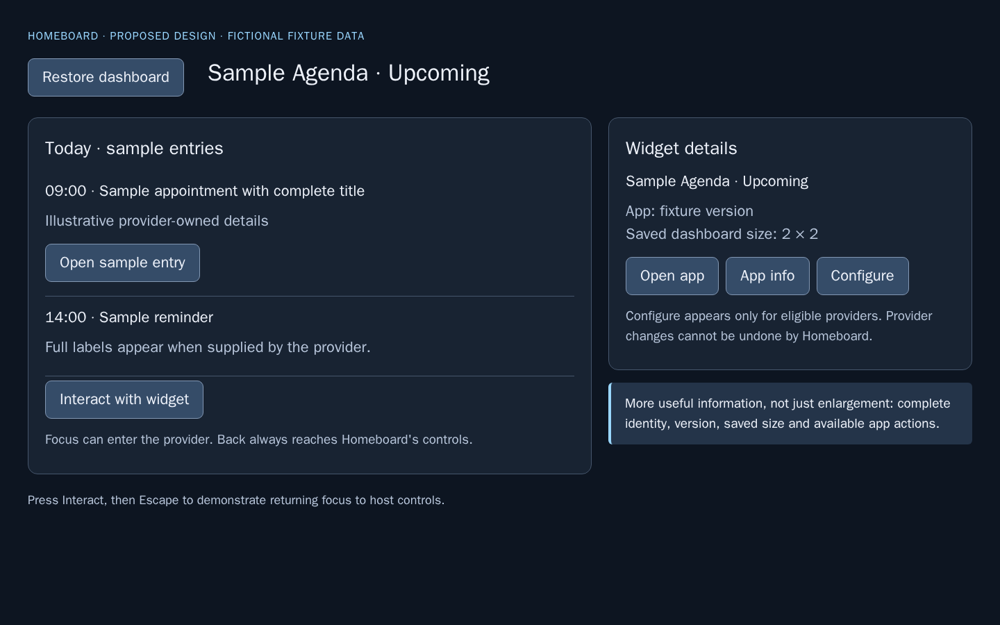
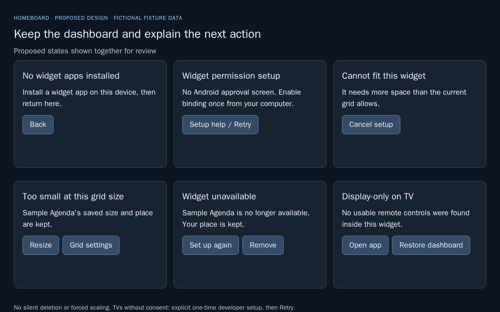
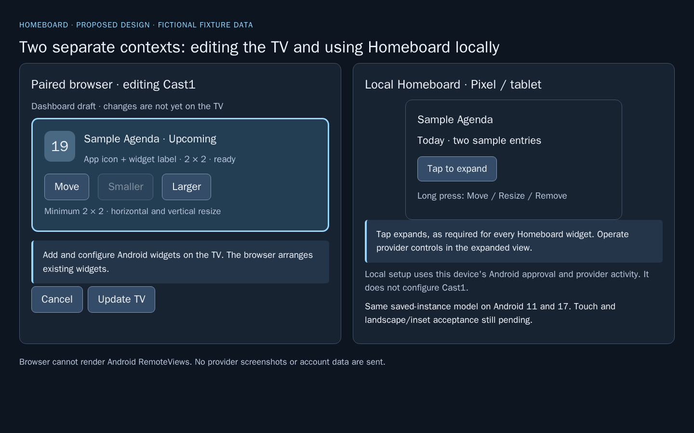
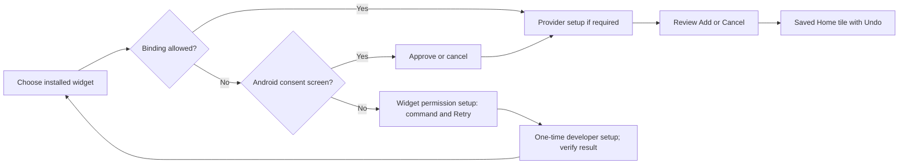
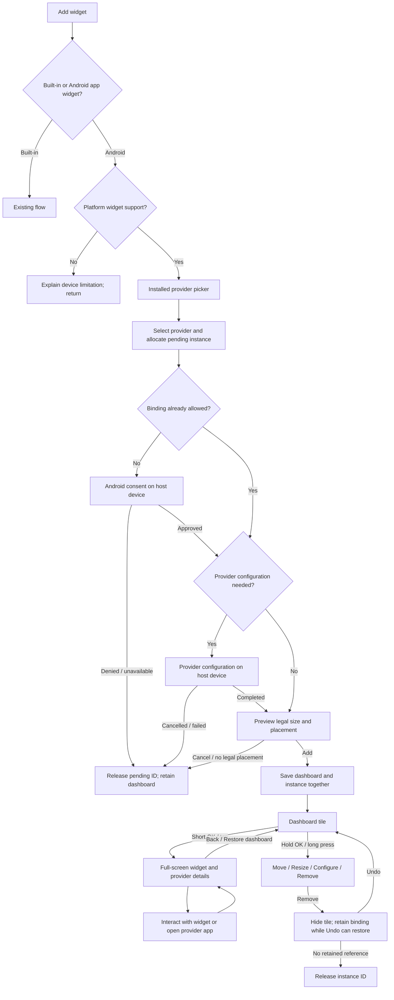
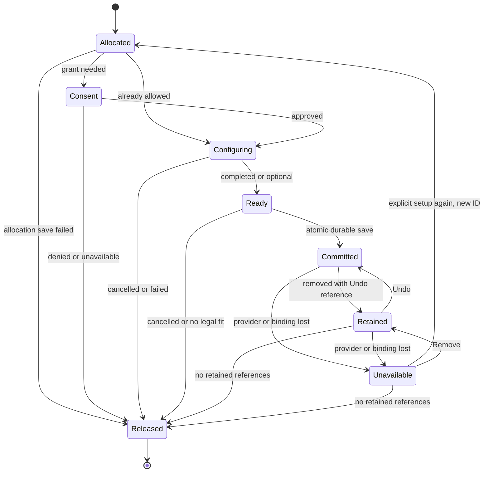
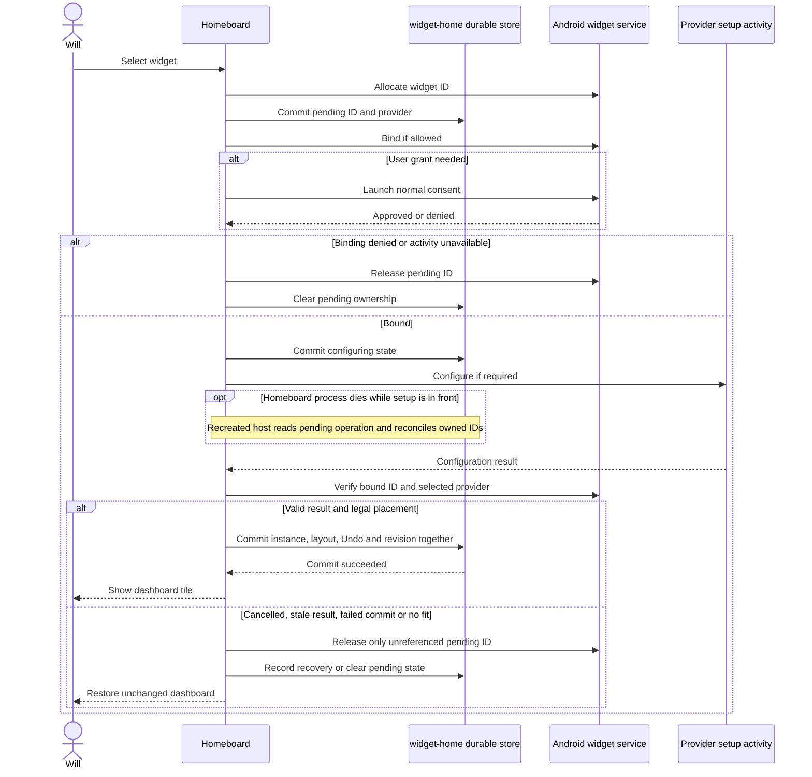
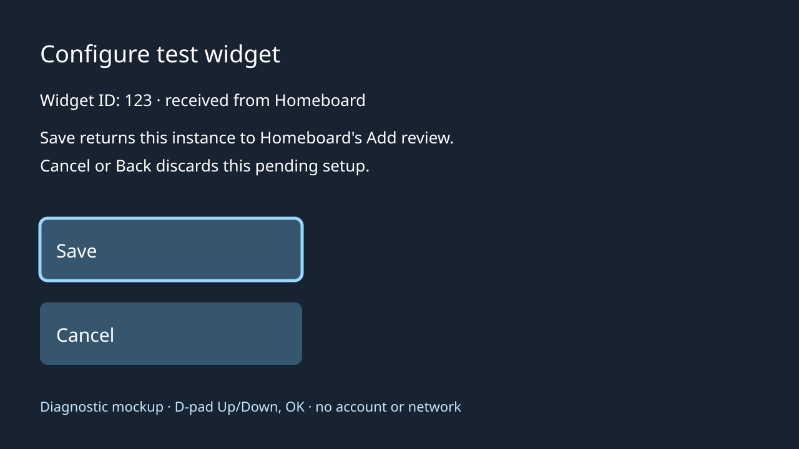
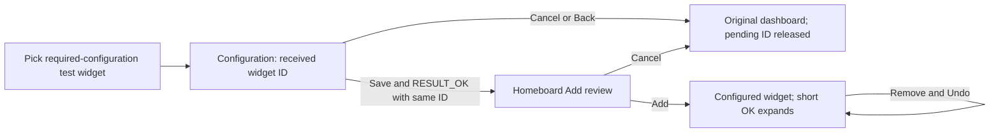

# Android app widgets on Homeboard

Status: **developer-grant binding/rendering proved on Cast1 and Cast2**, November 19, 2026. Both lack the ordinary binding-consent screen; the explicitly authorized disposable-host experiment succeeded with a temporary developer grant and verified grant/ID restoration. Homeboard host integration is implemented in 0.1.95 and installed on both TVs. Cast1 normal-menu fixture rendering/expansion and Cast2 isolated host/phone-Undo assertions passed; a real Breezy placeholder was added/expanded/undone on Cast2. Broader provider/mobile/resource checks remain open. See [measured results and captures](../testing/2026-11-19-android-app-widgets.md). Pixel's resolver/provider census passed (172 components); tablet remains unverified.

Host widgets supplied by other installed Android apps alongside Homeboard's own
Groceries, Timers & alarms, Rain, Calendar, Air quality, Favorites and World clock. Start with one working
provider on Cast1, then verify the same host on Cast2, Pixel and tablet before
claiming support across devices. This is the next implementation direction agreed
with Will; a custom Homeboard plugin API can wait.

[Mockup gallery](2026-11-19-android-app-widgets/index.html) ·
[Original critique](2026-11-19-android-app-widgets/critique-original.md)

[](2026-11-19-android-app-widgets/picker.html)
[](2026-11-19-android-app-widgets/expanded.html)
[](2026-11-19-android-app-widgets/recovery.html)
[](2026-11-19-android-app-widgets/phone.html)

## Authorized developer-grant experiment

Will authorized testing the developer/ADB grant route on November 19 ("let's find
out"). This supersedes the earlier no-shell-grant restriction **for this bounded
experiment**, not for general public setup. Work stays in coordinator-owned jobs.
The disposable-host experiment below is complete. The later implementation authorization permits one-time binding setup for Homeboard itself through a narrowly scoped coordinator workflow, with the original value and an inverse operation recorded.

```mermaid
sequenceDiagram
    participant C as Coordinator-owned check
    participant A as Android widget service
    participant H as Disposable host
    participant P as Separate fixture provider
    C->>A: Record original user-0 grant
    C->>A: Temporarily grant fixture binding
    C->>H: Launch frozen fixture APK
    H->>A: Allocate and bind provider instance
    P-->>H: RemoteViews content
    H->>H: Render and preserve visible proof
    H->>A: Release owned widget IDs
    C->>H: Run fixed cleanup receiver
    C->>A: Restore original grant and verify
    C->>C: Restore previous foreground; export evidence
```

A normal ungranted baseline must fail to bind the separate provider. Success in
the granted run requires the actual provider view to render known text and release
its widget IDs, not merely a successful shell command. Cleanup must restore the
original grant even after failed rendering or a crashed host; unreadable originals
block the change. One live test ID, a fixed provider and no household data. The
coordinator check option must be restricted to this fixture and frozen APK, held
during Personal use, with crash-safe grant restoration. CLI/MCP use the same typed
recipe; GUI shows the job/evidence and follows the same policy. Build/test the
coordinator change, prepare a reviewed release and use its administrator deployment
workflow before submitting device work. No direct-device fallback.

Visible probe: heading "Android widget binding test", state "Bound and rendered"
or "Binding not allowed", provider content region, and "Test widget released".
This is a diagnostic screen, not a new Homeboard product workflow. It follows the
existing mockups' clear state/recovery pattern. Repeat on Cast2 only after Cast1
restoration is verified. Real Fossify/Breezy compatibility and Homeboard integration
remain separate later acceptance.

## Homeboard implementation and TV setup

Will's request to implement follows the successful two-TV experiment. Normal
Android consent remains the first path on phones/tablets. TVs without that screen
show **Widget permission setup**, the installed Homeboard package and the exact
one-time developer command. Nothing changes automatically when this screen opens.
After setup, choose the widget again; approvals persist for that installation.
The command is a human setup instruction. Agent-owned device setup uses a typed
coordinator `widget-binding` recipe, limited to the registered Homeboard debug or
public package, user 0 and a frozen installed APK. It records before/target values,
journals before changing the grant, verifies readback and gives an inverse recipe.
It does not launch an app or modify existing widget IDs or default Home. Foreground
settings policy applies. CLI and MCP submit the same recipe; GUI displays its job,
result and evidence. A dedicated GUI form is unnecessary for this developer setup.



Native one/two-choice setup, recovery and review menus keep their complete explanation in the unused left side of the pie menu. This preserves the command and minimum-size review instead of replacing them with breadcrumbs. The picker mockup's setup/help entry covers the developer path; update its copy
and recovery mockup to show that branch. The Cooper review favors one understandable
setup step, normal consent when available, and a named recovery action. This is
an advanced setup requirement, not a claim every Android provider supports TV input.

## Review decisions and design filter

Revised after reading all inline critiques on November 19. The original comments
are archived above; this document is the operative plan. Apply the shared
[Alan Cooper design filter](/home/will/docs/howtos/alan-cooper-design-filter.md).
The provisional profile is Will arranging a useful household dashboard from a TV
remote, with local touch and a paired browser as secondary contexts. Evidence is
his explicit request for widgets and all four devices; provider usability remains
an assumption until physical testing.

Ordinary scenario: choose an installed widget, approve normal Android consent,
configure only when necessary, and see it on Home. An interruption during setup
must preserve the old dashboard; a provider disappearing must preserve placement.
A return visit must require no repeated setup. Keep provider names and useful
content prominent; technical IDs remain in diagnostics.

| Critique | Disposition |
|---|---|
| Built-in count and housekeeping | Corrected for Groceries; add a TODO entry. Commit only this work when ready, preserving concurrent timer edits. |
| Provider census and missing binding UI | Accepted as stage 0, with per-device stop criteria and an explicit coordinator capability check. No assumption that a stock inspect job collects these facts. |
| Memory and retained bindings | Accepted: four-view initial limit, comparative memory/wakeup checks, 24-hour test and named garbage-collection triggers. |
| Configure and no legal fit | Accepted: feature-gated reconfiguration, optional setup policy and explicit failure branch. |
| Touch pass-through | Not adopted: short tap must expand under the existing user requirement. Local touch interaction occurs inside expansion. Record the extra tap as a usability tradeoff and measure it. |
| Input boundary and browser representation | Accepted; mechanisms, constraint metadata and browser mockup specified below. |
| Old builds and schema | Accepted as a concrete deployment risk; add a schema and preserve unsupported instances in the new reader. Do not promise to change already released APKs or add an old-version compatibility framework. |
| Density policy | Accepted: keep position and saved span; show a too-small placeholder until an explicit resize or grid change fixes it. |
| Lifecycle diagrams and atomic storage | Accepted: full state and sequence diagrams; one durable preference transaction for host metadata and dashboard state. |
| Smaller milestones | Accepted for engineering checkpoints. Rejected the suggested user-facing build that deletes IDs on Remove or omits expansion: it would break Undo/full-screen requirements. |
| Defer Pixel/tablet | Not adopted as a scope reduction; keep them in acceptance, with first foreground proof on Cast1 and mobile checks pending while unreachable. |
| Runnable verification and mockup format | Accepted; commands/deliverables and self-contained 1440×900 HTML/PNG screens specified below. |

Disposition: **conditional on the stage-0 device gates**, not a claim that widget
hosting is available. Mockup checks establish the proposed workflow only; physical
interaction and memory behavior still need implementation evidence.

## Scope and evidence

| Device | Evidence available now | Acceptance still required |
|---|---|---|
| Cast1 · Chromecast HD · Android 14 | Feature/service and temporary-grant rendering proved; Homeboard 94 installed with explicit binding enabled. | Foreground host/provider acceptance and longer lifecycle/resource checks. Default foreground test target. |
| Cast2 · Chromecast 4K · Android 14 | Feature/service present; no normal consent screen. Temporary grant and Homeboard 94 host acceptance passed; later census found 17 providers. | Configured real-provider data, interaction, lifecycle and resource checks. |
| Pixel 8 Pro · Android 17 in coordinator inventory | Pixel supports ordinary home-screen widgets; Census completed: 172 provider components and a normal consent activity resolves. | Actual binding approval, app entry, touch, configuration, lifecycle and layout remain untested. |
| Lenovo Tab P11 Pro · TB-J706F · Android 11 | Product guide documents home-screen widgets; Homeboard hosting untested. | Same checks on Android 11 and a larger touch display. Currently unreachable through coordinator. |

Cast1 evidence: `artifacts/cleanup-tv/0.1.63/diagnostics/hardware-software.json`
and `artifacts/provider-compatibility/2026-11-18/inventory-before/hardware-software.json`.
Cast2 evidence: `artifacts/tv-4k-check/previous-display/hardware-software.json`.
That Cast2 inspection was of the previous display, not Will's new TV. HDMI 4K
output is unrelated to whether Android can host widgets.

Widgets belong to apps installed **on the device running Homeboard**. A widget
installed only on the Pixel cannot appear on Cast1 through this feature. Accounts,
provider permissions and any cloud synchronization remain the provider's concern.
No automatic Cast1/Cast2 configuration synchronization is included.

This changes the sequencing in the [widget/plugin investigation](../investigations/2026-11-19-widget-plugin-systems.md):
prove ordinary Android widget hosting before designing a new third-party contract.
It does not replace the native widgets or the separate Projectivy wallpaper API.

## Agreed test providers and stage-0 gate

Use these providers, agreed with Will:

| Provider | Purpose |
|---|---|
| Homeboard widget test fixture | Deterministic setup/cancel, independent instances, button/list interaction, update counter and size response. |
| [Fossify Calendar](https://github.com/FossifyOrg/Calendar) | Real calendar/agenda rendering, configuration and app handoff. |
| [Breezy Weather](https://github.com/breezy-weather/breezy-weather) | Real weather updates, layouts and resizing. |

The last two are candidates, not verified TV-compatible apps or known installed
providers. Pin a release, source URL, package, hash and version before installing;
use official release APKs and normal coordinator installation. Installing a
phone-oriented APK on a TV does not establish usable setup or remote controls.
Do not modify Will's existing calendar accounts or provider data for tests.

Before implementing the host, record a **provider census** and binding-activity
resolution separately on Cast1 and Cast2. Desired passive observations are the
installed providers/components, provider package versions and the resolver result
for `android.appwidget.action.APPWIDGET_BIND`. `dumpsys appwidget` and package
resolution are proposed coordinator-owned probes, never commands to run directly.
Inspect current coordinator support first: its fixed hardware inspection probes,
as read for this revision, do not include these observations. A successful normal
inspect alone is therefore insufficient. If no supported passive recipe exists,
record that gap and implement a minimal diagnostic activity using public provider
and resolver APIs, exercised through a coordinator-owned job, before the host UI.
Do not silently extend the shared coordinator or run arbitrary shell recipes.

Stop criteria are per device:

- No platform feature/service: stop hosting there and document unsupported status.
- No resolvable consent UI: stop new binding on a clean installation unless a
  normal API bind succeeds with an already valid user grant. Do not count an
  old grant as proof that new users can add widgets; never add a shell grant.
- Zero installed providers: record that fact, then test the agreed candidate APKs
  through the coordinator. An empty census alone is not a reason to cancel the
  user-requested feature. If neither real candidate can be installed/configured,
  keep the host at a fixture-only experiment and record the blocker before wider
  product work. No fixture-only release presented as real widget support.
- An unreachable or held device remains unverified; it does not cancel work on
  the other devices. Keep installation and foreground verification separate.

## User workflow

Keep **Home settings → Widgets / Restore → Add widget** as the entry point. Add an
**Android app widgets** choice alongside built-in choices. List installed providers
by app and widget name, with an available preview, minimum size and configuration
requirement. A preview is illustrative; labels/icons are sufficient when absent.
Never label an untested provider “TV compatible.”



Consent and provider configuration run on the host device. If the firmware has no
usable consent activity, show **Android widgets cannot be added on this device**
with the specific failure and a Back action. Do not require root, shell permission
grants, an accessibility workaround or changing the default Home app.

Configuration policy: during addition, honor `WIDGET_FEATURE_CONFIGURATION_OPTIONAL`
on API 31+ by using provider defaults, with Configure offered later only when the
provider declares `WIDGET_FEATURE_RECONFIGURABLE` (API 28+) and has a resolvable
configuration activity. Otherwise required configuration runs before Add. A
non-reconfigurable provider gets an explanation and separate **Remove** and
**Add widget** routes; never perform a destructive remove/re-add automatically.
Android feature flags are hints, so test actual completion and cancellation.
See [provider feature flags](https://developer.android.com/reference/android/appwidget/AppWidgetProviderInfo#widgetFeatures).

An empty picker explains **No widget apps installed on this device**. It is a
normal state, not a download failure. Provider discovery is local; app-store
discovery, APK downloads, pin requests from other apps and work-profile widgets
are follow-ups, not prerequisites for v1.

## Compact and full-screen behavior

Preserve the [full-screen contract](2026-11-17-widget-full-screen.md): short OK or
tap opens expanded detail; hold OK or long press opens Homeboard actions. The
dashboard wrapper owns focus and input, so embedded provider buttons do not
accidentally launch apps while navigating the dashboard.

Expanded presentation contains the live widget at a useful provider-supported
size, plus a detail pane with the complete app/widget name, app version, saved
dashboard dimensions, available provider configuration and **Open app / App info**
actions. This is additional information, not just a stretched tile. Show only
actions Android can resolve. When the provider exposes further data through its
own controls, make those accessible in the expanded view. Do not promise a
weather history or calendar detail that the provider does not supply.

Keep **Restore dashboard** visible outside the provider view. Provide a focusable
**Interact with widget** action: entering transfers D-pad focus into provider
controls; Back returns to the host controls before another Back restores Home.
Touch can operate the provider inside the expanded body. In compact mode use
`FOCUS_BLOCK_DESCENDANTS` and intercept touches with `onInterceptTouchEvent`;
long press belongs to the wrapper. In expanded Interact mode use
`FOCUS_AFTER_DESCENDANTS`. Edge navigation in a provider list/grid/stack remains
inside the expanded window, never paging the underlying dashboard. The host must retain an
escape path even for a widget with no usable remote focus targets. Such a provider
may be display-only on TV; record that limitation per provider rather than
inventing universal D-pad support or synthetic click coordinates.

Restoration preserves originating page, tile focus, placement and saved size,
including return from a provider activity. Expanded resizing is temporary. One
live host view per instance is moved between compact and expanded containers (or
recreated through the same owner); do not create competing live views for one ID.
Restore the compact size options when leaving expansion. Keep hidden pages from
needlessly inflating all provider views.

The mockup's “Sample Agenda” is a proposed test fixture, not an installed app or
compatibility claim. Provider content keeps the provider's own language and
appearance; Homeboard controls receive English and Thai translations.

## Java implementation boundaries

Use the platform `AppWidgetHost`, `AppWidgetHostView` and provider `RemoteViews`.
Keep a stable host ID within each Homeboard package and a distinct Android widget
ID per instance. Homeboard owns saved layout; providers own their content.
See [Android's host guide](https://developer.android.com/develop/ui/views/appwidgets/host).

Suggested small components, names to confirm during implementation:

- `AndroidWidgetHostController`: host ownership, lifecycle listening, view creation,
  capability checks, provider changes and pending add/configuration results.
- `AndroidWidgetInstances`: durable records keyed by a Homeboard instance key such
  as `widget:android:<uuid>`, containing provider component, Android ID and state.
- `AndroidWidgetTile` / `AndroidWidgetExpanded`: compact wrapper, expanded content,
  input boundary, sizing and errors integrated with `WidgetExpansion`.

Extend `WidgetKind`, `HomeLayout` serialization/validation, native rendering,
widget actions and phone configuration deliberately. Existing built-in behavior
must survive an upgrade. No general plugin runtime, service or host-side Java/SDK
installation is needed.

Persist an explicit layout `schemaVersion` and guard unknown widget kinds before
render/expand/configure dispatch. Unsupported keys are retained as inert
**Widget not supported by this version** tiles; unknown records must survive
save, Undo and browser transactions unchanged. A newer unsupported schema opens
read-only with the original bytes retained instead of normalizing or replacing it.
Tests cover both cases with synthetic documents. This hardens the new reader;
it cannot make previously released readers safe. The deployment owner must merge
intended worktrees and prohibit older frozen builds from overwriting this feature's
saved layout. Do not install an older build on Will's live dashboard to test this:
use a disposable fixture state/container test. No speculative migration framework
or preliminary deployment of a separate compatibility layer is required.

Declare binding permission and use the normal bind/consent flow. Bind before
starting required provider configuration; verify the result against the saved
pending operation and current provider before committing. Persist pending state
before leaving Homeboard so recreation or process death cannot lose ownership.
Refer to [binding APIs](https://developer.android.com/reference/android/appwidget/AppWidgetManager#ACTION_APPWIDGET_BIND)
and [host lifecycle/configuration APIs](https://developer.android.com/reference/android/appwidget/AppWidgetHost).

Calculate provider bounds in dp from the actual available content rectangle,
including host padding and grid gaps. ProviderInfo dimension fields returned to
the host are in pixels: convert them with the same density before comparing dp
bounds; do not treat those integers as dp or cell counts. Respect provider minimums, resize axes and
maximums where supported. Publish size options after committed resize, orientation
or display changes and temporary expansion. Use API-level guards for platform
features newer than the existing minimum Android version; this is required
platform support, not a new legacy abstraction. Reject an impossible fit with a
useful explanation instead of silently clipping it or deleting another widget.

### Provider sizes and global grid changes

Calculate cell pitch from the measured grid rectangle after margins; for an axis
with `n` cells and gap `g`, a span `k` has content extent `k * pitch - g - padding`.
Convert measured px to dp using current density, rounding available space down
and required minima up. The minimum legal span is the smallest `k` whose content
extent reaches the provider bound. Initial size uses `minWidth/minHeight`; an
allowed resize axis uses its positive `minResizeWidth/minResizeHeight`, otherwise
the initial bound. Respect declared maximum resize dimensions where present.
Translate S/M/L to the existing proposed grid spans, then clamp to legal spans on
resizable axes. Non-resizable axes keep their initial extent. Do not assume a
provider's target-cell hints use Homeboard's grid metrics. A picker minimum such as
2×2 is derived for the **current device/grid**, not stored as a universal minimum.

For a global column/row/default-size/display/density change, allow the change and
preserve saved placement and span. If the new content rectangle is below provider
minimum or above a binding maximum, render **Too small at this grid size** (or
**Size not supported**) with Resize and Home grid settings actions. Do not inflate
or shrink the provider view into an illegal rectangle, delete the tile, move
neighbors without consent or silently enlarge its saved span. Revalidate visible
views when dimensions change; clear the placeholder automatically when legal.
Explicit tile resize rejects illegal candidates before save with the named reason.
Apply the same calculation and validation to native and paired-browser editing.

For Pixel/tablet, audit launch entry and touch access first: the current activity
has HOME and LEANBACK_LAUNCHER filters and requests landscape. Add a normal app
entry if needed, without requiring default-launcher selection. Include a compact
touch layout, insets, readable controls, scrolling and recreation checks. A full
portrait redesign is outside this feature; document the chosen orientation and
test returning from portrait provider configuration. Do not claim mobile support
from widget capability alone.

## Persistence, removal and Undo

Model an add as `allocated → awaiting consent → configuring → ready → committed`.
Cancellation, denied consent, unavailable activities and failed placement release
only that pending ID and leave the dashboard unchanged. Make cleanup repeatable.
Use the existing `widget-home` SharedPreferences and extend the
`PhoneConfigurationStore` transaction boundary with `android-widget-instances`
and `android-widget-pending`. The committed instance map, layout, Undo and revision
must share one editor and successful synchronous `commit()` before reporting Add
or Remove complete. Pending transitions are committed before launching external
UI. Platform allocation cannot participate in that transaction: reconciliation
must recover any ID allocated just before a process or persistence failure.
Never garbage-collect against unreadable records; retain them for recovery.

On startup reconcile host-owned IDs with the durable instance records, current
layout, pending operation and retained Undo snapshots. Recover interrupted commits
without deleting a valid binding.



Setup again retains the old logical key and original state until the replacement
binding is durably ready. Commit the replacement mapping and matching Undo record
atomically; retain any previous binding referenced by history. Cancelling replacement
leaves the unavailable tile in place.



Result processing is idempotent. After recreation, check the saved phase and real
binding before resuming; do not infer configuration success from a non-null widget
info record alone. If the result cannot be recovered, offer Retry setup / Cancel,
retaining the pending ID until a deliberate resolution. A save failure must not
report success or remove metadata needed to retry cleanup.

Removing a tile immediately changes the layout but **does not immediately delete
its Android ID**. Retain the binding while any retained Undo snapshot references
it. Undo restores the same instance and provider configuration. Garbage-collect
only when no live layout, pending operation or retained snapshot references the
ID; follow the existing Undo retention policy rather than adding a second undo
stack. A hidden binding can persist for the existing 20-snapshot history, possibly
days; this is an explicit provider-wakeup cost of preserving configuration.
Run reference-based garbage collection after successful history eviction, native
or browser Undo/commit, cancelled addition and startup reconciliation. Delete an
ID only after its references have durably disappeared; a failed platform deletion
is retried next time. Hidden retained IDs have no inflated host view. Test
add→Undo, remove→Undo, several later edits, restart and final cleanup.

Provider configuration, provider-side data edits and app uninstall are external
effects; Homeboard Undo restores layout, not those external effects. Explain this
beside Configure when needed. If a provider is removed or its binding disappears,
keep the tile's place with **Widget unavailable** and **Set up again / Remove**.
Reinstallation may require fresh consent/configuration; never silently replace
the provider or claim its old configuration was recovered.

## Phone editor

The existing paired browser editor can move, resize and remove already configured
instances using its shared draft and **Update TV** transaction. Reject invented
provider components/Android IDs from browser requests; browser clients reference
only host-owned instance keys. Draft cancellation must not release live bindings.

The browser renders a host-owned app icon (or generic fallback), full widget label,
saved grid size and state; it does not attempt to render `RemoteViews` or request
provider screenshots. Include read-only legal span ranges, resize axes, constraint
revision and fit status in the instance model. Disable illegal resize controls in
the browser and repeat validation against current host metrics on Update TV;
a changed grid returns a useful conflict without losing the draft. Provider IDs,
components and constraints are never accepted as browser-supplied authority.
Unknown/unsupported tiles remain present and read-only through browser edits.

Adding or configuring a third-party widget in v1 happens on the host device. Show
**Add and configure Android widgets on the TV/device** in the browser rather than
launching an external activity while a draft is being edited. Account sign-in and
provider data are not copied into the phone editor. A browser on Pixel controlling
Cast1 is distinct from Homeboard running locally on Pixel.

## Implementation sequence

0. **Census and feasibility.** Run the per-device stage-0 gate above before host
   implementation. Add the smallest public-API diagnostic only if the coordinator
   cannot supply the evidence. Store provider and resolver results explicitly.
1. **Controlled provider and host core.** Use a new fixture package,
   `net.biohack.homeboard.widgetfixture`, separate from the existing uninstall
   fixture. Build it in the container and install through coordinator jobs. Prove
   normal consent, required/optional/cancelled configuration, ID reconciliation and
   a fixed-size live view. Keep this an internal checkpoint, not a user-facing
   widget release without expansion/Undo.
2. **Minimum complete widget.** Integrate saved placement, one supported size,
   full-screen detail/interaction and Remove/Undo together. Exercise restart and
   external activity return on Cast1. Only this complete slice is eligible for a
   working Homeboard deployment to both TVs.
3. **Size and editing.** Add legal resize/S/M/L mapping, global-grid placeholders,
   density changes and paired-browser draft editing. Verify local app entry/touch
   on Pixel/tablet when reachable. Unreachable devices stay pending, not omitted.
4. **Real providers and resource acceptance.** Install pinned Fossify Calendar and
   Breezy Weather candidates via the coordinator, then exercise each usable widget
   on all four targets. Run the memory/wakeup comparison and the 24-hour check.
   Remove only the dedicated fixture through the coordinator's supported uninstall
   UI/job after acceptance; preserve user apps, data, default Home and real provider
   setup. Record any fixture cleanup left pending.
5. **Documentation and release.** Update quick start, printable guide source and
   generated PDF, full-screen guide, phone-editor guide and README. Record exact
   provider/version/device combinations, display-only limitations and mobile gaps.
   Keep public website claims limited to measured support.

### Resource budget and long-running check

Initially inflate at most **four Android widget views on the visible page**, with
one live view per instance and none for hidden/Undo-only instances. When a page has
more than four, show a labeled inactive tile that can open its live widget in full
screen; do not silently hide it. Expanded mode releases inactive compact views and
uses one live view. This is a conservative implementation limit to revisit from
measurements, not a claim that four arbitrary providers fit in memory.

On Cast1 compare zero, one and four fixture widgets, then repeat with real
providers. Record Homeboard and each provider's PSS/RSS where available, system
available memory, update counts and observable wakeups/bindings, including a
removed-but-retained instance. Baseline and samples must use comparable layouts
and intervals, noting unrelated foreground activity. Proposed initial acceptance
budgets: at most 64 MiB additional Homeboard PSS for four lightweight fixture views
and at most 16 MiB sustained growth after 50 expand/restore/page cycles; no crash,
ANR, persistent input lag or new repeated low-memory kills. Provider PSS is
reported separately; a large real provider may require a lower live-view cap.
If these hypotheses fail, reduce the cap or fix retention before release.

Run a coordinator-admitted 24-hour on-screen check on Cast1 with periodic evidence
and update counters; do not claim uninterrupted exposure if Personal use or device
availability interrupts it. Record interruptions and extend/repeat the exposure.
Sample at start, after warm-up, intermediate checkpoints and end. The coordinator
must own the session and its policy; never hold a device awake or take foreground
back through a personal-use hold. Keep this check open until actual evidence
exists; a short smoke test does not substitute for it.

## Verification and deployment

Run `task check`, `task build` and `task bundle` in the existing container workflow;
use `task build-image` if the build image changes. Add meaningful state-machine
tests for ID ownership, interrupted/cancelled adds, result mismatches, serialization,
Undo retention/cleanup and untrusted browser edits. Platform rendering and consent
require physical evidence; unit tests cannot establish those outcomes.

| Acceptance | Required evidence |
|---|---|
| Consent and configuration | Normal approval and denial, cancelled required configuration, missing activity, recreation while pending; no abandoned IDs. |
| Real rendering | Fixture and real provider views, updates while visible, return after Homeboard was stopped, two independently configured instances. |
| Input and expansion | Short OK/tap, hold OK/long press, provider interaction, nested Back, visible Restore, app launch/return; original page/focus/size restored. |
| Sizing | Legal minimums, resize axes, impossible fit, dense grid and expanded/compact option changes; no overlap or unreadable forced scaling. |
| Persistence | Relaunch and coordinator-supported device restart when admitted; configured content, placement and dimensions retained. |
| Undo and failure | Remove/Undo across restart, add/Undo, expired history cleanup, provider update/removal/reinstall and lost binding; native widgets unaffected. |
| Global grid change | A minimum-size widget becomes too small after columns/rows/density/default-size change; placeholder preserves state and recovers when legal. |
| Resource use | Zero/one/four views, hidden/retained IDs, 50 lifecycle cycles and recorded 24-hour exposure meet the budgets above. |
| Unsupported state | New reader preserves unknown keys and unsupported schema; deployment history shows no older branch overwrote the saved state. |
| Mobile | Local app entry without default Home change, touch targets, Android 11 and 17 behavior, configuration orientation and large text/insets. |
| Browser | Draft move/resize/remove, Cancel, Update TV and Undo preserve bindings; injected IDs rejected; setup remains on host device. |

### Numbered verification procedure

These are implementation acceptance steps, **not yet executed**. Commands marked
“deliverable” must be implemented before moving the TODO entry to `[verify]`;
unknown coordinator features are a capability gap, not a fabricated runnable job.
Paste command output, job IDs, captures and PASS/FAIL below each step in the testing
record. Do not mark pending/held/unreachable as PASS.

1. Run `task chromecast:version`, `task chromecast:devices`,
   `task chromecast:support DEVICE=chromecast-test-01`,
   `task chromecast:support DEVICE=chromecast-test-02` and `task chromecast:queue`.
   Expected: actual support identified for passive census, expected cross-app
   configuration, install, recording, profile and cleanup. Record missing support.
2. Run supported passive census jobs, watch and export each. If unavailable,
   use the stage-0 diagnostic activity through a complete supported job. Expected:
   typed provider list, package versions and binding resolver result for each TV;
   apply the stop criteria. Merely listing packages is not a provider census.
3. Run `task check`, `task build`, `task bundle` and `task widget-fixture`
   (deliverable). Expected: unit tests/lint/packaging and separate fixture APK pass.
   Include ownership failure/recovery, retained-ID GC, unknown-key/schema and
   browser-forged-ID tests. Never infer device rendering from these tests.
4. Run `task android-widgets:plan-check` (delivered by this revision). Expected:
   standalone HTML screens render at 1440×900, same-basename PNGs exist, no external
   assets/errors/overflow, bundle within the size limit. Then `task md --
   docs/plans/2026-11-19-android-app-widgets.md`; inspect flow, state and sequence
   diagrams and the embedded mockups visually.
5. Install/register the frozen fixture and candidate APKs through the coordinator's
   supported install jobs, recording hashes; run `task deploy` for Homeboard after
   merging intended feature work and comparing all worktree version codes.
   Expected: one incremented APK, identical bytes submitted to both TVs. Watch
   each job and export evidence; distinguish installed from foreground-verified.
6. Submit the reviewed native recipe at `dev/device/android-widgets-check.json`
   (deliverable) on Cast1, then Cast2. Expected: setup success/denial/cancellation,
   two independent instances, full-screen/app-return restoration, illegal-size
   rejection, global-grid placeholder, Remove/Undo/restart and provider loss
   match the acceptance table. Recipe must declare expected system/provider
   transitions; use an owned Remote session if automated cross-app work is not
   supported. Capture both ordinary and failure states.
7. Run `task android-widgets:phone-check` (deliverable). Expected: host-backed tile
   representation, legal resize, lost-draft prevention, Cancel/Update TV/Undo and
   forged-ID rejection pass. Then use supported coordinator jobs on Pixel/tablet
   for local launch/touch/configuration acceptance; report either result or pending.
8. Use coordinator profile jobs for the zero/one/four configurations and the
   50-cycle/24-hour scenarios above. Record each actual profile command/recipe and
   its supported metrics before running. Expected: measured budgets pass; missing
   PSS/wakeup support remains an explicit verification gap. Do not replace it
   with host `ps`, an unsupported shell recipe or guessed numbers.
9. Run `task guide` after updating the guide sources. Expected: generated print PDF
   and guides explain local provider installation, setup, expansion, removal/Undo
   and verified compatibility. Inspect page boundaries and translated controls.

Follow the [Chromecast workflow](../how-to/chromecast.md) and shared command policy
for every device operation: devices/queue, complete submitted job, watch and export
evidence. No raw ADB/Gradle installation or direct-device fallback. Use coordinator
support for expected Android consent/provider-activity transitions; an unsupported
foreground transition needs an appropriate coordinator recipe, not a guard bypass.

Use `task deploy` for each working build: advance the version once and install the
identical frozen APK on both TVs, preserving settings. Compare all active worktree
deployment numbers first. Cast1 remains the routine foreground target; explicitly
check Cast2 for this compatibility milestone. Let the coordinator admit background
installs and defer foreground work during Personal use. Pixel/tablet receive that
same frozen build through coordinator jobs when reachable; keep their acceptance
pending until then. Do not switch any device's default Home app just to test hosting.

Create `docs/testing/2026-11-19-android-app-widgets.md` during implementation with
source revision, build/hash, host and provider versions, receipts, actual captures
and outstanding checks per device. Mockups are design evidence only. Completion
requires the host contract above and recorded results, not merely a feature flag.

## Critique revision validation

November 19: `task android-widgets:plan-check` passed in the pinned browser
container. All five standalone 1440×900 HTML screens have PNG counterparts;
the check found no external asset requests, script errors or canvas overflow.
The Interact/Escape mockup focus transition passed. Bundle size was 726,445 bytes.
Recovery and phone-editor screenshots were visually inspected. These are design
checks, not native Android acceptance.

`task md -- docs/plans/2026-11-19-android-app-widgets.md` completed and opened the
revised document in the browser. Output contained three rendered mechanism
diagrams and no raw Mermaid fallback. Local plan links resolve, and
`git diff --check` passed. The current Taskfile has no `todo:lint` command;
the new TODO entry follows its existing in-progress format.

The later implementation pass built/linted the diagnostic APK, verified identical
installation on both TVs, and completed the Cast1 census. That failed the ordinary
consent gate; host acceptance remains pending. The isolated
`feature/android-app-widgets` worktree is prepared for implementation, keeping
the separate in-progress cooking-timer edits untouched.

## Required-configuration follow-up · November 20

The implemented host was first deployed as 0.1.95 on both TVs. Real-provider checks on
Cast2 found that Fossify Calendar launches and accepts D-pad focus, while selecting
its event-list widget returns to Homeboard without reaching configuration or Add
review. A controlled required-configuration provider reproduced the same result.
Diagnostic build 0.1.96 established successful binding followed by Android 14's
`BAL_BLOCK` of the system-created configure IntentSender. Build 0.1.97 supplies the
explicit sender ActivityOptions opt-in for setup/reconfiguration; on-device
Save/Cancel and real Calendar setup passed on Cast2 in J‑5201a9261061. Both test
additions were undone and the TV released. Interruption/retry, reconfiguration
and independent binding-deletion checks remain open. See the
[testing record](../testing/2026-11-19-android-app-widgets.md#cast2-required-configuration-acceptance--0197).

Before treating required configuration as accepted:

- Extend the disposable provider with a separate required-configuration widget,
  retaining its existing no-configuration widget as a control. Show the received
  widget ID and offer remote-accessible Save and Cancel; log launch and result.
- Through normal Homeboard menus, verify Save reaches Add review with the same ID,
  Cancel leaves the dashboard unchanged, and interruption preserves Retry/Cancel.
  Inspect bindings so cancellation releases only the disposable pending instance.
- Use those results to isolate any host handoff defect, then repeat Fossify's
  required configuration. Keep configured-provider acceptance open until actual
  configuration and rendering are observed.

This diagnostic uses the existing setup/review workflow. Any product workflow
change still requires current mockups and workflow diagrams before implementation.

Diagnostic UI review applies the shared [Cooper filter](/home/will/docs/howtos/alan-cooper-design-filter.md).
The operator's goal is to establish whether Android delivers a widget ID and result
across applications using the TV remote. A single screen shows the received ID,
Save and Cancel, with Save initially focused. No data entry, network or account is
needed. Back cancels; Save only configures the disposable provider instance and
still requires Homeboard's separate Add review. Invalid/missing IDs cannot save.
Disposition: launch, Save, Cancel and restoration passed on Cast2 in 0.1.97;
interruption and independent binding-deletion checks remain conditional.





## References

- [Widget and plugin investigation](../investigations/2026-11-19-widget-plugin-systems.md)
  and its [Android host notes](../investigations/2026-11-19-widget-plugin-systems/research-notes/native-widget-hosts.md).
- [Android widget host guide](https://developer.android.com/develop/ui/views/appwidgets/host),
  [AppWidgetHost reference](https://developer.android.com/reference/android/appwidget/AppWidgetHost),
  [AppWidgetManager reference](https://developer.android.com/reference/android/appwidget/AppWidgetManager),
  consulted November 19, 2026. Check public API availability against compile SDK 34
  and the project's supported Android versions before implementation.
- [Provider feature flags](https://developer.android.com/reference/android/appwidget/AppWidgetProviderInfo#widgetFeatures), checked during critique revision.
- [Pixel widget instructions](https://support.google.com/pixelphone/answer/2781850?hl=en)
  and [Lenovo's TB-J706F/TB-J706L user guide, mirrored copy](https://device.report/m/2f51abb09dfa17dc1bbf442e6e0280037853825f3877289ba0e64a78e4fc19a2).
