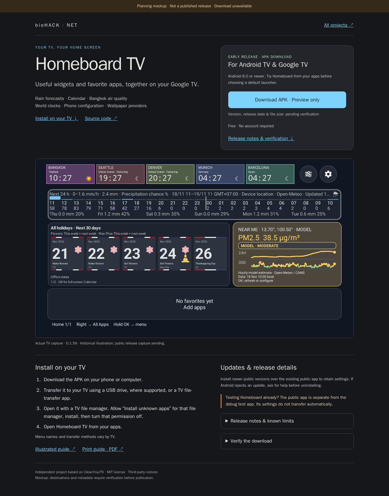
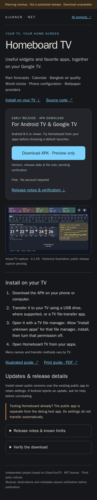
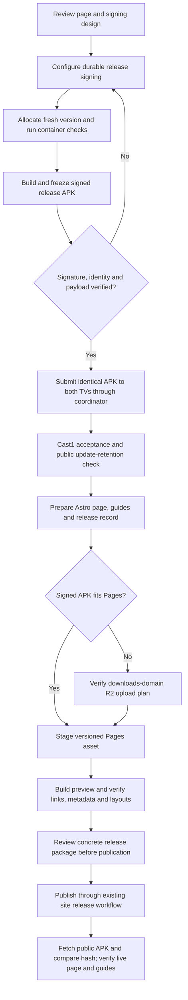

# Publish Homeboard TV APK downloads on biohack.net

Status: published, 2026-11-19. The signed public APK and updated guides are live
at **https://biohack.net/homeboard/**. The mockups below remain planning references.

## Implementation and publication record

- Public early release **0.1.73**, package `net.biohack.homeboard`, uses a durable
  private signing key and a separate local backup. `task release` verifies the
  signed APK; `task deploy VARIANT=release` freezes one numbered artifact and
  submits it to both TVs under a separate public-app catalog entry.
- The Astro page, homepage link, immutable APK/source downloads, build-time hash
  validation, licenses and source ledger are implemented in `../biohack.net/`.
  Publication uses the existing Cloudflare Pages project; its old tag-driven
  deployment workflow is absent. The deployed site was built from an isolated
  copy of the current site revision, preserving unrelated working edits.
- Markdown, print HTML and the two-page A4 PDF use the public download address.
  The printable guide has a verified QR code. The page offers **User guide** and
  **Printable PDF**; print HTML remains accessible from the guide.
- The page includes the verified 0.1.74 test-dashboard capture with YouTube in
  Favorites, labeled with its capture version. Release-note bullets are indented
  inside their card, including on phones.
- Cast1 public-app acceptance passed after handling Android's initial location
  prompt through the coordinator. Both TVs have verified 0.1.73 installation
  evidence; Cast2 foreground verification remains deferred during Personal use.
- Live download verification matched the frozen APK's SHA-256. Published page,
  guides, PDF, image, licenses and checksum links were checked over HTTPS.

See the [publication verification record](../testing/2026-11-19-apk-publication.md)
for hashes, deployment evidence and the precise device-testing limits.

## Outcome

Replace “Get the Homeboard APK from the project maintainer” with a public,
maintainer-owned download page at **https://biohack.net/homeboard/**. Someone
setting up their own TV can download the current signed APK, follow illustrated
installation instructions, and find updates without contacting Will.

Use the existing Astro/Cloudflare Pages site in `../biohack.net/`. Keep the
Java Android app and its container build workflow. Google Play distribution,
automatic in-app updates and a new dashboard backend are outside this milestone.

## What the checkouts show

- `docs/how-to/quick-start.md` and `quick-start-print.html` contain the maintainer
  handoff; the PDF is another delivery format of the guide.
- `launcher/app/build.gradle` defines release ID `net.biohack.homeboard` and
  debug ID `net.biohack.homeboard.debug`, minimum API 26, with release signing
  explicitly unconfigured. Debug also includes a wallpaper fixture library.
- `version.properties` currently reads `0.1.69`. This is an observation, not the
  proposed public release number. Allocate a new number when building.
- `task build` produces a debug APK; `task bundle` produces an unsigned release
  bundle. Neither currently provides the signed release APK this page needs.
- biohack.net uses static Astro routes, `src/layouts/Base.astro`, shared styles,
  and `public/` for static files. Its `Taskfile.yml` exposes build/test/link
  checks and tag-and-push publication commands. Inspect the actual deployment
  integration before implementation; this checkout has no main deploy workflow
  under `.github/workflows/`.
- The site's earlier [APK download plan](../../../biohack.net/docs/plans/2026-10-29-bsnes-jg-product-downloads.md)
  documents `downloads.biohack.net` and R2. That is a reusable option if needed;
  this session has not audited the live bucket or its permissions.

## Page and mockups

The page leads with what Homeboard does, a real dashboard capture, one **Download
APK** action, version/date/file size, and “Android TV / Google TV · Android 8.0+”.
Describe it as an early release and list actual known limits. Put **Install on
your TV**, **User guide**, **Source code**, release notes and verification below.
Link to this page from biohack.net's Projects list and Homeboard's README.
Use two guide links on the download page: **User guide** and **Printable PDF**.
Keep the print HTML accessible from the guide; it does not need a third download-page link.

The page URL is the stable destination for printed links and a QR code. QR links
open the page, allowing the current version to change without reprinting guides.
Keep version/hash detail out of the main installation steps.

### Desktop

[Open desktop HTML mockup](2026-11-19-biohack-apk-publication/desktop.html)

### Phone

[Open phone HTML mockup](2026-11-19-biohack-apk-publication/phone.html)

These are planning previews. Download actions are disabled, and release metadata
uses explicit placeholders. The real screenshot is historical, identified as
0.1.59, and must be refreshed or retain its caption when published.

## Hosting and release record

Start with Pages static hosting for the APK, keeping the page and download on
biohack.net. Measure the signed release APK before choosing the final storage:
Cloudflare limits each Pages asset to 25 MiB. If it exceeds that limit, use the
existing downloads-domain/R2 pattern after checking its configuration. No new
storage service is necessary for a small APK.

| Proposed path in biohack.net | Purpose |
| --- | --- |
| `src/pages/homeboard/index.astro` | Product/download page using Base and shared styles |
| `src/data/homeboard-release.json` | Validated release metadata used at build time |
| `public/homeboard/releases/<version>/homeboard-tv-<version>.apk` | Immutable signed APK, if it fits Pages |
| Same directory, `SHA256SUMS` | Hash of the exact signed download |
| `public/homeboard/guide/` | Published HTML/PDF guide and its local illustrations |
| `public/homeboard/images/` | Reviewed public screenshots |

The metadata includes channel, version name/code, package ID, source commit,
publication date, exact byte size, SHA-256, signing-certificate SHA-256, download
URL and release notes. One validated record generates the button and visible
metadata. Fail the build for missing or placeholder values and for mismatched
local bytes. An external download requires a fetch/hash verification receipt.

Retain versioned APK URLs unchanged. Avoid a mutable `latest.apk`: the stable
page points directly to the chosen immutable release. If a release is withdrawn,
remove its recommendation and explain why; never replace its bytes. Point the
page to an earlier known-good version if needed, but explain that an installed
newer Android version may require a later corrective release with a higher code.

## Signing and installed-app boundary

Configure durable release signing before enabling public downloads. Provision
and back up the maintainer's release key outside Git, mount it read-only into
the build container, and supply passwords through private runtime configuration.
Add a container-backed signed-release APK task; retain `task bundle` for its
existing purpose. Verify the signed artifact with the container's Android tools,
including package/version, certificate, non-debuggable status and absence of the
debug wallpaper fixture. Do not publish an unsigned APK or debug build.

Keep `net.biohack.homeboard` for the first public channel. Existing controlled
installs use `.debug` and are a separate app. Public installation does not update
that package or transfer its settings. State this plainly for current testers;
do not suggest uninstalling or changing their default launcher. Subsequent public
updates must use the same application ID and signing identity, with a higher
version code, and demonstrate settings retention. No migration layer is needed
for the first public release.

## Quick-start guide update and publication

Updating the quick-start guide is a required deliverable of this release. Update
all three maintained formats together:

- `docs/how-to/quick-start.md`: illustrated reference guide.
- `docs/how-to/quick-start-print.html`: compact printable guide.
- `docs/how-to/quick-start-print.pdf`: A4 PDF regenerated from the updated print HTML.

Replace the maintainer-only download instruction in each format with the stable
**https://biohack.net/homeboard/** address and a working link. Add a QR code to
the print guide/PDF that opens that page. Keep download, transfer, installation,
first launch and subsequent update instructions consistent across the formats.
Review the guide against the actual public release so its menu names, controls,
screenshots and limitations match what a new user installs.

Replace the handoff with:

> Open **biohack.net/homeboard/** on your phone or computer and choose **Download
> APK**. Transfer it to your TV using a USB drive, where supported, or a TV
> file-transfer app. Open it with a TV file manager and allow **Install unknown
> apps** for that file manager if prompted. Install Homeboard, then turn that
> permission off. Open **Homeboard TV** from your apps to try it.

Keep the existing same-signature update advice: install over the existing public
app to retain settings; ask for help on a rejected update instead of uninstalling.
Explain that trying Homeboard does not require making it the default Home app.

Update the Markdown guide and print HTML, regenerate its A4 PDF in a container,
and publish the guide with every referenced image. Rewrite repository-relative
links for the public site and check them; copying the HTML alone is insufficient.
The download page must retain access to the MIT license, upstream credit and
third-party notices. Review screenshots for private household information.

## Work sequence

1. Implement signing and a release-capable deployment path. Extend the current
   `task deploy` workflow deliberately: today it builds/freezes debug artifacts.
   Preserve its bump/check/build/freeze rules, adding an explicit release mode
   rather than silently changing routine debug deployments.
2. Run `task build-image` when the tool image changes, `task check`, and relevant
   container packaging tasks. Use `task deploy` with the release mode to allocate
   a fresh version and submit the same frozen signed APK to Cast1 and Cast2.
   All sessions use coordinator devices/queue/submit/watch/evidence. Submit
   install-only jobs during personal use; allow foreground checks to defer.
   Cast1 remains the routine foreground acceptance target. Record each outcome
   accurately rather than treating a queued or failed install as completed.
3. Verify the public package separately from `.debug`, including launch, dashboard,
   phone setup, About version and installation without changing default Home.
   Test a subsequent higher-code, same-key release over it for saved settings.
   Freeze and publish only the final verified build; never rebuild under the
   same deployed version number.
4. Update the quick-start Markdown and print HTML, regenerate the A4 PDF in a
   container, and verify the public download link and printed QR code. Implement
   the Astro page, homepage project entry, release record and guide asset export.
   Add focused metadata/link/hash checks and review phone/desktop
   layouts. Run the site's existing tests, build and internal-link checks in
   containers, using the workspace container standard.
5. Review the scoped diffs in both repositories, the frozen artifact/hash and
   publication destination before executing the site's tag/push release tasks.
   Preserve unrelated working changes. The existing guides already have edits
   in this checkout; reconcile them when implementing rather than overwriting.
6. After publication, fetch the actual public APK and compare SHA-256 and size
   with the frozen file. Verify HTTPS download headers/content, source link,
   notes, HTML guide, PDF, QR destination and homepage entry. Record the source
   commit, APK version/hash, site release and coordinator evidence.

Timing is dependency based. No publication date is promised; signing setup,
artifact acceptance and the site preview precede release.

## Acceptance checks

- A visitor can reach `/homeboard/` from the homepage and download a signed APK
  without an account, private URL or maintainer handoff.
- Download version, package, file size, hash and certificate match the frozen
  artifact; page metadata never derives from an old filename or mockup.
- Fresh public install and same-key update work; public update retains widget
  settings. Debug installs remain clearly distinguished.
- Both device jobs and their real outcomes are recorded; Cast1 evidence covers
  launch, navigation and About. Pending foreground work remains explicitly open.
- At 390px and 1280px widths, text and download controls are readable with no
  horizontal overflow. Keyboard focus is visible; image descriptions and link
  names are meaningful. Check the QR with a phone.
- Markdown, published HTML and regenerated PDF point to the stable page, and
  linked illustrations, licenses and notices resolve.
- All three quick-start formats replace the maintainer handoff with the public
  download instructions, match the released UI, and retain settings-preserving
  update guidance. The print HTML/PDF QR opens `/homeboard/`; the A4 PDF is
  regenerated and visually checked for clipped text, missing images and links.
- No signing material, private device addresses or household credentials enter
  published assets. The page states early-release limitations accurately.

## Source ledger

Inspected/accessed 2026-11-19. Local observations describe the current worktree;
proposed paths and release fields above are design choices.

| Claim | Source and evidence |
| --- | --- |
| Maintainer handoff exists | `docs/how-to/quick-start.md`, Install on your own TV; `quick-start-print.html`, first installation step |
| Identity, minimum SDK and unsigned release | `launcher/app/build.gradle`, defaultConfig/buildTypes; minSdk 26 and separate debug suffix |
| Current version and deployment behavior | `version.properties`; `Taskfile.yml`, bump/deploy/build/bundle; `docs/how-to/chromecast.md` governs implementation |
| Astro static hosting and publication commands | `../biohack.net/astro.config.mjs`, `wrangler.toml`, `Taskfile.yml`, `src/layouts/Base.astro` |
| Pages single-file limit is 25 MiB | [Cloudflare Pages limits](https://developers.cloudflare.com/pages/platform/limits/), File size; platform maximum, not an APK measurement |
| APKs require signatures; release key must be preserved for updates | [Android app signing](https://developer.android.com/studio/publish/app-signing), opening requirements and key-management guidance |
| Existing downloads-domain precedent | biohack.net's 2026-10-29 APK download plan linked above; historical repository evidence, live service not reverified here |
