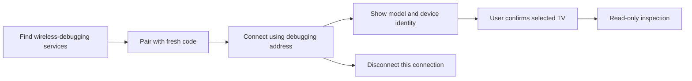

# Standalone cleanup connections

Implement an explicit standalone companion transport, independent of the shared
TV coordinator. The coordinator transport remains an explicit option for shared
lab TVs; neither transport falls back to the other. No live direct-device tests
on shared TVs. This step implements connections and read-only inspection only.



```text
Connect your TV                        [Find TVs]
TV: Settings > Developer options > Wireless debugging
Pairing address [192.168.1.20:12345]  Code [••••••] [Pair]
Debugging address [192.168.1.20:54321]              [Connect]
Connected: model / serial identity
[ ] This is the TV I want to inspect               [Inspect]
                                                  [Disconnect]
```

Use a private ADB server and persistent private identity; pairing codes go over
stdin, never logs or command-line arguments. Validate literal LAN IP/port inputs,
bound commands by timeouts, serialize operations, target every device read,
revalidate serial/firmware before accepting an inspection, and reject non-TV
connections. Never expose a general shell, install or package-change HTTP route.
Discovery lists endpoints but does not connect automatically. Pairing and connect
ports are distinct. Disconnect must not revoke unrelated authorizations.

Acceptance: fixture tests for pairing-code secrecy, invalid input, command errors,
identity changes, non-TV rejection and HTTP authorization; browser screenshots of
connection controls and inspection in English/Thai. Container-only tests. Record
fixture proof separately from physical new-TV acceptance.

Reference: [Android wireless debugging](https://developer.android.com/tools/adb).

## Implementation and scope

The connection adapter and bilingual browser controls are implemented in the working
tree; 60 container connection/recovery tests and Chromium/WebKit fixture checks pass. This is the connection milestone for the
[cleanup and restore plan](2026-11-18-tv-cleanup-and-restore.md). The
[two-page user manual](../how-to/quick-start-print.html) describes the complete
intended experience, including the later package-change stages.

- Standalone: private server socket, private persistent pairing identity, explicit
  discovery/pair/connect/disconnect, model and serial display, identity confirmation
  before inspection. Pairing codes are cleared from the form immediately and sent
  to the pairing subprocess through stdin. Discovery never chooses a TV for you.
- Coordinator: remains explicitly selectable for shared lab sessions. It gains no
  direct-device fallback. Shared Cast1/Cast2 tests continue to use complete jobs.
- Inspection: targeted read-only property/package queries, TV-feature check, stable
  serial and firmware before/after collection, private saved report. This is not
  yet a complete enabled-state/dependency inventory suitable for cleaning.
- Package changes: no new apply/disable/uninstall/restore HTTP route. These remain
  the next integration milestone, with concrete device profiles, durable recovery
  copies and a review of the exact package selection.

## Setup and UI details

The standalone Linux launcher runs the existing tool image with host networking
and a separate private state directory. No host Android SDK installation, account,
coordinator enrollment or daemon on the TV is required. Pairing needs the TV's own
Wireless debugging support; older TVs without code-based pairing are not silently
switched to an insecure port-5555 workflow. Manual addresses are available when
mDNS is unavailable. The companion opens only on loopback on the setup computer.

Pair and Connect are separate actions because their ports differ. Repeated
requests are blocked while an operation is active. All fields have visible labels;
errors preserve the entered address but never retain the pairing code. Device
selection changes clear identity confirmation. Unknown/disconnected identities
cannot become mutation-ready. Disconnect targets only the selected endpoint and
does not revoke another computer's authorization or disable TV debugging.

## Verification checklist

- [x] Container tests: endpoint validation, code format/secrecy, private socket and
  identity persistence, pairing errors/timeouts, discovery parsing, TV rejection,
  identity/firmware changes, targeted disconnect, no arbitrary shell action.
- [x] HTTP tests: same-origin/token checks, serialized connection and scan actions,
  explicit identity confirmation, coordinator-mode connection routes absent.
- [x] Chromium/WebKit: English/Thai controls, mobile fit, password field cleared,
  model/identity confirmation, inspect enabled only after confirmation. Save actual
  browser screenshots using controlled transport; no live devices in fixtures.
- [ ] Physical new-TV pairing and inspection through the standalone companion,
  separately from shared lab checks. Do not claim fixture proof as live pairing.
- [x] Update setup instructions and verification record. No APK rebuild is required
  for this computer-companion-only change; any later APK change gets a fresh
  deployment version and is submitted to both shared TVs.

## Follow-on cleaning work

After connections: collect exact user/package enabled states, active/default Home
and dependency facts; match reviewed firmware profiles; present unselected
candidates; save/verify independent recovery copies; apply only confirmed changes;
reconcile unknown results; restore and verify. New hardware must not inherit a
nearby model's cleanup list. Reuse the pinned upstream engine and tests rather than
inventing a second package-cleaning implementation.

## Evidence

See [connection verification](../testing/2026-11-19-cleanup-connections.md) for
fixture screenshots and test results. Physical pairing is a separate pending check.
