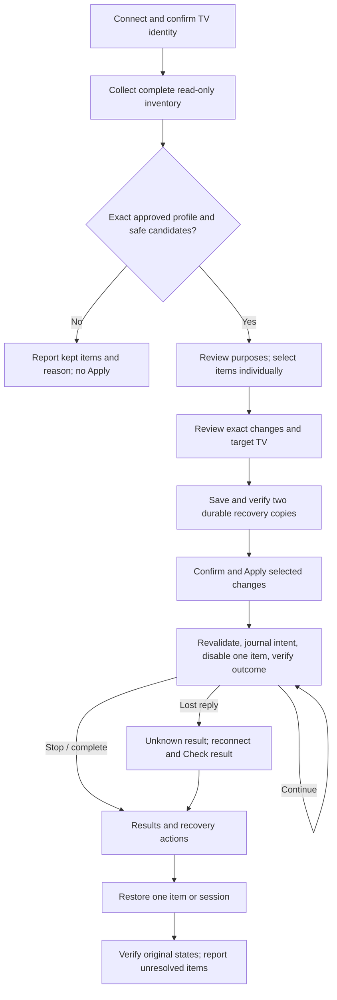
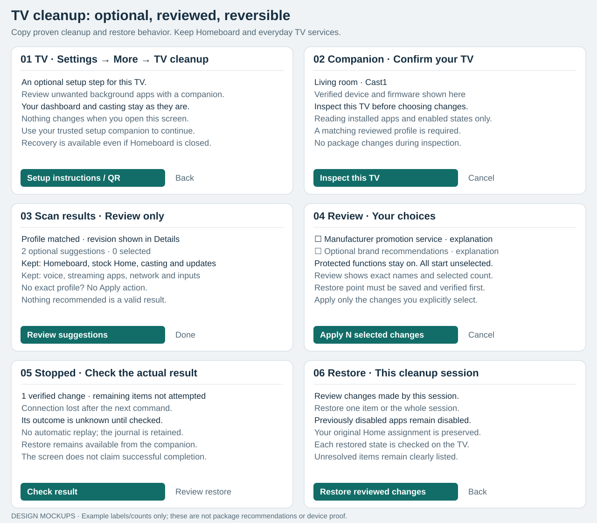

# Cleanup execution, review and independent recovery

## Objective and authorization

Finish the work that can be done independently: full inventory, exact profile
matching, review/confirmation, durable recovery, Apply/Stop/Check result/Restore,
container and browser fault tests, packaging and a disposable-app rehearsal.
Will authorized this work on November 19. No real TV system app is to be disabled
without a later review of the concrete TV-specific selection. Rehearsal uses only
the Homeboard disposable fixture, never an existing household app.

Build on the [cleanup foundation](2026-11-18-tv-cleanup-and-restore.md) and
[standalone connections](2026-11-19-cleanup-connections.md). Preserve the pinned
CleanYourTV recovery implementation and existing behavioral tests. Do not replace
it with another cleaning engine. The [user manual](../how-to/quick-start-print.html)
describes the intended finished flow.

## Current implementation

- Standalone pairing, connect/disconnect, identity confirmation and basic report:
  implemented, container/browser fixture tested. Physical new-TV pairing remains
  unverified.
- Review/protection/selection policy and dual-copy Session journal: implemented and
  tested against fake TVs, including interruptions and original-state recovery.
- Full inventory adapter: implementation started in `cleanup/inventory.py`.
  Strict package parsing tests pass. Transport-level collection still needs
  fixtures and integration checks.
- No approved real-device cleanup profiles exist. Upstream example lists are not
  execution authorization. Missing or ambiguous facts must produce no candidates.
- Companion package-change/recovery routes and screens remain to be connected.

## Inventory and eligibility

Collect the selected user's installed packages, exact enabled-setting values,
UIDs and versions; stable TV serial, manufacturer/model/product/board and complete
firmware fingerprint; default Home and every Home provider; active package UIDs.
Initially support primary user 0 only and reject a different foreground user.

Reject missing/duplicate/malformed package facts, unverified identity, truncated
output and changes during collection. Recheck identity before each operation.
Persistent recovery records use stable identity, never an ephemeral connection ID.

An exact reviewed profile supplies version-specific dependency eligibility.
Candidates start unselected. Protect Homeboard, every launcher, active processes,
shared UIDs, casting, streaming, input/remote/networking, permission/installation
services, updates, voice and other essential functions. Unknown dependencies stay
protected. An empty recommendation list is a valid successful result.

## Workflow



## Screen mockup

```text
Family TV · exact model / firmware

Suggested changes                          Kept functions
[ ] Promotional recommendations            Casting · Streaming · Home
    Why suggested / package details         Remote · Inputs · Updates
[ ] Vendor suggestions

[Review 2 selected changes]                 [Cancel]

Review changes · Family TV
Disable: Promotional recommendations, Vendor suggestions
Restore point: saved and verified · independent recovery copy available
[Apply these 2 changes]                     [Back]

Session results: 1 changed · 1 not attempted
[Stop after current item]   [Check result]   [Restore changes]

Restore changes · Family TV
[ ] Promotional recommendations · original state: default
[Restore selected]  [Restore session]  [Export recovery copy]
```

Use the existing [TV/companion mockups](2026-11-18-tv-cleanup-and-restore.svg)
for the larger screen sequence. English/Thai labels, accessible named controls,
keyboard/touch navigation and mobile-width screenshots are required. Device and
package data must be inserted as text, never executable markup.



## Execution and recovery

Wire the existing Session engine through explicit transport interfaces. No general
shell HTTP API. The browser sends selected reviewed package identifiers and a
server-issued confirmation bound to current identity, profile and inventory.
Stale, mismatched or replayed confirmation must not dispatch package changes.

Verify both durable recovery copies before any change. Keep records outside TV
cache/browser session storage. Support saved-session listing and recovery after
companion restart, independently of the TV dashboard. Export is authenticated and
contains no pairing credentials. Validate imported/reopened records before use.

Allow only reversible per-user disabling. Preserve exact original values, including
default-enabled versus explicitly enabled. Journal intent before dispatch and
verified outcome afterward. On timeout/lost reply, do not automatically reissue a
new mutation. Reconcile actual state. Stop prevents the next item; it does not
pretend to cancel a command already dispatched. Restore only this session's
recorded changes, never blindly enable a profile list.

## Shared TV integration

Coordinator 0.1.180 capability inspection on November 19 advertises inspect and
reactivate-package, but no cleanup apply/restore workflow. Configure is a closed
settings list, not a package-operation interface. These cannot substitute for the
required workflow. No raw ADB or direct-transport fallback on Cast1/Cast2.

Prepare a narrow reviewed coordinator stage contract for inventory and the
journaled disposable-package apply/restore rehearsal, including cancellation,
cleanup authority and evidence. Integration requires the coordinator to advertise
that contract before submitting a physical rehearsal. Keep any coordinator change
separately reviewable; never patch the installed service to bypass admission.

## Implementation order

1. Complete strict full inventory and transport fixtures, including active/Home
   protection and stable identity across reconnects.
2. Integrate reviewed profile loading, recommendation explanations and empty paths.
3. Connect review/confirmation, durable recovery copies and session management.
4. Add serialized Apply, Stop, Check result and Restore with restart recovery.
5. Complete English/Thai browser flows and recorded screenshot proof.
6. Add the narrow shared-coordinator workflow/adapter and disposable-app rehearsal.
7. Package the standalone setup and independent recovery entry; update user docs.
8. Prepare a concrete real-TV proposal only after the above evidence exists.

## Verification and proof

Container tests: malformed/truncated inventory, changed firmware/user/Home,
shared/active UIDs, unreviewed dependencies, wrong/ambiguous profiles, stale review,
confirmation replay, disk-full/corrupt/mismatched recovery copies, process restart,
network loss before/after effect, Stop, reconciliation and partial/full restoration.
No mutation may precede durable verified recovery.

Chromium/WebKit: select/review/cancel, exact target/count, protected items,
confirmation, progress, stopped/uncertain results, reconnect/check, saved sessions,
individual/full restore, English/Thai and mobile fit. Save screenshots with native
assertions or transport receipts; clearly distinguish controlled fixtures from TV
execution evidence.

Physical rehearsal: coordinator devices/queue, complete admitted fixture job,
watch and export evidence. Compare package enabled state and default Home before,
after disable and after restoration. Verify unrelated packages unchanged and
capture TV proof. Preserve original fixture state. If unsupported by the service,
record the missing capability and keep independent implementation progressing.

## Delivery boundary

No arbitrary real-TV package selection is inferred from this authorization.
Code and disposable rehearsal can proceed autonomously. Pairing approvals on new
hardware, concrete real-app approval and personal functional checks require Will.
APK changes use fresh versions and deployment to both Cast1/Cast2; companion-only
changes do not require rebuilding the launcher. Concurrent publication/signing
work remains separate and must not be overwritten.

## Implementation checkpoint

The standalone full-inventory adapter, profile loader, recommendations, confirmed
selection and recovery-before-confirmation are implemented. Both recovery copies
are verified before Apply is offered. Serialized execution uses the existing
Session engine; saved-session checks, individual/full restoration and recovery
export work independently of the TV app. No real-device profiles are approved.

70 container cleanup tests pass. Chromium/WebKit controlled-fixture runs pass
review, unselected candidates, confirmation, actual recovery download, Apply,
saved sessions, reconciliation and Restore, with English/Thai mobile captures.
See [verification](../testing/2026-11-19-cleanup-execution.md).

Still required: the coordinator execution workflow and adapter, physical fixture
rehearsal, real-TV profile/dependency review, physical standalone acceptance and
verified import recovery after loss of both host copies. These are not established
by fixture tests or by the completed user-manual text. No actual TV app cleanup
has been performed.
