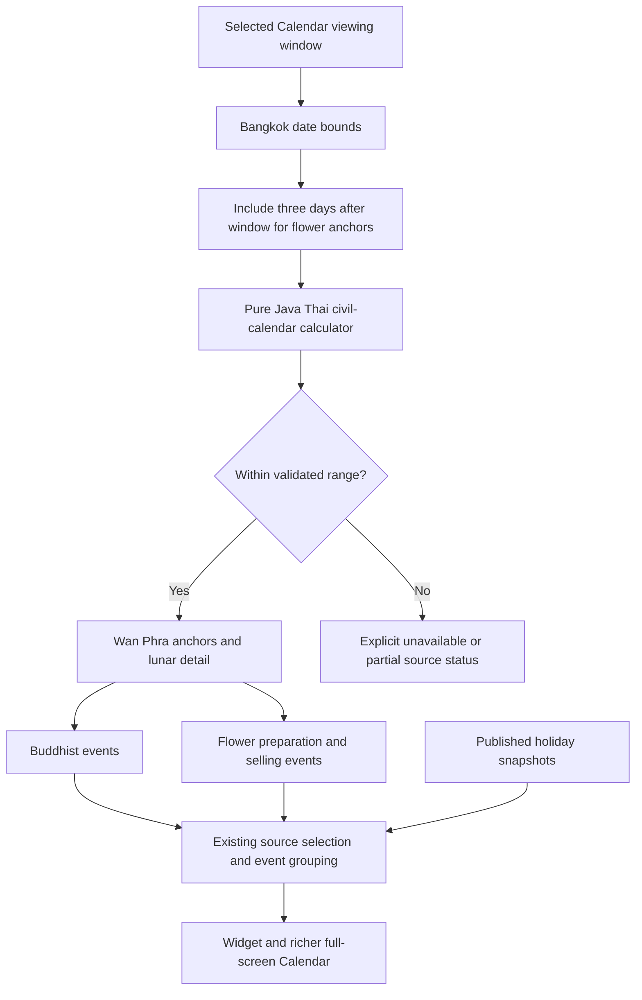
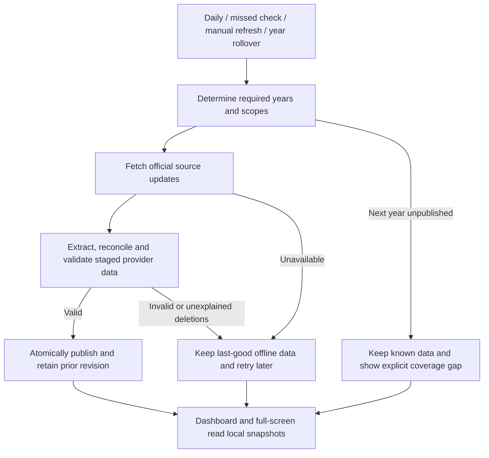

# Calculate Wan Phra on the TV

**Status: implemented in candidate 0.1.69; container verification passed; native source, boundary and restore evidence is linked below.**

TL;DR: calculate Thai civil-calendar Wan Phra dates locally in Java, then derive
the existing flower preparation/selling blocks from those dates. Validate the
calculation against published calendars before replacing the bundled Buddhist
and flower event lists. No server or annual download is needed for calculation.

This narrows the calculator section of the
[original Calendar plan](2026-11-16-thai-calendar-widgets.md#wan-phra-algorithm-thai-lunisolar-civil-calendar).
The header adjustment underway separately puts today's local date first and
removes the repeated “OK for full-screen Calendar” hint, retaining page numbers.

## Result on screen

Keep the existing combined Calendar widget and its configuration. Buddhist and
flower dates come from one calculated anchor sequence; the holiday sources keep
their own published data. The TV works offline, including after New Year.

Illustrative normal-size view; dates describe a November 2026 example:

```text
┌ Calendar ───────────────────────────────────────────────┐
│ Today · Thu 19 Nov 2026 · All holidays · Next 30 days   │
│ Flowers: this + next week · Wan Phra: this + next week │
│                                                      │
│ ┌ Sat ───────┐ ┌ Sun ───────┐ ┌ Mon ───────┐          │
│ │ 21       ❀ │ │ 22       ❀ │ │ 23       ❀ │          │
│ │ Make flowers│ │ Make flowers│ │ Sell flowers│         │
│ └────────────┘ └────────────┘ └────────────┘           │
│                                                   1/2│
└──────────────────────────────────────────────────────┘
```

Existing flag bands, contrasting card backgrounds and opacity apply. On a narrow
widget, today's date has priority over the holiday range; keep the compact card
strip and a short page count. No permanent algorithm/version banner consumes
dashboard space. Thai labels use BE dates; internal dates stay ISO.

Short OK still opens the richer full-screen Calendar. Its selected-day detail
shows all events, the Wan Phra anchor, flower work and existing approximate break
times. Source details identify **Calculated on this TV · Thai civil calendar**
and expose algorithm revision, supported years and reference links. Add lunar
month, waxing/waning day and repeated-month identification there, with localized
labels. Back and visible Restore dashboard retain page, focus and saved size.

```text
┌ Calendar · Tue 24 Nov 2026 ─────────────────────────────┐
│ Four-week calendar                 Selected day        │
│                                    Wan Phra            │
│                                    Waxing 15 · Month 12│
│                                    Sell flowers        │
│                                    Break about 11–16   │
│                                    Source details      │
│                                  [Restore dashboard]  │
└───────────────────────────────────────────────────────┘
```

These are mockups, not screenshot evidence. Exact lunar detail must come from
the validated calculator, rather than separately inferred labels.

## Calculation and reuse

Port the small civil-calendar path from
[pythaidate](https://github.com/hmmbug/pythaidate/tree/f526c4d9d9ee2a854bf790aaf6d6ee6db90f3f25),
at the revision already selected in the original plan:
`f526c4d9d9ee2a854bf790aaf6d6ee6db90f3f25`.
Use `csdate.py`, `lsyear.py` and their constants/conversion dependencies as the
reference. Retain the MIT notice and original file hashes; document the Java
adaptation separately. Python is test/reference tooling only, inside containers.

Implement a pure Java class returning civil lunar date and observance status.
Use integer Julian-day and Suriyayatra/Chulasakarat arithmetic, including the
five-year reconciliation, ordinary/leap-day/leap-month years, repeated month 8,
zero-remainder normalization and the reference's 800-year boundary correction.
Use long intermediates and explicit floor division/modulo where required.

Wan Phra selects waxing 8/15, waning 8 and the actual final waning day (14/15).
Do not reuse `Lunar.java`: its existing Chinese/Vietnamese-style astronomical
conversion is a different calendar. Do not substitute generic Moon phases or
the reference library's separate Pakkhakhananaa reckoning.

## Runtime integration



- Compute the Buddhist/flower provider events for the requested view, including
  full-screen month navigation. Use Asia/Bangkok for observances and work-day
  boundaries even if the TV's local date is different. The Today header describes
  the TV's local date; detail labels must make Thai calendar time-zone context clear.
- Keep independent Monday-based flower/Buddhist week selectors and source toggles.
  Holiday lookahead does not accidentally expand either week window.
- For each anchor D, preparation is D−3 and D−2; selling is D−1 and D.
  Preserve the approximate Bangkok `[11:00,16:00)` selling break. Generate anchors
  through view-end + 3 days, then filter derived work dates to the requested view.
- Give calculated events stable provider/date/anchor/kind IDs. Preserve sorting,
  same-date grouping and deterministic country bands. Generate one event per
  intended work block, without snapshot/calculator duplicates.
- Cache bounded year data or requested windows; never iterate a user's enormous
  holiday lookahead for the Buddhist sources. No calculation in drawing code.
  Refresh on date changes, source/range changes and full-screen navigation.
- Keep `dev/calendar/reviewed/thai.json` as an independent test fixture. After
  acceptance, remove bundled Buddhist/flower event arrays from production assets
  and their pipeline output. Do not add a hidden legacy fallback to those lists.
  Thai government holidays remain published data.
- Add source status for local calculation; it must not look like a failed network
  download. Missing unrelated holiday coverage still reports its own partial state.

### How far ahead are holidays stored?

Current bundled coverage, checked against the APK asset on 19 November 2026:

| Published source | Coverage ends |
|---|---|
| Thai government | 31 December 2026 |
| Spain national/Catalunya | 31 December 2027 |
| Tivissa-centre local dates | 31 December 2026; future/local amendments incomplete |
| US | 31 December 2027 |
| China, including published working-day adjustments | 31 December 2027 |

These are the offline seed's coverage bounds. Runtime source updates now maintain
the persistent cache. Thai 2027 and Tivissa 2027 coverage remains missing; Spanish
national/Catalunya 2027 dates have been added from the official BOE publication.

**Requirement confirmed by Will: keep the entire current calendar year and the
entire following year offline for every enabled holiday source.** Interpret the
year in that source's civil time zone. A display lookahead or week selector does
not trim stored annual coverage. Fetch and retain newly published next-year dates
without requiring the user to visit that year or update the APK.

An official calendar that has not been published cannot be cached yet. Track this
as **Next year not yet published**, or **Next year incomplete** when only some
jurisdictions are covered. Neither state means “there are no holidays.” Source
details must show exactly which years/scopes are complete. Never invent special
closures, replacement holidays or working-day substitutions to fill a gap.

The calculator has its own explicitly validated year interval below. The
holiday update implementation is a companion workstream to the calculator,
specified here so offline retention has an actual maintenance path.
The dedicated [offline holiday update implementation plan](2026-11-19-offline-holiday-updates.md)
defines its storage contracts, source adapters, rollout and acceptance evidence.

### Updating the offline calendars

Use the original plan's direct-source, staged native pipeline: **fetch official
documents → extract dated facts → reconcile amendments → validate → atomically
publish a local snapshot**. Keep the captured source documents and provenance
needed to reproduce an update. Runtime retrieval/parsing runs in the Android
client through provider-specific Java modules; container commands exercise those
same contracts. No hosted calendar service is assumed and no Python runs on TV.

| Trigger | Planned behavior |
|---|---|
| First use | Display the bundled snapshot immediately; request missing current/next-year data when connected. Do not block the dashboard. |
| Automatic refresh | Attempt a conditional source check daily while connected, using Android's scheduled background mechanism. Scheduling is best effort; the app need not remain open. Coalesce concurrent requests. |
| App returns to foreground | If a daily check was missed, enqueue one refresh. Avoid repeating successful checks on every navigation or widget redraw. |
| Manual action | Calendar configuration and full-screen source details offer **Refresh holiday data**, with progress and a per-source result. This refresh does not require reinstalling Homeboard. |
| Download failure | Keep the last-good calendar visible. Retry with bounded backoff, starting after an hour and capped at a day; connectivity recovery can enqueue a due retry. Do not flood an unavailable publisher. |
| New annual release or correction | Reconcile against that source's previous revision and activate only the successfully validated replacement. Preserve unrelated years, jurisdictions and provider branches. |
| Approaching New Year | During October–December, also look for the year after next. Prefetch it when published so January's required pair is already offline. |
| Year rollover | Re-evaluate required years on launch, scheduled refresh and date changes. Retain old data until replacement coverage is validated; discard unneeded older-year data only after successful publication. |

Daily checks include amendments to the current year, not just discovery of new
annual calendars. This is daily freshness, not a promise of immediate emergency
closure alerts. Fetch/check time and the publisher's revision/coverage are
separate fields: an HTTP success today does not prove next year's data exists.
Thai special-closure announcements retain the original 06:00/18:00 Bangkok
check targets; the daily cadence here concerns annual calendar maintenance.

Use conditional HTTP requests where supported. A not-modified response keeps the
same validated revision. Store active provider snapshots and update metadata in
private persistent app storage, retained through app upgrades. Bundled data is
the initial offline seed; a successful runtime update takes precedence thereafter.

Validation must reject wrong years/scopes, malformed dates and unknown source
formats. An unexpectedly empty or sharply reduced candidate calendar must not
silently erase cached holidays. Apply removals only when an explicit cancellation
or a recognized complete replacement publication accounts for them. A parser
failure preserves the prior snapshot and reports **Update needs attention**;
parser fixes may require an app update, ordinary calendar-data refreshes do not.

Keep at least the previous validated provider revision for rollback. Stage and
verify the new snapshot before atomic replacement, so interrupted downloads,
app termination or disk-write failures cannot leave half a calendar. A failure
in Spain must not prevent a valid Thai/US/China update, or local Wan Phra display.

Source details show **Offline coverage: 2026–2027**, last successful check and any
gap/failure, with localized dates and BE years in Thai. Full-screen source details
can list the individual national/regional/local scopes. The dashboard only needs
a concise warning when its visible dates have missing coverage; keep detailed
maintenance information out of the card header.



Acceptance requires container tests for daily/manual request coalescing,
conditional responses, retry bounds, unpublished/partial next year, documented
amendments/cancellations, parser failures, interrupted writes and December/January
rotation. On-device checks must load both required years with network retrieval
disabled in the test transport, restart the app, and confirm retained data and
correct source status. Do not disable a shared TV's Wi-Fi to run this check.
Capture source details before/after a controlled successful refresh and a failed
one; include receipts, revision/coverage assertions and screenshots in `docs/testing/`.

These update mechanisms are planned, not implemented. Closing the current
Thai/Spanish 2027 gaps and verifying the complete per-scope two-year cache are
required acceptance work, rather than assuming the existing bundled asset meets
this requirement.

## Validation gate and supported years

Provisional release target: **2024–2027**, covering past comparisons and the next
year. This is a validation target, not an already established support claim.
Ship only the contiguous interval actually proven by the checks below. Expand
it in a reviewed change with independent fixtures. Out-of-range dates report
unavailable/partial coverage; they never silently become “no Wan Phra.”

The [published DMC calendar](https://www.dmc.tv/article/5453) currently includes
2026 and earlier annual tables. Preserve the existing 49 listed 2026 anchors as
an exact regression fixture, including 3/9/17/24 November. Treat the fixture's
actual start/end as its assertion bounds; do not infer unlisted year-end dates
are forbidden. Obtain and record the independent 2027 published calendar before
claiming next-year validation. The existing
[government-hosted calendar](https://dopasakonnakhon.go.th/home/wp-content/uploads/2025/11/1111.pdf)
is a second 2026 reference to review. Source identity and calendar convention
matter more than agreement between two ports of the same library.

Compare every day with the pinned Python reference over a broader computational
test interval (for example 1900–2100), covering all year types and correction
branches. This establishes port equivalence; independently published fixtures
establish the smaller supported civil-calendar interval. Record discrepancies
and their resolution. Never fix a mismatch with an unexplained day shift.
Any genuine published correction needs a sourced, dated, explicitly tested rule.

## Implementation and acceptance

1. Vendor the minimal reference files/license and hashes; record precisely which
   functions are adapted. Capture published validation fixtures with provenance.
2. Implement the pure Java calculator and container tests for exact lunar detail,
   observance selection, repeated month 8, leap days and boundary corrections.
3. Test Bangkok midnight, local-vs-Bangkok date differences, December/January,
   flower anchors beyond view end, independent week controls, source toggles,
   grouping, unsupported years and bounded work for extreme holiday lookaheads.
4. Integrate runtime providers and full-screen lunar/source details. Update
   English/Thai strings, mockups, user docs and asset pipeline together. Verify
   existing holiday data and dashboard settings are retained.
5. Run `task check`, then `task deploy` for a new version and identical frozen APK
   on Cast1 and Cast2. Install-only jobs remain independent of reservations;
   coordinator admission governs them. Use Cast1 for foreground acceptance.

Screenshot proof is required, alongside native assertions and calculation tests:

| Capture | Required proof |
|---|---|
| English/Thai dashboard | Today date, correct CE/BE year, calculated events, weekday cards, page count without the redundant OK instruction. |
| Compact and larger widget | Readable date priority, intact cards, no overlap or clipping; no layout reset. |
| Full-screen date/detail | Published reference date agrees; lunar half/day/month and source details are visible; repeated month is identified when applicable. |
| Year boundary | Buddhist/flower results extend beyond the old asset limit, including preparation for an anchor outside the visible month. |
| Source/error state | Local calculation is identified accurately; unsupported range reports partial/unavailable coverage. |
| Restore dashboard | Short Back and visible Restore action preserve original page, Calendar focus and saved size. |

Store private coordinator receipts, frozen APK/source hashes and native reports;
copy reviewed screenshots and a concise verification record to `docs/testing/`.
Label mockups, synthetic clock fixtures and physical-device captures correctly.
Screenshots demonstrate presentation; exact calendar agreement comes from the
independent date fixtures and calculation tests.

## Completion

Done means local Java calculations drive both Buddhist and flower events in the
widget and full-screen view, the supported interval is documented with independent
date evidence, no annual runtime list is required, and the screenshot/restore
checks pass. Merely importing a library or matching four November dates is not
completion.

## Implementation checkpoint

The Java civil-calendar port, runtime Buddhist/flower event generation and lunar
detail labels are implemented. Original reference files/license/hashes are pinned
under `vendor/pythaidate/`; production assets no longer bundle religious event
lists. Exact conversion hashes cover every day of 1900–2100, with independently
published observance fixtures for 2024–2027. Supported display coverage remains
2024–2027; flower windows needing a later anchor report incomplete coverage.

The shared repository, live English/Thai source panel, manual refresh and native
background job are implemented with the holiday-update workstream. The offline
seed now includes 2027 Spanish national/Catalunya data. Source availability and
unpublished/local coverage gaps remain explicit; see the
[verification record](../testing/2026-11-19-calendar-data.md) for actual live checks
and device acceptance rather than treating the mockups as proof.
