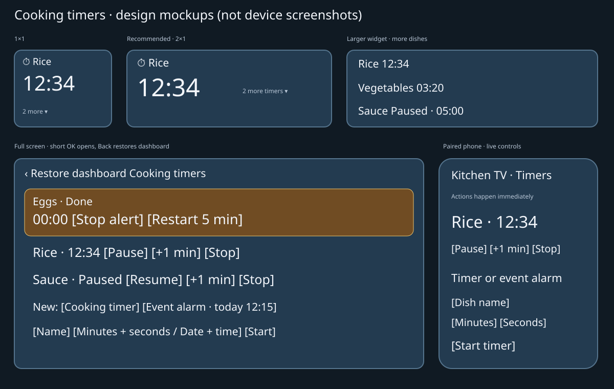
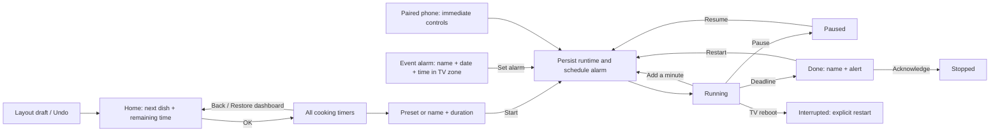

# Cooking timers and event alarms

Will's primary use case is cooking (19 November 2026). This narrows the
[countdown proposal](../investigations/2026-11-19-countdowns-and-timers-widget.md):
build cooking duration timers and one-off date/time event alarms. Will also needs
Shower at 12:00, Call Grab at 12:15 and Leave for school at 12:30. These are
independent named alarms, not one notification that hides the intermediate steps.
A stopwatch and recurring schedules remain outside this first release.

## Goal and design review

Apply the shared [Alan Cooper design filter](/home/will/docs/howtos/alan-cooper-design-filter.md).
Scope: native dashboard, expanded Timers, and paired phone controller. Baseline:
current Java widget shell and paired phone editor. Primary profile: someone cooking
several dishes, often away from the remote, who needs to know which dish needs
attention. Evidence: Will explicitly prioritizes cooking. Multiple simultaneous
dishes and common presets are assumptions to validate.

Ordinary scenario: open Timers, choose 5 minutes or enter a name and duration,
start, return to Home or another app, then acknowledge the named finished timer.
Variation: start Rice and Vegetables together; add one minute to Vegetables without
changing Rice. Interruption: launcher process dies or TV reboots. Finish: clearly
show Done until acknowledged; restarting is deliberate.

Findings: a general countdown editor forces calendar/time-zone choices that do not
help cooking (substantial friction); a ticking view alone loses alarms when leaving
Home (blocks the goal); mixing runtime with layout drafts permits accidental timer
rewinds (substantial risk). Use one kitchen timer collection, separate persistent
runtime, monotonic deadlines, and explicit immediate controls.

## Interaction and sizes

- Recommend **2×1**. Show the next timer, large remaining time, and how many more
  are running. At **1×1**, show the soonest timer and its remaining time. Larger
  widgets show more named timers, using the actual available height. Finished
  timers take priority. No scrollbars; overflow is a count/wedge.
- Short OK opens full screen. Put the timer list on the left and new-timer entry
  on the right so the form does not crowd several dishes off screen. Show all timers,
  names, exact remaining times, state,
  original duration, and per-timer Pause/Resume, +1 minute, Restart and Stop.
- Quick presets: 1, 3, 5, 10, 15, 20 and 30 minutes. Custom timer: optional dish name,
  minutes and seconds. Defaults describe time rather than assuming a recipe's cooking
  duration. Start commits immediately; no extra Save step.
- Keep focus on the same timer/action while seconds tick; do not rebuild the entire
  focused form each second. Finished state uses text and contrast, not color alone.
- Back and visible Restore dashboard return to the original page, size and focus.
  Leaving or deleting a widget does not stop timers; explicit Stop does.
- Phone placement/size uses the existing draft/Apply workflow. Live timer actions
  are separate, clearly immediate, revision checked and retry safe. Layout Undo
  does not rewind timers. Phone disconnect does not stop a timer.
- English and Thai labels; elapsed duration uses the project's duration conventions.

## Runtime and alert contract

Persist timer IDs, names, original duration, paused remainder, elapsed-realtime
deadline, boot identity, state and a runtime revision independently of HomeLayout.
Clock and time-zone changes must not alter duration. Reconcile expired timers on
read and alarm delivery. A duplicate/stale callback cannot restart or finish a
newer incarnation. Persist before acknowledging a command; bounded timers and input.

After reboot, mark formerly running timers Interrupted and require explicit restart;
never claim that cooking time was reliably tracked through TV power loss. Replacing
an APK on the same boot reschedules alarms. Force-stop/system restrictions and an
offline/powered-off/muted TV must not be represented as guaranteed audible alerts.

Android scheduling uses [exact alarms](https://developer.android.com/develop/background-work/services/alarms)
and checks special access on Android 12+. Request Alarms & reminders only when
starting a timer needs it. If unavailable, show the reason instead of claiming a
background alarm is armed. Do not select USE_EXACT_ALARM for a dashboard. An exact
user-requested alarm may [start an appropriate foreground service](https://developer.android.com/develop/background-work/services/fgs/restrictions-bg-start)
for a bounded audible alert if that is the chosen behavior. Never raise volume,
unmute, switch TV apps or show a full-screen takeover automatically.

Will chose sound even while another app is open: Homeboard is the house command
center. Ring for up to one minute, retain Done until acknowledged, and provide a
notification Stop alert action. Multiple simultaneous completions share the sound
without dropping their names. Treat sound audibility and background delivery as device acceptance
checks, not conclusions from JVM tests. No continuous background polling service.

## Acceptance and proof

Test independent concurrent timers; pause/resume; +1 minute; restart after Done;
invalid/zero/oversized inputs; stale revision and duplicate phone retry; deadline
rounding; wall-clock and time-zone changes; same-boot process recreation; reboot
interruption; permission denial/revocation and notification/audio failure visibility.
Container JVM and phone browser tests precede a fresh numbered deployment to both TVs.
Use Cast1 for foreground checks; submit Cast2 install independently of its availability.

Record actual coordinator job IDs, APK hash/version and screenshots under
`docs/testing/2026-11-19-cooking-timers/`: 1×1, recommended 2×1, wide/tall, full-screen
with concurrent timers, Done and Paused states, Thai, restored dashboard/focus and
phone controls. Capture a timed/background alarm scenario and corroborating logs:
a screenshot alone does not prove audible or timely delivery. Label mockups separately
from actual captures. Record deferred/failed device checks truthfully.

## Event alarms

Create a named one-off alarm with date and local time in the TV timezone, shown
on both TV and phone before committing. Offer Today with an editable date; reject
past times instead of silently rolling them to tomorrow. For example, create three
separate alarms at 12:00, 12:15 and 12:30. Do not prepopulate or arm these examples
without a user action. Resolve a date/time only when its zone has exactly one valid
offset; report missing/ambiguous daylight-saving times. Event alarms follow their
chosen instant if the TV timezone changes; show the new local time and zone.
Cooking timers use elapsed realtime; event alarms use wall-clock instants and
reschedule after clock corrections. On reboot future event alarms are restored;
missed events stay visibly Missed without a surprise late sound. Event controls:
Cancel, acknowledge Done, and create another alarm; no arbitrary +1 minute
pretending a fixed appointment is a cooking duration. Test both timer kinds due
together and restoration after reboot/time changes.

Disposition: conditional pending implementation/device
verification; the main workflow is duration-first cooking.
