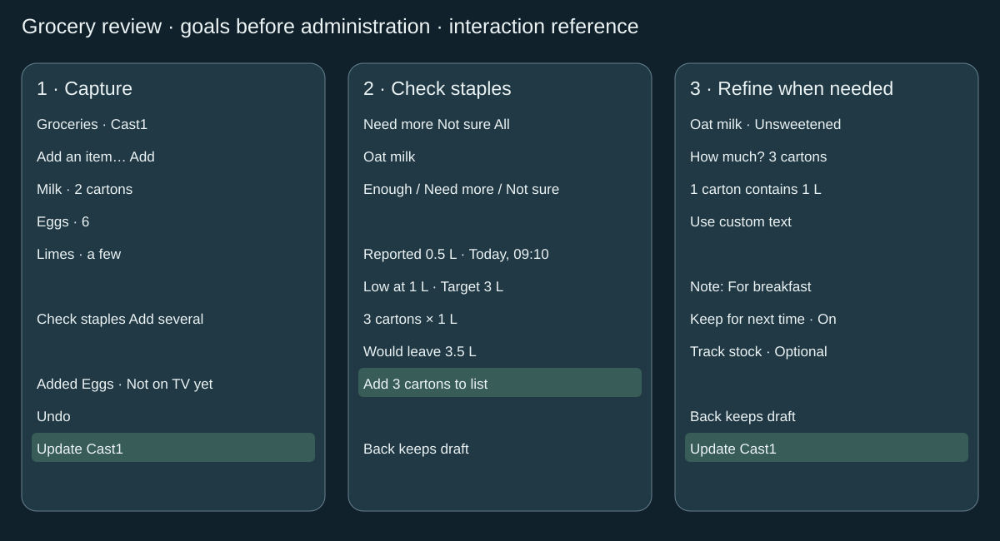
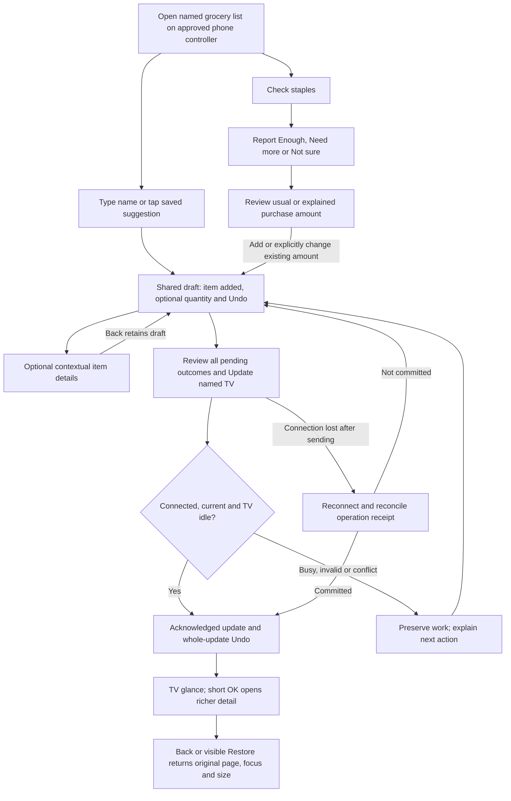

# Groceries: Alan Cooper goal-directed design review

Status: **implemented in the grocery worktree; 0.1.81 verified on Cast1**,
November 19, 2026. Governing review: shared filter v1.0. Original baseline:
Phase 1/2 on `feature/grocery-list`, debug build 0.1.78. The revision preserves the
existing data model and explicit publication boundary. See the
[revision verification record](../testing/2026-11-19-grocery-cooper.md).

TL;DR: Help someone remember what the household needs, then return to what they
were doing. Lead with **Add an item** and the shopping list. Offer **Check staples**
when deciding what to buy; keep product records, units and stock policy behind
relevant item details. Preserve explicit Update TV, honest saved-state feedback
and Undo. Feature richness should shorten these scenarios, not lengthen the form.

This refines the [grocery implementation plan](2026-11-19-grocery-list-widget.md)
and its six-app survey. It applies the same filter as the
[phone controller review](2026-11-17-phone-editor-goal-directed-design.md).
The [verification record](../testing/2026-11-19-groceries.md) establishes baseline
correctness; passing tests do not establish that the interaction is easy to use.

## Delivery checkpoint

The implementation is committed and pushed as **`77f4536`** on
`feature/grocery-list`; it remains separate from main. The
[main grocery plan's delivery checkpoint](2026-11-19-grocery-list-widget.md)
now consolidates Phase 1/2 completion, the Cooper revision and the Phase 3 boundary.

Build **0.1.81** passes the container gate (510 JVM tests and zero lint errors),
Chromium/WebKit phone scenarios and Cast1 native acceptance. Cast2 installation
was attempted with the identical frozen APK and rejected at execution with
`personal-install-in-use`; it is unconfirmed. Actual screenshots, job receipts
and remaining physical/usability checks are in the
[verification record](../testing/2026-11-19-grocery-cooper.md).

## Method and evidence

Governing reference: [shared Alan Cooper design filter, v1.0](/home/will/docs/howtos/alan-cooper-design-filter.md).
Its [research and interpretation record](/home/will/docs/investigations/2026-11-19-alan-cooper-design-filter-research.md)
is maintained centrally. This document applies that standard to groceries rather
than supplying another independent definition of the Cooper filter.

Evidence consists of Will's stated priorities, the implemented grocery phone form,
the shared phone editor, native compact/expanded views and recorded screenshots.
No household field study has been conducted. The behavioral profiles below are
provisional hypotheses; avoid invented names, demographics or claims that all
households behave this way.

Observed requirements: people mostly add from a phone; basic entry must work;
product/unit knowledge should become more useful over time; regularly bought items
persist independently of stock; purchase check-off and remote sync are Phase 3.
The Out of Milk pantry and Remember The Milk capture/recurrence references inform
options, but their complete feature inventories are not requirements.

## Shared-filter disposition

**The interaction revision is implemented.** The table below preserves the
baseline findings that drove it; the implementation record gives their current
disposition. Functional and browser acceptance are evidence of behavior, while
observing people with the provisional profiles remains a separate usability check.

| Shared filter coverage | Grocery finding and disposition |
|---|---|
| 1–3: goal, mental model, context | **Substantial friction:** management and overlapping storage categories precede capture. Put Add first; use a named-list title menu and a separate Check staples task. Keep the phone for entry and the TV for glancing/detail. |
| 4–7: learning, hierarchy, flow, manipulation | **Substantial friction:** known suggestions and replenishment open extra forms; raw base-unit entry makes the person calculate. Reuse confirmed defaults directly, expose familiar quantities, and keep direct reorder with accessible alternatives. |
| 8–9: navigation, defaults and memory | **Work-loss risk:** ordinary form fields must become recoverable draft state before removing nested Save actions. Establish Back/Cancel semantics and TV/list ownership; never confuse an unfinished editor with an acknowledged update. |
| 10–12: state, recovery and consequence | **Misunderstanding risk:** grocery summaries can hide the actual outcomes, and generic alerts do not identify the correction. Name added/changed items and stock reports, validate in context, and retain explicit Update TV plus whole-update Undo. |
| 13–14: attention, visual communication and access | **Substantial friction/polish:** repeated movement buttons and persistent setup explanation crowd the rows. Retain the grip and named alternative actions; move setup/detail aside, retire obsolete prompts, and check real phone/TV sizes and English/Thai text. |

Project-specific boundaries retained: the temporary approved controller, current
idle-TV update rule, exact unit checks, transactional revision/receipt safeguards,
per-list conflicts, no invented stock consumption, and richer full-screen content
with precise restoration. These boundaries are not removed merely to reduce clicks.
Purchase completion and remote sync stay Phase 3. Timing targets and provisional
profiles still require observation; the filter does not turn them into evidence.

## Goals, roles and scenarios

Primary provisional profile: someone noticing a household need while doing another
activity. Their end goal is **remember it without interrupting what I am doing**.
The desired experience is confidence that it was kept, with little typing or
administration. Choosing units or editing an inventory record is a supporting task.

Secondary profile: someone checking the kitchen before a shopping trip. Their goal
is **buy enough, avoid buying what we already have**. They may prefer a simple
Enough/Need more assessment to exact counts. A third, later context is the shopper
away from home; design for it explicitly in Phase 3 rather than imply today's
TV-hosted controller works there.

| Scenario | Desired experience | Design consequence |
|---|---|---|
| Notice we need eggs while cooking | Add Eggs, continue cooking, see whether the TV has acknowledged it. | One visible entry field, Enter/Add, retained keyboard focus and an honest pending/saved state. |
| Remember three things at once | Enter each name or paste lines, without repeatedly opening details. | Fast successive entry; batch paste remains a secondary option near Add. |
| Check milk before shopping | Say Need more or report what remains, review a useful amount, add it once. | A focused staple review, with simple status first and optional measured stock. |
| Buy the usual oat milk again | Recognize the saved variant and reuse its normal quantity. | Suggestions show name, variant and familiar purchase amount; no product-creation step. |
| Notice the saved carton size is wrong | Correct that item's package with the affected quantities visible. | Contextual package details and a consequence preview; no catalog maintenance detour. |
| Glance at the TV | See what is needed, then open full detail only if useful. | Current needs lead; stock review and technical detail are secondary. |

These scenarios are evaluation scripts, not evidence that users have already
succeeded with the revised design.

## Audit: filter each control through the goal

Review basis: `phone/grocery.js`, its integration in `editor.js`,
`GroceryWidgetView`, `GroceryExpanded` and `GroceryEditor` in the feature worktree.

| Current implementation | Cost to the person | Proposed decision |
|---|---|---|
| Choose list, List settings and three tabs precede quick entry. | A short capture begins with navigation and management choices. | Start with current list title, Add and existing items. Use a title menu to switch lists; offer management there. |
| Shopping list, Staples and Products are equal navigation choices. | The interface exposes storage categories that overlap in ordinary language. | Shopping list is the landing task. **Check staples** is a secondary task. Saved-product administration belongs under More. Keep distinct internal identities. |
| A saved suggestion opens an item editor before it joins the draft. | Reusing known groceries requires another form/save action. | Tap a suggestion to add its saved, valid default directly to the draft, with inline Undo and an optional quantity chip. Open detail only to change it. |
| Item details show both quantity text and a structured-quantity switch, then amount/unit fields. | People must choose a representation rather than state how much they want. | One visible **How much?** control: familiar quantity text initially, recognized product quantities as editable chips. Offer **Use custom text** without exposing a “structured” mode. |
| Product details start with brand, variant, aliases and category; Units and Stock policy open by default. | Learning the product feels like configuring a database. | Start from the item name and usual purchase. Put brand/variant under Details, aliases/category under More, and reveal stock controls only after opting in. |
| Package contents and stock thresholds are entered in base units. | A 1 L carton becomes a 1000 ml arithmetic exercise. | Let the person enter **1 carton contains 1 L** and choose stock display units. Normalize internally, showing the interpretation before saving. Keep exact conversions and dimension checks. |
| A simple stock change may show Manual need, Need more, and stock policy language. | Internal terms compete with the decision being made. | Use **Enough / Need more / Not sure**. Offer **Track an amount** in details. Unknown is never treated as zero. |
| Add to shopping list opens a second editor; an existing need opens another review form. | Replenishment requires traversing mechanics rather than accepting an explained result. | Show **Add 3 cartons** inline. If already listed, say **On list: 2 cartons** and offer an explicit change to 3, with before/after quantities. |
| The general change summary can say only Update groceries: Groceries. | People cannot tell which grocery outcomes they will publish. | Review **Added Eggs and Limes; Milk changed to 3 cartons; Milk stock reported as 0.5 L**. Collapse long summaries with an item count. |
| Save item to draft is followed by Update TV; local editor forms are separate from the shared draft. | Several save layers obscure whether work is kept or on the TV. | Ordinary edits join the shared recoverable draft; Back retains them. Keep one publishing action, Update TV. Reserve Apply/Cancel for atomic previews such as merging products. |
| Generic validation alerts combine many possible limits and unit rules. | The person has to diagnose a form instead of completing it. | Explain the specific field and next action inline: **Enter how much one carton contains**, or **Target must be above 1 L**. Preserve all entered values. |
| Reorder shows a grip and two arrow buttons on every row. | Seldom-used controls crowd item recognition. | Keep the grip as primary direct manipulation; put named movement actions in row options, preserving keyboard and screen-reader access. |
| TV expansion offers several actions above its data, including Edit list. | A glance/detail surface competes with configuration work. | Lead with the complete list and selected-item detail; retain visible Restore, Check staples and Add from phone. Put remote editing in Configure. |

A new suggestion must never silently increase an already listed quantity. Repeated
taps should show **Already on list · Change quantity**, not duplicate needs or
unannounced increments. Uncertain units stay readable text until confirmed.

## Proposed interaction framework

### Capture: open the list and add

The top of the phone page names the list and connected TV. With one list, do not
show a list selector. A title menu makes other named lists reachable without
creating an invisible mode. The next control is **Add an item…**, followed by the
current shopping rows. Empty state: **What do we need? Add your first item.**

Enter/Add puts a name in the draft and keeps entry focus. Suggestions may reuse a
confirmed product and usual amount; they never force catalog membership. Show
**Added Eggs · Not on TV yet · Undo**. Row quantities are readable secondary text;
tapping one opens the contextual amount control. Check staples and Add several
are nearby secondary actions, not prerequisites.

Keep the shared sticky **Update Cast1** action and outcome summary. A grocery action
must not silently publish unrelated Rain, Calendar or layout changes. When those
are pending, the review names them too. Only acknowledgement says **Updated Cast1**.
A transient toast is supplemental; pending/saved state remains readable afterward.

### Decide what to buy: check staples

**Check staples** opens a review of persistent household items. A small filter can
show **Need more**, **Not sure**, or **All staples**, with clear counts and an
explanation when the view is empty. Filtering changes visibility, not records;
items already on the shopping list stay reachable and labeled.

For simple stock, show Enough / Need more / Not sure directly on the row. Need more
shows the usual purchase, when known, and an explicit **Add to list** action. With
no known quantity, add the name; do not display a fabricated amount or force setup.
Changing Enough must not silently remove a previously confirmed shopping need.

For measured stock, show the report and age, followed by the proposed amount and
why: **Reported 0.5 L · Low at 1 L · Target 3 L. Buy 3 × 1 L cartons; would leave
3.5 L.** These are arithmetic consequences of a report, not a claim of live stock.
Adding a need does not increase inventory. A stale report can be checked or edited.

### Refine an item: only the knowledge needed now

The ordinary detail view contains name, amount, note and **Keep for next time**
(the user-facing staple choice). Reuse the saved variant where it matters. A person
may add a brand or edit a package when needed without completing every other field.

**Track stock** offers **Simple status** first, **Measured amount** second. Measured
setup progressively asks for reported amount, low point and desired stock; package
size appears only when necessary for a useful conversion or purchase recommendation.
Provide common unit choices and preserve free text as an alternative.

New draft fields must survive navigation, refresh/reconnection and conflict review,
bound to the correct TV. An explicit Cancel discards only that scoped edit; it
must not discard another widget's draft. Product merging remains an exceptional
preview with the surviving identity, package, stock report and affected needs
explained together. Do not add a second generic Save ladder to ordinary entry.

### TV: readable reminder and richer detail

Compact views show confirmed needs, quantities that fit, an honest total and
remaining count. No automatic cycling. A stock-review badge, if added, must remain
separate from the shopping count. The dashboard widget stays one focus target.

Short OK/click opens all items, full names, notes and confirmed package/stock
information; selection updates the detail pane. Check staples adds persistent-item
review. Hold OK still opens widget actions. Visible **Restore dashboard** and Back
restore the exact original page, focus and size; browsing creates no Undo entries.
Nested Back returns to the parent detail before leaving the expansion. Remote
editing remains available through Configure, with explicit Save/Cancel semantics
for the native editor; the phone's shared-draft design does not silently change it.

Add from phone preserves the existing approved pairing route and restores Home
before publishing. The current server requires the TV to be idle on Home; keep a
specific recovery instruction rather than dismissing someone else's TV workflow.

## Workflow and state

Preserve atomic updates, revisions, stable identities, per-list conflict review,
operation receipts and complete Undo. An open item editor must not overwrite a
concurrent TV edit without an explicit choice. A missing response is **Checking
update**, never assumed success or a fresh duplicate operation. TV/list switching
must not reuse another context's draft Undo.

Before changing ordinary editor semantics, trace every temporary field into the
shared draft/recovery record. Back-retention must not inadvertently save a product
merge or publish to the TV. Define validation for incomplete draft fields separately
from the valid committed snapshot; Update remains unavailable with a clear reason
until the proposed update is valid.

## Scope and implementation sequence

This is a presentation and interaction revision of Phases 1/2. Keep the existing
list/product/staple model and exact unit validation unless a concrete interaction
requires a focused extension. Do not introduce a general task manager or a new
backend to reorganize the form.

1. **Capture and publication clarity:** move Add ahead of management, title-menu
   list switching, direct reuse, contextual quantity controls, outcome summaries
   and inline validation. Verify shared-draft recovery before removing Save layers.
2. **Staple review:** focused Need more/Not sure views, familiar display units,
   explicit add/change amounts and contextual stock setup. Preserve manual order
   outside filtered views; disable or clearly scope reordering within filters.
3. **TV hierarchy and acceptance:** simplify actions, keep richer detail and full
   restoration, update English/Thai copy, mockups, workflow, how-to and evidence.

Out of Milk informs optional pantry status and inventory; Remember The Milk informs
fast capture and useful filtered views. Scheduled reviews, after-purchase recurrence,
barcode lookup, purchases, offline shopping and remote/cross-TV synchronization
remain separate later work. This plan adds no purchase checkboxes to Phases 1/2.

## Acceptance and validation

Use scenario walkthroughs before implementation and actual phone/TV checks afterward.
Timing goals below are hypotheses, not measured baseline performance.

- [x] On a 390×844 phone viewport at normal text size, Add is visible without
  scrolling, ahead of list management and product setup. With larger text it remains
  early in the page and accessible without horizontal scrolling.
- [x] Add three English/Thai names using Enter without visiting details or losing
  entry focus. One entry action per item after typing is verified; understanding
  explicit publication and saved state remains part of the observation check.
- [x] Reuse a known item with one tap; change its amount optionally. Repeated taps
  do not duplicate a product need or silently increase quantity. Unknown items and
  unknown units remain addable as text.
- [x] Report Enough/Need more/Not sure and add a staple without selecting base
  units or entering thresholds. The reusable item survives removal of its need.
- [x] Correct a 1 L carton and review the 0.5 L / 1 L / 3 L example without manual
  conversion to milliliters. Show exact meaning, rounding and resulting stock.
  Reject incompatible dimensions inline without clearing fields.
- [x] Back retains ordinary phone edits; refresh, reconnect and session recovery
  retain them for the correct TV. Cancel and merge preview discard only their
  documented scope. Open-editor conflicts show both meaningful alternatives.
- [x] Review a grocery change mixed with another widget change: the publication
  summary names both. One acknowledged update and one complete Undo cover both;
  uncertain responses reconcile the existing operation.
- [x] Filters show scope and counts; hidden, Enough and already-listed items remain
  reachable. Changing stock does not delete confirmed needs. Filter changes do not
  alter order or create Undo entries; reorder cancellation is lossless.
- [x] Real TV scripted short OK and native view click open richer content; hold does
  not also expand. Nested Back and visible Restore preserve page, widget focus and
  size. The isolated native probe reports pass on 0.1.81.
- [ ] Physical remote/pointer study and enlarged English/Thai TV review. Browser
  English/Thai, large text, empty and unavailable paths are separately verified.
- [ ] Observe a few people with relevant habits trying capture and staple-review
  scenarios. Record hesitation, wrong turns, publication misunderstandings and
  whether simple stock status is sufficient; revise the provisional profiles.
- [x] Run model/browser checks and `task check`/`task build` in containers for the
  implementation. Deploy through `task deploy` with a new number and identical
  frozen APK for both TVs. Use coordinator-owned Cast1 acceptance and preserve
  settings; record Cast2 admission/installation separately from foreground checks.

Will subsequently authorized implementation. The original design-only boundary is
superseded for this UI revision and the project's required build/deployment workflow;
no new service integration or Phase 3 purchase/sync scope is added.

## Implementation record

- Capture leads. The named-list title opens management; a single list has no
  selector. Add/Enter keeps focus, successive additions show a readable pending
  result, suggestions reuse confirmed defaults directly, and unconfirmed purchase
  units stay readable text. Shopping rows remain a single named touch target with
  their amount, rather than separate small chips; this preserves the complete
  item action and is a deliberate touch-target choice pending observation.
- **Check staples** has counted All / Need more / Not sure filters. Simple stock
  controls do not remove confirmed needs. Recommendations name the purchase amount;
  existing needs show their current amount and a deliberate before/after change.
- Item detail shows either quantity text or amount/unit with **Use custom text**,
  without a representation checkbox. Product name and usual purchase lead;
  brand/variant, aliases/category, packaging and optional stock setup are disclosed
  in context. Package and reported-stock entry accept familiar L/ml and kg/g;
  normalization and display preserve exact decimal values. Changed definitions show
  the old/new package and affected needs before explicit confirmation.
- Ordinary fields are recoverable component buffers inside the shared TV-specific
  session record. Back retains valid edits in the shared draft; Done is an optional
  return action, Cancel discards only its open buffer, and incomplete fields remain
  editable but block publication. Reload/reconnect offers explicit draft recovery.
  A removed or redirected widget leaves an unfinished-edit panel; finishing it
  preserves list data without adding a widget. A removed list requires an explicit
  restore-in-draft action; missing product links become readable free text.
- Publication reviews name grocery outcomes together with other widget changes;
  long reviews disclose their details from a count. Atomic Update, operation-receipt
  reconciliation and whole-update Undo are retained. Rebase compares the original
  record before replacing a concurrently edited item.
- Reordering keeps the grip, keyboard alternative and named row options. TV data
  precedes secondary actions; the duplicate Edit list action is removed in favor
  of the shared Configure action. Full-screen data and Restore/Back behavior remain.

The design is **conditional on observed usability**, not an official Cooper
certification. Household task observation, physical handset pairing and expanded
English/Thai TV large-text review remain distinct from container/browser/native
probe evidence. See the verification record for exact tested boundaries.
