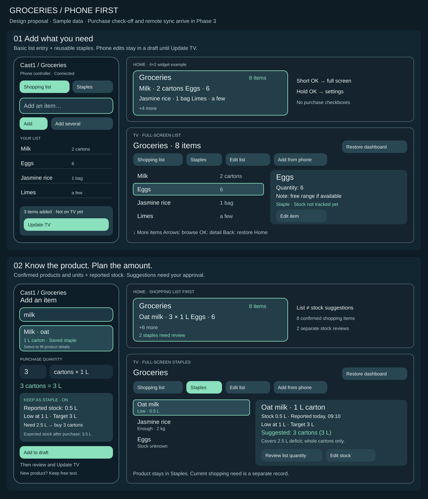
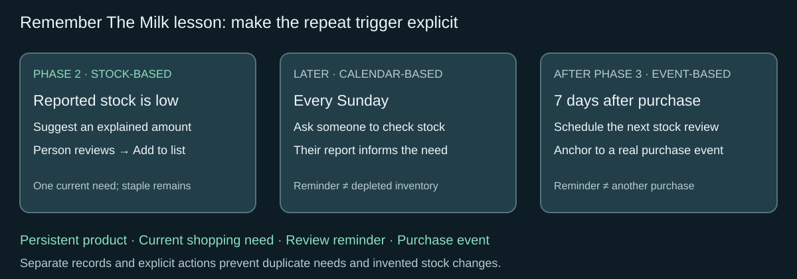
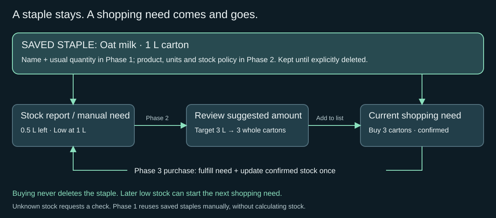
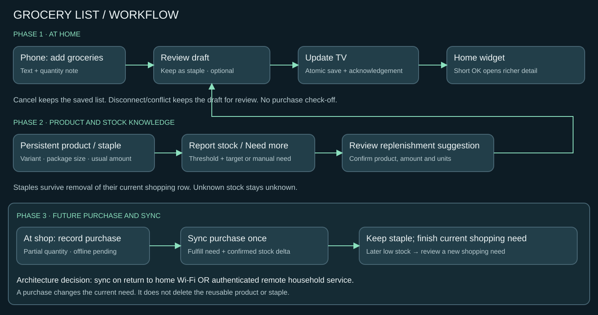

# Grocery list: phone entry, product knowledge and household staples

Status: **Phases 1 and 2 implemented, with the Cooper interaction revision**,
November 19, 2026, developed in `.worktrees/grocery-list` on
`feature/grocery-list` and merged into `main`. The revision adds capture-first phone entry, direct reuse, counted
staple review, familiar quantities and recoverable ordinary edits. See the
[Cooper implementation record](2026-11-19-grocery-goal-directed-design.md) and
[0.1.81 verification](../testing/2026-11-19-grocery-cooper.md). Original Phase 1/2
acceptance on 0.1.78 is retained in the [baseline record](../testing/2026-11-19-groceries.md).
Phase 3 purchase check-off and remote sync remain future work. Mockups illustrate
the design; verification records distinguish implemented behavior and remaining
physical/usability acceptance.

TL;DR: Phase 1 makes adding groceries from a phone quick and shows the saved list
on Homeboard. Phase 2 adds reusable product knowledge, meaningful quantities and
stock-aware staples. Phase 3 adds purchase check-off away from home and reliable
sync back to the dashboard. A staple remains in the household's catalog after a
purchase; its current shopping need is a separate record.

[Open the illustrated plan](2026-11-19-grocery-list-widget/index.html) ·
[Phase 1 and Phase 2 mockups](2026-11-19-grocery-list-widget/mockups.svg) ·
[Interaction workflow](2026-11-19-grocery-list-widget/workflow.svg)

## Delivery checkpoint — November 19, 2026

Implementation and evidence are committed and pushed on `feature/grocery-list`:
`77f4536` implements the Cooper revision, following `15f1061` and `421d56f`
for the original Phases 1/2. The separate cleanup completion-race correction is
`919b733`. The feature branch is now merged into main; the tested Android source
is unchanged by the documentation conflict resolution.

| Scope | Delivered behavior | Current acceptance |
|---|---|---|
| Phase 1 | Phone Add/Enter and batch entry, quantities/notes, named lists, reorder/removal, persistent staples, explicit Update TV and whole-update Undo. | Browser/model checks pass; Cast1 native full-screen/restoration proof passes. Physical handset pairing remains to be checked. |
| Phase 2 | Direct product reuse, contextual quantities and custom text, exact package conversions, simple/measured stock, counted staple filters and explained replenishment. | Browser/model checks pass, including package correction and explicit quantity replacement; Cast1 shows richer product/stock detail. Household usability observation remains open. |
| Cooper revision | Capture precedes management; ordinary edits recover across navigation/reload/conflicts; removed widgets/lists retain an explicit recovery path; publication names all affected outcomes. | Committed in `77f4536`; checked in Chromium and WebKit at 390×844 and with 200% text. |
| Phase 3 | Purchase check-off, away-from-home editing and reliable dashboard sync. | Away-from-home and offline use required; API Gateway/Lambda/DynamoDB selected with durable phone storage. Enrollment/client/account decisions remain open; implementation is planned. |

Frozen debug build **0.1.81** passed 510 JVM tests, Android lint and the shared
phone checks. Cast1 installation `J‑f1c8ca8cfac7` and native proof
`J‑0d317527642f` succeeded. Cast2's identical-APK installation
`J‑3e40923b3c88` was submitted and admitted, then failed
`personal-install-in-use`; installation there remains unconfirmed.

The [verification record](../testing/2026-11-19-grocery-cooper.md) contains the
APK hash, source verification, precise test boundaries and actual
[phone capture](../testing/2026-11-19-grocery-cooper/phone-capture.png),
[staple review](../testing/2026-11-19-grocery-cooper/phone-staples.png) and
[Cast1 full-screen capture](../testing/2026-11-19-grocery-cooper/cast1-staples.png).
The original mockups and workflow below remain design references.

## Goals and agreed boundaries

- People primarily add items on a phone. The TV is a readable household reminder,
  with full-screen detail and a secondary remote-entry route.
- Phase 1 is basic list entry. Phase 2 understands products and units. Purchase
  check-off and synchronization from the shop belong to Phase 3.
- Some products are regularly bought and must remain available even when there
  is currently enough stock. Buying something and deleting its product record
  are different actions.
- Build on the Java launcher and current phone-controller pairing, draft,
  **Update TV**, revision and Undo behavior. No account or server is needed for
  Phase 1 or Phase 2. Each TV owns its list initially.

The current phone controller needs a temporary approved session on the home
network, with Homeboard open. That supports adding groceries at home; it does
not support editing from a shop or automatic Cast1/Cast2 list synchronization.
Phase 3 must deliberately add that capability rather than imply it already exists.

## Existing-app survey and design decisions

Surveyed official product pages and help documentation on November 19, 2026,
after the initial design and first implementation pass. This is a documentation
survey, not hands-on testing or a claim that integrations are available. Will
identified **Out of Milk** as a feature-rich reference; it is the primary reference
for pantry behavior. No external app, service or account has been selected.

| Reference | Documented pattern | Homeboard decision |
|---|---|---|
| **Out of Milk** | Separate pantry and shopping lists; pantry items can use **Low/Full** or numerical quantities with units. Items can be copied from pantry to shopping while remaining in pantry. | Adopt the distinction between **what we regularly keep**, **what we have**, and **what to buy now**. Offer simple **Need more / Enough / Unknown** first, with optional measured stock. Adding a shopping need keeps the persistent staple. [Pantry modes](https://support.outofmilk.com/hc/en-us/articles/115002181512-Pantry-List-Low-Full-vs-Quantities), [copy versus move](https://support.outofmilk.com/hc/en-us/articles/206157726-Android-Move-or-Copy-items-between-lists). |
| **AnyList** | Favorites form a reusable master list; favorites are suggested while typing and preserve saved item details. Separate item details include quantities, package sizes and notes. | Adopt quick entry, explicit **Keep as staple**, suggestions from confirmed products, and optional details. Reuse must not require re-entering brand/variant or package size. [Favorites](https://help.anylist.com/articles/favorites/), [item details](https://help.anylist.com/articles/feature-overview-item-details/). |
| **OurGroceries** | A master list remembers entered items; typing narrows suggestions. Crossing off moves a current item out of the active section without removing it from reusable history. | Adopt identity-based reuse and a clear separation between active needs and retained products. In Phase 3, purchase completion must remain reversible and must not delete the staple. Automatic history of every free-text entry is a possible follow-up, distinct from explicitly saved staples. [User guide](https://www.ourgroceries.com/user-guide). |
| **Bring!** | Fast item entry plus optional quantities/descriptions, variant refinements and categories; descriptions distinguish otherwise similar items. | Adopt progressive detail: a name is sufficient. Keep variants distinct and require confirmation before combining quantities or products. Store/category ordering can follow observed household use. [Items and lists](https://www.getbring.com/help-center-main-categories/items-lists). |
| **grocy** | Product-based inventory, minimum-stock shopping suggestions and purchase tracking; self-hosted with an API. | Use as a reference for explicit stock units and replenishment policies. Keep inventory optional in Homeboard and preserve the quick-list workflow. A grocy adapter is a candidate for a later integration investigation, not a required server. [Official overview](https://grocy.info/). |
| **Remember The Milk** | One-line Smart Add; saved searches as Smart Lists; calendar-based **Every…** versus completion-based **After…** recurrence; shared lists and task assignment. | Learn fast capture, filtered views over one underlying record, and explicit repeat triggers. Keep time-based reminders separate from stock-based replenishment. [Tour](https://www.rememberthemilk.com/tour/), [Smart Lists](https://www.rememberthemilk.com/help/?ctx=basics.smartlists.createlist), [repeat semantics](https://www.rememberthemilk.com/help/?ctx=basics.basics.repeatformat). |

The Out of Milk pantry help pages are older documentation (2017–2019); they
establish the reference interaction, not present-day platform parity or an API
contract. Its [feature overview](https://outofmilkapp.com/features) also describes
pantry management, quantities, item history, categories, barcode entry and shared
lists. Those additional capabilities inform the roadmap; none implies that
Homeboard currently supports barcode lookup or remote shared-list sync.

### Adopt in Phases 1 and 2

- **Phone-first, one-field entry.** Keep name-only Add/Enter prominent; reveal
  quantities, product identity and stock only when the person wants them.
- **Reusable staples / pantry.** A persistent household item is independent of a
  shopping row. Enough stock hides its current shopping need, not its identity;
  until purchase handling exists, removing a row remains an explicit manual edit.
- **Simple status or measured stock.** People can report Need more, Enough or
  Unknown without counting grams or milliliters. Quantitative tracking is optional
  per product, with a report timestamp and explicit units.
- **Remember confirmed detail.** Product suggestions can reuse names, aliases,
  brand/variant, normal purchase quantity and known package sizes. Unknown items
  remain addable immediately.
- **Review replenishment.** Low-stock suggestions are separate from confirmed
  shopping needs. Show the deficit, package rounding and expected resulting stock
  before adding; never duplicate needs during a refresh.
- **Preserve user intent.** Quantity increases, product merges, deletion and stock
  corrections require clear actions and reversible drafts. A stock edit alone
  does not mark a purchase or silently clear someone's shopping row.

### Keep for Phase 3 or later

Phase 3 owns shopping-away-from-home use, check-off, partial purchases, offline
pending state and household/dashboard synchronization. Later candidates include
barcode/product lookup, recent-item history beyond saved products, configurable
store/category ordering, prices and product photos. Recipes, coupons and retailer
ordering are separate needs to validate; Out of Milk's breadth is a reference,
not a requirement to expose all those features in the first form.

### Remember The Milk: strengths and what to take

Remember The Milk is a task-management reference rather than a pantry inventory
model. Its strongest contribution here is making capture and follow-through easy
without requiring the person to open a large editor. The following are Homeboard
design judgments informed by its official documentation, not claims that RTM has
stock-aware grocery behavior.

| Strength | What Homeboard can learn | Phase and acceptance |
|---|---|---|
| **Fast capture with progressive detail.** Smart Add accepts several task properties in one line; mobile entry also offers visible shortcuts for people who do not know the syntax. | Preserve the one-field Add/Enter path. Consider optional quantity/category chips when an interpretation is confident, with the interpreted product/amount/unit visible before confirmation. Keep the original text and an ordinary editor available; do not require syntax or silently reinterpret Thai/English names. [Smart Add](https://www.rememberthemilk.com/help/?ctx=basics.smartadd.whatis), [mobile entry](https://www.rememberthemilk.com/services/iphone/faq/). | Phase 1 fast entry and Phase 2 explicit confirmed fields are current scope. Natural-language parsing is a later enhancement; an ambiguous `2 milk` must stay text until confirmed. |
| **Useful views over shared records.** Smart Lists save search criteria and update as matching tasks change. | Offer named, understandable views such as **Need more**, **Check stock**, and **Already on shopping list** over the same products/needs. A view must not create a second inventory. Any future store/category filters must say what they exclude. [Create a Smart List](https://www.rememberthemilk.com/help/?ctx=basics.smartlists.createlist). | Phase 2 follow-up: filtered staple review, without importing a general query language. Changing a status updates view membership; an existing shopping need remains reachable and is never duplicated. |
| **Two distinct recurrence rules.** `Every…` follows the calendar; `After…` generates another occurrence after completion. | Distinguish **review stock every Sunday**, **review again 7 days after purchase**, and **suggest buying when reported stock is low**. A calendar reminder is not evidence of consumption, an actual purchase, or depleted stock. [Repeat formats](https://www.rememberthemilk.com/help/?ctx=basics.basics.repeatformat). | Stock thresholds/manual need remain Phase 2. Scheduled review reminders are later work. Completion-relative review belongs after Phase 3 has real purchase events. Test late/missed reviews, purchase reversal and duplicate prevention before enabling recurrence. |
| **Shared responsibility and reminders.** Lists can be shared with edit/view permissions, tasks assigned, and reminders configured. | A future **Who is shopping?** assignment and **Check stock** reminder can support household coordination. Preserve one shopping need; show assignment/sync state instead of copying a row per person or TV. [Getting started](https://www.rememberthemilk.com/help/guide/). | Phase 3 or later: decide household identity, permissions, offline acknowledgements and notification delivery first. Do not add a required account or background alert service to Phases 1/2. |

The key modeling lesson is **a persistent product is not a repeating task**.
A staple can stay visible indefinitely with enough or unknown stock. A shopping
need represents a particular decision to buy. A reminder requests a review.
An actual purchase is an event. They may reference each other, but checking off a
future reminder must not increase stock or fulfill a shopping need.

For a later review-reminder feature, specify `calendar schedule` versus `after
purchase`, the relevant time zone, next review time and the event that advances
it. Preserve product identity, usual amount and package knowledge across cycles;
keep purchase-specific notes/history separate. A missed reminder must not create
multiple identical shopping needs. Do not estimate inventory from elapsed time
unless a separately designed, explicit prediction feature is chosen.

This survey expands the design vocabulary and roadmap. It does **not** expand the
currently authorized Phase 1/2 build into a general task manager, scheduled-reminder
service or RTM integration. Provider/API availability, authentication, terms and
product/unit mapping would need separate verification before any adapter choice.

### Shared implementation sequence

Will authorized Phases 1 and 2 together, or sequentially if more efficient. Use one
shared list/product/staple model and transaction path in this worktree:

1. Persist lists, current needs and reusable products; register compact and richer
   full-screen presentations and preserve widget restoration.
2. Extend the existing phone draft with fast Add/Enter, batch entry, edit/reorder,
   multiple lists and reusable staples; commit through Update TV with Undo.
3. Add confirmed quantities, product/package knowledge, optional stock reports and
   replenishment review. Use exact decimal arithmetic and matching validation on TV
   and phone; do not infer consumption.
4. Run container model/browser/lint checks and record screenshots, then deploy the
   identical newly numbered APK to both TVs through the coordinator. Record actual
   install and foreground acceptance separately. Keep unrelated main-worktree edits
   out of this feature branch and coordinate a combined deployment when necessary.

## Phase 1 — a useful list, fast to add to

### Phone: the primary surface

Open the existing named TV controller and tap the **Groceries** card. The header
identifies the TV and list. Keep an **Add an item…** input and **Add** action
above the ordered draft list. The keyboard's Add/Enter action adds the row,
clears the field and keeps the keyboard ready for the next item. Accept Thai,
English and mixed text without requiring a catalog selection.

An optional quantity field is plain text, for example **2 cartons**, **500 g** or
**a few**. It is a human-readable note in this phase, never silently parsed or
converted. Row details provide quantity text and a longer note. A new row needs
only a nonblank name. **Add several** accepts one item per line and previews the
result before putting the rows in the draft; blank lines are ignored.

Adding changes the phone draft immediately. A persistent summary says, for
example, **3 items added · Not on TV yet**, beside the existing **Update TV**
action. One update commits the entire reviewed draft and creates one Undo entry.
Typing or adding individual rows must not produce repeated TV writes. After a
successful acknowledgement, say **Saved to Cast1**. A lost acknowledgement is
**Checking update…**, not an invitation to create duplicate entries.

People can edit names, quantity text and notes, reorder by drag grip or explicit
move actions, and remove a row with draft Undo. There are **no checkboxes or
Bought actions** in Phase 1. The list is maintained manually through editing and
removal until Phase 3 introduces purchase semantics. Removal must say **Remove
from list**, never **Purchased**.

Matching names show a gentle **Already on the list — edit it or add another?**
choice. Case and surrounding whitespace may help find a possible duplicate, but
never merge entries automatically: two Milk rows may describe different products.
Preserve entered names, punctuation and language. Stable row IDs distinguish them.

### TV: glance and richer full screen

Add **Groceries** through the existing widget picker; do not rearrange the default
dashboard. Start with an empty list, not the sample groceries in the mockup.
Propose a **4×2** size preset, subject to the current grid and collision checks.

| Surface | Phase 1 content and interaction |
|---|---|
| 1×1 | Basket icon, list name, item count and first item when space permits. |
| Wide one-row | Title/count and a few item names with a clear remaining count. |
| Standard/tall | Ordered names and quantity text; show **+N more** instead of auto-scrolling. |
| Full screen | Entire scrollable list, full names, quantities and a highlighted-item pane with complete notes. Edit list opens the remote Add item/Edit item fallback; Add from phone and Configure are explicit actions. |

Home focuses the whole widget. Short OK/click opens the existing expansion shell;
hold OK opens Configure/Move/Resize/Remove widget. In full screen, Up/Down moves
through rows and updates details; Right reaches the detail actions and Left returns
to the selected row. OK on a row opens its detail, without changing list data.
An explicit Edit item action opens a draft editor with Save/Cancel. Add item uses
the same fields and Android's available input method; built-in voice recognition
is not a feature requirement.

**Add from phone** in full screen enters the existing temporary phone-pairing
flow, restoring the originating dashboard first so Update TV can proceed once paired. Reuse its TV approval and session
lifecycle rather than exposing a permanent unauthenticated list URL. Follow the
current controller rule that Update TV waits until the TV leaves an active
full-screen interaction; the phone explains **Return the TV to Home to update**
and retains the draft. The Home card refreshes after the acknowledged update.

Back closes nested details/editors first, then restores the original Home page,
widget focus and saved size. **Restore dashboard** is always visible in the
expansion and returns directly, resolving any dirty editor with Save/Discard/Keep
editing first. Browsing, expansion and restoration create no Undo entries.

### Recurring items begin as “Keep as staple”

An optional **Keep as staple** switch is available in item details. Saving creates
a persistent, named staple and links the current shopping row to it. The phone has
two clearly labeled views: **Shopping list** and **Staples**. A staple remains in
Staples if its shopping row is removed. **Add to shopping list** reuses its saved
name and default quantity text; if already listed, open that row instead.

Phase 1 staples are reusable entries, not automatic stock tracking. Show **Stock
not tracked yet** in their details, with no guessed low-stock badge. Deleting a
staple is a separate explicit action: explain that any current shopping row is
kept as an ordinary item. Removing a widget keeps its list and staples so re-adding
can restore them; deleting a list is separate and has Undo. Multiple widget instances
can select the same local list by stable ID; separate named lists are independent.
Start with one **Groceries** list; keep list management in Configure rather than
requiring it during first use.

### Phase 1 empty, failure and limit behavior

An empty TV card says **No groceries listed · Add from phone**. Full screen also
offers Add item; the phone focuses the add field. A blank Staples view explains
**Keep regularly bought items here to add them again**.

Keep saved TV data visible without network access. The phone distinguishes a
draft from saved data, preserves pending edits on disconnect and requires fresh
approval/conflict checks after reconnecting. Use the current operation receipt
and conflict resolution path, never last-writer-wins. Two concurrent edits to the
same list require explicit review; independent lists may merge independently.
If storage fails, retain the draft and show that saving failed; do not show a saved
confirmation. A failed load is **List unavailable**, not an empty list; never
overwrite unreadable data automatically.

Server-validated limits: 32 named lists, 200 rows and 200 saved products per list,
and 256 KiB of grocery JSON across all lists, 120 Unicode
code points for names, 40 for quantity text and 500 for notes. Explain limits at
the relevant input; do not truncate silently. Validate every row before atomic
commit. Large lists scroll normally with identity-based focus.

## Phase 2 — understand what and how much

Phase 2 keeps the fast free-text path. Product knowledge begins with what the
household has entered and confirmed; a global commercial product database or AI
service is not a prerequisite. No catalog lookup may prevent adding an unknown item.

### Phone: recognize, suggest, confirm

Typing **milk** can suggest a saved product, such as **Milk · oat · 1 L carton**,
with its usual purchase quantity and staple status. Selecting it fills editable
fields; typing a new name still creates a new product. Product details contain:

- Name, optional brand/variant, household-confirmed aliases and optional category.
- Usual purchase quantity and package definition, such as **1 carton contains 1 L**.
- Optional staple status, stock tracking choice and replenishment threshold/target.

Distinct brands, sizes and variants remain separate unless a person explicitly
merges them with a preview of affected rows and stock records. Suggestions must
not turn every item named Milk into the same product. Categories are optional,
manually editable grouping aids; changing them does not change quantity or stock.

Quantity entry accepts explicit **amount + unit**, and an optional package count:
**2 cartons × 1 L = 2 L**, **500 g**, **6 eggs**. Show a confirmation chip after
parsing and let people edit it. Ambiguous **2 milk** stays unstructured until
confirmed. Original free text remains available for items that do not fit the
model; do not force a false structured interpretation.

| Unit rule | Example and decision |
|---|---|
| Same dimension | 1 kg + 500 g can be displayed as 1.5 kg when the product is the same. Use exact decimal values and explicit conversions. |
| Packaging | 2 cartons becomes 2 L only when that product's carton size is confirmed as 1 L. A carton has no universal size. |
| Count | Eggs may use pieces; **1 dozen = 12 pieces** can be an explicit supported count unit. A bag/bunch remains a package without a confirmed content quantity. |
| Different dimensions | Never convert mass to volume without a product-specific, reviewed rule. Phase 2 does not need density conversions. |
| Missing knowledge | Preserve **2 packs** as packages with unknown content; explain what information is missing rather than inventing grams. |

When a matching product is already listed, offer **Increase quantity** only if
the quantities are compatible; preview the resulting total before commit. Otherwise
offer a separate row or edit. Keep brand/variant and unit identity in the decision.

### Staples: inventory is separate from shopping demand

Each staple chooses **Manual need** or **Track quantity**. The first allows
**Enough / Need more / Unknown**, without claiming an exact stock count. The second
records an explicit amount in a compatible base unit, plus a low-stock threshold
and a desired stock target. A person updates stock from the phone; there is no
automatic inference that elapsed days imply consumption.

Example: oat milk comes in 1 L cartons; reported stock is 0.5 L, the threshold is
1 L, and the target is 3 L. Recommend **3 cartons** to cover a 2.5 L deficit,
showing the expected 3.5 L after that purchase. Threshold means **at or below**;
round upward only in whole-package mode. Loose goods can use their supported
purchase increment. Targets must exceed thresholds; negative stock and invalid or
incompatible units block saving with a field-level explanation.

Show a phone **Needs review** section for low-stock/Need more staples. Its
**Add to list** action confirms the proposed quantity and creates or updates one
linked shopping need. In Phase 2 low stock suggests a need; it does not silently
append groceries every time the dashboard refreshes. Existing listed quantities
are shown before any replacement or increase. A later stock correction marks a
linked need for review rather than silently removing a manually confirmed row.

Every stock value shows **Reported [date/time]**. Unknown stock stays unknown;
allow **Check stock** reminders and explicit manual entry. Show the report age
instead of an arbitrary claim that stock is still accurate. Until Phase 3, manually
adjusting stock does not imply a purchase transaction or erase a list row.

### TV: more information without more friction

The compact card prioritizes the current shopping list and counts only confirmed
shopping rows. Expanded Staples provides stock review. The mockup also explores a
secondary **2 staples need review** line, separate from **8 items on list**; this
compact stock summary and a standalone Staples display choice remain follow-up
layout work. Unconfirmed suggestions must never count as shopping rows.

Full screen has **Shopping list / Staples** tabs. The shopping detail adds the
selected product, brand/variant, package size, quantity breakdown and notes. The
staple detail adds reported stock and its timestamp, threshold, target and a
human-readable explanation of the proposed purchase. All records remain reachable
regardless of compact size. Add to list and Edit stock are explicit phone draft
actions. The native remote editor is the basic names/quantity-text/notes fallback;
product, packaging and stock-policy configuration uses the phone controller.
Back/Restore/focus follow Phase 1's expansion contract. There is still no purchase
check-off in this phase.

## Phase 3 — purchase at the shop and sync home

**Confirmed requirement, November 19:** shopping must work away from home and
when offline. A connection will normally be available; occasional loss must not
interrupt shopping or lose purchases. This requirement applies to Phase 3 and is
not a claim about the current temporary home-network controller.

The [Phase 3 shopping and sync plan](2026-11-19-grocery-shopping-sync.md) defines
the scenarios, screen mockups, state diagram, operation contract and acceptance.
Architecture direction: a durable phone copy and operation queue, with an
**authenticated household sync service using API Gateway, Lambda and DynamoDB**
for remote updates, as accepted by Will. A connected TV catches up automatically;
returning to home Wi-Fi is not required. Account/region, enrollment, durable client
technology and the operation/transaction protocol remain implementation decisions.
The [selected backend diagram](2026-11-19-grocery-shopping-sync.md) separates phone
offline durability, shared service acceptance and actual TV delivery.

- Record purchases, partial amounts and package changes locally before showing
  success. Prepared phones must reopen their shopping view and list while offline.
- Distinguish **Saved on phone · Waiting to sync**, **Shared list updated ·
  Dashboard waiting**, and actual TV delivery. Reconcile lost responses with the
  same operation ID; do not duplicate purchases or stock effects.
- Fulfilled needs move out of To buy, with reachable purchase history and Undo.
  Keep the reusable staple/product. Any measured-stock increase uses confirmed
  actual amounts and checks for a later report; simple stock is not guessed.
- Merge concurrent edits and handle purchase reversal without overwriting later
  reports, another shopper's purchase or a newer replenishment cycle.
- Scope shopping sync to groceries. Keep household/list ownership explicit, adopt
  existing independent TV lists deliberately, and preserve the full-screen
  Back/Restore/page/focus/size contract. The temporary configuration editor is
  not an always-on public shopping server.

## Data and implementation design

| Record | Responsibility |
|---|---|
| GroceryList | Stable ID, title, ordered shopping-row IDs, staple IDs and revision. |
| ShoppingItem | Stable ID, product/staple link if any, entered label, quantity text/structured quantity, note and explicit order. Represents a current need. |
| Staple | Stable ID, reusable product/default quantity and, in Phase 2, manual need or stock policy. Persists independently of the current need. |
| Product (Phase 2) | Stable ID, confirmed name/aliases/variant/category, quantity dimension and package definitions. Package sizes belong to this product. |
| Stock report (Phase 2) | Product/staple identity, reported amount/unit or qualitative state, timestamp and revision. It is a report, not an inferred consumption rate. |
| Purchase event (Phase 3) | Unique operation ID, need/product references, actual quantities, effects and acknowledgement/sync state. |
| Widget settings | List reference and display choice; geometry belongs to HomeLayout. Two views of one list share data, not duplicate inventories. |

Keep content in the existing atomic configuration transaction and revision/Undo
boundary, with widget settings referencing list IDs. A phone update must not restore
an old list snapshot over later TV edits. Extend aggregate snapshots and composite
Undo to include groceries. Removing a widget preserves list records; an explicit
list deletion cannot leave dangling widget references. Apply deletion and affected
widget choices atomically with Undo. Do not store pairing credentials in list data.

Use native Java compact/expanded views and one controller/model per list. Reuse
`WidgetExpansion` restoration/lifecycle and the phone editor's approved session,
draft recovery, operation receipts and conflict UI. Data mutations share one path
whether initiated by TV or phone. Do not add a legacy compatibility layer for an
unreleased model. When Phase 2 arrives, preserve actual Phase 1 lists as free-text
rows; structure quantities only after confirmation, never by a lossy rewrite.

Localize controls and quantities in English/Thai, leaving product names as entered.
Use explicit units, readable text, visible focus and accessible movement controls.
Palette/opacity, larger text and Reduced motion must work. No automatic carousel,
color-only stock status or provider account requirement in Phase 1/2.

## Workflow

## Delivery and acceptance

### Phase 1

- [x] Phone: quickly add several English/Thai items; Enter retains entry focus;
  optional quantity/notes, duplicate choice, batch preview, edit/reorder/remove and
  draft Undo work. No purchase checkboxes appear.
- [ ] Draft versus saved state is clear; one Update TV commits all reviewed rows
  with one Undo entry. Cancel, disconnect, stale revision, uncertain result and
  storage failure preserve work without duplicate or partial commits.
- [x] Keep as staple persists a reusable entry. Removing a current need preserves
  its staple; adding it again avoids accidental duplicates; deleting a staple
  explicitly leaves its current row as an ordinary item.
- [ ] Empty, unavailable, limits, multiple lists, shared-list widget instances,
  widget removal/re-add and relaunch preserve correct content and identity.
- [ ] Compact size variants show honest counts/overflow. Short OK opens the entire
  list with additional quantities/notes; hold opens actions without also expanding.
- [ ] Remote row/detail/editor navigation, cancel/save and dirty-editor restoration
  work. Back and visible Restore recover the exact Home page, focus and dimensions.
  Full-screen browsing changes neither saved geometry nor Undo history.
- [x] Cast1 scripted short/held OK, native view clicks, nested Back and visible
  Restore preserve the original page, widget focus, dimensions and list data.
  Aggregate Apply/retry/Undo also passes in the isolated native probe.
- [ ] Phone pairing from full screen and return-to-Home-before-update behavior are
  understandable; real phone LAN testing establishes connectivity separately from
  browser fixture tests. English/Thai, larger text and reduced-motion checks pass.

### Phase 2

- [x] Saved product suggestions reuse known defaults directly; unknown products
  and unconfirmed units remain addable as text. Repeated reuse does not increase
  an existing need.
- [ ] Complete a dedicated product-merge walkthrough: aliases/variants remain
  distinct until explicitly merged, with all surviving/discarded effects reviewed.
- [x] Exact decimal mass/volume/count conversion, confirmed package sizes, fractional
  amounts, whole-package rounding and incompatible/unknown units behave as specified.
  Ambiguous text stays unstructured until confirmed.
- [x] Manual need and quantitative stock both work. Unknown stock has no fabricated
  quantity; report timestamps and threshold/target validation are visible.
- [x] Low stock suggests an explained quantity. Confirming adds/updates one need;
  refresh/retry creates no duplicate; a stock correction requests review instead of
  silently clearing the shopping list. No consumption is inferred from time.
- [x] Staples remain present independently of active needs. Both tabs add real
  full-screen product/stock detail and preserve the Phase 1 restoration contract.
- [x] Existing Phase 1 data is retained verbatim until structured by its owner.

For each implemented phase, run appropriate model and phone browser checks plus
`task check` and `task build` in containers, following the build how-to. Use
`task deploy` for one newly numbered frozen APK on both Cast1 and Cast2, preserving
app data. Coordinator devices/queue/complete job/watch/evidence owns every device
session; Cast1 is the routine foreground acceptance target. Capture phone draft,
saved dashboard, full-screen detail, empty/error states and restoration. Implementation now requires these checks; the earlier design-only revision did not
require a build, deployment or device session.

## Next acceptance work

- [ ] Observe capture, simple stock and replenishment with real household items;
  record hesitation and whether the publication state is understood.
- [ ] Verify physical phone LAN pairing/reconnection and enlarged English/Thai
  TV presentation, including physical remote/pointer use.
- [ ] Finish the remaining broad acceptance items above, especially native editor
  interruption/cancellation, size variants, limits and product merging. Checked
  items record verified scenarios; an unchecked composite item is not a claim
  that its entire feature is absent.
- [ ] Confirm Cast2 installation through the coordinator when the reported
  execution precondition changes. Reuse the identical frozen 0.1.81 APK for this
  additional target; record its own receipt. Personal use remains operation-specific.
- [x] Confirm that Phase 3 must support away-from-home shopping and occasional
  offline use; record the durable-phone-copy plus remote-sync direction.
- [x] Select AWS API Gateway, Lambda and DynamoDB as the Phase 3 backend.
- [ ] Resolve account/region, enrollment, durable phone storage, API/table/transaction
  contracts and operating-cost budget against the
  [shopping/sync acceptance contract](2026-11-19-grocery-shopping-sync.md).

## Open product decisions

Validate the proposed stock threshold/target workflow with real household items,
especially loose produce and partial packs. Away-from-home and offline shopping
are required for Phase 3. The AWS backend is selected; account/region, enrollment,
durable client storage and the consistency protocol still need detailed design. Barcode
lookup, retailer prices, recipes, automatic consumption prediction and retailer
ordering remain separate future features.
