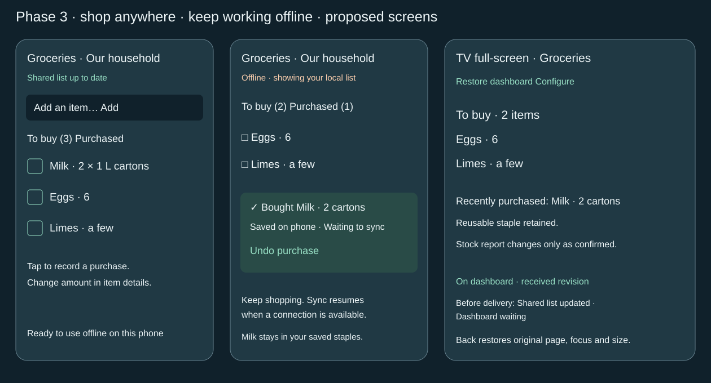
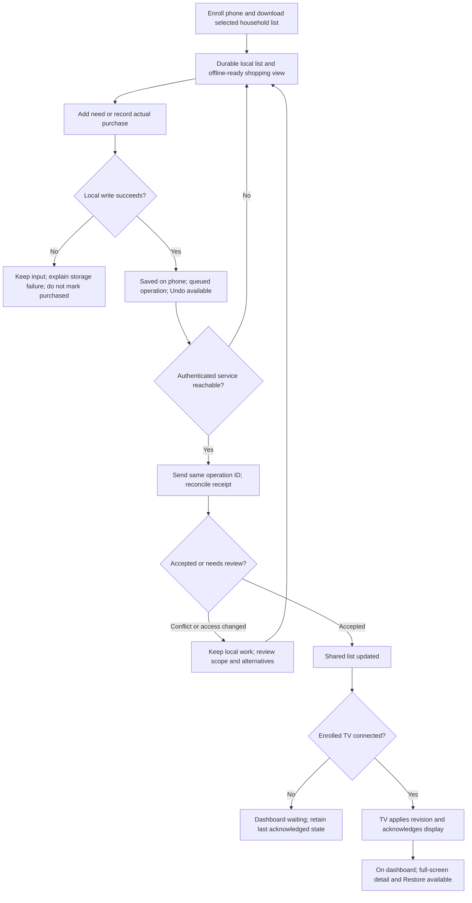

# Grocery Phase 3: shopping away from home, including offline

Status: **requirements confirmed; architecture direction proposed**, November 19,
2026. Will confirmed that shopping must work away from home and when offline,
although a connection will normally be available. Phases 1/2 remain implemented
on `feature/grocery-list`; this plan adds no running service or shopping code.
See the [grocery plan](2026-11-19-grocery-list-widget.md) and the
[shared Cooper filter](/home/will/docs/howtos/alan-cooper-design-filter.md).

## Requirement and architecture direction

**Shop anywhere. Keep working through connection loss. Sync automatically when
connected.** Offline support is a required recovery path, not a separate mode the
person must remember to enable.

Use a durable phone copy of the shopping list and a durable queue of grocery
operations, backed by an authenticated household sync service. The phone can shop
without contacting the TV. Connected phones exchange changes through the service;
the TV catches up when connected and acknowledges the revision it actually shows.
Returning to home Wi-Fi is not required for synchronization.

This selects the direction over return-home-only synchronization. Service hosting,
identity/enrollment, client technology, storage guarantees and operating cost still
need a focused implementation decision. No provider or account is selected here.
Do not expose the temporary TV configuration editor to the internet.

## Cooper scenarios and boundaries

The primary profile is the person buying groceries, usually connected, sometimes
losing service inside a shop. Their goal is to see what is needed and record what
they bought without losing their place or wondering whether a tap was kept. The
secondary profile is someone adding needs at home while shopping is in progress.
These are provisional profiles based on Will's requirement, not field-study results.

| Scenario | Required behavior |
|---|---|
| Open the list at the shop | Show the last local list immediately, including quantities, notes and variants; refresh in the background when possible. |
| Lose connectivity after opening, or close and reopen while offline | Reopen the previously prepared list and retain purchases and edits. Initial enrollment/list download requires a connection; say so before promising offline readiness. |
| Check off Milk with no signal | Persist the purchase locally before showing success. Label **Saved on phone · Waiting to sync** and offer Undo. No connection or sign-in dialog interrupts the cached shopping task. |
| Buy only part of a need or a different package | Record the actual amount/package explicitly, preview the remaining need and any stock effect. Preserve ambiguous quantities as text for review. |
| Someone adds an item at home | Merge additions by identity. Show received changes without jumping the shopper's position or hiding the item they are acting on. |
| Connection returns, or a response is lost | Automatically reconcile queued operations with the same IDs. Never duplicate a purchase or stock increment. A connected TV receives the resulting list without an open phone-configuration session. |
| Service accepted the change, but TV is offline | Show **Shared list updated · Dashboard waiting**. Only a TV acknowledgement supports **On dashboard**. |

Purchase completion keeps the reusable product/staple. Fulfilled needs move out of
To buy into a reachable Purchased view with Undo. Simple stock remains an explicit
report: checking off an item does not claim its current stock is Enough. For
measured stock, propose an increase from the confirmed actual purchase, with clear
control and a report-revision check; do not invent amounts or overwrite a later
stock correction.

Shopping actions commit grocery changes only. The shopper must never publish
pending Rain, Calendar or layout edits from the configuration editor. Enrollment
makes the shopping target household/list visible; switching targets never carries
another household's draft, queue or Undo along with it. Sharing a canonical list
with Cast1 and Cast2 is explicit enrollment, not an automatic merge of their
currently independent lists.

## Screen mockups

The shopping page leads with the named list, Add and To buy / Purchased. A purchase
control has a clear label and a large touch target. Normal taps do not require a
confirmation dialog; partial amounts and package changes open contextual detail.
A persistent status line explains local save, household sync and dashboard delivery.
An unobtrusive offline indicator must not obscure the list or require dismissal.
The mockups are design references, not implemented screens.

The TV widget remains a reminder with current needs and honest counts. Short OK
opens the full list, product/stock detail and recent purchase/sync information.
Back and visible Restore dashboard retain the original page, widget focus and
saved size. Network-driven refreshes do not move focus, change geometry or create
layout Undo entries.

## Workflow and consistency contract

- Persist local operations and their ownership before acknowledging the tap. Cache
  the shopping interface as well as data so a prepared device can reopen offline.
  Storage refusal, quota exhaustion and cold-start behavior require explicit tests;
  do not equate a browser cache or an in-memory draft with a durability guarantee.
- Give operations stable IDs, list/need identities and need-generation references.
  A retry is the same operation. A subsequent replenishment cycle is a new need;
  a delayed purchase must not fulfill it accidentally.
- Apply deltas/events rather than publishing an old full-list snapshot. Concurrent
  purchases of the same need can represent real overbuying; preserve both events
  and surface the resulting discrepancy instead of discarding one silently.
- Check stock-report revisions before applying an inventory increase. A changed
  report requires review of that stock effect; a purchase acknowledgement must say
  which effects were applied and which remain unresolved.
- Undo is a compensating operation referencing the original purchase, usable
  offline and deduplicated on sync. It must not replace a later report, remove
  someone else's purchase or resurrect a newer fulfilled need.
- Revoked/expired access must not erase queued local work. Retain it for explicit
  recovery, explain why it cannot be shared, and require valid authorization before
  remote application. Initial enrollment and cross-household recovery are online
  boundaries; do not silently redirect operations to a different list.

## Implementation sequence and acceptance

1. Decide the service, durable client storage and enrollment design against this
   contract; specify cost/maintenance and how existing TV lists are adopted.
2. Deliver remote list read/add with phone persistence and TV revision delivery.
   Keep grocery synchronization separate from dashboard configuration transactions.
3. Add purchase events, partial amounts, explicit stock effects and compensating
   Undo; preserve reusable staples and make Purchased reachable.
4. Verify interruption, concurrency, conflicts and delivery states before rollout.

- [ ] Normally connected: phone additions/purchases made away from home reach an
  enrolled TV automatically; a sleeping/disconnected TV catches up on reconnect.
- [ ] Prepared phone: launch, browse, add, purchase, Undo, close and reopen with no
  network; all acknowledged local work survives app/browser restart.
- [ ] Disconnect before send, during send and after server commit; retries and
  duplicate delivery apply each operation exactly once at the effect boundary.
- [ ] Two shoppers, a concurrent home addition, stale stock reports and a new
  replenishment cycle preserve identity and expose meaningful conflicts.
- [ ] Partial/changed-package purchases, unknown amounts and purchase reversal have
  truthful remaining-need and inventory effects; staples survive fulfillment.
- [ ] Local storage failure, session expiry, revoked access and target switching
  preserve work without fabricating completion or leaking another household's data.
- [ ] Phone and TV distinguish local save, household acceptance and actual TV
  delivery; TV short/held OK, nested Back and Restore meet the widget contract.
- [ ] Observe connected/offline shopping and sync comprehension with English/Thai
  and larger text. Do not infer usability from automated checks alone.

Offline-capable shopping is now a requirement. The unchecked items describe
future implementation/acceptance, not capabilities of the current 0.1.81 build.
