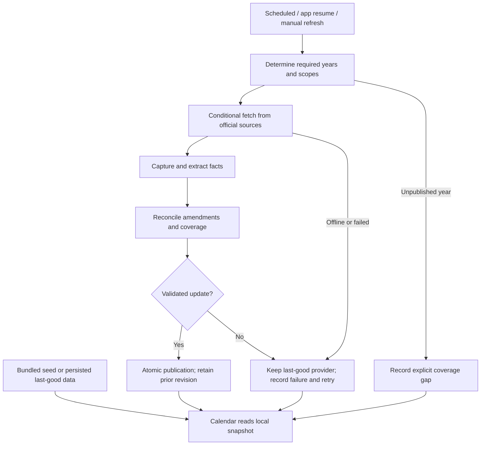

# Two-year offline holidays and automatic updates

**Status: runtime repository, updater, scheduling and source UI implemented in candidate 0.1.69; source/device verification and limits recorded below.**

TL;DR: keep the complete current and following calendar years in persistent local
storage for each enabled holiday source/scope. Refresh official data in the
background and on demand, validate each provider independently, and preserve
last-good data when retrieval or parsing fails. Calendar data updates must not
require a new APK.

This is the holiday-update workstream extracted from the
[client-side Wan Phra plan](2026-11-19-client-side-wan-phra.md).
Wan Phra/flower dates use that local calculator; published civil holidays and
official working-day adjustments use this pipeline. The
[original Calendar plan](2026-11-16-thai-calendar-widgets.md) remains the authority
for country/scope choices and special Thai government-closure semantics.

## Current gap

The APK has reviewed static holiday snapshots, with Thai/Spanish coverage through
2026 and US/China coverage through 2027. The existing container tools normalize
reviewed JSON and atomically assemble an asset. That was the pre-implementation
state. Android now reads persisted revisions seeded from the asset and runs the
native updater described below. The seed also includes 2027 national/Catalunya dates.

The existing `coverageStart`/`coverageEnd` envelope alone cannot establish that
every selected national/regional/local scope is complete. Add year-and-scope
coverage metadata before claiming the two-year requirement is satisfied.

## Required behavior

- Retain full current-year and following-year data, regardless of the widget's
  7/30/custom viewing range. Determine each source's current year in its own
  civil time zone, rather than the phone/browser time zone.
- Seed from bundled data immediately. Prefer a validated persisted revision on
  subsequent starts, including after app upgrades and while offline.
- Fetch missing years automatically. An unpublished annual calendar must show
  **Next year not yet published**; incomplete jurisdictions show **Partial**.
  Neither state may imply that dates have no holidays.
- Preserve national/regional/local distinctions, observed-day anchors and
  Chinese make-up working-day classification. Do not derive exceptional closures
  or working-day substitutions from a generic holiday formula.
- October–December checks also discover and prefetch the year after next when
  published. At January rollover, retain old snapshots until the new required
  pair has been validated; prune older unneeded data after a successful update.
- Refresh without reopening Settings, changing widget placement or taking focus.
  An update to one provider must not interrupt the others or the local calculator.

## Source adapters and staged data

Use the sources already selected in the original plan, with an adapter per
publication format. Verify actual current responses and year discovery during
implementation, keeping captured fixtures and publisher URLs with each parser.

| Branch | Authoritative inputs and scope |
|---|---|
| Thai | Cabinet Secretariat / Ministry of Interior annual government calendar, plus official Cabinet/government closure announcements; retain Bangkok/local scope and service exceptions. |
| Spain | BOE national resolutions, Generalitat Catalunya labour calendar and local-holiday dataset, plus applicable BOPT/Tivissa amendments. Tarragona city is not a substitute for Tivissa. |
| US | OPM federal schedules and observed-day notes, including adjoining-year cases. |
| China | State Council annual arrangements and official amendments/authorized republications, including explicit make-up working days. |

Port the existing normalize/assemble contracts into small reusable Java modules.
Keep container replay commands, so captured responses can be tested without a TV.
Python build tools remain useful for fixture generation but are not runtime
dependencies. The app retrieves official sources directly; this plan does not
introduce a hosted feed, account, household bridge or always-running service.

Persist these stages in private app storage:

1. **Capture:** HTTP status, retrieval time, conditional-request validators,
   publisher URL, response hash and bounded raw source document.
2. **Extract:** dated facts with issuer, publication date, scope, event kind,
   observed-date anchor, amendment/cancellation references and source provenance.
3. **Reconcile:** provider/year/scope snapshot, explicit completeness and revision,
   plus last attempt and last successful check as separate fields.
4. **Publish:** validated active provider revisions assembled for Calendar display.

The data contract distinguishes a recognized complete replacement publication
from an incremental notice. A successful HTTP response or empty parser result
does not authorize removing previously known holidays.



## Scheduling and freshness

Annual calendars: attempt one conditional refresh daily while connected. Catch up
on foreground resume if the last due check was missed. Use Android's native
scheduled-job mechanism with persisted scheduling and appropriate network
constraints; scheduling is best effort, not an exact alarm. Never launch the TV
UI to refresh. Coalesce manual, scheduled and resume requests for each provider.

**Thai special-closure announcements retain the original twice-daily target:
06:00 and 18:00 Asia/Bangkok**, with missed-window catch-up. The newer daily
annual-cache policy does not weaken that existing requirement. Neither cadence
claims immediate emergency alerts. Surface overdue checks accurately.

Manual **Refresh holiday data** requests a current check without bypassing an
in-flight request or corrupting its state. Retry transient failures with bounded
backoff from one hour up to a day; account for connectivity recovery. Use HTTP
conditional requests where supported. Not-modified responses advance successful
check time while retaining the same calendar revision.

Validate year, time zone, scope, dates and parser format before publication.
Unexplained large reductions/empty updates need attention; removals require a
recognized complete replacement or explicit sourced cancellation. Save and verify
staged files before atomically swapping the active revision. Retain the prior
validated revision for rollback. Interrupted writes, app termination or disk-full
failures must leave the active calendar readable.

## User interface and mockup

Keep maintenance details in full-screen Calendar source details and Calendar
configuration. Add an equivalent source/status view to phone configuration when
its Calendar settings are extended; refresh on the TV is the same underlying
operation. Do not introduce a second independent phone cache.

```text
Calendar → Sources & offline data

Thai government holidays
Offline coverage       2026 complete · 2027 not yet published
Last successful check  Today 06:12

Spain · selected regions and locality
Offline coverage       2026 complete · 2027 partial
Missing                Tivissa local dates

US federal holidays    2026–2027 complete
China                  2026–2027 complete

                [▼ more / ▲ previous]
[Refresh holiday data]                    [Back]
```

This mockup illustrates states, not verified current coverage. Use English/Thai,
localized timestamps and BE years in Thai. Show progress and per-source results.
Use a focusable wedge to page long details, with no visible scrollbar.
The widget only needs a concise warning if its visible dates lack coverage.
Keep today's date first and the page counter short. Existing short OK expansion,
Back and visible Restore dashboard preserve original page, focus and saved size.

## Implementation sequence

- [x] Add provider/year/scope coverage and revision contracts, validators, persistent
  storage and atomic publication. Exercise seed/upgrade/rollback behavior first.
- [ ] Implement and fixture-test each official-source adapter and discovery path.
  Close Thai/Spanish 2027 gaps wherever the relevant publications exist; retain
  explicit missing/unpublished status for remaining scopes.
- [ ] Add reconciler handling complete replacements, incremental amendments,
  cancellations and per-provider failures. Preserve all unaffected cached data.
- [x] Wire the native scheduler, missed-check catch-up, retry/coalescing and
  current/following-year rollover. Keep Thai announcement checks twice daily.
- [x] Add bilingual source details, manual refresh and visible coverage/error states.
  Keep dashboard and phone settings using the same persisted provider data.
- [x] Integrate the separately validated local Wan Phra/flower branch and update
  user docs/provenance. Do not label bundled religious lists as calculated.
- [ ] Complete container checks and physical screenshot acceptance, then deploy
  one newly numbered frozen APK to both TVs through `task deploy`.

## Acceptance and proof

Container tests must cover conditional/not-modified responses, parse changes,
unpublished and partially published years, amendments/cancellations, observed
holidays across New Year, stale check metadata, source-zone year changes, interrupted
publication, disk-write failures, retries and concurrent request coalescing.

Prove that app restart/upgrade retains both full years and that a failed refresh
leaves each previously valid provider unchanged. Test the next-year rollover
without advancing a shared TV's clock. Test offline behavior using a controlled
network adapter rather than changing shared Wi-Fi settings. Ported modules must
run in the existing build container, with no host Java/Android installation.

Capture and visually review on Cast1:

| Screenshot | Assertion accompanying the image |
|---|---|
| English/Thai source details | Correct per-year/per-scope completeness, localized years and successful-check time. |
| Successful refresh | Matching revision/coverage assertions show an actual validated update. |
| Failed refresh | Last-good events still display; failure does not advance successful-check time. |
| Offline next-year navigation | Events persist after restart with test-transport retrieval disabled. |
| Missing publication | Explicit unpublished/partial state; no false empty-calendar claim. |
| Dashboard restore | Correct Today header and retained page/focus/size after Back and Restore dashboard. |

Save frozen artifact/source hashes, coordinator receipts, native assertions and
reviewed screenshots in `docs/testing/`. Label synthetic dates/network fixtures
separately from real publisher updates. Device sessions follow the coordinator's
devices → queue → submit → watch → evidence workflow. Submit installs on both
Cast1/Cast2 independently of foreground availability; let the coordinator admit
or defer operations according to their actual effects.

Completion requires operational updates without APK replacement, demonstrated
two-year offline coverage for supported scopes, accurate gaps for unpublished
data and the failure/rollover evidence above. A Refresh button or a larger bundled
JSON file alone does not satisfy this plan.

## Implementation checkpoint

Candidate 0.1.69 implements the persistent provider store, conditional HTTPS
captures, source-specific extraction, independent reconciliation, retry/coalescing,
year rollover and safe pruning, the network-constrained native job and bilingual
live source/refresh screen. Runtime Java modules also run through the container
`calendar:replay` command. There is no hosted service or runtime Python dependency.

500 JVM tests, 7 pipeline tests, 52 cleanup/recovery tests and Android lint passed.
Real Java HTTPS runs updated China 2026/2027, Spanish national/Catalunya 2026/2027
and Tivissa 2026. Tivissa 2027 had no records in the official dataset. OPM/Thai
annual requests were blocked and the configured Thai feed did not resolve from
the development network; those are unresolved live-source limits, with last-good
data retained. Ambiguous Thai cancellation/jurisdiction wording requires review.
No complete Thai 2027 or Tarragona-province coverage is claimed.

Cast1 installation succeeded; Cast2's independent install was admitted but failed
`personal-install-in-use`. Physical English/Thai source, offline boundary,
failure-retention and restore acceptance is recorded in the
[verification record](../testing/2026-11-19-calendar-data.md). The remaining unchecked rollout
items cover unresolved publisher validation, ambiguous amendment handling and the
unsuccessful Cast2 install; they are not a claim of verified completeness
for publishers or future years that could not be validated.
