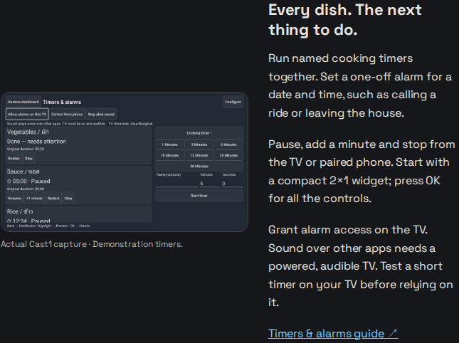
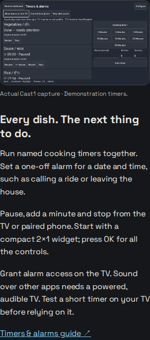

# Publish cooking timers and household alarms

Will requested updated docs, website, commits and pushes on 19 November 2026.
The public download must include the feature shown on its page; do not relabel the
existing 0.1.73 APK as a newer build or export the separate debug APK.

## Reviewable page change

Keep the existing download/install/verification layout. Add a compact section
between the dashboard screenshot and install instructions: a native Timers screenshot,
what cooking timers and one-off alarms do, a phone-control link, and an honest
alert/power/permission sentence. Preserve the existing dashboard image and caption.

[Desktop/phone browser preview](2026-11-19-timers-publication.html)

Built page previews, verified at 1365px and 390px viewport widths:

Apply the [Alan Cooper design filter](/home/will/docs/howtos/alan-cooper-design-filter.md):
primary visitor wants a useful household command center and an understandable install
path. Show recognizable cooking and departure scenarios, screenshot evidence and
one download for the described release. Avoid making the visitor interpret debug
builds or look through technical release hashes before deciding whether it is useful.
Keep transfer/install instructions and release verification available below.

```mermaid
flowchart LR
    A[Native acceptance + screenshot review] --> B[Update user docs + release notes]
    B --> C[Commit app sources including new files]
    C --> D[Fresh signed public build]
    D --> E[Submit identical APK to both TVs]
    E --> F[Record independent install results]
    F --> G[Export frozen APK, source and guide to site]
    G --> H[Container website tests/build + phone/desktop screenshots]
    H --> I[Scoped commits and pushes]
    I --> J[Publish via existing site workflow]
    J --> K[Verify public page, download and hashes]
```

A Cast2 install execution failure remains separate from Cast1 acceptance; do not
claim it is installed or clear a personal-use marker. Keep unrelated edits in both
repositories out of commits/publication. Commit new app inputs before the public
source archive is generated, since the exporter selects tracked files.

Acceptance: current signed public package and hash match the download and exact
source archive; page links and images resolve; timer/phone screenshots have truthful
captions and versions; published source ledger maps quantitative and capability
claims to app sources and measured test results. Run website tests/build/link checks
inside a container and inspect phone/desktop screenshots. Verify deployment receipts
before claiming the live site changed.

Delivered: [Homeboard TV](https://biohack.net/homeboard/), public 0.1.92.
[Publication verification](../testing/2026-11-19-timers-publication.md).
