# Control interface: one command model, links and a local listener

**Status: plan for review, 2026‑11‑20. Nothing is built.** TODO entry: "Homeboard control
interface: deep links and a local listener" (`[wip T4]`). It comes from
[Recommended sequence, step 4](../investigations/2026-11-20-google-home-integration.md#recommended-sequence)
of the Google Home investigation: "Every route in direction 1 ends by telling the TV 'show
this scene' or 'start this timer'. Defining that once serves Google Home, Home Assistant and
anything else."

## Context

Nothing outside the TV can tell Homeboard "show page 2", "start a 10 minute timer" or "show
the screensaver" today, and nothing outside can read what Homeboard knows.

| Fact today | Evidence | Why it matters |
|---|---|---|
| The only network surface is the phone editor's listener, and it exists only during an approved Configure-from-phone session with Homeboard in front. | `MainActivity.onPause` stops it (`MainActivity.java:403`); every command checks `phoneForeground()` (`PhoneEditor.java:68`); access ends after 15 min idle (`PhoneEditorSession.java:11`). | There is no durable way in. The phone editor's short-session model is right for editing and must not be stretched into an always-on one. |
| The phone listener is plain HTTP on the TV's site-local IPv4 address, with a one-use invitation, a matching code approved on the TV, a short-lived token, Host and Origin checks, bounded bodies and a 4-thread pool. | `PhoneEditorServer.java`, `PhoneEditorSession.java`, [phone editor plan, Local transport](2026-11-17-phone-widget-editor.md#local-transport-and-implementation-boundary) | A reviewed and deployed pattern to reuse: library (NanoHTTPD 2.3.1, already a dependency), address selection, limits and approval prompt. |
| `MainActivity` is exported (it is the Home activity) and acts on the action `homeboard.timers` from any caller. | `MainActivity.java:488`, manifest `MainActivity` filters | A de facto deep link already exists, unauthenticated. Harmless while it only opens the timer screen; the pattern must not grow actions that change things. |
| A shell-only broadcast receiver already exists: `GuardConfig` is guarded by `WRITE_SECURE_SETTINGS` and answers through the broadcast's result data. | `GuardConfig.java`, manifest line 271 | A proven way to give `adb shell` and the device coordinator full control and a state read, with no new authentication. |
| Home Assistant already reaches Homeboard through the Android TV Remote service, as a `VIEW` intent. | `AppLaunchActivity` handles `market://launch` "from the Android TV Remote service (Home Assistant android_tv_remote)" (manifest line 203) | Links reach Home Assistant users through a pairing that Google's own TV service already authenticates. |
| Timers and alarms run without any activity: one store, exact alarms, a boot receiver and a sound service. | `KitchenTimerStore.command(Context, JSONObject)`, `setAlarmClock`, `KitchenTimerReceiver`, `KitchenTimerSound` (`foregroundServiceType="mediaPlayback"`) | Timer commands can be served while another app is in front, as long as the process is alive. |
| Timer commands are already idempotent: each carries an operation identity, and a replay returns the first result. | `KitchenTimers.command` receipts | The control layer reuses this rule for every command. |
| Air readings are fetched only while Home is on screen. | `AirQualityCard.start`/`stop` from `onResume`/`onPause`; `AirQualityReading.stale` is 3 h | A PM2.5 value reported to Google while a film plays is old unless refreshing moves out of the activity. Freshness must always travel with the value. |
| App data is not backed up. | `android:allowBackup="false"` (manifest line 103) | Keys stored on the TV do not leave it through Android backup. |

Who needs a way in: a cloud-to-cloud bridge holding an outbound connection from the TV; a
Matter device running inside Homeboard; Home Assistant and scripts on the LAN; the device
coordinator and ADB. The bridge and the Matter device also need **state out**: PM2.5, running
timers and the chosen screensaver, kept current. So this plan defines **one command and state
model** that every transport shares.

## Approach

| Question | Decision | Rejected, in one line |
|---|---|---|
| Model | One in-process `ControlHub` with one vocabulary of commands, one state snapshot and one change feed. Every transport is a thin adapter onto it. | One entry point per caller: four authentication stories and four vocabularies to keep in step. |
| Links | `homeboard://v1/<verb>?<args>` on a dedicated exported activity, limited to **navigation** verbs: links show things, they never change things. | Letting links start timers or change settings: any app on the TV could then do it. |
| ADB and coordinator | A shell-only broadcast receiver, guarded like `GuardConfig`, with the full vocabulary and a state read in the result data. | A custom signature permission: `adb shell` does not hold it, and the coordinator is the main caller. |
| Network | An authenticated HTTP listener on the TV's home network address, **off by default**, turned on in Home settings. Each device is added on the TV with a code and an Allow question, named, listed and removable. | Running the phone editor's listener always: it is a browser surface with assets and same-origin rules, built for minutes, not months. |
| In-process | The Matter device and the bridge client call `ControlHub` directly and subscribe to its changes. They appear in the same device list. | A loopback HTTP hop for in-process callers: a second authentication path for no gain. |
| State out | `GET /v1/state` plus server-sent events on `GET /v1/events`; in-process subscribers get the same snapshots. | WebSocket: commands are already plain requests, so only one direction needs streaming, and it would add a dependency. |
| Phone editor | Stays separate, with its own port, session and approval. It shares the domain stores, so its timer actions appear in the change feed. | Merging the two listeners. |
| Scenes | Reserved in the vocabulary and the state (`scene.activate`, `scenes: []`), built by the scenes plan. A scene will be a named list of these same commands. | A scene store now, before its interface is designed (Decision 4). |

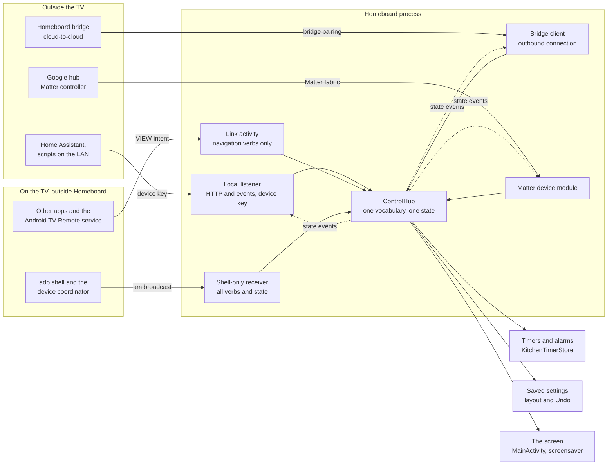

## The command and state vocabulary

A command is data: `{"id": "<operation id>", "do": "<verb>", "args": {…}}`. The same object
travels over every transport, is stored as a receipt, and will be the instruction set of a
scene. Verbs are `noun.verb`, stable, and versioned by the `v1` in links and paths; adding a
verb or an optional argument does not change the version.

Each verb has a **class**, and the class decides who may send it and what the TV shows:

- **navigation** changes what is on screen and nothing that is saved;
- **runtime** changes timers and alarms, which live outside Undo, as they do for the phone;
- **setting** changes a saved setting, with an Undo entry;
- **read** returns state.

| Verb | Arguments | What it does | Class | Links |
|---|---|---|---|---|
| `page.show` | `page` (1‑based, as the footer shows it) or `widget` (shows the page holding it) | Show that Home page | navigation | yes |
| `apps.show` | none | Show All Apps | navigation | yes |
| `widget.open` | `widget` (key from state) | Open the widget full screen, as short OK does | navigation | yes |
| `widget.close` | none | Restore dashboard: the original page, focus and size | navigation | yes |
| `timers.show` | none | Open the timer screen (replaces `homeboard.timers`) | navigation | yes |
| `screensaver.show` | none | Start the screensaver now, as Show now does | navigation | yes |
| `screensaver.dismiss` | none | End Homeboard's screensaver, activity or `ScreensaverDream` | navigation | yes |
| `timer.start` | `seconds` (1 to 86 400), `name` (up to 80 characters, optional) | Start a cooking timer | runtime | no |
| `timer.pause`, `timer.resume`, `timer.restart`, `timer.add_minute` | `timer` (id, or a name that matches one entry) | The same actions as the timer screen | runtime | no |
| `timer.cancel` | `timer` | Stop and remove the entry in one step | runtime | no |
| `alarm.set` | `name`, `local` (ISO local date and time), `zone` | Set an event alarm; past or ambiguous times are refused, as on the TV | runtime | no |
| `alarm.cancel` | `alarm` | Stop and remove the alarm | runtime | no |
| `sound.silence` | none | Stop the ringing ("dismiss the alarm") | runtime | no |
| `setting.set` | `setting`, `value` | Set one entry of the settings registry below | setting | no |
| `scene.activate` | `scene` | Reserved. Version 1 lists no scenes and answers `unknown_scene` | (per scene) | no |
| `state.read` | none | The state snapshot (the shell receiver's read; the listener uses `GET /v1/state`) | read | no |

Names resolve case-insensitively among live entries. Two timers called "Rice" make
`timer.cancel {"timer": "rice"}` fail with `ambiguous` and both candidates, never a guess.

**Settings registry, version 1.** A setting is a descriptor (id, kind, options, English and
Thai labels, spoken synonyms), so the bridge can declare Google `Modes` and `Toggles` from it
without knowing Homeboard's internals.

| Setting | Kind | Values | Stored in |
|---|---|---|---|
| `screensaver.choice` | mode | Clock, Home background, and each provider once [screensavers stage 2](2026-11-20-screensavers.md#stages) lists them | `ScreensaverSettings.choice` |
| `screensaver.idle` | mode | Android decides, 1, 2, 5, 10, 15 or 30 min | `ScreensaverSettings.idleMinutes` |
| `screensaver.show_clock` | toggle | on, off | `ScreensaverSettings.backgroundShowsClock` |

Adding a setting is one registry row and its labels. A row is admitted only for something a
person would say aloud and could undo on the TV.

**Readable state.** One snapshot, with a revision that rises on every change. Values that
come from outside carry their freshness.

```json
{
  "v": 1,
  "revision": 413,
  "tv": {"id": "5b0d…", "name": "Cast1 · 7f3a"},
  "screen": {"view": "home", "page": 2, "pages": 3, "widget": null, "busy": false},
  "timers": [
    {"id": "9c1e…", "name": "Rice", "kind": "timer", "state": "running",
     "remaining_s": 372, "ends_at": "2026-11-20T12:48:10Z", "ringing": false}
  ],
  "ringing": false,
  "screensaver": {"showing": false, "selected": "clock", "everywhere": true},
  "air": [
    {"widget": "widget:air", "label": "Benchasiri Park", "source": "AirBKK / BMA",
     "pm25": 25.9, "unit": "µg/m³", "estimate": false,
     "observed_at": "2026-11-20T12:00:00Z", "fetched_at": "2026-11-20T12:41:03Z", "stale": false}
  ],
  "settings": [{"id": "screensaver.choice", "value": "clock"}],
  "scenes": [],
  "control": {"started_at": "2026-11-20T00:14:02Z", "previous_exit": "clean"}
}
```

- `screen.view` is `home`, `apps`, `widget`, `screensaver` or `other`. When another app is in
  front it says `other` and never which app: what a household watches is not Homeboard's to
  report.
- Timers report `ends_at` on the wall clock and are not re-sent every second; a client counts
  down itself. Events fire on state changes only.
- `control.started_at` and `previous_exit` let a client, and the lifetime test, see that
  Homeboard restarted.

**Left out on purpose.** Each of these would widen what a stolen key can do, or duplicates a
control the TV already has:

- **Editing the dashboard**: adding, moving or configuring widgets is the phone editor's
  job, with a draft the person reviews.
- **Launching apps, inputs, volume and power**: the Chromecast is already a Cast device in
  Google Home with those controls; Homeboard would duplicate them and widen its power.
- **Undo from a device**: Undo history belongs to the people in the room.
- **Managing access**: no command adds or removes devices, turns the listener on or off, or
  touches the phone editor, the default Home app, installs or language. A device cannot
  widen its own access.
- **Text on screen** ("the doorbell rang"): useful, but arbitrary text from any device on a
  shared screen needs its own design.
- **Grocery list contents**: household data that no caller has asked for yet.
- **Which other app is in front**, and per-second timer ticks.

**Scenes, reserved.** `AGENTS.md` lists scheduled scenes as future work, and Google's routines
can trigger scenes but not modes or toggles
([investigation](../investigations/2026-11-20-google-home-integration.md#1a-cloud-to-cloud-integration)).
The interface therefore names scenes now: an opaque `scene` id, a `scenes` list in state
(empty in version 1) and `scene.activate`. A scene will be stored as a named list of the
commands above, so it needs no second language, and adding scenes adds list entries and a
handler with no protocol change. Until then, a caller that needs a scene-shaped trigger maps
it to one command on its own side: a Home Assistant script, a bridge entry, a Matter
endpoint.

## Transports

| Transport | Who can reach it | What authenticates it | Verbs | What it costs to carry |
|---|---|---|---|---|
| **Links** `homeboard://v1/<verb>?<args>` on `ControlLinkActivity` (exported, `BROWSABLE`, no display) | Any app on the TV; the Android TV Remote service, so Home Assistant's `android_tv_remote`; a browser on the TV; `adb shell am start -d` | Nothing. That is why only navigation is allowed | navigation | One exported activity and a URI parser. A custom scheme can be claimed by another app too, which would show a chooser; acceptable on a TV. |
| **Shell receiver** `ControlReceiver`, `android:permission="android.permission.WRITE_SECURE_SETTINGS"` | `adb shell`, so the device coordinator and Home Assistant's ADB integration; privileged system apps | Android: only holders of that development permission can send | all, and `state.read` in the result data | One exported receiver. The guard needs no `uses-permission`, so it costs the Play edition nothing. |
| **Local listener** `ControlServer` (NanoHTTPD) on the TV's site-local IPv4 address, port 8780 | Devices on the home network, only while the switch is on | A per-device key issued after Allow on the TV | navigation, runtime, setting, read | A standing network surface while on: the reason this plan exists as a T4 item. No new library. |
| **In-process** `ControlHub` Java interface | Code in the Homeboard process: the Matter device, the bridge client | Being in the process; each integration's own pairing (Matter commissioning, bridge pairing) admits it, and it is listed and removable | all | None beyond the integration itself. |

The shell receiver and links stay available when the switch is off. The shell already has
total control of the TV, so gating it adds nothing; links can only show things, the same
class of effect as launching Homeboard. The Off screen says both plainly.

Example calls, for the how-to:

```text
adb shell am start -a android.intent.action.VIEW -d 'homeboard://v1/page.show?page=2'
adb shell am broadcast -n net.biohack.homeboard/com.gathin.tvhome.ControlReceiver \
    -a net.biohack.homeboard.CONTROL --es command '{"do":"state.read"}'
curl -H 'Authorization: Bearer hb1_…' http://192.168.1.42:8780/v1/state
curl -H 'Authorization: Bearer hb1_…' -H 'Content-Type: application/json' \
    -d '{"id":"ha-20261120-0001-rice","do":"timer.start","args":{"seconds":600,"name":"Rice"}}' \
    http://192.168.1.42:8780/v1/commands
```

A debug build's package is `net.biohack.homeboard.debug`; the examples use the release one.

### The listener's interface

| Request | Authenticated | Purpose |
|---|---|---|
| `GET /v1` | no | `{"service": "homeboard-control", "v": 1, "tv": {…}, "adding": true or false}`. Nothing else is public. |
| `POST /v1/enrol` `{code, name}` | no; only while the add window is open | Starts the Allow question; returns a request id. |
| `GET /v1/enrol/<request>` | the request id | `pending`, `denied`, `expired`, or `approved` with the key, returned once. |
| `GET /v1/state` | key | The snapshot. `ETag` is the revision, so `If-None-Match` polling costs a `304`. |
| `GET /v1/events` | key | Server-sent events: `event: state` with the full snapshot and `id:` the revision; a comment line every 25 s keeps the connection honest; `Last-Event-ID` resumes with the current snapshot. |
| `POST /v1/commands` | key | Runs one command. |
| `GET /v1/commands/<id>` | key | The receipt of an earlier command, for a client that lost the response. |
| `GET /v1/vocabulary` | key | Verbs with argument schemas, and the settings registry with labels and synonyms. |
| `DELETE /v1/client` | key | The device removes itself, for an integration being uninstalled. |

Results and errors use one shape, `{"status": …, "error": …, "revision": …}`:

| Status | HTTP | Meaning |
|---|---|---|
| `done` | 200 | Done; the result and new revision are included. A replayed id returns the first result. |
| `invalid` | 400 | Unknown verb, unknown or out-of-range argument. Nothing changed. |
| `unauthorized` | 401 | No key, unknown key, or a removed device. |
| `not_allowed` | 403 | The verb's class is not open to this transport, such as `timer.start` by link. |
| `unknown` | 404 | No such page, widget, timer, alarm, setting or scene. |
| `conflict` | 409 | The id was already used for a different command, or a name is `ambiguous` (candidates listed). |
| `busy` | 423 | A navigation verb arrived while a person was using Home: in a menu, moving, resizing, editing or previewing. Runtime verbs never get this. |
| `not_on_home` | 409 | A navigation verb while another app is in front, if Decision 1 says not to take the screen. |
| `blocked` | 503 | Android did not let Homeboard come to the front (see [Process lifetime](#process-lifetime)). |
| `limited` | 429 | Rate limit; `Retry-After` given. |

## Authentication and consent

Nothing listens until the household turns on **Control from other devices** in Home settings.
Turning it on, turning it off, adding a device and removing a device are saved changes with
the Undo banner and hold-Back Undo, like every other saved change.

**Adding a device.** Choosing **Add a device…** opens a five-minute window that exists only
while that screen is in front. The TV shows a six-digit code and its address. The device
sends the code and its name. If the code matches, the TV asks **Allow "Home Assistant" to
control this TV?**, naming the device, its address and what it will and will not be able to
do, with focus on **Deny** so a stray OK never grants access. On Allow, Homeboard creates the
device's key and the device collects it once.

The code proves that whoever set up the device can see this TV; the question lets the person
check the name and address before any access exists. A typed code fits headless clients such
as Home Assistant, which already use this pattern for Android TV Remote pairing. The phone
editor's compare-two-codes check suits a browser on a phone in the room, which a server in a
cupboard is not.

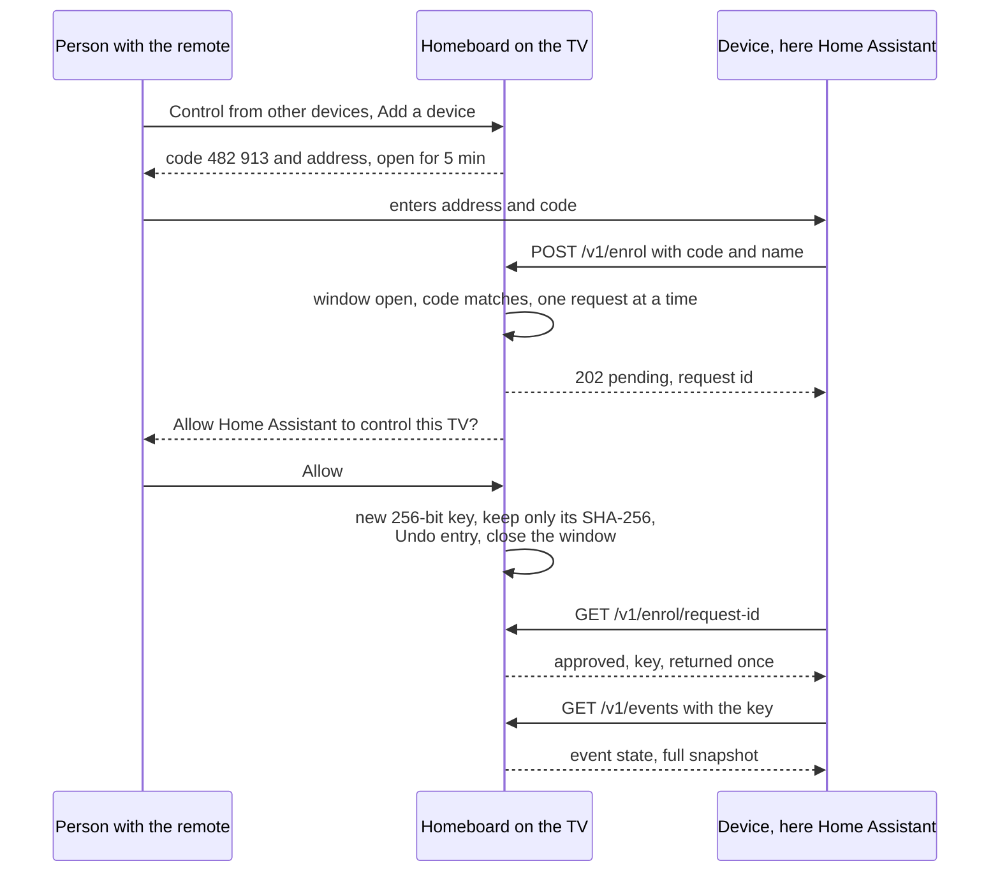

**Keys.** 32 random bytes from `SecureRandom`, written `hb1_` plus base64url, so a key pasted
somewhere public is recognisable. The TV keeps only the SHA-256 of each key, beside the
device's id, name, kind, address at enrolment, times added and last used, in app-private
`SharedPreferences` (`control-clients`). Keys are compared in constant time. They are never
logged; logs and the activity list name the device. There is no expiry: a key lives until the
device is removed, the app's data is cleared or Homeboard is reinstalled, because a home
automation that silently stops working every month is worse than a revocable key. Android
Keystore adds nothing to a stored hash and is not used.

**Reinstall, reset, update.** An APK update keeps devices. Clearing Homeboard's data,
uninstalling, or a factory reset removes every device; their keys then get `unauthorized`, and
each must be added again. Nothing restores devices from a backup, since `allowBackup` is
false. Settings exports and the phone editor never include the device list.

**Where it listens.** Only on the site-local IPv4 address of the active network, chosen as the
phone editor does (`PhoneEditor.address`), never on all interfaces: a VPN or a second
interface is not exposed. A network change rebinds to the new address. Requests from
addresses outside the private ranges are dropped. Port 8780 is fixed so automations keep
working, and it sits outside the phone editor's 8765 to 8775. If 8780 is busy the screen says
so and offers the next port, rather than moving silently.

**Requests.** `Host` must be the bound address and port, or a `.local` name with that port,
which defeats DNS rebinding from a web page. Any request carrying an `Origin` header is
refused, so no browser page can drive the listener. No CORS headers. JSON bodies only, up to
8 KB, no chunked uploads. The worker pool is bounded as in `PhoneEditorServer`, with at most
four event streams open at once.

**Rate limits.** Per key: 20 commands in any 10 s, then `limited`. Per source address: ten
failed keys in a minute block that address for 5 min. Enrolment: one pending request at a
time, one attempt per 2 s, and five wrong codes close the window.

**Announcing it.** While the switch is on, Homeboard announces `_homeboard._tcp` with Android's
`NsdManager` (no library, no permission expected), with TXT records `v=1`, the TV id and the
TV name, and no secrets. Home Assistant can then discover the TV and find it again after an
address change, and the Local Home SDK route
([1D](../investigations/2026-11-20-google-home-integration.md#1d-local-home-sdk)), which
discovers devices this way, stays open. The Chromecast already announces its own name, so
this reveals one more fact: that this TV offers Homeboard control.

**Plain HTTP on the home network, not TLS.** The phone editor's V1 decision applies here too:
local HTTP on a trusted home network, not encrypted against other devices on it. What a
sniffer on the LAN could take is a device key, and with it the vocabulary above: no
dashboard edits, no apps, no access management, every action named on the TV and listed,
and one Remove away from revoked. The same LAN can already cast to this Chromecast without any
authentication. TLS with a self-signed certificate would protect keys in transit, but every
client would have to pin the certificate's fingerprint, Homeboard would have to rotate it,
and simple tools such as `curl` and Home Assistant's `rest_command` would need extra steps,
for as long as the feature exists. TLS can be added later on a second port without breaking
plain clients. This is Decision 3.

**Threats considered.**

| Who | Can | Stopped by |
|---|---|---|
| A guest or a compromised gadget on the LAN | Reach the port; try codes during an open window; replay a sniffed key | Off by default; window only while the person is on the add screen; code plus Allow; rate limits; narrow vocabulary; notices and activity list; Remove |
| A web page in a browser on the LAN | Send requests to the TV's address, or rebind a name to it | `Origin` refused, `Host` checked, key required |
| An app on the TV | Send links; try to forge the internal intent that brings Homeboard to the front | Links are navigation only; the internal intent carries a one-time ticket that the hub must recognise |
| Someone with developer access | Everything, through ADB | Out of scope: ADB access is already total |
| Someone in the room with the remote | Everything Homeboard offers | Intended: the household owns the TV |

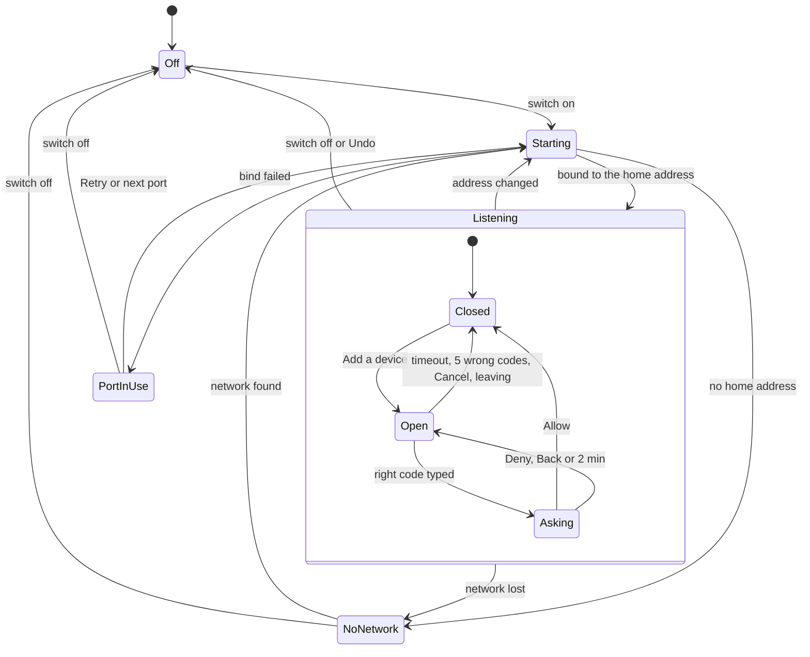

A device moves through its own states. In-process integrations follow the same diagram,
entering through their own pairing instead of the code.

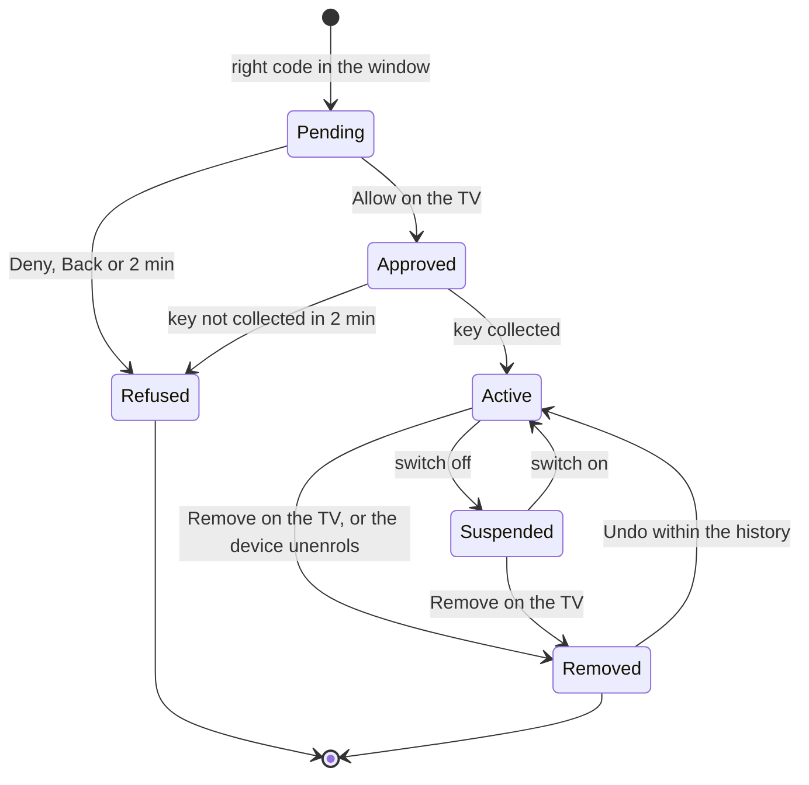

Clearing data or reinstalling ends every state at once. Removing a device takes effect
immediately: its key stops working and an open event stream is closed within a second.

## The screens

**Home settings → Control from other devices**, beside Configure from phone. The menu entry
shows its state ("Off", "On · 2 devices").

[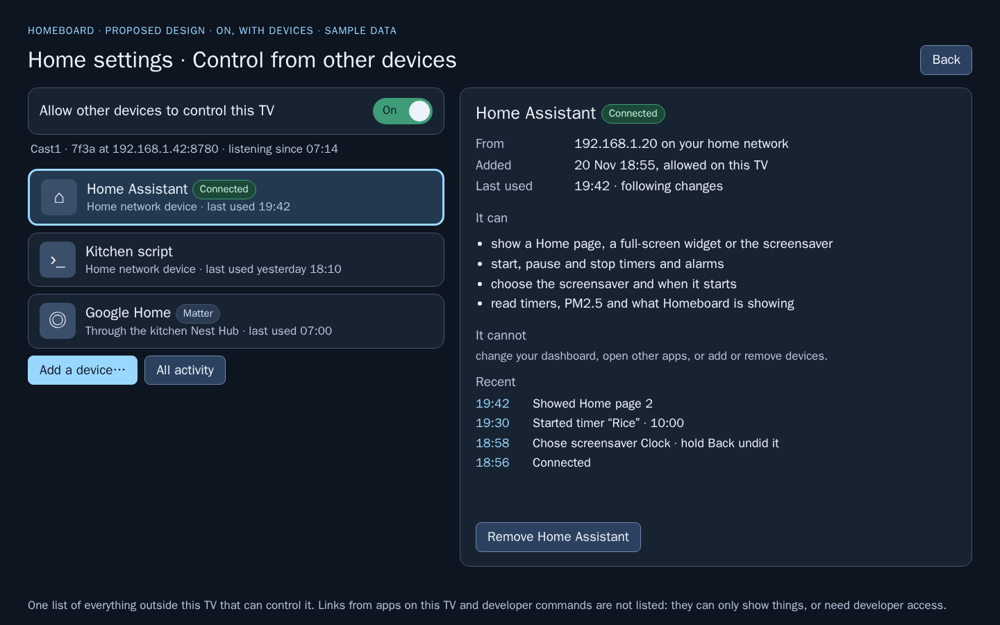](2026-11-20-control-interface/settings.html)

On, with devices. The left pane is the switch, the address, and one list of everything outside
the TV that can control it, including in-process integrations such as a future Matter device.
The right pane shows the focused device: where it is, what it can and cannot do, and what it
did recently. The decision this asks for: is one list for network devices and built-in
integrations the right model? [Open the interactive mockup](2026-11-20-control-interface/settings.html).

[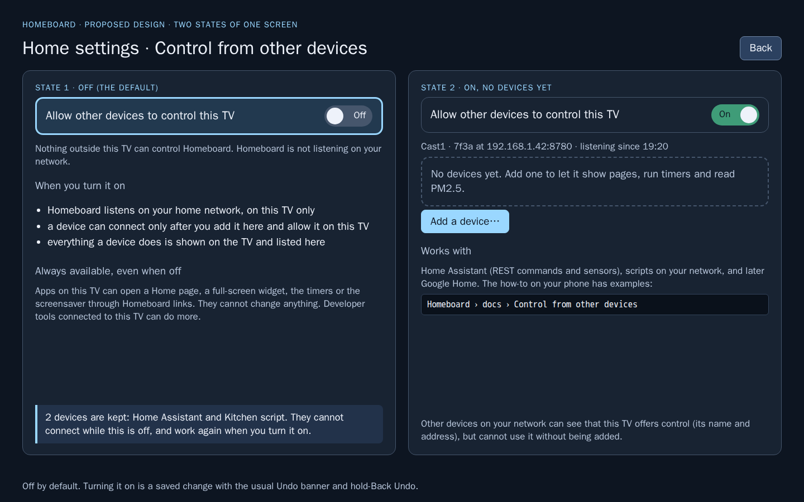](2026-11-20-control-interface/settings-states.html)

Off, the default, says what turning it on means and what stays available when off (links that
only show things, and developer tools). Devices added earlier are kept and said to be kept.
On with no devices puts focus on **Add a device…**.
[Open the interactive mockup](2026-11-20-control-interface/settings-states.html).

[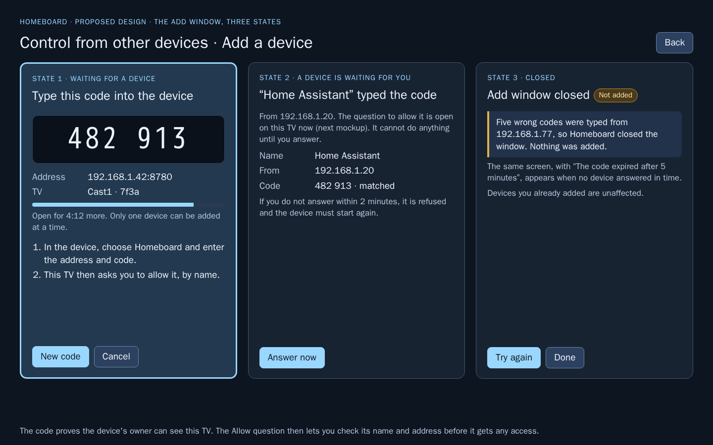](2026-11-20-control-interface/add-device.html)

The add window: the code and address with time left; a device that typed the code and is
waiting for Allow; and the window closed after five wrong codes or a timeout.
[Open the interactive mockup](2026-11-20-control-interface/add-device.html).

[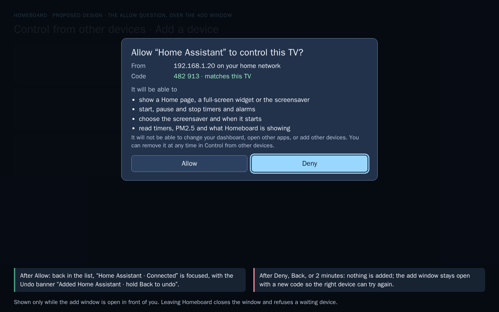](2026-11-20-control-interface/approve.html)

The Allow question. It names the device, its address and the matched code, lists what it will
be able to do and what it will not, and starts on Deny. The decision this asks for: is focus on
Deny worth the extra key press? [Open the interactive mockup](2026-11-20-control-interface/approve.html).

[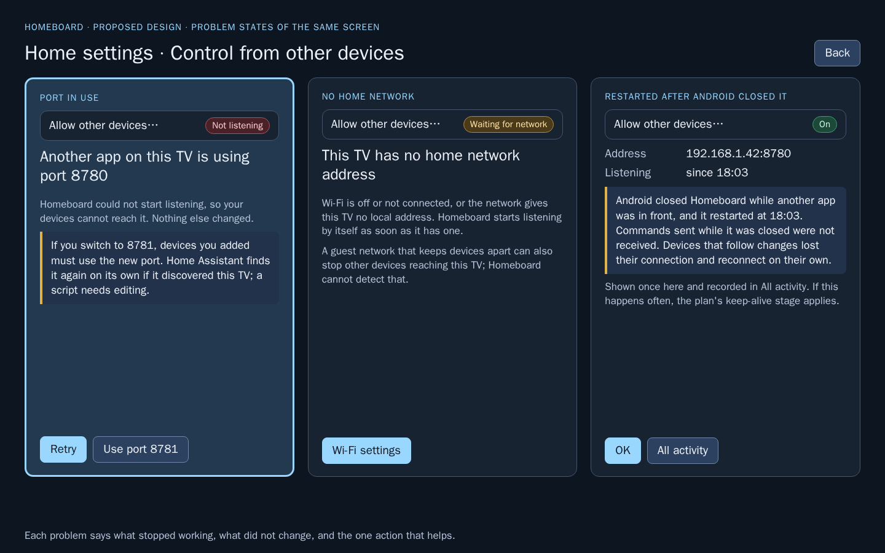](2026-11-20-control-interface/errors.html)

Problems: the port is taken by another app; the TV has no home network address; Android closed
Homeboard and it restarted, so commands sent in between were lost. Each says what stopped,
what did not change, and the one action that helps.
[Open the interactive mockup](2026-11-20-control-interface/errors.html).

## Relationship to the phone controller

The phone editor stays exactly as it is: started on the TV, foreground only, one phone at a
time, a 15‑minute idle limit, keys only in the phone tab's memory. Nothing in this plan
lengthens a phone session or lets a phone become a device without going through Add a device.

The two share three things:

1. **The domain stores.** Timers, layout and Undo are already shared code; `ControlHub`
   observes them rather than wrapping the phone API, so a timer started from the phone, the TV
   remote or a device appears in the change feed the same way.
2. **The HTTP library and its limits.** Stage 2 lifts the bounded executor, body limits and
   JSON error helpers out of `PhoneEditorServer` into a small shared base, covered by the
   existing `PhoneEditorTest` and `task phone:check`.
3. **The address selection** (`PhoneEditor.address`).

They do not share a port, a session, keys or the approval prompt. The phone editor serves a
web page and enforces same-origin rules for a browser; the control listener refuses browsers
outright. Merged, one of the two models would have to weaken.

## State out

Every source of change notifies the hub, and the hub publishes one coalesced snapshot per
change:

- `KitchenTimerStore` after each persisted change, whoever made it;
- `PhoneConfigurationStore.commit` and `MainActivity.save` for settings;
- `MainActivity` for page, view, full-screen widget and busy;
- `ScreensaverActivity` and `ScreensaverDream` start and stop;
- the air readings when a fetch lands (Stage 3 moves fetching out of the activity).

Network clients choose polling (`GET /v1/state` with `If-None-Match`) or the event stream. The
Matter device and the bridge client call `ControlHub.subscribe(listener)` and receive
`onState(snapshot, changedSections)` on the hub's thread, never the UI thread; the Matter
module maps sections to attribute updates, the bridge to Report State.

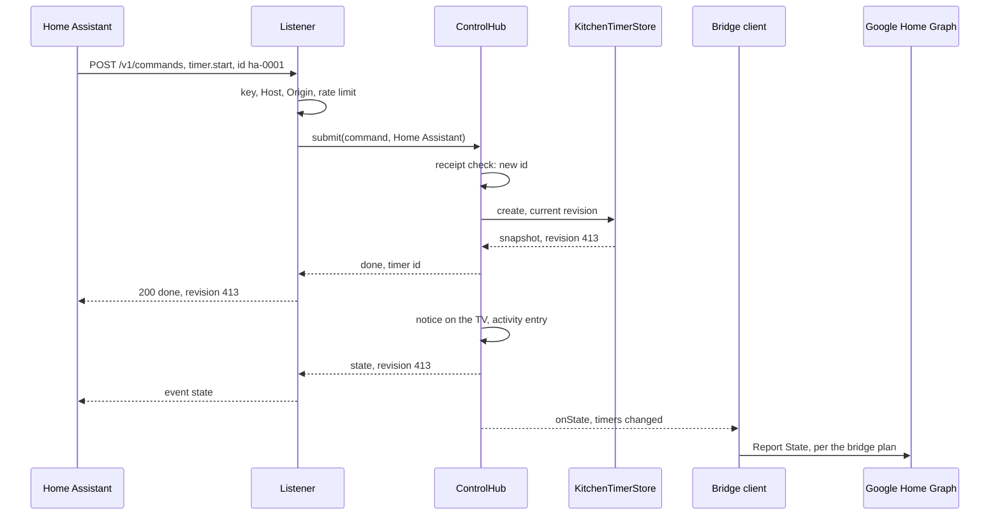

How the planned integrations map onto the model:

| Integration | Commands it sends | State it tracks |
|---|---|---|
| Cloud-to-cloud bridge | `SCENE` `ActivateScene` → `scene.activate`; `Toggles` "screensaver" → `screensaver.show` / `dismiss`; `Modes` → `setting.set` from the registry; `Timer` → `timer.*` | `air` → `SensorState` PM2.5; `timers`; `settings`; `screensaver.showing` |
| Matter device | On/Off endpoint "Screensaver" → `screensaver.show` / `dismiss`; one On/Off per page or scene | Air Quality Sensor with PM2.5 measurement ← `air`; On/Off ← `screensaver.showing` |
| Home Assistant | `rest_command` → `/v1/commands` | `rest` sensors on `/v1/state`, or a custom integration on `/v1/events` |
| Coordinator, ADB | `am broadcast` → all verbs; links for navigation | `state.read` in the result data |

## Process lifetime

A launcher is often not the app in front. What keeps the listener and the in-process callers
alive is the Homeboard process itself: the listener and the hub belong to the process, not to
`MainActivity`, and are started by whichever component starts the process (the activity, the
boot and package-replaced receiver, `GuardRevival` where enabled). No activity needs to exist.
Whether the process stays alive is the open question.

**Known from the code.**

- The phone listener deliberately dies with `onPause`; the control listener must not copy that.
- Timer and alarm commands need only a `Context`.
- Navigation needs the screen, so it needs `MainActivity` in front.
- Air readings stop when Home leaves the screen.
- The process can be started at boot (`KitchenTimerReceiver` on `BOOT_COMPLETED` and
  `MY_PACKAGE_REPLACED`) and, on firmware that kills it, revived by `GuardRevival` when that
  listener is allowed.
- No foreground service runs except while an alarm sounds.

**Needs a device test.** From AOSP as I remember it, not verified on these TVs: Android ranks
the current default Home app's process above ordinary background apps, and a process with a
system-bound service (the accessibility helpers, `GuardRevival`) ranks higher still; Android
also lets the current Home app start activities from the background, an exemption ordinary
apps lack. Chromecast remotes send Home to Google TV, so whether Homeboard holds the Home role
on Cast1 and Cast2 is itself unknown. Unknown in particular:

1. Does the process survive an hour with another app in front, and does that depend on holding
   the Home role or on the helpers being bound?
2. Is it frozen rather than killed? A frozen process keeps its socket but does not answer,
   which looks different from a restart.
3. Can Homeboard bring itself to the front from the background?
4. Does the Android TV Remote service deliver a custom-scheme `homeboard://` link?
5. What happens in standby, with the TV off over HDMI-CEC?

**How a screen command reaches the screen.** The hub never trusts an intent to carry a
command: it keeps the command, starts `MainActivity` with a one-time ticket, and `MainActivity`
claims the ticket. A forged intent with an unknown ticket does nothing. If the ticket is not
claimed within 3 s, a failure guard, never the success path, the command reports `blocked`.

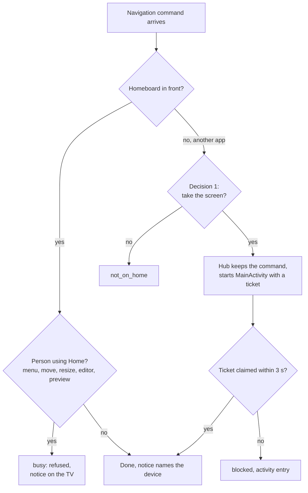

**The device test**, run through the coordinator and recorded under
`docs/testing/2026-11-20-control-interface/`:

| Run | Set-up | Measured |
|---|---|---|
| A, Stage 0, no new code | Homeboard launched, then HOME (Google TV in front), the coordinator's `poke-resume` validator with `RESUME_AFTER=300` | `pid_before`, `pid_before_start`, `same_process` from `resume.json`: does the process survive 5 min behind Google TV? |
| B, Stage 2 | An added test device; another registered app held in front for 60 min with wake pulses; a host probe reads `/v1/state` every 60 s and keeps `/v1/events` open | Every read answered or not; `control.started_at` unchanged; the stream kept or dropped; stalls (no answer, no reset) versus restarts |
| C, Stage 2, end of B | `page.show` sent while the other app is still in front | `done` with a capture showing page 2, or `blocked` |
| D, Stage 2 | B repeated with the helpers on, and with the Home role held, where the TV allows it | Whether either changes the result |
| E, Stage 1 | `homeboard://v1/timers.show` sent through Home Assistant's Android TV Remote pairing, from the household's Home Assistant if Will runs it | Whether the link arrives |

Run A uses two lines in `Taskfile.chromecast.yml` mapping `RESUME_AFTER` and `POKE` to
`WF_CC_RESUME_AFTER` and `WF_CC_POKE`, as the coordinator's own Taskfile does; they were added
on 20 November 2026. Runs B and D need coordinator support for holding
another app in front for 60 min (`RESUME_AFTER` stops at 300 s) and for recording each
process's priority from `dumpsys activity`; that is a request to the coordinator's owner, not
something to work around.

**Reading the result.** If the process survives B on both TVs without help, nothing more is
needed. If it dies or freezes, Stage 4 adds a foreground service of type `connectedDevice` that
runs only while the switch is on, subject to Decision 2. If C reports `blocked`, Decision 1 is
moot on that firmware and navigation commands answer `not_on_home` honestly.

## Edition and policy effects

For the planned Play edition ([TODO](../../TODO.md), "Homeboard on Google Play"):

- **No new permission** for links, the shell receiver or the listener. `INTERNET` and
  `ACCESS_NETWORK_STATE` are already declared. Registering an `NsdManager` service is expected
  to need none; the Stage 2 build confirms it with lint.
- **Exported components.** `ControlLinkActivity` (exported, `BROWSABLE`, custom scheme, no
  verification needed) and `ControlReceiver` (exported, guarded by `WRITE_SECURE_SETTINGS`).
  The guard does not require the app to hold that permission, so the Play edition can drop its
  `uses-permission` for `ServiceRepair` without affecting this. `MainActivity` stops acting on
  outside actions such as `homeboard.timers`.
- **Keep-alive service, only if Stage 4 is needed.** `FOREGROUND_SERVICE_CONNECTED_DEVICE`, one
  of its prerequisite permissions (such as `CHANGE_NETWORK_STATE`), the service type in the
  manifest, a notification while the switch is on, and a foreground-service declaration with a
  video in the Play Console. Started only when the person turns the switch on, or at boot.
- **Local network permission.** The [phone editor plan](2026-11-17-phone-widget-editor.md#local-transport-and-implementation-boundary)
  records Android's coming local-network permission, enforced for apps targeting API 37 or
  higher. When the Play edition targets that level, Homeboard asks for it at the moment the
  switch is turned on, never at install.
- **Background starts tighten with each target API.** Rerun runs B and C at every target bump.
- **No dependence on accessibility services** for lifetime: they are optional helpers here,
  and Play reviews accessibility use strictly.
- **Data safety.** The listener sends nothing off the device. The bridge plan owns anything
  that does.

## Undo and visibility

Project rule: a saved change supports Undo (hold Back). Remote commands follow it by class.

| Class | When Homeboard is in front | When another app is in front | Undo |
|---|---|---|---|
| navigation | Done, with a notice naming the device | Per Decision 1 | None: nothing was saved; Back and Restore work as usual |
| runtime (timers, alarms) | A notice naming the device; focus does not move | Nothing drawn; the timer itself and the activity list show it later | None, as for timer actions from the phone |
| setting | The Undo banner, labelled "Screensaver: Clock · from Google Home" | Saved, and listed in Undo history with the device's name | Hold Back, like any change |
| access (switch, add, remove) | The Undo banner | Only possible on the TV | Hold Back |
| refused as `busy` | A warning notice: "Home Assistant wanted to show Home page 2" | Not applicable | None |

[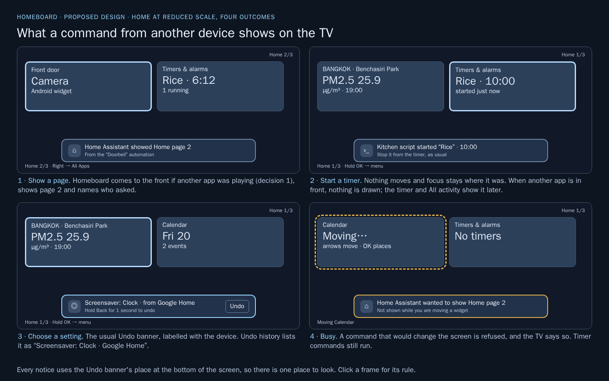](2026-11-20-control-interface/on-tv.html)

Every notice uses the Undo banner's place at the bottom of the screen, so there is one place to
look; it never takes focus and fades after 5 s. The decision this asks for: is a notice for
every remote action right, or should runtime commands be silent?
[Open the interactive mockup](2026-11-20-control-interface/on-tv.html).

**Activity list.** The last 7 days or 200 entries, whichever is smaller, kept app-private:
time, device, command and result, never a key. It answers "who started this timer?" after
the fact, and is shown per device and under **All activity**.

**Undo across sources.** Hold Back undoes the newest saved change whoever made it; its label
says who. A device cannot undo anything, so the people in the room always have the last word.

## Code shape

| Piece | Responsibility |
|---|---|
| `ControlHub` | Process-wide; serialises commands on the main thread as `PhoneEditor.command` does; receipts (bounded, like `KitchenTimers`); class rules; busy rules; tickets; subscribers. |
| `ControlVocabulary` | Verb registry: argument schema, class, link eligibility; the settings registry with labels and synonyms. Pure Java, unit tested. |
| `ControlState` | Builds the snapshot from the stores and the screen state. Pure Java given its inputs. |
| `ControlClients` | Device registry: hashed keys, names, kinds, times; constant-time match; Undo-able add and remove. |
| `ControlActivityLog` | The bounded activity list. |
| `ControlServer` | NanoHTTPD listener on a base shared with `PhoneEditorServer`; enrolment, commands, state, events. |
| `ControlAdvertiser` | `NsdManager` announcement while listening. |
| `ControlLinkActivity`, `ControlReceiver` | The two intent transports. |
| `MainActivity` | The settings screen, the Allow question, notices, ticket claims, screen-state reports. |

## Stages

Each stage ships and is deployed on its own.

| Stage | Delivers on its own | Needs |
|---|---|---|
| **0. Lifetime probe** | Evidence: does Homeboard's process survive 5 min behind Google TV on each TV, and does it hold the Home role. No app change. | Two adapter lines; coordinator admission. |
| **1. Command model, links and shell** | `ControlHub`, the vocabulary, receipts, busy rules, notices and the activity list; `homeboard://v1/…` links; the shell receiver with `state.read`; `homeboard.timers` replaced. The coordinator and ADB can drive and read Homeboard, and Home Assistant can through its ADB or Android TV Remote integrations. | Nothing. |
| **2. Listener and consent** | Control from other devices with every state in the mockups; the add window and Allow question; keys; state, commands and events; announcement; limits; network changes; Undo; the activity list on screen; a how-to with `curl` and Home Assistant `rest_command` and `rest` sensor examples. Runs B to D. | Stage 1; Decision 3. |
| **3. State for integrations** | Air readings fetched by a process-wide reader used by both the card and the hub, at the card's cadence, while the switch is on; `screensaver.showing` including `ScreensaverDream`; `/v1/vocabulary` with Thai and English labels; the in-process subscription interface written down for the Matter and bridge plans. | Stage 2; the lifetime evidence. |
| **4. Keep-alive, only if needed** | A `connectedDevice` foreground service while the switch is on. | Runs B to D show the process dying or freezing; Decision 2. |

The Matter device and bridge prototypes (their own TODO item) start after Stage 3, or after
Stage 1 if they only need commands.

## Design filter record

Applied the shared [Alan Cooper design filter](/home/will/docs/howtos/alan-cooper-design-filter.md).

- **Scope and baseline.** New Home settings screen, add window, Allow question and on-screen
  notices on Android TV and Google TV; baseline is source at `9faedc8`, where no outside
  control exists and the phone editor is the only network surface.
- **Primary profile and goal.** Two profiles. The person who sets up automation, once, from a
  laptop or Home Assistant, who wants the TV to react to the house without opening a port to
  the internet or handing out a password. And everyone on the sofa, who wants to understand
  why the screen just changed and to undo what they did not want. Evidence: Will's request
  and the investigation's callers. Assumption: a household adds one to three devices and rarely
  revisits the screen.
- **Scenarios.** Ordinary: turn it on, Add a device, type the code into Home Assistant, Allow;
  later the doorbell automation shows the camera page. Variation: "Hey Google, start a
  10‑minute rice timer" through the bridge. Interruption: someone is moving a widget when the
  automation fires. Failure: port taken; address changed; a key leaked and the device must be
  removed now; Homeboard reinstalled and devices must be added again.
- **Findings.**
  - An always-on listener with no visible owner → hidden exposure on a shared TV → off by
    default, the address and every device on one screen, Remove with immediate effect.
    Substantial risk.
  - The screen changes and nobody knows why → confusion, distrust of the automation → a notice
    naming the device, the activity list. Substantial friction.
  - A remote command lands in the middle of a person's move or edit → lost work → `busy`
    refusal for navigation, said on the TV. Blocks the goal.
  - Allowing a device the person does not recognise → silent over-grant → code plus a named
    question with its powers listed, focus on Deny. Substantial risk.
  - Implementation words (token, port, mDNS, client) → a screen nobody can read → "device",
    "code", "address"; the port appears only in the address and in its own error.
  - A remote setting change with no way back → Undo entry labelled with the device.
- **Proposed framework.** The six mockups and six diagrams above.
- **Acceptance.** The verification steps below, as observed scenarios on Cast1 and Cast2.
- **Disposition.** Conditional on Stage 0 and run B (whether the process lives) and on
  Decision 1. No exception to the filter is claimed.

## Decisions for Will

1. **May a command take the screen from another app?** Recommendation: yes, for navigation
   verbs only. "When the doorbell rings, show the Front door page" and "show the screensaver
   at 22:00" exist to interrupt; a timer never takes the screen. If not: navigation works only
   while Home is showing and answers `not_on_home` otherwise, and those routines quietly do
   nothing during a film.
2. **A keep-alive foreground service, if the lifetime test fails.** Recommendation: yes, of type
   `connectedDevice`, running only while the switch is on. The cost is permanent: a
   notification entry while on, and a foreground-service declaration with a video in the Play
   Console. If not: outside control works only while Homeboard is in front or until Android
   reclaims it, which defeats the bridge and the Matter device.
3. **Plain HTTP, announced on the home network.** Recommendation: plain HTTP with hashed
   per-device keys, home-address binding, `Host` and `Origin` checks and announcement by
   mDNS, matching the phone editor's approved transport. The alternative, TLS with a pinned
   self-signed certificate and no announcement, protects keys from a LAN sniffer and hides the
   service, but every client must pin and Homeboard must rotate a certificate forever,
   Home Assistant setup becomes typed addresses, and the Local Home SDK route closes.
4. **Scenes: reserved now, built by the scenes plan.** Recommendation: reserve. The bridge and
   the Matter prototype map scene-shaped triggers to single commands on their side until real
   scenes exist. The alternative, a scene store now with named command lists edited from the
   phone, gives Google routines their targets sooner but fixes the scenes data model before its
   interface and schedules are designed.

## Out of scope

These are deliberately not designed here.

- **The bridge, the Matter device and a Home Assistant integration.** Each consumes this
  interface and has its own plan; Stage 2's how-to gives Home Assistant `rest_command` and
  `rest` sensor examples only.
- **Scenes and schedules.** Reserved names only (Decision 4).
- **Text on screen from a device** ("the doorbell rang"). Needs its own design for abuse and
  for what a shared screen shows.
- **TLS for the listener.** Addable later on a second port (Decision 3).
- **IPv6.** The listener binds to the site-local IPv4 address, as the phone editor does.
- **Waking the TV from standby.** Power belongs to the Chromecast's own Google Home device.
- **A timer link that pre-fills the timer screen for the person to confirm**, such as
  `homeboard://v1/timers.show?minutes=10`. Possible later as a navigation verb with arguments.

## What is not verified

- Everything under [Process lifetime, Needs a device test](#process-lifetime): process
  survival, freezing, background starts, the Android TV Remote link path and standby. The AOSP
  behaviour described there is from memory.
- Whether Homeboard holds the Home role on Cast1 or Cast2.
- That `NsdManager` registration needs no permission at the current and the Play target.
- Whether the installed coordinator can hold another app in front for 60 min or record process priority.
- Whether the coordinator can send `am broadcast` to an arbitrary receiver or open a link; its
  documented broadcast is a single fixed one for the World Foundry engine. Stage 1's device step
  depends on it.
- How Home Assistant's Android TV Remote integration sends a link, and whether it accepts a
  custom scheme.
- Whether Google accepts Thai synonyms for `Modes` and `Toggles` (carried over from the
  investigation).
- The air feed's update cadence, which Stage 3's background refresh follows.

## Verification

Each step is the spec. When it runs, paste the raw output beneath it, then PASS or FAIL.

1. `task control:plan-check` validates the six mockups: self-contained, 1440×900, no overflow,
   every button explains itself, PNG captured, bundle within budget.

    ```
    $ task control:plan-check
    PASS settings: 1440x900, inline assets, no overflow/errors, PNG captured
    PASS settings-states: 1440x900, inline assets, no overflow/errors, PNG captured
    PASS add-device: 1440x900, inline assets, no overflow/errors, PNG captured
    PASS approve: 1440x900, inline assets, no overflow/errors, PNG captured
    PASS errors: 1440x900, inline assets, no overflow/errors, PNG captured
    PASS on-tv: 1440x900, inline assets, no overflow/errors, PNG captured
    PASS bundle size: 1028661 bytes
    ```

    **PASS**: all six mockups meet the bundle rules (run 2026‑11‑20).

2. `task md -- docs/plans/2026-11-20-control-interface.md` renders with no
   `Warning: mermaid.ink render failed` line, and all six diagrams draw.

    ```
    $ task md -- docs/plans/2026-11-20-control-interface.md
    task: [md] dev/render-markdown.sh docs/plans/2026-11-20-control-interface.md
    task: [md] bash /home/will/python-tui-lib/scripts/md-to-html.sh docs/plans/2026-11-20-control-interface.md
    Style: j-bladerunner
    /home/will/tmp/2026-11-20-control-interface.html (1823 KB)
    ```

    **PASS**: no render warning; the page holds six `mermaid-diagram` SVGs and no
    `language-mermaid` fallback block (run 2026‑11‑20).
3. Stage 0, Cast1 then Cast2: `task chromecast:version`, `task chromecast:devices`,
   `task chromecast:queue`, then
   `task chromecast:check DEVICE=chromecast-test-01 APP=homeboard-tv VALIDATOR=poke-resume RESUME_AFTER=300 POKE=false`,
   `task chromecast:watch JOB=<job>` and
   `task chromecast:evidence JOB=<job> OUT=/home/will/homeboard-tv/docs/testing/2026-11-20-control-interface/stage0-cast1`.
   Record `same_process`, the three pids and the activity in front before `am start` from
   `resume.json`, and which app holds the Home role. The result is a measurement; either answer
   is a PASS if it is recorded.
4. Stage 1: `task check` passes with new tests. `ControlVocabularyTest`: every verb parses
   its arguments, unknown verbs and fields are refused, and the link-eligible set is exactly
   the navigation verbs. `ControlHubTest`: a replayed id returns the first result; the same id
   with a different command is `conflict`; an ambiguous timer name lists both candidates;
   `busy` refuses navigation and lets `timer.start` through; a ticket is claimed once; an
   unclaimed ticket reports `blocked`. `ControlStateTest`: the snapshot's fields, `ends_at`,
   `stale` air, and `other` for another app.
5. Stage 1 on Cast1, through a coordinator workflow that can send the broadcast and open the
   link (to be provided by the coordinator, see What is not verified):
   `state.read` returns the snapshot in the result data; `homeboard://v1/page.show?page=2`
   shows page 2 with a notice, captured; `homeboard://v1/timer.start?seconds=60` is refused
   with `not_allowed` and no timer exists afterwards; an intent to `MainActivity` with a
   made-up ticket changes nothing.
6. Stage 2: `task check` passes with `ControlServerTest`, against a real socket as
   `PhoneEditorTest` does: no key and an unknown key are `unauthorized`; a request with an
   `Origin` header, or a wrong `Host`, is refused; enrolment outside the window is refused;
   five wrong codes close the window; the key is returned once; a removed device is
   `unauthorized` and its event stream closes within 1 s; the 21st command in 10 s is
   `limited`; a body over 8 KB is refused. `ControlClientsTest`: the stored preferences
   contain no key, only hashes. `task phone:check` still passes after the shared server base.
7. Stage 2 on Cast1: a coordinator recipe `dev/device/control-enrol-check.json` opens Home
   settings → Control from other devices, turns it on, opens Add a device and captures the
   code; `python3 dev/control-lan-check.py <capture> <out>` reads the code, enrols "Verification
   device", and the recipe presses Allow. Then: `GET /v1/state` answers; `timer.start` returns
   `done` and an `event: state` arrives on the open stream; `page.show` is captured with its
   notice; Remove in the recipe makes the next request `unauthorized` and closes the stream;
   hold Back restores it; turning the switch off refuses connections. The test timer is removed
   and the switch is returned to its starting value.
8. Stage 2, runs B, C and D on Cast1, then Cast2 when admitted:
   `python3 dev/control-lifetime-probe.py --address <tv>:8780 --minutes 60 --out <evidence>`
   during the coordinator-held 60 minutes with another app in front. Record every read,
   `control.started_at`, the stream's drops, and the result and capture of the final
   `page.show`. Measurements, recorded per TV, decide whether Stage 4 is needed.
9. Stage 3: `task check` passes with tests for the process-wide air reader (cadence, `stale`,
   one fetch shared by the card and the hub). On Cast1, with the switch on and another app in
   front, `air[0].fetched_at` advances on the reader's cadence, and `screensaver.showing`
   follows `ScreensaverDream` start and stop.
10. Stage 4, only if built: the foreground service exists only while the switch is on, shown
    in coordinator evidence, and run B then shows one `control.started_at` for the full hour.
11. Every device stage ends with Control from other devices back at its starting value and
    no test device left, shown by a final capture of the screen and a refused connection to
    port 8780.
