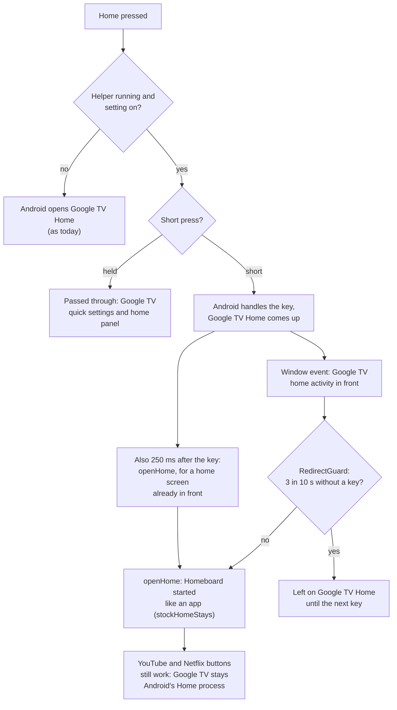
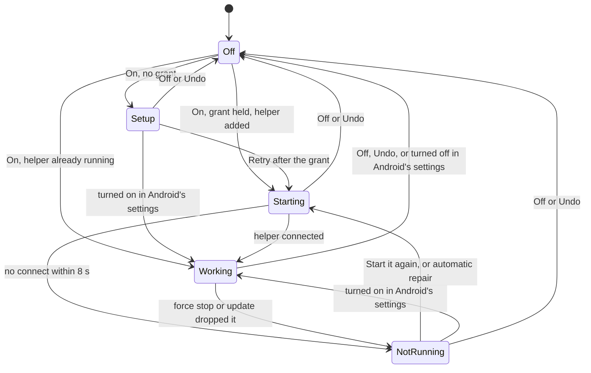
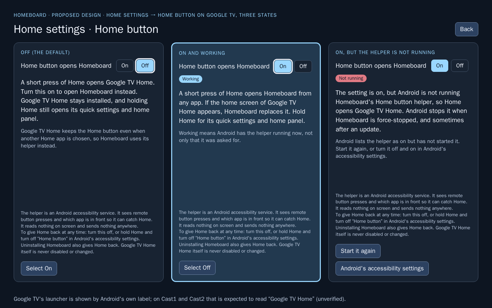
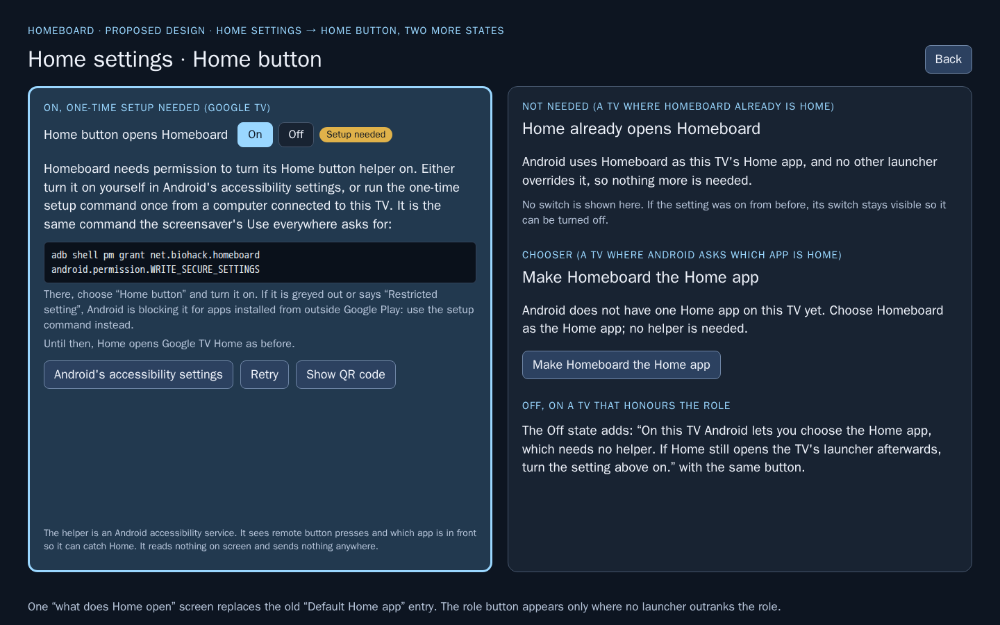

# Home button: make the remote's Home open Homeboard on Google TV

**Status (2026‑11‑21): Cast1 0.1.117 routes short Home from Homeboard,
Android settings and YouTube with the labelled test helper enabled. Physical key
repeat and lifecycle acceptance remain open.** Cast2 is on 0.1.116 and was in
Personal use; only passive inspection was performed. Both builds already contain
the key-repeat fix `d7b2ad4`, confirmed by their frozen source manifests. The old
0.1.108–110 handoff is superseded by the [fresh validation record](../testing/2026-11-21-home-button.md).

On Cast1 the old public helper was On and the test helper Off. The session turned
the obsolete public helper Off and enabled **Home button · Homeboard TV (test)**
through Android's normal consent. Coordinator-injected holds moved one row both
with the test helper On and with both helpers Off, so they do not establish
physical key-repeat acceptance. Will subsequently confirmed with the physical
remote that held Home opens Google's settings panel. Screenshot corroboration
and recovery tests were blocked by an unrelated coordinator foreground-cleanup
fence at 15:30; see the fresh validation record. Physical repeat and the branded
remote buttons remain open, as do restart, force-stop and app-update recovery.
Historical November 20 observations follow.

Will,
2026‑11‑20: "ok, make home button work". Research:
[The Home key on Google TV](../investigations/2026-11-20-home-key-on-google-tv.md).

Current-state check, coordinator Remote `J‑3906ace77986`: a short Home tap from
Homeboard opens Google TV's launcher. Home settings → Home button shows **Off**.
The feature is installed but routing is not enabled after the authorized app reset.
No grant, accessibility switch or Home-button setting was changed by this check.
Captures are under `docs/diagnostics/home-button-current/` (`before.png`,
`after-home.png`, `status.png`); evidence is exported alongside them. This proves
the current Off behavior only. On/Working, cross-app return, held Home, physical
remote key repeat and restart recovery remain unverified.

Follow-up Remote `J‑c8fc1b7792cd`: Will selected On in Homeboard; the screen showed
Setup needed. Android accessibility lists multiple identically named Home button
entries, with Configuration disabled (the service declares no settingsActivity).
Agent and physical remote inputs overlapped, and the selected accessibility service
was turned off during inspection. The agent restored that same entry through Enable
and Android's Use Home button confirmation; `restored-on.png` verifies its blue On
switch. A subsequent Home tap still opened Google TV. This does not prove the
restored entry belongs to the currently deployed debug package; the duplicate entries
must be disambiguated before enabling anything else. Remote was then stopped and
evidence exported under `docs/diagnostics/home-button-enabled/evidence`.

### Distinguish the test helper in Android accessibility

Read-only inspection `J‑7ffd7a5603a3` confirms both installed copies: public
`net.biohack.homeboard` versionCode 92 and debug `net.biohack.homeboard.debug`
versionCode 113. Both expose the inherited Home button label. Available evidence
does not establish their upper/lower order, so do not infer identity by position
or toggle either one to find out.

Apply the shared [Alan Cooper filter](/home/will/docs/howtos/alan-cooper-design-filter.md)
to this label correction: the person enabling Home needs to identify the installed
copy, without understanding package names or trying switches. Duplicate labels
create substantial friction and risk configuring the wrong app. The debug build's
service label becomes **Home button · Homeboard TV (test)**, with a Thai equivalent;
the public entry remains Home button. The same resource feeds Homeboard's setup
instructions. This changes no workflow, permissions, helper components or saved
choices; the existing diagrams and setup mockups still apply. Acceptance: verify
the merged APK resource and the actual Android accessibility list after a fresh
numbered, data-preserving deployment. Leave the switches as found.

Implemented as **0.1.114**, installed on both TVs using identical APK SHA-256
`902f9b0c26218496065f1013476b8f1b5d72c611d42ea7b8e4b7d84795b3e616`.
Container `aapt2 dump resources` verifies the English and Thai labels in the frozen
APK; the manifest assigns `home_key_name` to `com.gathin.tvhome.HomeKeyService`.
Cast2 install/launcher verification `J‑8e54ae846147` passed. Cast1 background
install `J‑73190089cc9d` refused `install-over-foreground`; independent foreground
install/check `J‑e4e5494a6208` then passed and verified the same installed hash.
The plain Home button entry belongs to the older public package; the test-labelled
entry belongs to `net.biohack.homeboard.debug`. No accessibility switches were
changed during this identification step. The actual refreshed Android list and
enabled routing remain to be checked. See the [identification record](../testing/2026-11-20-home-button.md).

## Context

On Google TV, choosing Homeboard as the Home app records the role and the Home key still opens
Google's launcher, `com.google.android.apps.tv.launcherx`. Stage 0 of the
[control interface plan](2026-11-20-control-interface.md) saw this on both test TVs (Cast1, a
Chromecast HD, and Cast2, a 4K Chromecast; both Android 14, both 32‑bit ARM). Disabling
launcherx works but breaks the Google Home panel and needs ADB to undo, so it is ruled out.

What existed before this change:

| Piece | State before | Evidence |
|---|---|---|
| `HomeKeyService`, the accessibility helper inherited from CleanYourTV | Present, with the short-press redirect, the held-press pass-through, `stockHomeStays` for the YouTube and Netflix buttons (upstream issue 1274) and `probeAtBoot` | `HomeKeyService.java` |
| The launcher to send back (`stock_home_redirect`) | A build-time string in `config.xml` or a theme's `config.json`; empty, so the redirect was off | `config.xml`, `Config.java` |
| Turning the helper on | Only over ADB (`settings put secure enabled_accessibility_services …`) | the class comment |
| `restore_key_services` and `ServiceRepair` | The record half runs; `ServiceRepair.restore` is called from nowhere in Homeboard, so a dropped helper is never put back | `git grep 'ServiceRepair.restore'` finds only its definition |
| "Default Home app" in Home settings | Requests the Home role, which Google TV does not honour for the key | `MainActivity.chooseDefaultHomeApp`, [quick start](../how-to/quick-start.md) |
| The one-time `WRITE_SECURE_SETTINGS` grant | Detected and explained by the screensaver's Use everywhere | `SystemScreensaver.mayWrite`, `MainActivity.drawEverywhere` |

## Approach

**One screen, Home settings → Home button, that says what Home opens and changes it.** It
replaces the "Default Home app" entry. On Google TV it offers **Home button opens Homeboard**,
off by default, through the helper. On a TV where Android honours the Home role it offers
**Make Homeboard the Home app** as well, which needs no helper. Where Homeboard already is Home,
it says so.

| Decision | Reason | Rejected |
|---|---|---|
| The target launcher is found at runtime (`HomeTarget`): a known list naming launcherx, plus any system launcher whose HOME filter has a positive priority, outranks the role; otherwise Android's resolved choice | One public APK for every household. Priority is honoured only for system apps, which is exactly how launcherx outranks Homeboard | A build-time package name |
| `stock_home_redirect` is removed from `config.xml`, `Config` and themes | The runtime setting covers its cases, and there is no compatibility duty before v1. One source of truth | Keeping it as an override beside the setting |
| The choice is saved in its own preferences (`home-button`), not in the layout | It is a device setting with an Android side, like the language; Undo carries `{"wanted": …}` and re-applies through the same code path | Storing it in `HomeLayout` |
| With the one-time grant, Homeboard adds only its own entry to `enabled_accessibility_services`, and on Off removes only that entry, only if it added it, and puts `accessibility_enabled` back to 0 only if nothing else is left and it was 0 before | Other services, such as TalkBack or another app's, are never touched; a helper the household turned on for other buttons stays on | Rewriting the list, or always removing the helper |
| Without the grant, the screen offers Android's accessibility settings and the same setup command the screensaver uses | One setup story; the helper can be turned on by hand where Android allows it | A second setup flow |
| The screen shows whether the helper is **running** (bound now), not whether it was asked for. "Turning on…" ends on the helper's own connect signal (`HomeKeyService.stateListener`); an 8 s failure guard then shows Not running | Honest state; no timing on the success path | Polling, or reporting "On" after the write |
| Repair: Home's resume, boot and an update put the helper back **only** when Android took it off the list or turned the switch off, and only with the grant. A helper still listed but not bound gets a **Start it again** button (the add, remove, add cycle that clears a crashed mark, now shared in `ServiceRepair.cycle`) | A listed helper may simply be starting; cycling it then would be a fight | Reviving `restore_key_services`, which is a build flag and never called |
| If the household turns the helper off in Android's settings, the setting follows to Off (`HomeKeyService.onUnbind` outside standby) | Homeboard never puts back what a person turned off | Repairing it on the next resume |
| Without the grant and with the helper dropped, Home shows one toast saying so and where to fix it | The person learns why Home changed | Silence |
| No lock-out: `RedirectGuard` stops redirects after 3 within 10 s with no key pressed between, until the next key | If Homeboard fails to stay up, Google TV stays usable | No guard |
| Held Home and the YouTube and Netflix buttons keep their existing handling (`redirectHomeKey`, `stockHomeStays`) | Already right, and the brief's requirement | |
| `HomeKeyService.reload()` applies a change to a running helper, which now also **drops** window events when the setting goes off | Off takes effect at once without a new connection; the helper stops watching windows it no longer needs | Leaving window events subscribed |





`NotNeeded` and `Chooser` sit outside this diagram: they depend only on what Android resolves,
and the switch appears there only if it was left on.

## Mockups

[](2026-11-20-home-button/home-button.html)

On Google TV: Off (the default), On and working, and On but the helper not running, with **Start
it again** and Android's accessibility settings. Every helper state ends with what the helper
can see and how to give Home back. [Open the interactive mockup](2026-11-20-home-button/home-button.html).

[](2026-11-20-home-button/home-button-other.html)

One-time setup needed, with the same command and QR code as the screensaver, and the
Restricted-setting explanation; and the non-Google states: Homeboard already is Home, and a TV
where Android asks which app is Home. [Open the interactive mockup](2026-11-20-home-button/home-button-other.html).

The implementation follows the mockups with Homeboard's existing two-pane panel: the switch is
the On/Off segmented row the screensaver Options use, and the status is a badge beside it.

## No lock-out and recovery

- Google's launcher package is never disabled, hidden or changed by this code.
- The setting can always be turned off: Homeboard itself opens on Home.
- A held Home press still reaches Google TV's quick settings, from which Android's accessibility
  settings can turn the **Home button** helper off. The setting then follows to Off.
- If Homeboard crashes, the helper dies with its process (it runs in Homeboard's process), so
  Google TV Home stays. If Homeboard keeps failing to stay up, `RedirectGuard` stops the bounce.
- Uninstalling Homeboard removes its service, and Android drops it from the enabled list.
- Over ADB, from a computer: `adb shell settings put secure enabled_accessibility_services ''` removes
  every service, or edit the list to drop only `net.biohack.homeboard/com.gathin.tvhome.HomeKeyService`.

## Effects elsewhere

- **Key filtering.** The helper declares `flagRequestFilterKeyEvents` and `key_filter` is on by
  default, so while it runs it sees every remote key. Upstream notes TCL Google TV sets on Android
  12 where any key-filtering service stops held keys from repeating. Not known for a Chromecast;
  verification step 9 checks it.
- **Control interface.** With the override, Homeboard is not Android's Home process, so the
  control interface's run C (can Homeboard bring itself to the front) should be run with the
  helper on. A bound accessibility service is one of Android's exemptions for background
  activity starts, from memory of AOSP, unverified here.
- **Play edition.** An app using the accessibility interface without being an accessibility
  tool needs the AccessibilityService declaration in the Play Console and a prominent
  in-app disclosure before turning it on
  ([Play policy](https://support.google.com/googleplay/android-developer/answer/10964491?hl=en)).
  The `hb_hb_how` text is a start on that disclosure. No action in this plan.
- **Strings.** New `homeboard_home_button.xml` in English and Thai. Removed:
  `hb_default_home_app`, `hb_choose`, `hb_homeboard_tv_is_now_the_default_home_app`,
  `hb_default_home_app_was_not_changed`.

## Code

| File | Change |
|---|---|
| `HomeTarget.java` (new) | Pure target detection |
| `AccessibilityList.java` (new) | Pure editing of the enabled-services list |
| `HomeButtonRules.java` (new) | Pure screen state, menu summary, repair and notice rules, `RedirectGuard` |
| `HomeButton.java` (new) | Preferences, PackageManager and Settings glue; `set`, `restart`, `repair`, `helperTurnedOff` |
| `HomeButtonReceiver.java` (new) | Repair after boot and after an update |
| `HomeKeyService.java` | Target from `HomeButton`; `reload()`; `stateListener`; window events added and removed; guard; `onUnbind` follows the household |
| `ServiceRepair.java` | The add, remove, add cycle extracted as `cycle(Context, String)` |
| `Config.java`, `config.xml` | `stock_home_redirect` removed |
| `MainActivity.java` | The Home button screen, menu entry, Undo kind `home-button`, resume repair and notice; setup command shared with the screensaver |
| `AndroidManifest.xml` | The receiver; a query for Android's accessibility settings; comments |
| Tests | `HomeTargetTest`, `AccessibilityListTest`, `HomeButtonRulesTest` |

## Design filter record

Applied the shared [Alan Cooper design filter](/home/will/docs/howtos/alan-cooper-design-filter.md).

- **Scope and baseline.** Home settings → Home button, replacing "Default Home app"; baseline
  `3750acc` on Android TV and Google TV.
- **Primary profile and goal.** A household member with the remote who wants Home to bring back
  the dashboard, without learning which Android mechanism decides it. Evidence: Will's request
  and Stage 0. Assumption: most households will not run ADB, so the hand-turned path in
  Android's accessibility settings must be complete on its own where Android allows it.
- **Scenarios.** Ordinary: turn it on once, press Home from YouTube, see Homeboard. Variation: a
  TV that honours the role, where no helper is needed. Interruption: Homeboard was force-stopped
  and Home opens Google TV again. Failure: no grant and Restricted setting blocks the switch;
  Android refuses the write; Homeboard fails to stay up.
- **Findings.**
  - "Default Home app" did nothing on Google TV and said it worked → fabricated success →
    one screen that says what Home actually opens. Blocks the goal.
  - "On" shown while the helper is not running → false state → Working only when bound, Not
    running with the one action that helps. Substantial risk.
  - An accessibility helper with no explanation → distrust → one line on what it sees and does
    not, and how to give Home back. Substantial friction.
  - A setting that fights the person's own Android switch → loss of control → the setting
    follows Android's switch. Substantial risk.
  - A redirect loop if Homeboard cannot stay up → lock-out → `RedirectGuard`. Blocks the goal.
- **Proposed framework.** The two mockups and two diagrams above.
- **Acceptance.** Verification steps 4 to 12 on Cast1, then Cast2.
- **Disposition.** Conditional on the device steps: whether Android starts the helper after a
  settings write, whether a short press redirects without a visible flash, and whether key
  repeat survives. No exception claimed.

## Out of scope

- A Play Console accessibility declaration and its in-app disclosure screen, for the Play edition item.
- Reviving `restore_key_services` for `InputKeyService`, which no Homeboard build turns on.
- A Home-key override that does not filter keys (window events only), if step 9 shows key repeat breaking on a Chromecast.

## Verification

Record raw output beneath each step, then PASS or FAIL.

1. `task home-button:plan-check` validates the two mockups (in this worktree the browser
   artifacts come from the main checkout, mounted read-only; after merge the task runs as is).

    ```
    $ docker run --rm -v "$PWD:/workspace" -v /home/will/homeboard-tv/artifacts:/workspace/artifacts:ro -w /workspace mcr.microsoft.com/playwright:v1.59.1-noble node dev/plan-mockup-check.cjs docs/plans/2026-11-20-home-button home-button home-button-other
    PASS home-button: 1440x900, inline assets, no overflow/errors, PNG captured
    PASS home-button-other: 1440x900, inline assets, no overflow/errors, PNG captured
    PASS bundle size: 484826 bytes
    ```

    **PASS** (2026‑11‑20).

2. `task md -- docs/plans/2026-11-20-home-button.md` renders with no
   `Warning: mermaid.ink render failed` line, and both diagrams draw.

    ```
    $ task md -- docs/plans/2026-11-20-home-button.md
    task: [md] dev/render-markdown.sh docs/plans/2026-11-20-home-button.md
    task: [md] bash /home/will/python-tui-lib/scripts/md-to-html.sh docs/plans/2026-11-20-home-button.md
    Style: h-mondrian
    /home/will/tmp/2026-11-20-home-button.html (805 KB)
    ```

    **PASS**: no warning; the page holds 2 `mermaid-diagram` blocks and no fallback (2026‑11‑20).

3. `task i18n:check` and `task check` pass, with `HomeTargetTest`, `AccessibilityListTest` and
   `HomeButtonRulesTest` among the tests run.

    ```
    $ task i18n:check
    > Task :app:checkTranslations
    Validated 888 English/Thai Homeboard resources
    BUILD SUCCESSFUL in 18s
    $ task check
    task: [check] dev/container.sh run ./gradlew --no-daemon :app:testDebugUnitTest :app:lintDebug
    Validated 888 English/Thai Homeboard resources
    BUILD SUCCESSFUL in 1m 25s
    107 actionable tasks: 10 executed, 97 up-to-date
    ```

    Test reports: `HomeTargetTest` 12, `AccessibilityListTest` 10, `HomeButtonRulesTest` 12,
    `HomeKeyServiceTest` 11, all passing; 627 unit tests in all, 0 failures. **PASS**
    (2026‑11‑20). The first `task check` run failed 5 `AccessibilityListTest` cases: the test
    used a short form `net.biohack.homeboard/.HomeKeyService`, which is not Homeboard's
    component (its classes are in `com.gathin.tvhome`); the test was corrected, not the code.
4. Before anything changes, on Cast1: `task chromecast:version`, `task chromecast:devices`,
   `task chromecast:queue`, then a coordinator read of `enabled_accessibility_services`,
   `accessibility_enabled` and the resolved HOME activity
   (`cmd package resolve-activity -a android.intent.action.MAIN -c android.intent.category.HOME`).
   Record all three as the starting state.
5. Install the frozen build with `task deploy`. Through a coordinator `check` recipe: open Home
   settings, capture the entry (expected "Home button · opens Google TV Home" or Android's own
   label), open it, capture the Off state; it must say Google TV keeps the button and offer no
   role button.
6. Without the grant: select On; capture Setup needed. Select Android's accessibility settings,
   turn on "Home button", come back; capture Working, or capture what Android showed (a
   Restricted-setting block is a recorded result, not a pass).
7. With the grant (`pm grant <package> android.permission.WRITE_SECURE_SETTINGS`, only if the
   coordinator's policy admits it): Off, then On; capture Turning on… then Working, and read the
   enabled list back: the starting entries plus Homeboard's helper, nothing else changed.
8. With Working: short press Home (hold of about 100 ms) from Homeboard, from YouTube and from
   Google TV Home reached by holding Home and backing out. Each time capture what is in front
   1 s and 3 s after release, and say whether Google TV Home showed first.
9. With Working: hold Home (about 1500 ms); capture Google TV's quick settings or home panel.
   Hold Down on a long Home page and hold Volume Up for 2 s; record whether each repeats.
10. With Working: press the remote's YouTube and Netflix buttons; each app must open.
11. Restart the TV through the coordinator; after boot, short press Home from Google TV Home and
    from YouTube; Homeboard must open. Then force-stop Homeboard through the coordinator's
    background-kill stress, open Homeboard from the app row, and capture the screen: Working
    again with the grant, or the dropped toast and Not running without it.
12. Select Off; capture the Undo banner and that Home opens Google TV Home again; hold Back on
    Home and capture Working again; select Off once more. Finally restore the starting state
    from step 4 (enabled list, switch, grant revoked if it was not held before) and read all
    three back. Repeat steps 4 to 12 on Cast2.

Steps 4 to 12 are written as coordinator steps, not as recipe files: their key sequences
depend on the live menu positions, which a recipe must be built against on the TV.
