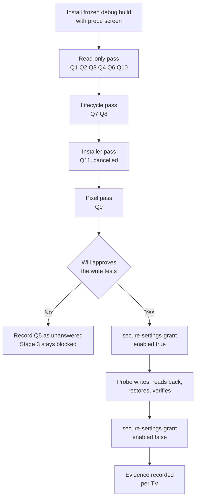
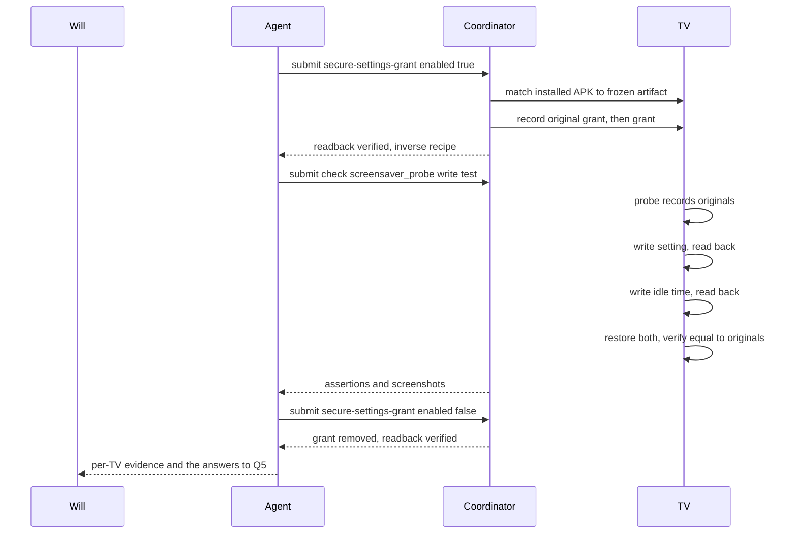

# Screensavers Stage 0: the probe recipe

**Status:** draft for review. Nothing has run on any device. This is the recipe the
[screensaver plan](2026-11-20-screensavers.md) calls for in Stage 0: how each of its
eleven questions gets answered as recorded evidence, with no raw ADB on the shared TVs.

**No visible surface.** The probe is a debug-only screen and coordinator job output, not
product UI, so there are no mockups. Its evidence is JSON plus screenshots in the testing
record.

## What the coordinator already has

Read from the coordinator's Android plugin manifest (revision `b3b5e874`). These typed
workflows already exist and need no new code:

| Workflow | Use here |
|---|---|
| `screensaver-list` | Installed screensaver services and which declare a settings document (Q6, Q9). Works on the phone profile. |
| `screensaver-trigger` / `screensaver-show` | Start Android's screensaver over whatever is in front (Q7). |
| `screensaver-select`, `screensaver-setting-set` | **Shell-level** writes. They answer "can Android's setting change", not "can Homeboard change it", so they are not Q5. |
| `install`, `verify-launch`, `capture`, `press`/`remote`, `record`/`profile` | Install the debug build, screenshots, remote presses, memory over time. |
| `check` with an app-side option | The pattern the widget probe uses (`widget_bind_test`): the app runs assertions and the job records them. |

## What is missing

Questions 4 and 5 ask what **Homeboard itself** may do, and the coordinator talks to the TV
as the ADB shell. Two additions are needed, both modelled on `widget-binding`:

1. **`check` option `screensaver_probe`** (read-only, frozen debug APK only). Homeboard
   runs its probe screen and returns structured assertions: settings it can read, intents
   that resolve, lifecycle callbacks, installer flags.
2. **A typed `secure-settings-grant` workflow**: `{app, apk, enabled}`, like
   `widget-binding`. It grants or revokes `WRITE_SECURE_SETTINGS` for the registered
   Homeboard debug package after matching the installed APK to the frozen artifact. It
   journals the original state, requires readback, emits an inverse recipe, and holds
   Personal use. Without it the two write tests in Q5 cannot be run by an agent.

Both are coordinator changes: a container-tested release, then the reviewed administrator
deployment, as `widget-binding` was.

## Question → method

| # | Question (short) | Method | Mutates a TV? |
|---|---|---|---|
| 1 | Current values of the four settings | `screensaver-list` plus the probe's own reads. If `sleep_timeout` is absent from the list output, add it to the read-only `platform-facts`. Confirm on the first run. | No |
| 2 | Android's screensaver settings screen opens, lists third-party savers | Probe resolves and starts the dream-settings intent; `capture` shows the screen. | No |
| 3 | "Start screensaver now" shortcut works from Homeboard | Probe starts it; `capture` plus a foreground read. | No, it only starts the saver |
| 4 | Read screensaver and idle time with no extra permission | Probe reads `Settings.Secure` and `Settings.System` before any grant. | No |
| 5 | Writes succeed, read back, survive restart; idle write needs that permission alone | `secure-settings-grant` → probe writes the screensaver setting, reads back, writes the idle time, restores both and verifies. Restart check below. | **Yes, restored** |
| 6 | Installed savers and settings activities | `screensaver-list`; probe queries each declared settings activity. | No |
| 7 | What Homeboard's activity sees when Android's saver starts over it; where wake returns | `screensaver-trigger` while Homeboard is foreground; probe logs lifecycle callbacks; `capture` on wake. | No |
| 8 | A video provider plays inside Homeboard's screensaver service, within memory, for how long | Probe hosts a throwaway dream service on the existing wallpaper host; `profile` for memory over time. Heaviest, so last. | No |
| 9 | Pixel 8 Pro lists screensavers installed from outside the system | `install` the already-published World Foundry screensaver, then `screensaver-list` on the phone profile. | Installs one app |
| 10 | Play listing link opens the TV's Play Store | Probe starts the market intent; `capture` and foreground package. | No |
| 11 | "Install unknown apps" for Homeboard, and what the installer and Play Protect show | Probe reads `canRequestPackageInstalls` and resolves the manage-sources intent; a harmless frozen test APK is offered through the probe, `remote` presses, `capture` each screen. Cancel at the installer. | No install completes |

## Order and safety

The write tests go last, after Will approves them. Each TV is its own job, so a failure on
one stops that TV only.

**Stop criteria.** Stop that TV and report if: the installed APK hash differs from the
frozen one; any original value cannot be read; a restore does not read back equal to its
original; or the grant cannot be removed. A failed restore is reported first, before any
answer.

**Survives a restart (Q5).** After the restore, a second job writes the test value, a
restart follows, a third job reads it, then the original is restored again. This needs a
typed restart. If the coordinator has none, that step waits for Will to restart the TV
and the reading job runs afterwards. Open point to confirm before the run.

## Evidence

Per TV and for the Pixel, one JSON file in
`docs/testing/2026-11-20-screensavers-stage0/` named `<device>-q<N>.json`, plus the
screenshots it cites, and a summary table in `docs/testing/2026-11-20-screensavers-stage0.md`
with the job id for every row. The plan's questions 1 to 11 are answered there and the
plan's Stage 0 line then links to it.

## Recipes in this repo

- [`dev/device/screensaver-stage0-list.json`](../../dev/device/screensaver-stage0-list.json)
  runs today: read-only `screensaver-list` for Q1 and Q6.
- The probe, grant and write-test recipes are added with the coordinator change, because
  their workflows do not exist yet.

## Verification

1. Container tests in the coordinator for `secure-settings-grant`: identity mismatch,
   unknown package, failed readback, idempotence, inverse recipe, crash settlement.
2. Reviewed administrator deployment, preserving concurrent coordinator changes.
3. Read-only pass on both TVs: Q1, Q2, Q3, Q4, Q6, Q10 recorded.
4. Lifecycle and installer passes: Q7, Q8, Q11 recorded.
5. Pixel pass: Q9 recorded.
6. Write tests with Will's approval: Q5 recorded, every original restored and verified,
   grant removed.
7. Plan's Stage 0 line and the TODO item updated to link the evidence.

## Needs from Will

- Approval of the two coordinator additions and, separately, of the write tests.
- The same items already on the TODO: the World Foundry app's name and package, and 12
  testers. Neither blocks this probe.

**Cost.** No infrastructure is created or changed, so there is no AWS cost.
