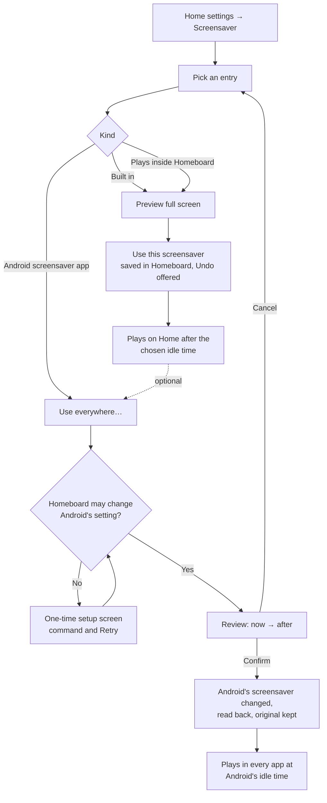
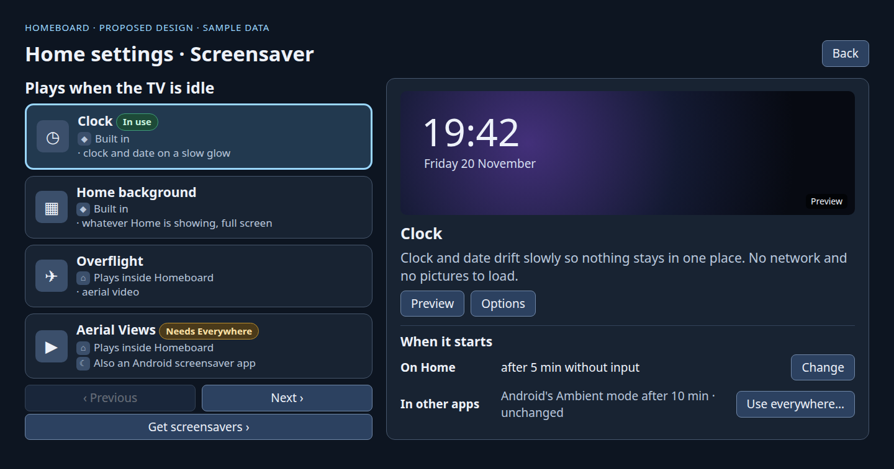
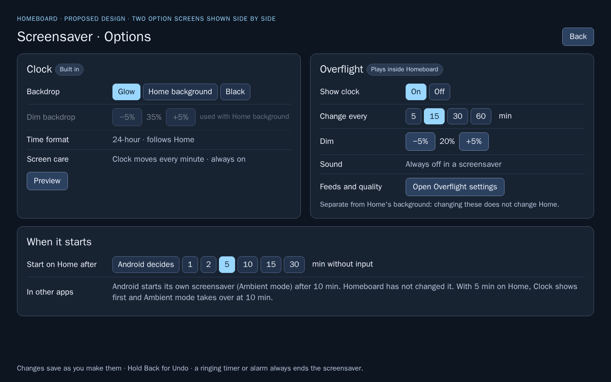
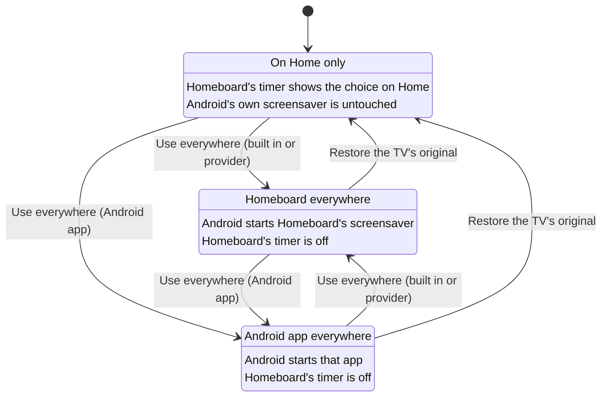
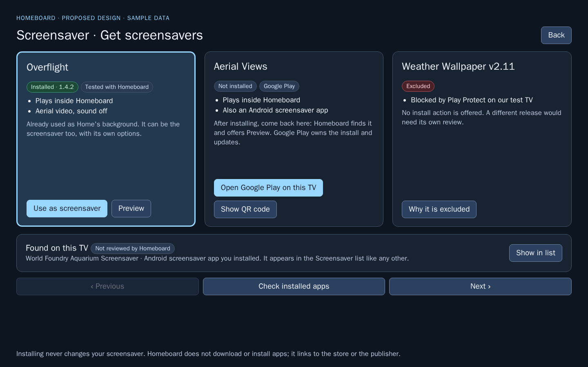
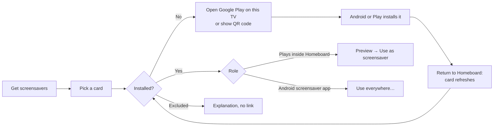
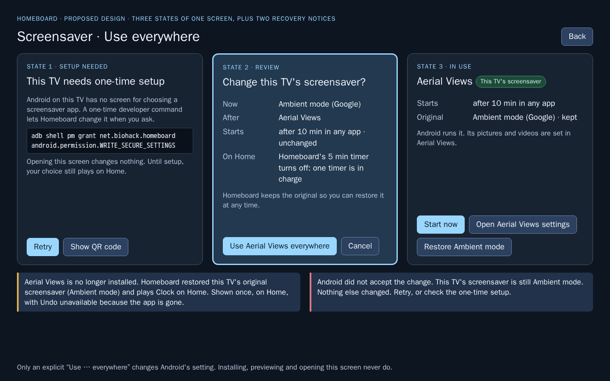
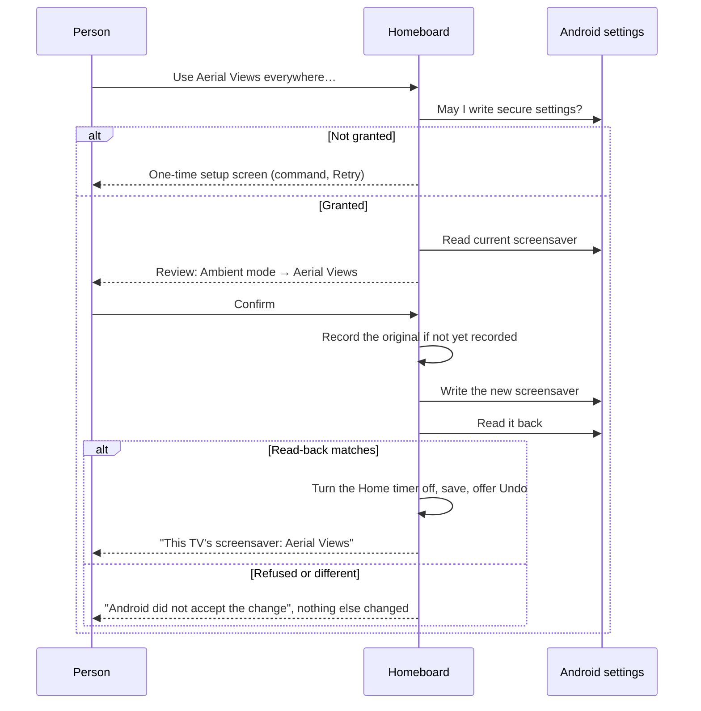
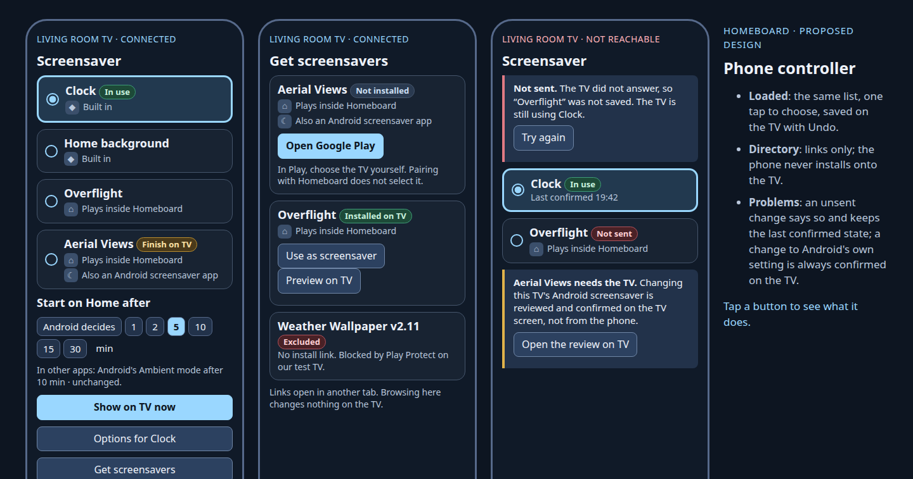
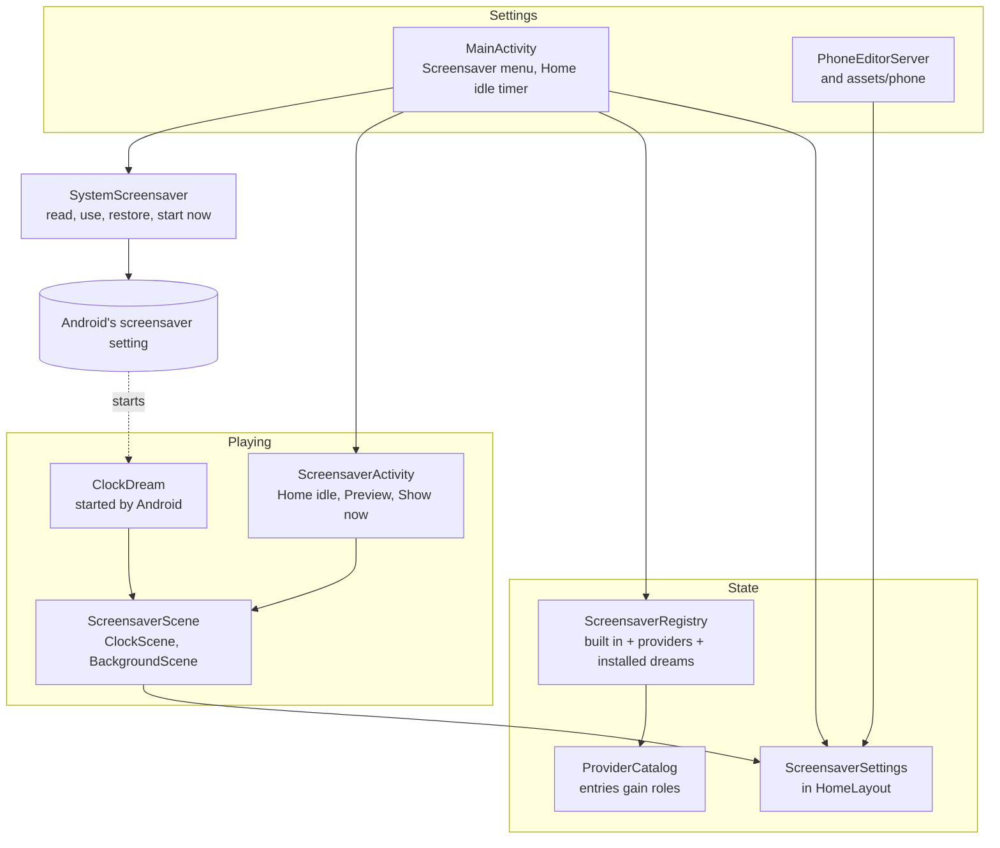

# Screensavers: choose, configure and get more

**Status: plan for review, 2026‑11‑20. Nothing is implemented.** The mockups and diagrams
below are the proposal. Four decisions are waiting for Will (see
[Decisions for Will](#decisions-for-will)), and the device probe in Stage 0 has not run:
at 17:40 on 2026‑11‑20 Cast1 was `recovery-required` and Cast2 was in personal use.

Will, 2026‑11‑20: "we need a way to configure the screensaver, and way to choose from
multiple screensavers, and way to install screensavers".

## Context

Homeboard has one screensaver today and no screen for it.

- **One screensaver.** `ClockDream` is the only `DreamService`. Its label is "Clock"
  (`dream_name`) and it draws `ClockScene`: clock and date on a slow glow.
- **No way to choose it on our TVs.** Android starts whichever screensaver its own setting
  `screensaver_components` names. Cast1 and Cast2 are Chromecasts on Android 14. The
  [Aerial Views instructions](https://github.com/theothernt/AerialViews#how-to-set-aerial-views-as-the-default-screensaver)
  state that since 2023 nearly all Google TV devices on Android TV 12 or later, the
  Chromecast with Google TV among them, "have no user-interface to change the screensaver
  to a 3rd party one", and give a developer command instead. That has not yet been
  observed on our two TVs; Stage 0 checks it.
- **No way to configure it.** The options exist only as build or theme values:
  `clock_glow`, `clock_wallpaper`, `clock_wallpaper_dim` and `clock_format`. Nothing on
  the TV or the phone changes them.
- **The Home idle clock is dead code.** `Config.homeIdleClockMinutes` (`Config.java:236`)
  and `Config.backOpensClock` (`Config.java:138`) are parsed and read nowhere else.
  `MainActivity.onUserInteraction` only tells the wallpaper host about activity.
  `ClockActivity` is reachable only as the fallback of the remote's `screensaver` action
  (`RemoteKeys.java:391`).
- **The clock's "Home wallpaper" backdrop reads the wrong background.**
  `ClockScene.useHomeWallpaper` reads the inherited theme files (`cfg.wallpapers`), not
  Homeboard's own background (`layout.wallpaper`, played by `ProjectivyWallpaperHost`).
- **Earlier plans kept away from screensavers on purpose.** The
  [provider plan](2026-11-18-provider-testing-spike-and-installation.md) says
  "Android DreamService-only screensavers are also outside this host contract" and "Do not
  change the TV's system screensaver". This plan is where that separate work is designed.

## Approach

**One Screensaver screen in Home settings, holding one list.** A person wants something
pleasant on the idle TV, wants to pick it, adjust it and find more. They should not have
to know which Android mechanism plays it. The list therefore mixes three kinds, each
labelled by what it means for the person:

| Kind | Examples | Who runs it | Options | How you get it |
|---|---|---|---|---|
| **Built in** | Clock, Home background | Homeboard | Homeboard's own | Ships with Homeboard |
| **Plays inside Homeboard** | Overflight, Aerial Views, Movie Art | Homeboard, through the wallpaper host it already has | Homeboard's, plus the provider's own settings | Get screensavers |
| **Android screensaver app** | Aerial Views' own screensaver, World Foundry Aquarium, Android's Ambient mode | Android, outside Homeboard | The app's own settings | Get screensavers, or anything you installed yourself |

The second kind is the leverage: every wallpaper provider Homeboard already hosts becomes
a screensaver with no new integration, and the reviewed directory already exists.

The third kind has a hard limit. Homeboard cannot run another app's screensaver service,
because Android reserves that binding for the system. It can only make that app **this
TV's screensaver**, which means changing Android's setting. That is the "Use everywhere"
step, and it is always explicit.



### Choose

[](2026-11-20-screensavers/screensaver.html)

The list is paged, four entries to a page, with no scrollbar, like the provider
directory. The right pane always shows the focused entry: a preview, one sentence on what
it is, its actions, and a plain statement of **when it starts** on Home and in other
apps. The decision this mockup asks for: is one mixed list, with the kind shown as a
label, the right model? [Open the interactive mockup](2026-11-20-screensavers/screensaver.html).

- **Preview** plays the entry full screen at once. OK uses it, Back cancels and nothing
  is saved. An Android screensaver app has no preview, because Android gives ordinary apps
  no way to start a specific screensaver; the pane says so instead of offering a button
  that cannot work.
- **Use this screensaver** saves the choice in Homeboard with the usual Undo banner and
  hold‑Back history. It changes nothing in Android.
- A chosen entry that later disappears (the app was uninstalled) falls back to Clock, and
  Homeboard says so once on Home.

### Configure

[](2026-11-20-screensavers/options.html)

Each entry has its own options, kept separately from Home's background settings, so
dimming the screensaver does not dim Home. The decision this mockup asks for: are these
the right options, and is "Android decides" the right default for the Home timer?
[Open the interactive mockup](2026-11-20-screensavers/options.html).

| Entry | Options |
|---|---|
| Clock | Backdrop: Glow, Home background or Black (for OLED). Dimming when the backdrop is Home background. |
| Home background | Show clock on or off. Dimming. |
| A provider | Show clock on or off. Change every 5, 15, 30 or 60 min. Dimming. A button that opens the provider's own settings. |
| An Android screensaver app | A button that opens the app's own screensaver settings, when it declares one. |
| All | Start on Home after: Android decides, 1, 2, 5, 10, 15 or 30 min. |

Not options, and shown as plain statements: sound is always off; the clock moves every
minute; the time format follows Home. Changes save as they are made, with Undo.

### Who starts it, and when

Two timers could start a screensaver: Homeboard's own, which can only run while Home is on
screen, and Android's, which runs in every app. The rule is that **the person is always
told which one is in charge**, and after "Use everywhere" there is only one.



| State | On Home | In other apps |
|---|---|---|
| **On Home only** (no setup needed) | Homeboard shows the choice after the Home idle time. If Android's own timeout is reached later, Android's screensaver takes over. | Android's own screensaver, unchanged. |
| **Homeboard everywhere** | Android starts Homeboard's screensaver at Android's timeout. | The same. |
| **Android app everywhere** | Android starts the app at Android's timeout. | The same. |

With "Android decides", Homeboard runs no timer at all, which is today's behaviour and
the proposed default: an update must not start showing something new by surprise.

Two things always end a screensaver and are never options: any remote key, and a ringing
timer or alarm from [Timers & alarms](2026-11-19-cooking-timers.md).

### Install

[](2026-11-20-screensavers/get.html)

**Get screensavers** is the existing reviewed directory, seen from the Screensaver screen.
It follows the rules already settled in the
[provider plan](2026-11-18-provider-testing-spike-and-installation.md): reviewed links
only, Google Play first, a QR code for the phone, publisher release pages under
Advanced, excluded entries with an explanation and no link. Homeboard does not bundle,
download or install apps, and **installing never changes the screensaver**.
[Open the interactive mockup](2026-11-20-screensavers/get.html).

What is new:

- **Roles on each card.** A card says whether the app "Plays inside Homeboard", is "Also
  an Android screensaver app", or both. Aerial Views is both and appears once.
- **Found on this TV.** Any Android screensaver app that is installed appears in the
  Screensaver list whether or not it is in the directory, labelled "Not reviewed by
  Homeboard". That covers apps installed by any other route, such as World Foundry
  Aquarium Screensaver, which is already on a test TV.
- **Installed cards** offer Preview and Use as screensaver directly.



The first directory holds the seven reviewed provider entries Homeboard already lists.
There is no verified list of Android‑only screensaver apps yet; an inventory with one
controlled test each is a separate item (see Out of scope).

### Use everywhere

[](2026-11-20-screensavers/everywhere.html)

This is the one place Homeboard changes an Android setting, so it gets a review step
that shows now and after, and a permanent way back. The decision this mockup asks for:
may Homeboard change this TV's screensaver at all? See Decision 1.
[Open the interactive mockup](2026-11-20-screensavers/everywhere.html).

- **Setup needed.** On a TV with no Android screen for choosing a screensaver, Homeboard
  needs the `WRITE_SECURE_SETTINGS` permission, which the manifest already declares for
  the remote helpers. It is granted once with a developer command, the same pattern as
  [widget permission setup](2026-11-19-android-app-widgets.md). The screen shows the
  installed package name and the exact command. Opening it changes nothing. On a TV whose
  Android settings do offer a screensaver chooser, Homeboard opens that instead.
- **Review.** Now, after, when it starts, and what happens to the Home timer.
- **In use.** Start now, the app's settings, and Restore the TV's original.
- **The original is kept.** Before its first write Homeboard records the value it found
  and never overwrites that record. Restore puts it back. Undo after a change puts back
  the previous value.
- **Changing Android's idle time** from this screen is offered only if Stage 0 shows that
  Homeboard can write it with the same permission. Until then the screen states the
  current value and does not offer a control.



### Phone controller

[](2026-11-20-screensavers/phone.html)

The phone shows the same list for the connected TV: tap to choose, set the Home idle
time, "Show on TV now", and the directory as links. A change that did not reach the TV
says "Not sent" and keeps the last confirmed state. A change to Android's own setting is
never committed from the phone: the phone opens the review on the TV, and the person
confirms it there. [Open the interactive mockup](2026-11-20-screensavers/phone.html).

### Code



| File | Change |
|---|---|
| `ScreensaverSettings.java` (new) | The choice and its options, stored in `HomeLayout` beside `wallpaper`, parsed and written like `WallpaperSettings`. It replaces the unused `home_idle_clock_minutes` and `back_opens_clock` and the `clock_*` theme values as the single source; no compatibility layer. |
| `ScreensaverRegistry.java` (new) | Lists built‑ins, installed providers (through `ProjectivyProviderRegistry`) and installed screensaver apps (`queryIntentServices` for the `DreamService` action, which needs one new `<queries>` entry). Reads each app's declared settings activity. |
| `ScreensaverRules.java` (new) | The pure rule table above: given the state and the choice, which timer is in charge and what the status line says. Unit tested. |
| `ScreensaverScene` (new interface), `ClockScene.java`, `BackgroundScene.java` (new) | One scene contract. `ClockScene` takes its options from `ScreensaverSettings`. `BackgroundScene` plays a provider through `WallpaperSurface` and `ProjectivyWallpaperHost`, muted, with an optional clock, and uses Homeboard's own background for "Home background". |
| `ScreensaverActivity.java` (replaces `ClockActivity.java`) | Home idle, Preview and Show now. Logs a `started` and `stopped` line so device checks wait on an event, not a delay. |
| `ClockDream.java` | Keeps its component name, so a TV whose setting already names it keeps working. Its label becomes "Homeboard". It plays the chosen Homeboard scene. |
| `SystemScreensaver.java` (new) | Reads Android's current screensaver and idle time, reports whether Homeboard may write, writes with read‑back, keeps the original, restores it, and starts the screensaver now. |
| `ProviderCatalog.java` | Entries gain roles. The link rules in its constructor stay. |
| `MainActivity.java` | A Screensaver entry in `homeSettings()`, the menus above, and the Home idle timer in `onUserInteraction`, `onResume` and `onPause`. |
| `RemoteKeys.java` | The `screensaver` action starts the chosen screensaver. |
| `KitchenTimerSound.java` | A ringing timer or alarm ends a Homeboard screensaver. |
| `PhoneEditorServer.java`, `assets/phone/` | The phone panel and directory. |
| `docs/how-to/screensaver.md` (new) | The user how‑to, written with Stage 1. |

### Stages

Each stage ships on its own and is deployed to both TVs.

| Stage | Delivers | Needs |
|---|---|---|
| **0. Probe** | Answers to the eight questions below, as recorded evidence. Changes nothing on a TV except the two write tests, which restore the original. | Both TVs available; a typed coordinator recipe for the write tests, like `widget-binding`. |
| **1. Choose and configure** | The Screensaver screen, Clock and Home background, their options, Preview, the Home idle timer, Show now, Undo. No permissions. | Decisions 2 and the list model. |
| **2. Providers and directory** | Providers as screensavers, Get screensavers with roles, Found on this TV. | Stage 1. |
| **3. Use everywhere** | Android screensaver apps, the setup, review and restore screens. | Decision 1; Stage 0 answers 2, 4 and 5. |
| **4. Phone** | The phone panel and directory. | Stages 1 and 2. |

**Stage 0 questions**, each answered per TV:

1. What are `screensaver_components`, `screensaver_enabled`, `screen_off_timeout` and
   `sleep_timeout` now?
2. Does Android's own screensaver settings screen open from Homeboard, and does it list
   third‑party screensavers?
3. Does Android's "start screensaver now" shortcut work from Homeboard?
4. Can Homeboard read the current screensaver and idle time with no extra permission?
5. With `WRITE_SECURE_SETTINGS`, does a write to the screensaver setting succeed, read
   back, and survive a restart? Does a write to the idle time succeed with that permission
   alone? Both tests restore the original and verify it.
6. Which screensaver apps are installed, and which declare a settings activity?
7. When Android's screensaver starts over Homeboard's own, what does Homeboard's activity
   see, and where does the TV return on wake?
8. Does a video provider play inside Homeboard's screensaver service within the TV's
   memory, and for how long?

**Cost.** No infrastructure is created or changed, so there is no AWS cost.

## Design filter record

Applied the shared [Alan Cooper design filter](/home/will/docs/howtos/alan-cooper-design-filter.md).

- **Scope and baseline.** New Screensaver workflow on the TV and phone; baseline is
  source at `2633196`, where the only surface is Android's own setting.
- **Primary profile and goal.** A household member on the sofa with the remote, who
  wants the idle TV to show something they like and to change it without a computer.
  Evidence: Will's request, and the installed Aquarium screensaver. Assumption: most
  households never run a developer command, so the path that needs none must be complete
  on its own.
- **Scenarios.** Ordinary: open Screensaver, preview three entries, use one. Variation:
  want it in every app, so go through setup and review once. Interruption: a timer rings
  during the screensaver and must be seen. Failure: the chosen app is uninstalled; Android
  refuses the change; the phone cannot reach the TV.
- **Findings.**
  - Three Android mechanisms would be three settings screens → the person must learn the
    implementation → one list with a kind label. Blocks the goal.
  - Two idle timers with no explanation → "why did it change after ten minutes?" → a
    status line names who starts what, and Use everywhere leaves one timer. Substantial
    friction.
  - Changing a system setting silently → surprise on a shared TV, and no way back → a
    review step, read‑back, a kept original and Restore. Substantial risk.
  - A Preview button on an entry that cannot be previewed → fabricated capability → the
    pane states why there is none.
- **Proposed framework.** The five mockups and four diagrams above.
- **Acceptance.** The verification steps below, as observed scenarios on the TVs.
- **Disposition.** Conditional: the model depends on Decision 1 and on Stage 0. No
  exception to the filter is claimed.

## Decisions for Will

1. **May Homeboard change this TV's Android screensaver?** Recommended: yes, only from an
   explicit "Use … everywhere", only after the one‑time setup, with the original kept and
   a Restore action. Installing, previewing and choosing a Homeboard‑run screensaver never
   touch it. Without this, Android screensaver apps can be listed and configured but not
   selected from Homeboard, and Stage 3 is dropped.
2. **Default for the Home idle timer.** Recommended: "Android decides", so an update shows
   nothing new until someone chooses. The alternative is 5 min of Clock on Home for
   everyone.
3. **First directory.** Recommended: the seven provider entries already reviewed, plus
   automatic "Found on this TV". A reviewed inventory of Android‑only screensaver apps
   follows as its own spike.

4. **World Foundry screensavers: bundle them, or play them from their own app?** (Will,
   2026‑11‑20: "and/or can we bundle them with homeboard-tv?") Recommended: keep them as
   separate apps and let Homeboard play them. Each already has an exported
   `ScreensaverPreviewActivity` that runs the live tank in its own process, so Homeboard
   can start it for Preview and for the Home idle timer with no Android setting changed.
   That gives them the "Plays inside Homeboard" behaviour without bundling. Compiling them
   into Homeboard's APK is possible but has three costs, measured on 2026‑11‑20:
   - **Licence.** Homeboard is MIT. World Foundry's own documents describe it as GPL v2
     (not checked file by file, and the tank assets' provenance is unchecked). An APK that
     contains both would have to be distributed as a whole under the GPL.
   - **Size.** Homeboard 0.1.97 is 5.4 MB. The engine library is 3.2 MB (32‑bit) plus
     4.1 MB (64‑bit) before compression, and the three tank bundles are 23 MB, 3.9 MB and
     3.0 MB. From the existing APK sizes, all three with one shared engine would bring
     Homeboard to roughly 15–17 MB. That figure is an estimate.
   - **Coupling.** Homeboard's container build would need the NDK and the World Foundry
     tree, or a pinned prebuilt library; the engine must run in a separate process so a
     native crash cannot take down the Home app; and every tank fix would need a
     Homeboard release.

## Out of scope

- **An inventory of Android‑only screensaver apps**, with a reviewed link and one
  controlled test each, before any is added to the directory.
- **Schedules and scenes**: a different screensaver by time of day, or one that follows
  what is playing. Scheduled scenes are already listed as future work in `AGENTS.md`.
- **Homeboard widgets inside a screensaver** (a dimmed dashboard, a timer countdown on
  the clock). Worth a plan of its own once Stage 1 exists.
- **Fire TV and other firmware with different screensaver settings.** The Aerial Views
  instructions list different setting names there; only Android TV and Google TV are
  designed here.
- **Turning the TV off after a time.** `sleep_timeout` is read in Stage 0 for the status
  line but is not given a control.

## Verification

1. `task screensaver:plan-check` validates the five mockups: self‑contained, 1440×900, no
   overflow, every button explains itself, PNG captured, bundle within budget.

    ```
    $ task screensaver:plan-check
    PASS screensaver: 1440x900, inline assets, no overflow/errors, PNG captured
    PASS options: 1440x900, inline assets, no overflow/errors, PNG captured
    PASS get: 1440x900, inline assets, no overflow/errors, PNG captured
    PASS everywhere: 1440x900, inline assets, no overflow/errors, PNG captured
    PASS phone: 1440x900, inline assets, no overflow/errors, PNG captured
    PASS bundle size: 923745 bytes
    ```

    **PASS** — all five mockups meet the bundle rules (run 2026‑11‑20).

2. `task md -- docs/plans/2026-11-20-screensavers.md` renders with no
   `Warning: mermaid.ink render failed` line, and all five diagrams draw.
3. Stage 0: one coordinator job per TV answers the eight questions; its evidence is
   exported under `docs/testing/2026-11-20-screensavers/`, and both write tests show the
   original value restored and read back.
4. `task check` passes with new unit tests: `ScreensaverSettingsTest` (parse, defaults,
   round trip, an unknown kind falls back to Clock), `ScreensaverRulesTest` (every row of
   the state table and its status line) and the `ProviderCatalog` role rules.
5. Stage 1 on Cast1, through normal menus: Home settings → Screensaver lists Clock and
   Home background; Preview plays and Back saves nothing; Use shows the Undo banner; hold
   Back restores the previous choice.
6. Stage 1 on Cast1: with "Start on Home after 1 min", the check waits for the
   `started` log line, captures the screen, sends one key, waits for `stopped`, and Home
   returns with the same focus. With "Android decides", no `started` line appears within
   Android's own timeout.
7. Stage 1 on Cast1: a timer set to ring during the screensaver ends it; the ringing
   timer screen is captured.
8. Stage 2 on Cast1: an installed provider previews and plays as the screensaver, muted,
   with and without the clock; uninstalling it falls back to Clock with the one‑time
   notice.
9. Stage 2: Get screensavers shows roles, the excluded card has no link, and "Check
   installed apps" refreshes a card after a store round trip.
10. Stage 3 on Cast1, then Cast2: without the permission, Use everywhere shows the setup
    screen and Android's setting is unchanged; with it, Review → Confirm changes the
    setting and reads it back; Restore returns the recorded original; each value is shown
    before and after from coordinator evidence.
11. Stage 4: `task phone:check` covers the panel's loaded, not‑sent and finish‑on‑TV
    states; a phone choice appears on the TV with Undo on both.
12. Both TVs end every stage with their original Android screensaver unless Will chose
    otherwise, shown by the final read of `screensaver_components`.
