# Timers on every page

**Status: plan for review, nothing built (2026‑11‑20).** TODO entry: Open, `[T4]` "Show
active timers on every page of Home, All Apps and the full-screen views". No device
evidence exists for anything below; the mockups are designs, not captures.

Will, 2026‑11‑20: "showing active timers on ALL pages". He asked straight after the change
in which an alarm that ends a screensaver opens the timer screen.

## Context

A running cooking timer or event alarm is visible in only two places today.

- **The Timers & alarms widget**, if it is on the Home page being shown
  (`KitchenTimerWidgetView`). Move to page 2, All Apps or a full-screen view such as
  Calendar, and nothing on screen says a timer is running.
- **The Timers & alarms full-screen view** (`KitchenTimerExpanded`), opened from the
  widget, from the alarm notification, or by the `homeboard.timers` action
  (`ScreensaverActivity.ACTION_OPEN_TIMERS`, handled at `MainActivity.java:488` by
  `expandWidget(HomeLayout.TIMER, null)`).

When a timer finishes, `KitchenTimerSound` plays the alarm tone for up to 1 min and posts
a notification. It ends a Homeboard screensaver and opens the timer screen
([screensaver plan](2026-11-20-screensavers.md), Stage 1 notes). Over Home it opens
nothing, by design: the [how-to](../how-to/timers-and-alarms.md) says Homeboard "never
opens itself automatically".

What the code imposes on a design:

- **Pages are several windows.** Home and All Apps are one `FrameLayout root` in
  `MainActivity`; menus and the Home settings pie are an `overlay` added to that root.
  Full-screen widget views are `WidgetExpansion`, a separate `Dialog` window. The
  screensaver is `ScreensaverActivity` or Android's `ScreensaverDream`. One Android view
  cannot appear in two windows, so "one shared view" has to mean one view *class* and one
  shared source of state, with one small instance per window.
- **Every page already keeps a band clear at the bottom.** Home and All Apps reserve
  52 dp under the grid (`AppGridSizing.BOTTOM_MARGIN = 52`) for a 40 dp hint line
  (`MainActivity.java:1259`, `:1522`). `WidgetExpansion` ends with a 13 sp hint row
  ("Back → Dashboard · Highlight → Preview · OK → Details"). The hint text is left-aligned,
  so the right end of the band is empty on every page.
- **Each timer view runs its own clock.** The widget re-reads `KitchenTimerStore.snapshot()`
  every second, and the full-screen view every 500 ms. Each read parses the stored JSON and
  reconciles it. There is no shared tick and no change notification: the brief's "reuse
  the existing timer model's tick" has no tick to reuse yet, so Stage 1 creates one.
- **The Undo banner** (`MainActivity.java:599`, bottom margin 28 dp) spans most of the
  screen's width just above the hint line and would cross a corner indicator.
- **The app is a single process** (no `android:process` in the manifest), so an in-process
  listener on `KitchenTimerStore` reaches every window, the alarm receiver and the
  phone-controller server.

## Approach

**Recommended design: a timer chip in the bottom-right corner of the band every page
already keeps clear.** It is a small pill that shows the most urgent timer's name and
remaining time, with a count for the rest. It appears only while a timer or a near alarm is
live, never takes focus by itself, and opens Timers & alarms when the person moves to it
and presses OK. One `TimerTicker` per process feeds one `TimerIndicatorView` per window.

Rejected, closest first:

- **Top-right, beside the two round header buttons.** That is where Google TV puts status,
  but on Homeboard the world-clock header takes that row and its width is measured. Up from
  the grid already reaches the header, so the chip would crowd the clocks and add a focus
  stop to a busy row. The bottom band is empty on every page today.
- **A system overlay window** that would also show over YouTube and other apps. It needs
  "Display over other apps", which Google TV gives no screen to grant, and it would sit on
  top of video. Listed in Out of scope.
- **Making it a widget.** Widgets belong to a Home page's layout; the need is every page.

[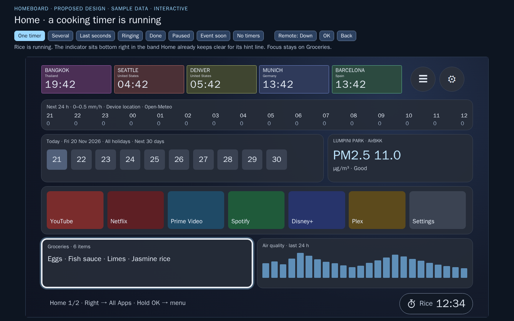](2026-11-20-timers-on-every-page/home.html)

Home page 1 with Rice running. The chip sits in the band Home keeps for its hint line, so it
covers nothing, and focus stays on Groceries. The buttons switch between the real states and
show what Down, OK and Back do.
[Open the interactive mockup](2026-11-20-timers-on-every-page/home.html).

### Where it lives on each page

| Page | Indicator | Takes focus? | Why |
|---|---|---|---|
| Home, every page | Bottom right of the 52 dp hint band | Yes, by Down from the bottom row | Band is already reserved; no reflow when it appears |
| All Apps | Same place | Yes, by Down from the bottom row | Same activity, same band |
| Full-screen widget views (Calendar, Air quality, Rain, Groceries, World clock, Favorites, Android widgets) | Right end of the hint row, which becomes a fixed 44 dp band | Yes, by Down from the last row of the view | Fixed height, so content never jumps when a timer starts or stops |
| Timers & alarms full-screen view | Hidden | — | The list beside it already shows every timer in more detail |
| Menus and pie menus, including paged Home settings, the phone-editor overlay, move and resize | Visible above the dimmed page, same place | No | The menu owns focus until it closes; the pie is centred and never reaches the corner |
| Quick settings pie (`QuickSettingsActivity`) | Visible, same place | No | Same as menus |
| Keyboard editors (`GroceryEditor`, `WorldClockEditor`, calendar custom entry) | Not added | — | The on-screen keyboard covers the band; typing is a short bounded task |
| Homeboard screensaver (`ScreensaverActivity`, `ScreensaverDream`) and its Preview | One dim line under the clock that drifts with it (Stage 4, Decision 1) | No input | See [Screensaver](#screensaver) |
| Other apps, Android screensaver apps, inherited settings screens | None | — | See [Out of scope](#out-of-scope) |

[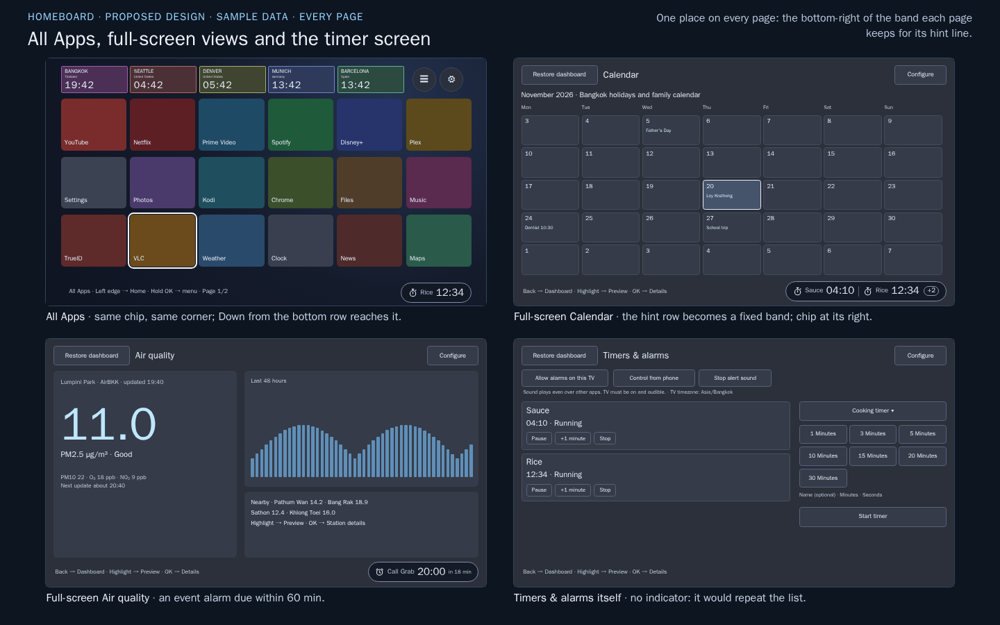](2026-11-20-timers-on-every-page/pages.html)

The same chip in the same corner on All Apps and two full-screen views; none on the timer
screen. [Open the mockup](2026-11-20-timers-on-every-page/pages.html).

### What it shows

`TimerIndicatorRules` decides from the existing runtime JSON; nothing new is stored.

- **Shown:** a cooking timer that is running or paused; an event alarm from 60 min before
  it is due (Decision 4); a finished timer or alarm (`done`) until Stop or Restart, ringing
  while its sound lasts (Decision 2).
- **Not shown:** stopped entries, and `interrupted` or `missed` entries left by a TV restart
  (Decision 3). They stay on the widget and the timer screen.
- **Order:** ringing, then done, then running by remaining time (so a timer in its last
  seconds is always first), then event alarms by time, then paused. This extends
  `KitchenTimerUi.ordered` rather than adding a second ordering.
- **How many:** the two most urgent are named, then `+N`. With Android's font size Large or
  larger, or if two names would take more than 40 % of the screen width, it drops the names
  and keeps the time and the count (`04:10 +2`). A name is cut to 220 dp with an ellipsis;
  the time is never cut.
- **Text:** remaining time uses `KitchenTimers.clock`, with the same rounding up as the
  widget, so the two never disagree. An event alarm shows its time of day and "in 18 min",
  rounded up to whole minutes.

[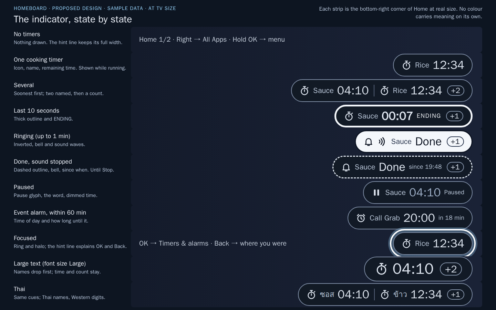](2026-11-20-timers-on-every-page/states.html)

Each state at real size, as the bottom-right corner of Home. No state is told apart by colour
alone. [Open the mockup](2026-11-20-timers-on-every-page/states.html).

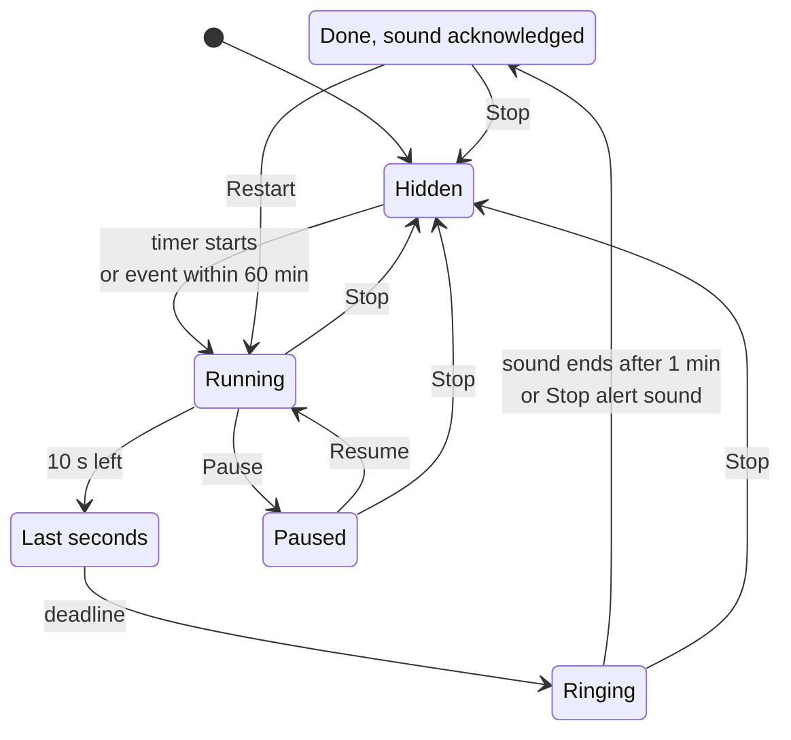

With several timers the chip takes the state of its first, most urgent entry.

### Running, last seconds, ringing and done

| State | Look | Non-colour cue |
|---|---|---|
| Running | Dark fill, off-white text, stopwatch | — |
| Paused | Same, time dimmed | Pause glyph and the word Paused |
| Last 10 s | Thick outline, heavier digits | The word ENDING |
| Ringing (at most 1 min) | Inverted: light fill, dark text | Bell with sound waves; Done in place of the time |
| Done, sound stopped | Dashed outline | Bell without waves; "since 19:48" |
| Event alarm | Alarm-clock glyph | Time of day and "in 18 min" |

**Ringing never opens anything over Home, All Apps or a full-screen view.** Someone may be
in the middle of moving around, and opening a screen would take their focus and change the
page under them. The sound, the inverted chip and the notification say it; the timer screen
is one Down and one OK away, with Stop already focused. The screensaver is different: no one
is using the remote, so ending it and opening the timer screen (built 2026‑11‑20) takes
nothing from anyone, and stays.

[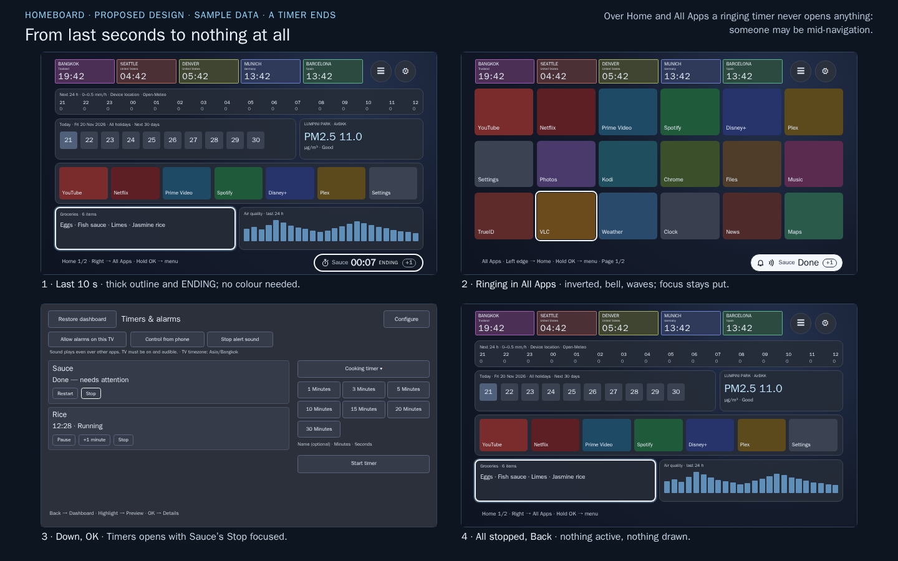](2026-11-20-timers-on-every-page/ringing.html)

From the last 10 s to nothing at all. [Open the mockup](2026-11-20-timers-on-every-page/ringing.html).

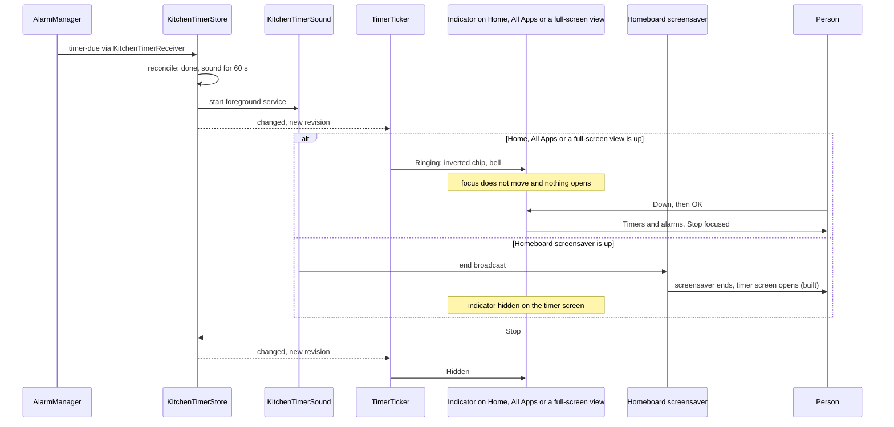

### Interaction: remote only, no new mode

[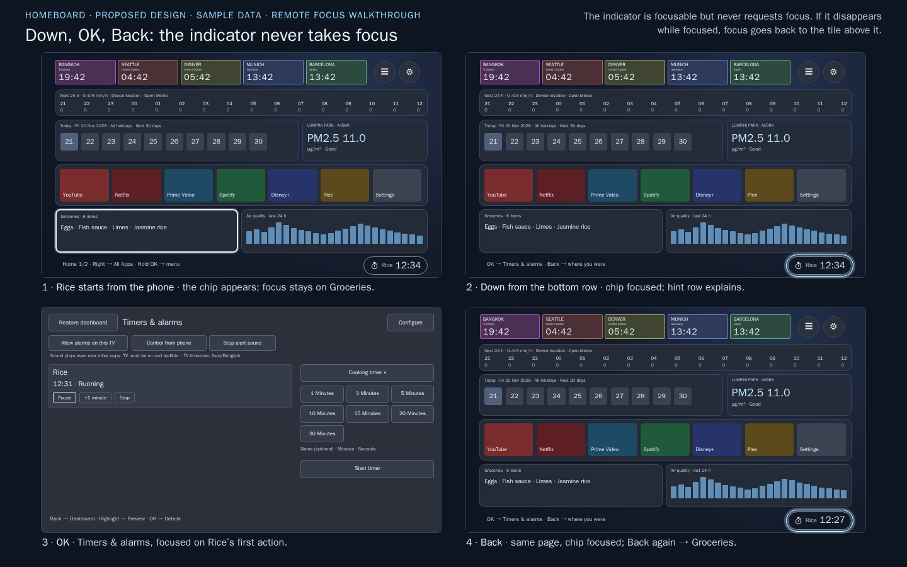](2026-11-20-timers-on-every-page/focus.html)

[Open the mockup](2026-11-20-timers-on-every-page/focus.html).

- **It never takes focus.** The chip is focusable but never requests focus. A timer started
  from the phone while someone is moving around makes it appear with no focus change. If
  it disappears while focused (the timer is stopped from the phone), focus goes back to the
  element the person came from, or the page's default focus if that is gone.
- **Reaching it.** Down from the bottom row of Home or All Apps, where Down does nothing
  today; Down from the last row of a full-screen view. While it is focused, the hint line
  beside it reads "OK → Timers & alarms · Back → where you were".
- **OK** opens Timers & alarms full screen. Focus lands on the first timer the chip showed:
  its Stop button when ringing or done, otherwise its first action (Pause). The person acts
  where the information is.
- **Back** on the chip returns focus to where the person came from and does nothing else. A
  second Back then does what Back does on that page today. Hold Back for Undo is unchanged.
- **Back or Restore dashboard on the timer screen** returns to the page it was opened from,
  with focus on the chip. Opened from a full-screen view, it returns to that view with its
  state (`WidgetExpansion.state()`), not to Home. The timer screen gains a "return to" key
  for this.
- **In a menu** the chip is shown but cannot be focused, so the menu's Directions and Back
  keep their meaning.

[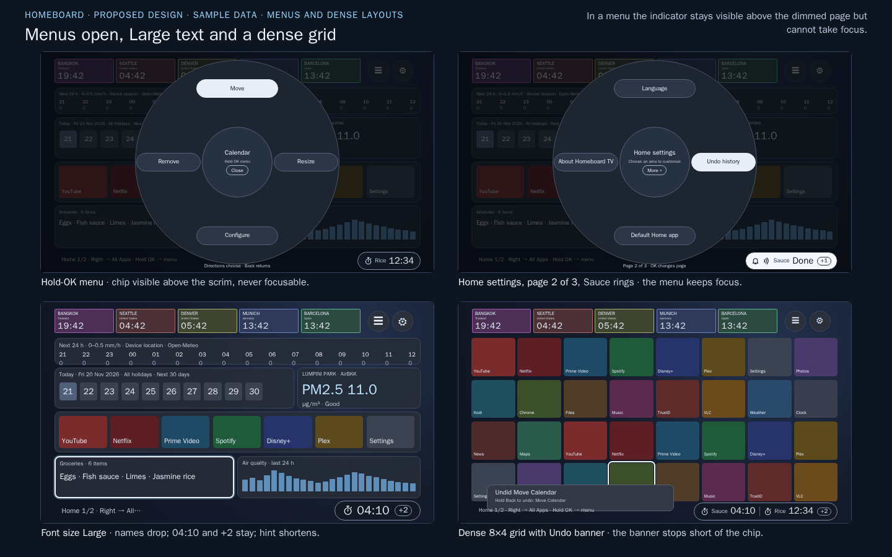](2026-11-20-timers-on-every-page/menus.html)

Menus, page 2 of 3 of Home settings while a timer rings, Android font size Large, and a dense
8×4 grid with the Undo banner, which now stops short of the chip.
[Open the mockup](2026-11-20-timers-on-every-page/menus.html).

### Covering nothing, OLED burn-in and reading it across a kitchen

- **Covers nothing.** On Home and All Apps the chip is 44 dp tall inside the 52 dp band, so
  the grid does not move. On full-screen views the hint row becomes a fixed 44 dp band
  whether or not a timer runs: it costs 31 dp of content height on every full-screen view
  (about 6 % of 540 dp), and in return nothing reflows when a timer starts or stops. While
  the chip shows, the hint text ends before it, and the Undo banner's right margin grows to
  the chip's width plus 16 dp.
- **Burn-in.** The screensaver plan already treats a static picture on an OLED TV as a
  risk. (1) The chip exists only while something is live: cooking timers end, and an event
  alarm shows only in its last 60 min. With nothing active, nothing is drawn. (2) It is low
  luminance: a dark fill at the UI opacity and off-white text. Only ringing is light, for
  at most 1 min. (3) It moves: once a minute it shifts within the band by up to 4 dp
  sideways and 2 dp up or down, a slow orbit like the clock's drift. (4) It does not hold off
  the Home idle screensaver (`ScreensaverIdle` is unchanged), so a running timer never keeps
  a still Home on screen longer than today. The longest-lived still state is Done after the
  sound, which is Decision 2.
- **Across a kitchen.** The remaining time is 24 sp with bold tabular digits, about 2 cm tall
  on a 55‑inch TV (48 px of 1920, at 0.63 mm per pixel). That should be readable from about
  4 m. This is a hypothesis to check on Cast1, not a measurement. The chip draws its own
  fill, so its contrast (off-white on a 90 % opaque dark fill, above 12:1) does not depend
  on the wallpaper behind it.

### Screensaver

Recommendation (Decision 1): **show one dim line under the clock in Homeboard's own
screensaver**, and in Preview, since Preview shows what will play. The kitchen case is the
reason. Someone starts 20 min of rice and walks away; after 5 min the screensaver starts,
and today the countdown vanishes until the alarm rings. The line drifts with the clock, so it
adds no burn-in of its own. Android screensaver apps such as Aerial Views cannot show it.
The [screensaver plan](2026-11-20-screensavers.md) listed "a timer countdown on the clock"
as out of scope until its Stage 1 existed. Stage 1 now exists, so this plan takes the item
up as its own last stage.

[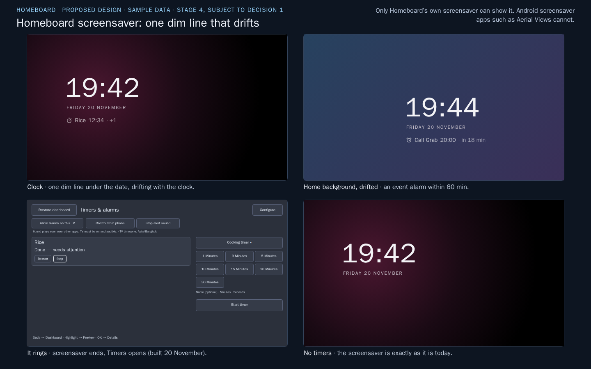](2026-11-20-timers-on-every-page/screensaver.html)

[Open the mockup](2026-11-20-timers-on-every-page/screensaver.html).

### Phone controller

**The phone stays as it is.** Its Timers panel already lists every timer with its remaining
time and immediate actions, and the phone is opened on purpose rather than watched in
passing. The chip's text comes from `TimerIndicatorRules`, so a phone summary added later
would use the same words. A timer summary on every phone panel is listed in
[Out of scope](#out-of-scope).

### Language and accessibility

- **Thai.** New strings go in the existing `homeboard_timers.xml` pair, which
  `task i18n:check` already validates: ครบเวลา (Done), หยุดชั่วคราว (Paused), อีก 18 นาที (in
  18 min). Digits stay Western, as `KitchenTimers.clock` uses `Locale.ROOT` on the Thai timer
  screen. Thai marks above and below need a line height of 1.2, which the 44 dp chip allows.
  When space runs short the name goes first and the time last.
- **Non-colour cues** are listed in the table above: outline weight, inversion, glyph and
  word.
- **TalkBack.** The content description reads every shown timer, for example "Timers: Sauce,
  4 minutes 10 seconds left; Rice, 12 minutes 34 seconds left; 2 more. OK opens Timers and
  alarms." It is announced once when a timer starts ringing, never every second.
- **Large text** drops names before anything else, and the band height is fixed, so the
  layout does not grow.

[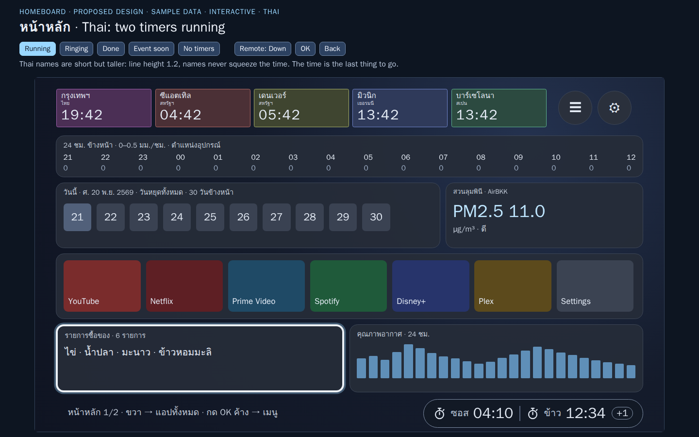](2026-11-20-timers-on-every-page/thai.html)

[Open the interactive Thai mockup](2026-11-20-timers-on-every-page/thai.html).

### Performance on a 1 GB TV

- **One tick for the whole app.** `TimerTicker` keeps the parsed runtime and recomputes
  remaining times from the stored deadlines; it re-reads and re-parses only when the store
  reports a new revision. Today's widget and timer screen move onto it in Stage 1, which
  removes the three or more JSON parses a second they cause now.
- **It ticks only when needed:** once a second, aligned to the soonest deadline's second
  boundary, while at least one window shows a chip that changes each second. With only a
  distant event alarm it sets one wake-up for the moment the alarm enters its 60 min window.
  With no listeners, or nothing live, it stops.
- **One small view per window:** at most two exist at once (Home and one full-screen view).
  Each calls `setText` only when its string changes, and subscribes in
  `onWindowVisibilityChanged`, so a hidden window costs nothing.
- **No polling service.** Changes arrive through a listener that `KitchenTimerStore` calls
  after every save, on the main thread. At a deadline the ticker calls
  `KitchenTimerStore.snapshot()` once, so a late alarm delivery still reconciles.

### Full-screen presentation (AGENTS.md)

The indicator is not a widget type, but it follows the rule. Its full-screen presentation is
the existing Timers & alarms view, with more and more detailed data: every timer, its state,
original duration, controls, the TV timezone and alarm access. OK opens it. Back and the
visible Restore dashboard return to the original page and put focus back on the chip, or
return to the full-screen view it was opened from with that view's state. Verification steps
6 and 10 check this.

### How a timer reaches every page

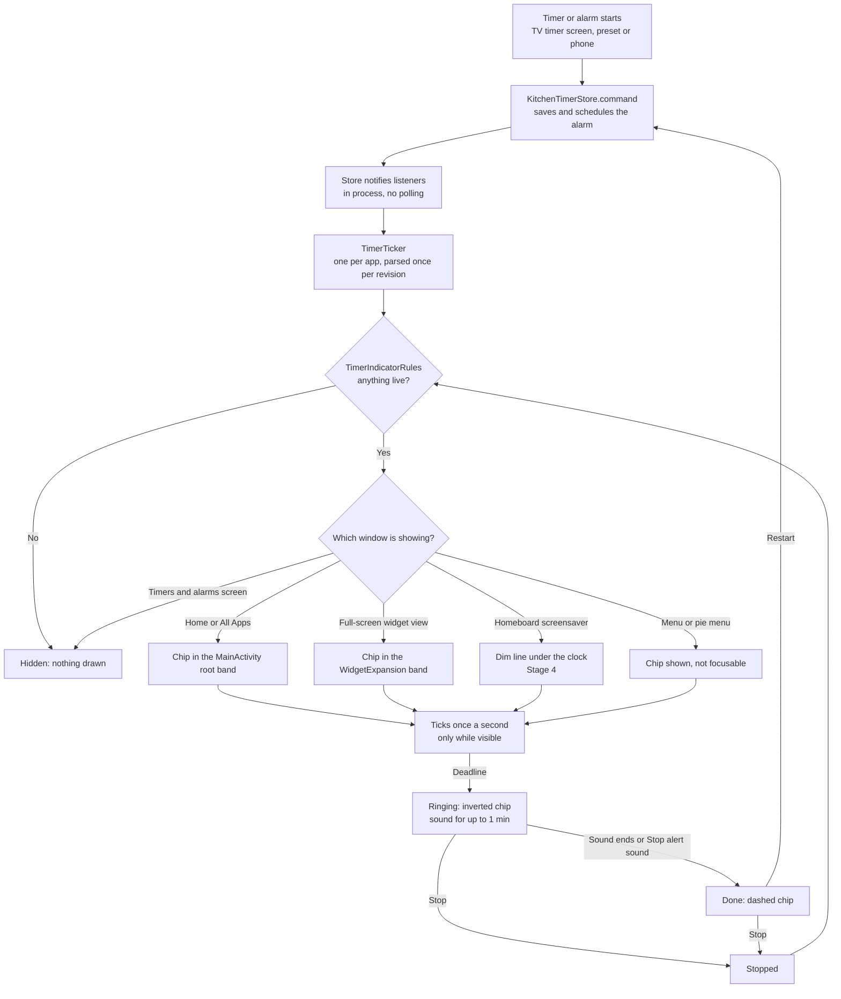

### Code

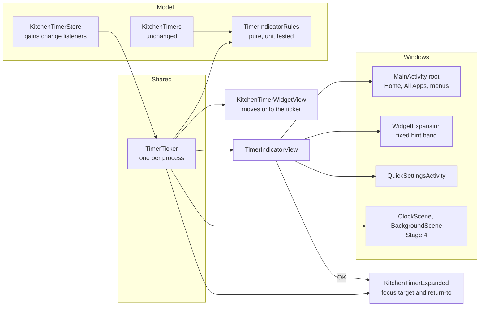

| File | Change |
|---|---|
| `TimerIndicatorRules.java` (new) | Pure rules: visible or not per entry and per page, order, state of the chip, capacity (two names or time only), text parts, last-seconds threshold, event lead window, next wake-up time, and whether Down from a row reaches the chip. No Android types. |
| `TimerTicker.java` (new) | Process-wide, main-looper ticker with listeners; keeps the parsed runtime; re-parses only on a new revision; schedules the next tick from `TimerIndicatorRules`. |
| `TimerIndicatorView.java` (new) | The chip: icon, names, times, `+N`, state styling, burn-in orbit, content description, remembered return focus. Logs `HomeboardTimers: indicator …` lines for device checks. |
| `KitchenTimerStore.java` | Notifies listeners after each save (`command`, `reconcile`, `silence`). |
| `KitchenTimerWidgetView.java`, `KitchenTimerExpanded.java` | Move from their own handlers to `TimerTicker`. The full-screen view accepts a focus target (timer and action) and a return-to key. |
| `MainActivity.java` | Adds the chip to `root` above `surface` and `overlay`; makes it non-focusable while `overlay != null`; Down, OK and Back handling in `dispatchKeyEvent`; ends the hint text before the chip; widens the Undo banner's right margin. |
| `WidgetExpansion.java` | The hint row becomes a fixed 44 dp band with the chip at its right; no chip for the Timers kind. |
| `QuickSettingsActivity.java` | Adds a non-focusable chip. |
| `ClockScene.java`, `BackgroundScene.java` | Stage 4: one dim line under the date, drifting with the clock. |
| `res/values*/homeboard_timers.xml` | English and Thai strings. |
| `docs/how-to/timers-and-alarms.md` | Describes the indicator, written with Stage 2. |

## Stages

Each stage ships on its own, through `task deploy` to both TVs with a new version code, and
is accepted on Cast1.

| Stage | Delivers | Needs |
|---|---|---|
| **1. One tick** | `TimerIndicatorRules`, `TimerTicker`, store listeners; the widget and timer screen move onto the ticker. No visible change; less work each second. | Nothing. |
| **2. Home and All Apps** | The chip in `MainActivity`: states, order, overflow, Down, OK and Back, menus, Undo banner and hint spacing, burn-in orbit, Large text, Thai, TalkBack; the timer screen's focus target and return-to; how-to update. | Stage 1. |
| **3. Full-screen views** | The fixed band and chip in `WidgetExpansion`; none on Timers & alarms; return to the originating full-screen view; Quick settings. | Stage 2. |
| **4. Screensaver line** | The countdown line in Homeboard's screensaver and Preview. | Stage 2; Decision 1. |

### Tests

- **JVM (`task check`):** `TimerIndicatorRulesTest` covers each state shown or hidden
  (running, paused, done while ringing, done after the sound, stopped, interrupted, missed;
  an event at 61 min, exactly 60 min and 59 min); order with mixed states; two names then
  `+N`; time only at Large text; the 10 s threshold matching `KitchenTimers.clock` rounding;
  the page table (Home, All Apps, full-screen view, Timers & alarms, menu, editor,
  screensaver); focusability per page; the next wake-up (no per-second tick when only a
  distant event exists); English and Thai text parts. `TimerTickerScheduleTest` checks that
  the ticker parses once per revision, not once per tick.
- **Strings:** `task i18n:check` with the new English and Thai entries.
- **Device:** Verification steps 5–11, through the coordinator on Cast1.

## Design filter record

Applied the shared [Alan Cooper design filter](/home/will/docs/howtos/alan-cooper-design-filter.md).

- **Scope and baseline.** Every Homeboard page while a cooking timer or event alarm is live.
  Baseline: source at `2c6cdc3` on `main`, where only the Timers widget and its full-screen
  view show timers. Platform: Google TV, remote only; phone controller unchanged.
- **Primary profile and goal.** Someone cooking, often across the room from the TV and away
  from the remote, who wants to know at a glance how long is left and which dish needs them,
  whatever page the TV is on. Evidence: Will's request and his cooking priority in the
  [timers plan](2026-11-19-cooking-timers.md). Assumptions: glances come from about 4 m;
  several dishes at once are common; a household member may be using the remote while
  someone else cooks.
- **Scenarios.** Ordinary: start Rice from the phone, browse All Apps, glance at 12:34 left.
  Variation: four timers, two named and "+2"; an event alarm 18 min away. Interruption: Sauce
  rings while someone is in page 2 of Home settings; the menu keeps focus, and Down then OK
  reaches Stop. Failure: the timer is stopped from the phone while the chip is focused, and
  focus returns to Groceries. Finish: Stop on the last timer, and nothing is drawn.
- **Findings.**
  - The timer is invisible off the widget's page → the cook must navigate to check → a chip
    on every page. Blocks the goal.
  - Opening the timer screen when a timer rings over Home → takes focus mid-navigation →
    ring visibly, open nothing, Stop two presses away. Substantial risk.
  - A per-page timer view on each window → several clocks parsing JSON each second on a
    1 GB TV → one ticker, parsed per revision. Substantial friction (performance).
  - A static bright badge on an OLED TV for a long simmer → burn-in → live-only, low
    luminance, orbit. Substantial risk.
  - Colour-only ringing → missed by some viewers and in Thai → inversion, glyph and word.
    Polish.
- **Proposed framework.** The eight mockups and four diagrams above; the page table; the
  state table.
- **Acceptance.** Verification steps 5–11 as observed scenarios on Cast1. The 4 m
  readability and burn-in orbit are hypotheses until observed.
- **Disposition.** Conditional on Decisions 1–4; no exception to the filter is claimed. Next
  action: Will's decisions, then Stage 1.

## Decisions for Will

Each has a recommended default that the plan assumes; a different answer changes only the
named stage.

1. **Countdown on Homeboard's screensaver?** Recommended: **yes**, as Stage 4. It is the
   moment the cook is most likely to look, and the line drifts with the clock. The
   screensaver plan had deferred it until its Stage 1 existed. If no, Stage 4 is dropped.
2. **Done after the sound stops: stays until Stop, or leaves after 10 min?** Recommended:
   **stays until Stop or Restart**, like the widget ("Done remains visible until you Stop or
   Restart"). The food is waiting, and one Down and two OKs clear it. The cost is a dashed
   chip that can stay up for hours if nobody presses Stop; the orbit limits burn-in.
3. **Interrupted and Missed in the indicator?** Recommended: **no**. They are history after a
   TV restart, not something counting down, and they stay on the widget and the timer
   screen. Showing them would put a chip on every page from power-on until someone cleans
   up.
4. **When does an event alarm appear?** Recommended: **60 min before**, fixed, with no new
   setting. Earlier would put "Leave for school 12:30" on every page all morning.

## Out of scope

- **Showing active timers over other apps** (YouTube, Netflix, live TV). It needs an overlay
  window and the "Display over other apps" permission, which Google TV offers no screen to
  grant, and it would draw over video. It needs its own plan and a probe of the permission on
  Cast1 and Cast2.
- **A countdown inside Android screensaver apps** (Aerial Views, Ambient mode). Homeboard
  cannot draw in them. Re-check if Android adds a way to publish a status line to the
  screensaver.
- **A timer summary at the top of every phone-controller panel**, using
  `TimerIndicatorRules` text, for a phone left open on the counter.
- **Quick actions on the chip itself** (Stop, +1 minute) without opening the timer screen.
  Only worth adding if the device check shows Down, OK, OK is too slow while something
  rings.
- **A setting for the event alarm lead time**, or a per-alarm "show early" option, if 60 min
  proves wrong in use.
- **The indicator in the inherited settings screens** (`LauncherSettingsActivity`,
  `HomeSettingsActivity`) and in keyboard editor dialogs.
- **A one-time notice after a TV restart** that names interrupted timers and missed alarms,
  if Decision 3 keeps them out of the indicator.

**Cost.** No infrastructure is created or changed, so there is no AWS cost.

## Verification

1. `task timers-everywhere:plan-check` validates the eight mockups: self-contained,
   1440×900, no overflow, every button explains itself, PNG captured, bundle within budget.

    ```
    $ docker run --rm -v "$PWD:/workspace" \
        -v /home/will/homeboard-tv/artifacts/phone-browser:/workspace/artifacts/phone-browser:ro \
        -w /workspace mcr.microsoft.com/playwright:v1.59.1-noble node dev/plan-mockup-check.cjs \
        docs/plans/2026-11-20-timers-on-every-page home states pages menus ringing focus screensaver thai
    PASS home: 1440x900, inline assets, no overflow/errors, PNG captured
    PASS states: 1440x900, inline assets, no overflow/errors, PNG captured
    PASS pages: 1440x900, inline assets, no overflow/errors, PNG captured
    PASS menus: 1440x900, inline assets, no overflow/errors, PNG captured
    PASS ringing: 1440x900, inline assets, no overflow/errors, PNG captured
    PASS focus: 1440x900, inline assets, no overflow/errors, PNG captured
    PASS screensaver: 1440x900, inline assets, no overflow/errors, PNG captured
    PASS thai: 1440x900, inline assets, no overflow/errors, PNG captured
    PASS bundle size: 2549569 bytes
    ```

    **PASS** — all eight mockups meet the bundle rules; the largest PNG is 407,651 bytes
    (run 2026‑11‑20, in `.worktrees/timers-everywhere`). This is the task's command plus one
    mount: `artifacts/` is untracked, so a worktree lacks the Playwright module that
    `dev/plan-mockup-check.cjs` loads, and the run borrowed the main checkout's copy. From
    the main checkout `task timers-everywhere:plan-check` needs no extra mount.
2. `~/python-tui-lib/scripts/md-to-html.sh docs/plans/2026-11-20-timers-on-every-page.md`
   renders with no `Warning: mermaid.ink render failed` line, and all four diagrams draw.

    ```
    $ ~/python-tui-lib/scripts/md-to-html.sh docs/plans/2026-11-20-timers-on-every-page.md; echo rc=$?
    Style: c-gem
    /home/will/tmp/2026-11-20-timers-on-every-page.html (2406 KB)
    rc=0
    ```

    **PASS** — no warning line; the output page holds four rendered Mermaid images, no
    unrendered `language-mermaid` block, and eight live mockup iframes (counted in the HTML,
    run 2026‑11‑20).
3. `task check` passes with `TimerIndicatorRulesTest` and `TimerTickerScheduleTest` covering
   every case listed under [Tests](#tests), and the existing `KitchenTimersTest` unchanged.
4. `task i18n:check` validates the new English and Thai timer strings.
5. Stage 2 on Cast1, coordinator-owned:
   `python3 dev/timers-everywhere-proof.py --version <n> --device chromecast-test-01`. The
   debug `TimerIndicatorProbeActivity`, modelled on `ScreensaverAlarmProbeActivity`, runs only
   when no household timers exist. It starts a 45 s test timer "Homeboard indicator test" and
   an event alarm 30 min ahead, then moves through Home, All Apps, Home settings page 2 and
   (Stage 3) full-screen Calendar using debug-only intent extras. Each page waits for the
   view's own `HomeboardTimers: indicator page=<page> state=<state> focusable=<bool>` log
   line, never a fixed delay. Pass: the expected line for every page (`focusable=false` in
   Home settings), and captures that show the chip in the same corner on each.
6. Stage 2 on Cast1, focus: from Groceries on the bottom row, the recipe sends Down, OK,
   Back, Back. The log shows `indicator focused`, then
   `timers opened from=indicator focus=<id>:pause`, then `indicator focused` on return, then
   `focus returned to=groceries`. A second run starts the timer from the probe while the
   recipe presses Left and Right: no `indicator focused` line appears, and the focused key
   is unchanged.
7. Stage 2 on Cast1, ringing on Home: the test timer finishes with Home up. The log shows
   `indicator state=ringing` and no `timers opened` line, and the capture shows the inverted
   chip. After the probe stops the timer, `indicator state=hidden`.
8. Stage 2 on Cast1, Thai: the same run with `--language th` sets Homeboard's language for
   the run and restores it afterwards. The Home capture shows ซอส and ข้าว with Western digits
   and nothing clipped.
9. Stage 2 on Cast1, cost: a passive `meminfo` sample before the timer starts and after 5 min
   with the chip visible. Hypothesis: the heap grows by under 1 MB. `TimerTickerScheduleTest`
   (step 3) is the evidence for one parse per revision.
10. Stage 3 on Cast1: in full-screen Calendar the chip sits in the fixed band. OK opens
    Timers & alarms. Back returns to Calendar with its state (log
    `expansion restored key=calendar`) and focus on the chip. The Timers & alarms screen has
    no chip (no `indicator page=timers` line).
11. Stage 4 on Cast1: with a timer running, the probe starts the screensaver (as
    `screensaver-alarm-proof.py` does). Two captures 2 min apart show the countdown line in
    two different places. The ringing timer then ends the screensaver and opens Timers, as
    today.
12. Every device run ends with the household timer runtime byte-identical to its state
    before the run (the probe logs a hash of the `kitchen-timers` runtime before and after),
    and Homeboard's language restored.
