# Air-quality startup without a preference wait on the UI thread

The retained Cast1 ANR for Homeboard 0.1.128 shows the main thread in AirQualityCard.legacyConfiguration → SharedPreferencesImpl.awaitLoadedLocked during MainActivity.onCreate. The preference-loader thread is parsing XML. File size, corruption and storage latency are not established causes.

## Behavior and design review

Apply the shared [Alan Cooper filter](/home/will/docs/howtos/alan-cooper-design-filter.md): Will wants Home to appear and respond while saved air data loads. The dashboard keeps its normal layout/focus and the card shows the existing translated Loading message. Opening its full-screen view retains Back and Restore dashboard. No saved/default configuration is written while loading. Configuration/phone edits wait for the saved state; leaving or closing the widget must prevent late publication. A failed load remains explicit and Refresh can retry. No new settings workflow or household setup is added. See [loading mockup](2026-11-23-air-quality-startup.svg).

```mermaid
stateDiagram-v2
    [*] --> Loading: construct without preferences or cache reads
    Loading --> Ready: worker loads snapshot; UI publishes
    Loading --> Unavailable: load fails
    Unavailable --> Loading: retry
    Loading --> Closed: dashboard/widget disposed
    Ready --> Closed
    Closed --> [*]
```

## Implementation and acceptance

- [ ] Open preference handles, read saved configuration/legacy fallback, parse feed/history on a worker. Read existing canonical settings first and avoid eager fallback evaluation. Keep startup read-only so it cannot race phone/Undo writes.
- [ ] Publish a complete snapshot on the UI thread. No location request, network fetch or configuration action may use temporary defaults before publication.
- [ ] Preserve source, location mode/name/coordinates, station, feed/history and timezone; invalid/missing cache is an absent reading, never a zero reading.
- [ ] Delayed-load regression proves UI work can proceed before I/O returns; test failure/retry, close-before-publication and saved model/station cache/history.
- [ ] Run container checks/lint/package; deploy an advancing frozen APK through the coordinator, preserve app data, and verify cold launch plus Home On / Working on Cast1.
