# Air-quality startup without a preference wait on the UI thread

The retained Cast1 ANR for Homeboard 0.1.128 shows the main thread in AirQualityCard.legacyConfiguration → SharedPreferencesImpl.awaitLoadedLocked during MainActivity.onCreate. The preference-loader thread is parsing XML. File size, corruption and storage latency are not established causes.

## Behavior and design review

Apply the shared [Alan Cooper filter](/home/will/docs/howtos/alan-cooper-design-filter.md): Will wants Home to appear and respond while saved air data loads. The dashboard keeps its normal layout/focus and the card shows the existing translated Loading message. Opening its full-screen view retains Back and Restore dashboard. No saved/default configuration is written while loading. Configuration/phone edits wait for the saved state; leaving or closing the widget must prevent late publication. A failed load remains explicit and Refresh can retry. No new settings workflow or household setup is added. See [loading mockup](2026-11-23-air-quality-startup.svg).

```mermaid
stateDiagram-v2
    [*] --> Loading: construct without preferences or cache reads
    Loading --> Ready: worker loads snapshot; UI publishes
    Loading --> Unavailable: load fails
    Unavailable --> Loading: retry
    Loading --> Closed: dashboard/widget disposed
    Ready --> Closed
    Closed --> [*]
```

## Implementation and acceptance

- [x] Open preference handles, read saved configuration/legacy fallback, parse feed/history on a worker. Read existing canonical settings first and avoid eager fallback evaluation. Keep startup read-only so it cannot race phone/Undo writes.
- [x] Publish a complete snapshot on the UI thread. No location request, network fetch or configuration action may use temporary defaults before publication.
- [x] Preserve source, location mode/name/coordinates, station, feed/history and timezone; invalid/missing cache is an absent reading, never a zero reading.
- [x] Delayed-load regression proves UI work can proceed before I/O returns; test failure/retry, close-before-publication and saved model/station cache/history.
- [x] Run container checks/lint/package; install the advancing frozen APK on Cast1 through the coordinator, preserve app data, and verify cold launch plus Home On / Working.
- [ ] Complete the identical frozen APK installs on Cast2, Pixel and tablet when coordinator connectivity returns; requests remain queued.

## Source and verification

Source commit on main: `2c370f4`. The controlled blocking-loader test proves the UI executor still handles input before preference I/O is released. Saved station/model settings, cached readings, history and timezone are retained without startup writes. Failure/retry and closed-widget publication are covered. Final `task check` passed: 668 Java tests (including seven startup regressions), calendar 7, cleanup 71, deployment 5, translation validation and Android lint. Lint completed with warnings; no lint error blocked the build. `task build` packaged the debug APK.

The isolated lint process outlived its interrupted caller and held the shared Gradle journal; the first integrated attempt failed before bump/build. Only that owned duplicate container was stopped. Subsequent serialized checks and packaging succeeded. Version 129 was passed over; the deployment is **0.1.130** and must not be reused for a future build.

Frozen APK: `/home/will/homeboard-tv/artifacts/deployments/0.1.130/homeboard.apk`.
SHA-256: `fd8f33cabfe9c8dd68ea099ca91da6635c8ad2289a4c56fb09a77e0cdcaf947b`.
The integrated build retains the existing 0.1.128 tester changes already present in the workspace; their two modified source/build files match the deployed 0.1.128 source hashes. Other uncommitted plans and diagnostics are not part of the source fix commit.

| Target | Coordinator job | Result |
| --- | --- | --- |
| Cast1 | `J‑95ed96c67664` | Installed matching frozen hash; succeeded, health ready. About independently shows 0.1.130. |
| Cast2 | `J‑1ee914351f18` | Queued; device unreachable/recovery required. |
| Pixel | `J‑589bf016d200` | Queued; coordinator control unavailable. |
| Lenovo tablet | `J‑fd776c69d0d7` | Queued; device unreachable/recovery required. |

All four install-only requests were submitted before watching. The local deployment watcher was stopped after Cast1 evidence export because the other devices are offline; this did not cancel their coordinator jobs. The fleet deployment is incomplete.

## Cast1 acceptance, 23 November

Owned cold-launch diagnostics `J‑d7bbeb06fb9a` deliberately force-stopped and launched the app, then sampled it for approximately seven seconds including collector overhead. The job succeeded, health ready, no new exit records, no surviving effects. The applied screenshot shows the configured dashboard, Near me · 13.70°, 100.50° · model, PM2.5 30.3, and populated 24-hour/30-day trends. No app data/history was cleared. This is one successful cold launch, not proof that all possible startup stalls or ANRs are eliminated. The capture does not measure first-window or Home-release latency; exact flash/delay timing remains parked.

Owned Remote `J‑d27d7c5781c9` confirmed:

- The air card opens its full-screen presentation. Hourly model history shows 168 samples from 16 Nov 22:00 to 23 Nov 21:00 with Asia/Bangkok timezone.
- Back and the visible Restore dashboard action both return to the original page, air-card focus and size.
- About shows 0.1.130. Home button was Off when inspected; it was explicitly switched On, then only `Home button · Homeboard TV (test)` was enabled through Android's consent UI. Final status is On / Working. The three other listed services remain Off in before/after screenshots. This comparison covers helper re-enablement, not an independently sampled before/after comparison for the earlier install or force-stop.
- A Home tap returned to the dashboard. The attempted later YouTube-navigation frames actually show settings; do not count their filenames as proof of a new YouTube-to-Home return. That cross-app scenario was previously accepted on 0.1.128 and is not re-established by this run.
- Remote was stopped normally: cancelled by owner, health ready, no survivors, every journal effect restored; evidence exported.

Private evidence root: `/home/will/homeboard-tv/docs/diagnostics/air-startup-20261123/` (`cold-launch-130/`, `remote-130/` and the labelled frames). Cast1 install evidence is under `artifacts/deployments/0.1.130/chromecast-test-01/evidence/`. Initial pre-update frames showed Google TV, so they are not an independent air-card preference baseline. Preservation is supported by the saved-data regressions and retained location/history on the updated device, not a byte-for-byte device data comparison.
