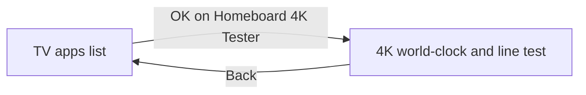
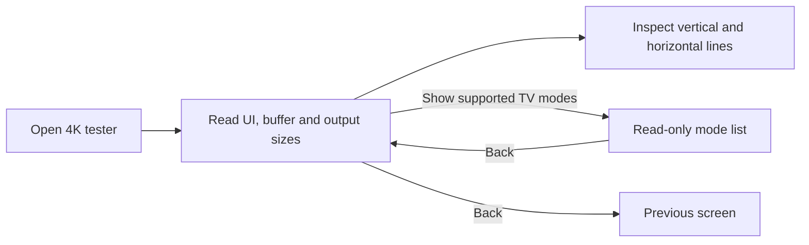

# Native 4K dashboard

**Goal:** render Homeboard's actual dashboard, text, charts and widgets at 3840 × 2160 when the connected device and display can support it, by default, while preserving the existing layout, D-pad focus, accessibility, widget interactions, wallpaper behavior and recovery. A 4K HDMI signal carrying an upscaled 1080p dashboard does not meet this goal. On a device whose UI is already 4K, the existing View hierarchy should use that UI without changing display settings.

**Evidence:** coordinator passive inspection on Cast2, 2026-11-23, reported physical/output 3840 × 2160 at 60 Hz, Android logical display override 1920 × 1080. The detailed coordinator display evidence is retained locally in `docs/diagnostics/cast2-display-2026-11-23/`. The current dashboard is a normal Android View hierarchy. [Android's surface documentation](https://developer.android.com/media/media3/ui/surface) says a SurfaceView can use the full display resolution even when the UI layer is lower resolution. [SurfaceHolder](https://developer.android.com/reference/android/view/SurfaceHolder#setFixedSize(int,%20int)) supports a fixed buffer size. Neither establishes that the existing View hierarchy can be transparently rendered into that surface with correct input, app widgets, animations, video, overlays and accessibility. [View.draw documentation](https://developer.android.com/reference/android/view/View) warns that software snapshots have compatibility issues with hardware-only features. Android's [TV memory guidance](https://developer.android.com/training/tv/playback/memory) identifies 1080p UI on many 4K devices and limited memory.

Do not change the system-wide display size, density or preferred HDMI mode as a shortcut. Do not claim a 4K dashboard based on HDMI mode, an enlarged bitmap, screenshot size or a 4K wallpaper alone.

## Engineering gates

1. **Isolated native surface proof:** in a debug-only activity, request a full-resolution SurfaceView buffer using the current physical display mode, display a diagnostic 4K pattern, and report logical UI size, physical mode and actual surface buffer dimensions. On Cast2, verify native-resolution presentation using independent compositor/output evidence; a 1080p screenshot alone cannot resolve one-pixel 4K detail. Test resize, pause/resume, no-4K output and cleanup. No saved settings or system display changes.
2. **Real dashboard renderer proof:** compare candidate approaches against the real dashboard, including custom Canvas widgets, text, app icons, live Android widgets, video TextureView, focus, accessibility, overlays and full-screen widgets. Measure input latency, memory and frame timing on Cast2. A static 4K bitmap or manually redrawn facsimile is not acceptance. Choose an implementation only after it renders the real interactive dashboard faithfully and actually presents native detail.
3. **Automatic mode and fallback:** choose native 4K only when the output and renderer are verified to support it, keep existing 1080p behavior on Cast1 and unsupported devices, and recover safely from allocation, surface, output mode and lifecycle failures. Never change global settings.
4. **Assets and resources:** remove the current provider-image 1080p target only for a verified native 4K path, with bounded memory and real-device measurements. Test static images, animated assets and video separately; prove actual video output rather than assume TextureView is 4K.
5. **Acceptance:** Cast2 4K pixel-detail evidence and actual user interactions (Home, All Apps, focus, menus, live Android widgets, widget expansions, screensaver, Back and Undo); Cast1 1080p regression; text scale, Thai, screen changes, idle and memory/frame pacing. Install one numbered build on the standard fleet via coordinator. Cast2 is justified for this 4K-specific check; let the coordinator admit or defer foreground work.

## Status

Investigation and proof preparation. Native 4K dashboard is **not implemented or verified**. This is an architectural rendering change, not a device-output toggle. Preserve user data, the existing interaction model and the pinned upstream boundary.

## Design filter

Apply the [shared Alan Cooper design filter](/home/will/docs/howtos/alan-cooper-design-filter.md) to the existing dashboard rather than introduce a separate configuration workflow. The observed goal is a sharp 4K dashboard on the new TVs; assume the same reading distance, remote navigation and layout until measured. The normal scenario is opening Homeboard on a 4K display and seeing the same dashboard at native detail; variations include a 1080p display, mode changes and an unavailable 4K surface. The finish is a readable, responsive dashboard with unchanged focus and settings. Fallback must preserve the working dashboard, never present an upscaled image as verified native 4K. Acceptance requires the device and interaction checks above; native detail and performance remain open findings.

## Candidate for a real interactive View hierarchy

Investigate a private, own-content `VirtualDisplay` rendered to the native-size `SurfaceView`, with a `Presentation` hosting Android Views at native dimensions and appropriately scaled density. The [DisplayManager API](https://developer.android.com/reference/android/hardware/display/DisplayManager#createVirtualDisplay(java.lang.String,int,int,int,android.view.Surface,int)) supports an application-supplied output surface. This is an **unverified candidate**, not an implementation decision: it must preserve normal D-pad/touch dispatch, accessibility, embedded app widgets, focus, TextureView/video, dialogs, animations and Homeboard lifecycle without privileged input injection. In particular, it must be compared against a native-size renderer and tested against real widgets before any default change. A surface containing only a drawn clock or image is not the requested dashboard.

**Probe build:** 0.1.119 includes debug-only `Native4kSurfaceProbeActivity`; it requests a display-sized SurfaceView and logs the logical display, mode, callback and canvas dimensions. It was built with `task check` and `task build`. Cast2 install job `J‑3ff5183c40d7` failed `install-over-foreground` while Homeboard was open, without changing the device. No Cast2 surface result yet; even a 3840 × 2160 buffer alone would not establish one-pixel detail at the panel.

**Surface result, 2026-11-23:** Cast1 `J‑76e1bf04b564` reported logical, mode, surface and hardware Canvas 1920 × 1080. Cast2 `J‑31629f813cd8` reported logical 1920 × 1080, mode 3840 × 2160, surface and hardware Canvas 3840 × 2160. Both coordinator jobs completed; [Cast2 log](../testing/2026-11-23-native-4k/cast2-surface/logcat.txt), [Cast1 log](../testing/2026-11-23-native-4k/cast1-final/logcat.txt). This proves allocation and drawing at native buffer size, not native output pixel detail or the interactive dashboard. Initial Cast1 recipes incorrectly contained capture-only input; their failures are not surface results. Catalog registration was restored to MainActivity after the probe.

**Interactive View experiment:** `Native4kViewProbeActivity` is debug-only and creates an own-content private presentation display targeting a display-sized SurfaceView. It hosts the actual `WorldClockWidgetView` and a selectable button, forwarding D-pad events to the presentation. This is a limited technology probe, not a complete dashboard. Checks passed on the host build container; real-device display sizing, focus and physical output remain to be measured.

**Interactive View result, 2026-11-23:** Cast2 job `J‑94a648550e24` reported logical 1920 × 1080, target/surface 3840 × 2160, presentation root 3840 × 2160 and Homeboard clock 3520 × 296, hardware accelerated at 640 dpi. The capture shows the actual clock widget. However, Down then OK did not activate the test button: the captured button remains `Select test` and the log reports clock activation instead. Do not count D-pad navigation as passed. Coordinator cleanup reported the previous Google TV launcher restored; Will reported a transient "Something went wrong" message afterwards, not explained by the probe log. A subsequent passive capture showed Google TV's Your apps screen. No 4K dashboard implementation is enabled. See the [probe capture](../testing/2026-11-23-native-4k/cast2-views/input-frame-001.png); the later capture is retained locally under `docs/diagnostics/`.

## Tester launcher icon

For the debug-only 4K View tester, add a distinct TV launcher entry with a monitor and 4K line-pattern icon, labelled “Homeboard 4K Tester”. Selecting it opens the existing test activity. The [shared design filter](/home/will/docs/howtos/alan-cooper-design-filter.md) applies: the user wants to find and reopen the test on a TV remote without a developer command; an identifiable label and distinct focusable launcher tile shorten that route. Back returns to the prior launcher. Acceptance: the icon and label appear on TV, open the tester, and Back restores the launcher; the entry is absent from release builds. This is a diagnostic, not a 4K dashboard or a public release feature.

**Panel observation:** During the Cast2 0.1.121 line-pattern viewing, Will reported the one-pixel vertical band appeared grey with darkish pink stripes. The band used white against the tester's dark navy background. This observation does not establish where color or resolution loss arose. Add true black/white vertical and horizontal patterns at 1, 2 and 4 buffer pixels; compare both orientations and, where possible, use a native-output capture or close panel photograph. Record TV processing and output format before drawing conclusions.

## Tester information and mode list

The debug tester identifies Android's ordinary UI size, the test rendering surface and View dimensions, and the active physical display mode and refresh rate. A remote-focusable **Show supported TV modes** control opens a read-only, screen-filling scrolling list of resolution/refresh-rate combinations reported by the current display; Back returns to the test without changing modes. Refresh on each opening, avoid claiming every supported mode is native panel resolution, and label unavailable data. The pattern compares 1-, 2- and 4-buffer-pixel white/black lines vertically and horizontally. Pixel patterns in the mockup are illustrative; actual buffer-pixel widths are drawn in code.

[Shared Alan Cooper filter](/home/will/docs/howtos/alan-cooper-design-filter.md): the user is checking whether the TV actually displays 4K detail and needs to distinguish the logical interface, test buffer and current HDMI output. Direct labels and a read-only mode list avoid an unrelated display change. Back restores the tester, then exits to the originating screen; ordinary D-pad focus and accessible text are required. The observed darkish pink/grey one-pixel band is retained as evidence, not attributed to a particular cause without further testing. Accept only when Cast2 shows accurate sizes, the mode list matches Android's reported modes, D-pad opens/scrolls/closes it, and individual buffer-pixel widths are verified separately from any scaled screenshot.

The [supported modes mockup](2026-11-23-4k-tester-modes.svg) uses the full remaining height for the list, with a single visible Back action. Up and Down scroll when needed; no pagination controls consume space when all modes fit. This follows the shared design filter by making the reported modes immediately scannable and avoiding unnecessary navigation. The workflow remains tester → modes → tester, and the acceptance check includes a short list and a list taller than the screen.

## Standalone tester

The tester becomes a separately installed diagnostic app, `net.biohack.homeboard.tester`, with its own phone and TV launcher entries, label, icon and banner. The Homeboard debug probe remains available for engineering checks but is no longer a second launcher entry. Share the existing tester activity and actual clock widget so the line patterns, measurements and mode list have the same behavior in both contexts. The standalone manifest does not declare a Home launcher or Homeboard services. The [tester mockup](2026-11-23-4k-tester.svg) and [modes mockup](2026-11-23-4k-tester-modes.svg) describe the unchanged screens and workflow: launch → tester → modes → tester → exit.

The [shared Alan Cooper design filter](/home/will/docs/howtos/alan-cooper-design-filter.md) is applied: a distinct icon and name give the user a direct, repeatable way to open the diagnostic; the same screen and remote actions avoid relearning it. Phone touch and TV remote are both intended inputs. Acceptance: a separate package installs without altering Homeboard, the icon launches on phone and TV, the modes list opens and Back returns, and the test reports its own surface and physical display mode. Check device availability through the coordinator; report unverified interactions and queued installs accurately.
