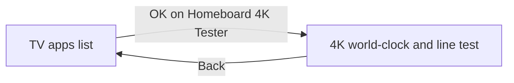
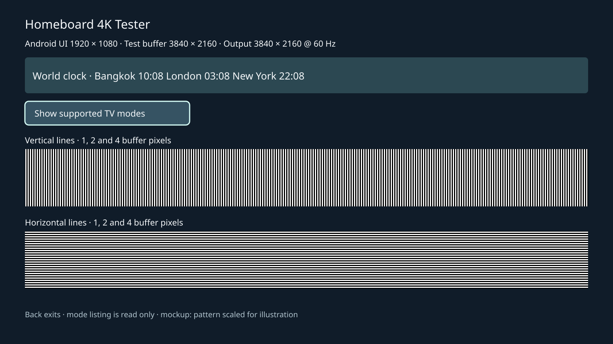
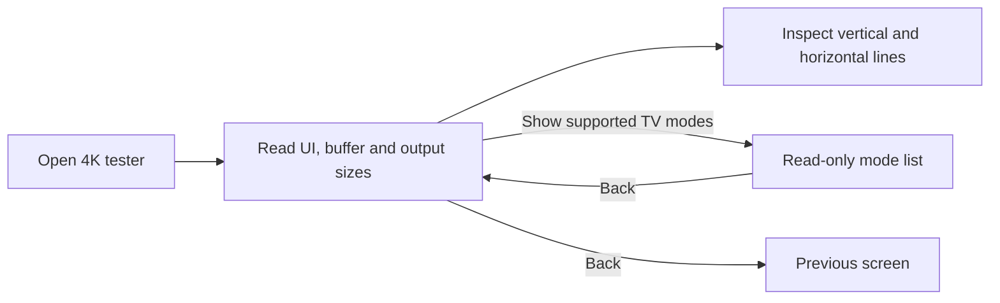
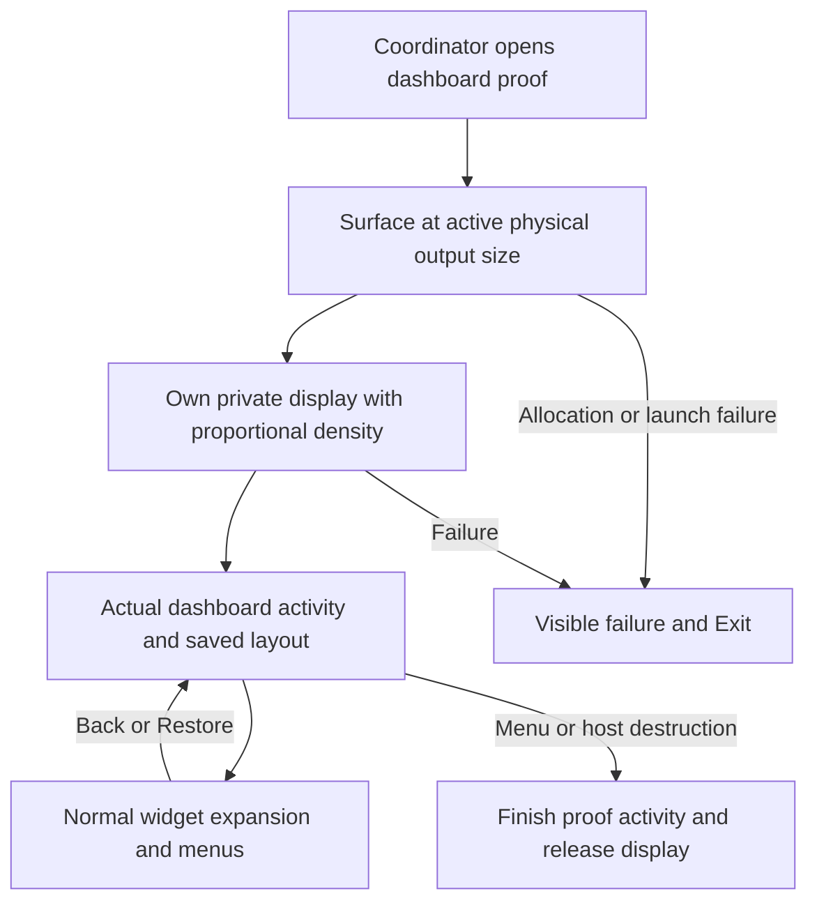

# Native 4K dashboard

[Android 4K implementation HOWTO](../how-to/android-4k.md) · [Verification record](../testing/2026-11-25-native-4k-dashboard.md)

**Goal:** render Homeboard's actual dashboard, text, charts and widgets at 3840 × 2160 when the connected device and display can support it, by default, while preserving the existing layout, D-pad focus, accessibility, widget interactions, wallpaper behavior and recovery. A 4K HDMI signal carrying an upscaled 1080p dashboard does not meet this goal. On a device whose UI is already 4K, the existing View hierarchy should use that UI without changing display settings.

**Evidence:** coordinator passive inspection on Cast2, 2026-11-23, reported physical/output 3840 × 2160 at 60 Hz, Android logical display override 1920 × 1080. The detailed coordinator display evidence is retained locally in `docs/diagnostics/cast2-display-2026-11-23/`. The current dashboard is a normal Android View hierarchy. [Android's surface documentation](https://developer.android.com/media/media3/ui/surface) says a SurfaceView can use the full display resolution even when the UI layer is lower resolution. [SurfaceHolder](https://developer.android.com/reference/android/view/SurfaceHolder#setFixedSize(int,%20int)) supports a fixed buffer size. Neither establishes that the existing View hierarchy can be transparently rendered into that surface with correct input, app widgets, animations, video, overlays and accessibility. [View.draw documentation](https://developer.android.com/reference/android/view/View) warns that software snapshots have compatibility issues with hardware-only features. Android's [TV memory guidance](https://developer.android.com/training/tv/playback/memory) identifies 1080p UI on many 4K devices and limited memory.

Do not change the system-wide display size, density or preferred HDMI mode as a shortcut. Do not claim a 4K dashboard based on HDMI mode, an enlarged bitmap, screenshot size or a 4K wallpaper alone.

## Engineering gates

1. **Isolated native surface proof:** in a debug-only activity, request a full-resolution SurfaceView buffer using the current physical display mode, display a diagnostic 4K pattern, and report logical UI size, physical mode and actual surface buffer dimensions. On Cast2, verify native-resolution presentation using independent compositor/output evidence; a 1080p screenshot alone cannot resolve one-pixel 4K detail. Test resize, pause/resume, no-4K output and cleanup. No saved settings or system display changes.
2. **Real dashboard renderer proof:** compare candidate approaches against the real dashboard, including custom Canvas widgets, text, app icons, live Android widgets, video TextureView, focus, accessibility, overlays and full-screen widgets. Measure input latency, memory and frame timing on Cast2. A static 4K bitmap or manually redrawn facsimile is not acceptance. Choose an implementation only after it renders the real interactive dashboard faithfully and actually presents native detail.
3. **Automatic mode and fallback:** choose native 4K only when the output and renderer are verified to support it, keep existing 1080p behavior on Cast1 and unsupported devices, and recover safely from allocation, surface, output mode and lifecycle failures. Never change global settings.
4. **Assets and resources:** remove the current provider-image 1080p target only for a verified native 4K path, with bounded memory and real-device measurements. Test static images, animated assets and video separately; prove actual video output rather than assume TextureView is 4K.
5. **Acceptance:** Cast2 4K pixel-detail evidence and actual user interactions (Home, All Apps, focus, menus, live Android widgets, widget expansions, screensaver, Back and Undo); Cast1 1080p regression; text scale, Thai, screen changes, idle and memory/frame pacing. Install one numbered build on the standard fleet via coordinator. Cast2 is justified for this 4K-specific check; let the coordinator admit or defer foreground work.

## Status

**The actual dashboard now renders at 3840 × 2160 in a separate proof APK**, with reviewed Home/All Apps, Rain expansion, Restore/Back and World clock captures. Automatic native rendering in the normal launcher is **not enabled**; performance, remaining widgets/providers, accessibility and lifecycle/output acceptance remain gates. See the [25 November verification record](../testing/2026-11-25-native-4k-dashboard.md). Preserve user data, the existing interaction model and the pinned upstream boundary.

### Current priority · 24 November

Will requested focusing on using the standalone tester to determine whether the
new TVs display native 4K detail. The LG is already known to be 4K; its panel
capability is settled. Record source, output, buffer size and physical detail
for each new TV. See the [current status and pending work report](../investigations/2026-11-24-4k-status.md).

Coordinator 0.1.232 inventory on 24 November at 21:26 Bangkok time reports Cast1
as Chromecast HD, limited to 1080p; it cannot supply the 4K test signal. Cast2's
last-confirmed display report (23 November at 12:32) names LG TV SSCR2 on HDMI 2,
3840 × 2160 at 60 Hz, maximum 4K. This is historical input-mode evidence, not a
new panel verification or an exact retail model identification.

Cast2 reconnect job `J‑d8c468ecb9a1` failed `device-not-found-on-network`;
Wireless debugging was not advertising. Fresh display inspection and foreground
tester acceptance cannot proceed until the enrolled connection returns. Do not
bypass recovery or change global display settings. Reconnect evidence is retained
locally in `docs/diagnostics/2026-11-24-4k-reconnect/`. Next: obtain the TV model
numbers, restore the coordinator connection, and run the existing standalone
tester with physical observation of the black/white horizontal and vertical
1-, 2- and 4-pixel bands. Record accepted output, buffer size and panel observations
separately for each TV; ordinary coordinator screenshots alone cannot prove panel
pixel detail.

## Design filter

Apply the [shared Alan Cooper design filter](/home/will/docs/howtos/alan-cooper-design-filter.md) to the existing dashboard rather than introduce a separate configuration workflow. The observed goal is a sharp 4K dashboard on the new TVs; assume the same reading distance, remote navigation and layout until measured. The normal scenario is opening Homeboard on a 4K display and seeing the same dashboard at native detail; variations include a 1080p display, mode changes and an unavailable 4K surface. The finish is a readable, responsive dashboard with unchanged focus and settings. Fallback must preserve the working dashboard, never present an upscaled image as verified native 4K. Acceptance requires the device and interaction checks above; native detail and performance remain open findings.

## Candidate for a real interactive View hierarchy

Investigate a private, own-content `VirtualDisplay` rendered to the native-size `SurfaceView`, with a `Presentation` hosting Android Views at native dimensions and appropriately scaled density. The [DisplayManager API](https://developer.android.com/reference/android/hardware/display/DisplayManager#createVirtualDisplay(java.lang.String,int,int,int,android.view.Surface,int)) supports an application-supplied output surface. This is an **unverified candidate**, not an implementation decision: it must preserve normal D-pad/touch dispatch, accessibility, embedded app widgets, focus, TextureView/video, dialogs, animations and Homeboard lifecycle without privileged input injection. In particular, it must be compared against a native-size renderer and tested against real widgets before any default change. A surface containing only a drawn clock or image is not the requested dashboard.

**Probe build:** 0.1.119 includes debug-only `Native4kSurfaceProbeActivity`; it requests a display-sized SurfaceView and logs the logical display, mode, callback and canvas dimensions. It was built with `task check` and `task build`. Cast2 install job `J‑3ff5183c40d7` failed `install-over-foreground` while Homeboard was open, without changing the device. No Cast2 surface result yet; even a 3840 × 2160 buffer alone would not establish one-pixel detail at the panel.

**Surface result, 2026-11-23:** Cast1 `J‑76e1bf04b564` reported logical, mode, surface and hardware Canvas 1920 × 1080. Cast2 `J‑31629f813cd8` reported logical 1920 × 1080, mode 3840 × 2160, surface and hardware Canvas 3840 × 2160. Both coordinator jobs completed; [Cast2 log](../testing/2026-11-23-native-4k/cast2-surface/logcat.txt), [Cast1 log](../testing/2026-11-23-native-4k/cast1-final/logcat.txt). This proves allocation and drawing at native buffer size, not native output pixel detail or the interactive dashboard. Initial Cast1 recipes incorrectly contained capture-only input; their failures are not surface results. Catalog registration was restored to MainActivity after the probe.

**Interactive View experiment:** `Native4kViewProbeActivity` is debug-only and creates an own-content private presentation display targeting a display-sized SurfaceView. It hosts the actual `WorldClockWidgetView` and a selectable button, forwarding D-pad events to the presentation. This is a limited technology probe, not a complete dashboard. Checks passed on the host build container; real-device display sizing, focus and physical output remain to be measured.

**Interactive View result, 2026-11-23:** Cast2 job `J‑94a648550e24` reported logical 1920 × 1080, target/surface 3840 × 2160, presentation root 3840 × 2160 and Homeboard clock 3520 × 296, hardware accelerated at 640 dpi. The capture shows the actual clock widget. However, Down then OK did not activate the test button: the captured button remains `Select test` and the log reports clock activation instead. Do not count D-pad navigation as passed. Coordinator cleanup reported the previous Google TV launcher restored; Will reported a transient "Something went wrong" message afterwards, not explained by the probe log. A subsequent passive capture showed Google TV's Your apps screen. No 4K dashboard implementation is enabled. See the [probe capture](../testing/2026-11-23-native-4k/cast2-views/input-frame-001.png); the later capture is retained locally under `docs/diagnostics/`.

## Tester launcher icon

For the debug-only 4K View tester, add a distinct TV launcher entry with a monitor and 4K line-pattern icon, labelled “Homeboard 4K Tester”. Selecting it opens the existing test activity. The [shared design filter](/home/will/docs/howtos/alan-cooper-design-filter.md) applies: the user wants to find and reopen the test on a TV remote without a developer command; an identifiable label and distinct focusable launcher tile shorten that route. Back returns to the prior launcher. Acceptance: the icon and label appear on TV, open the tester, and Back restores the launcher; the entry is absent from release builds. This is a diagnostic, not a 4K dashboard or a public release feature.

**Panel observation:** During the Cast2 0.1.121 line-pattern viewing, Will reported the one-pixel vertical band appeared grey with darkish pink stripes. The band used white against the tester's dark navy background. This observation does not establish where color or resolution loss arose. Add true black/white vertical and horizontal patterns at 1, 2 and 4 buffer pixels; compare both orientations and, where possible, use a native-output capture or close panel photograph. Record TV processing and output format before drawing conclusions.

## Tester information and mode list

The debug tester identifies Android's ordinary UI size, the test rendering surface and View dimensions, and the active physical display mode and refresh rate. A remote-focusable **Show supported TV modes** control opens a read-only, screen-filling scrolling list of resolution/refresh-rate combinations reported by the current display; Back returns to the test without changing modes. Refresh on each opening, avoid claiming every supported mode is native panel resolution, and label unavailable data. The pattern compares 1-, 2- and 4-buffer-pixel white/black lines vertically and horizontally. Pixel patterns in the mockup are illustrative; actual buffer-pixel widths are drawn in code.

[Shared Alan Cooper filter](/home/will/docs/howtos/alan-cooper-design-filter.md): the user is checking whether the TV actually displays 4K detail and needs to distinguish the logical interface, test buffer and current HDMI output. Direct labels and a read-only mode list avoid an unrelated display change. Back restores the tester, then exits to the originating screen; ordinary D-pad focus and accessible text are required. The observed darkish pink/grey one-pixel band is retained as evidence, not attributed to a particular cause without further testing. Accept only when Cast2 shows accurate sizes, the mode list matches Android's reported modes, D-pad opens/scrolls/closes it, and individual buffer-pixel widths are verified separately from any scaled screenshot.

The [supported modes mockup](2026-11-23-4k-tester-modes.svg) uses the full remaining height for the list, with a single visible Back action. Up and Down scroll when needed; no pagination controls consume space when all modes fit. This follows the shared design filter by making the reported modes immediately scannable and avoiding unnecessary navigation. The workflow remains tester → modes → tester, and the acceptance check includes a short list and a list taller than the screen.

## Standalone tester

The tester becomes a separately installed diagnostic app, `net.biohack.homeboard.tester`, with its own phone and TV launcher entries, label, icon and banner. The Homeboard debug probe remains available for engineering checks but is no longer a second launcher entry. Share the existing tester activity and actual clock widget so the line patterns, measurements and mode list have the same behavior in both contexts. The standalone manifest does not declare a Home launcher or Homeboard services. The [tester mockup](2026-11-23-4k-tester.svg) and [modes mockup](2026-11-23-4k-tester-modes.svg) describe the unchanged screens and workflow: launch → tester → modes → tester → exit.

The [shared Alan Cooper design filter](/home/will/docs/howtos/alan-cooper-design-filter.md) is applied: a distinct icon and name give the user a direct, repeatable way to open the diagnostic; the same screen and remote actions avoid relearning it. Phone touch and TV remote are both intended inputs. Acceptance: a separate package installs without altering Homeboard, the icon launches on phone and TV, the modes list opens and Back returns, and the test reports its own surface and physical display mode. Check device availability through the coordinator; report unverified interactions and queued installs accurately.

## Resolution-size background and fixed content

The standalone tester draws its controls and test content inside a fixed 1920 × 1080 buffer-pixel rectangle anchored at the upper left. Behind it, the full surface contains nested, distinct, labelled 960 × 540, 1280 × 720, 1920 × 1080, 2560 × 1440 and 3840 × 2160 rectangles, all measured in rendering-buffer pixels and anchored to that same corner. Rectangles larger than the surface are naturally clipped; these are size references, not a claim that the panel is displaying one buffer pixel per panel pixel. The test uses the full reported output size up to its existing 4K cap. [Mockup](2026-11-23-resolution-size-background.svg).

Apply the [shared Alan Cooper design filter](/home/will/docs/howtos/alan-cooper-design-filter.md): the user wants to see precisely how much of the available surface a Full HD design occupies, so the common origin and explicit pixel labels make the comparison direct. The existing tester → mode list → Back workflow stays intact, with controls readable over a translucent panel. Verify the actual canvas and root sizes, the 1920 × 1080 bounds, visibly different colours and focus/Back on 4K and 1080p devices; phone and smaller surfaces must clip rather than silently scale the fixed content. Do not interpret a screenshot resampled by the coordinator as proof of native physical pixel delivery.

**Cast1 check, 0.1.126:** The [initial capture](../testing/2026-11-23-native-4k/cast1-size-background-126/input-frame-001.png) shows a 1920 × 1080 UI and test surface; the [modes capture](../testing/2026-11-23-native-4k/cast1-size-background-126/input-frame-002.png) shows the supported-mode list after OK. The size labels were too dim under the content overlay, so the next build reduces that overlay's opacity. Cast1 is 1080p and cannot establish the 4K presentation or physical pixel accuracy.

## Highest available mode and phone orientation

For the standalone diagnostic, choose the largest pixel area from `Display.getSupportedModes()`, preserving the current refresh rate as closely as possible among modes at that resolution. Request that mode on the tester window only; Android may ignore the preference, so show requested, actual and rendering-buffer sizes separately. Update the buffer when the active mode changes. Use the active mode in the activity's rotated orientation, including naturally portrait phones, and preserve aspect ratio. Do not cap the buffer at 4K silently; if allocation fails, report the failure rather than claim native output. The current-mode selection is reset by window lifecycle. This is a diagnostic request, not a global display change or a 4K dashboard implementation.

Apply the [shared Alan Cooper design filter](/home/will/docs/howtos/alan-cooper-design-filter.md): Will needs to see the highest available detail without guessing, while seeing whether the device actually accepted it. The existing layout and mode-list workflow remain; [mockup](2026-11-23-4k-tester.svg) stats gain requested and actual values. Acceptance: prove ranking and refresh tie-breaking, rotated phone sizing, mode-switch buffer rebuild, honest rejected-mode reporting and exit restoration; inspect the Pixel and a 4K Chromecast when available.

**Pixel failure evidence, 0.1.127:** The coordinator's activity dump showed the physical display awake and the tester activity visible in landscape, 2244 × 1008, while the tester-created virtual display was portrait, 970 × 2160. This confirms that the earlier natural-orientation sizing produced a mismatched surface. The virtual display also reported sleeping while the physical display did not; the coordinator incorrectly labeled the launched session `device-asleep`. The [coordinator bug report](/home/will/chromecast-coordinator/docs/inbox/2026-11-23-pixel-virtual-display-device-asleep.md) records the observations without asserting the parser cause.

**Cast1 check, 0.1.128:** The [initial capture](../testing/2026-11-23-native-4k/cast1-highest-mode-128/input-frame-001.png) reports requested, current and surface sizes of 1920 × 1080 at 59.94 Hz, with the size backgrounds visible. The [modes capture](../testing/2026-11-23-native-4k/cast1-highest-mode-128/input-frame-002.png) shows the reported list; Back returned to the test. The standalone selection and rotation unit tests and lint passed. The updated APK installed on the Pixel, but Pixel orientation and actual mode-switch behavior have not yet been checked on-device. Cast2 remains unreachable.

## Consolidation verification, 23 November

**PASS — existing standalone tester source consolidated; no native 4K dashboard implementation added.** Container `:tester:testDebugUnitTest`, `:tester:lintDebug` and `:tester:assembleDebug` passed during repository cleanup. The four mode-selection/orientation tests passed. The tester source/build/test files match the already frozen 0.1.130 source manifest; consolidation records previously loose files rather than changing the main dashboard. Physical 4K pixel-detail, Pixel orientation and dynamic mode-change acceptance remain open; a successful package does not establish those device results.

## Full dashboard activity proof on 25 November

Will authorized implementing the remaining dashboard work. First prove the real
activity before enabling automatic native rendering. The existing Presentation
clock experiment leaves activity windows and input unresolved. The next debug-only
candidate launches a subclass of the actual MainActivity on an app-owned private
VirtualDisplay connected to a native-sized SurfaceView. Android creates its Views,
window and resource configuration on that display; this avoids drawing a snapshot
or rebuilding a second dashboard. The subclass uses the saved dashboard and its
normal controls. The host forwards local key and scaled touch events to that own
activity without privileged injection. A separate task avoids moving the ordinary
launcher task between displays. No display settings are changed.

[Proof screen mockup](2026-11-25-native-dashboard-proof.svg). Applying the shared
Cooper filter: Will wants the existing dashboard sharp without maintaining a
second layout. Keep its normal objects and navigation; engineering entry and Menu
exit exist only in debug. A failed display or activity launch shows an explicit
failure and Exit. Release builds have no proof entry. No default switch until
native pixel detail, windows, external-app return, widgets, accessibility and
lifecycle pass. The LG's physical capability remains settled.

Acceptance: log physical output, surface, dashboard window size and density;
exercise Home/All Apps, expanded widget Back/Restore, menus and focus; verify
host cleanup, original foreground restoration and 1080p control. Continue with
embedded providers, video, text scale/Thai, accessibility, external app return,
performance and mode/lifecycle transitions. This is an architectural candidate,
not acceptance of every engineering gate.

The coordinator rejects duplicate catalog entries for one package. To preserve
other owners' queued jobs and avoid temporarily changing the normal launcher
entry, the proof now has its own `:dashboard-proof` APK,
`net.biohack.homeboard.dashboardproof`, labelled Homeboard 4K Dashboard Test.
It shares the production Java sources/resources and launches the MainActivity
subclass above; its settings are independent, so initial acceptance uses its own
fresh default dashboard rather than copying household state. It declares no Home
intent and no boot receiver filters. The earlier 0.1.141 debug APK contained the
initial proof classes, but no proof entry was selected in its normal catalog.

The ActivityOptions display request is subject to Android's
[secondary-display activity support and admission](https://developer.android.com/reference/android/app/ActivityOptions#setLaunchDisplayId(int)).
The proof checks that platform feature and reports refusal as a failed candidate,
not native dashboard success. Hardware/input/window acceptance is still required.

**142 result:** Cast2 check `J‑006702fa735c` completed its coordinator session,
but the rendering candidate failed: `Secondary-display activities are unsupported`.
The display was 3840 × 2160 and the ordinary UI 1920 × 1080. This is a failed
renderer proof, not native dashboard acceptance. Evidence is retained locally at
`docs/diagnostics/2026-11-25-native-dashboard-cast2/`.

The next candidate keeps the actual MainActivity on the physical display and
attaches its real hierarchy to a native-size Presentation window, as the earlier
clock proof did. A protected window-key dispatch hook lets MainActivity's normal
navigation use that window without privileged injection; touch coordinates map
from the physical viewport. Resources use the proportional-density virtual display.
The separate proof APK keeps its own settings. Workflow and mockup above still
apply, with Presentation hosting the dashboard instead of launching an activity
on the virtual display. Input, accessibility and window behavior remain gates.

**143 observation:** coordinator-owned Remote `J‑39e19e77af08` opened the actual
dashboard, loaded Rain/air data, navigated to All Apps, opened Rain and restored
Home with Back. Rain's Dialog stayed on the physical display and was oversized;
that is a failed expanded-window acceptance. The next revision gives shared
expansion/clock/grocery dialogs the rendering display's context and private
presentation window type, and routes local events to the top showing dialog.
The normal Activity's dialog context and dispatch remain the defaults.

**144 result:** Cast2 `J‑e738cfc3caab` passed its complete navigation script with
reviewed captures: Rain expansion is readable on the native display, Back restores
Rain focus and the original layout, Right reaches All Apps, and Back restores
Home. Logs report `dashboard=3840x2160 surface=3840x2160 density=640 hardware=true`.
Physical pixel detail, the remaining widget/editor types, providers, accessibility,
external-app return, lifecycle/mode recovery and measured performance remain gates.
Evidence is local at `docs/diagnostics/2026-11-25-native-dashboard-144-navigation/`.

The follow-up Restore script did not pass: forwarded D-pad events reached the
Dialog but did not invoke ViewRootImpl's default focus navigation, so OK opened
Rain detail instead of Restore. Revision 145 adds explicit focus search only
when the target window leaves a directional key unhandled. The clock recipe also
needed correction: Up from Rain reaches Settings; three Left presses reach Clock.
Those earlier captures are menu/detail evidence, not Clock/Restore acceptance.

Performance sample `J‑50df18c05376` measured 119 new HWUI rows, median completion
105.56 ms and p95 111.89 ms; all exceeded their recorded deadlines. Normal debug
Homeboard baseline `J‑707db77dbf21` also missed deadlines in its sample (120 rows,
median 84.57 ms, p95 104.96 ms). These runs use separate app state and collection
overhead; they do not isolate the cause or measure physical input latency. Native
memory samples were approximately 80 MiB PSS. Do not enable the default path from
these results; rendering attribution and performance acceptance remain open.

### Direct embedded surface comparison

Compare the Presentation path with Android 11+'s public
[SurfaceControlViewHost](https://developer.android.com/reference/android/view/SurfaceControlViewHost)
through [SurfaceView.setChildSurfacePackage](https://developer.android.com/reference/android/view/SurfaceView#setChildSurfacePackage(android.view.SurfaceControlViewHost.SurfacePackage)).
This API embeds the actual hierarchy, links accessibility hierarchies, and avoids
using a virtual display as the compositing output. That could reduce overhead;
it is a hypothesis until measured on the same hardware. The debug comparison
uses the same screen/workflow mockup and real MainActivity source, proportional
rendering density and the current physical mode; no system settings change.
First compare actual root size and frame/memory samples, then handle dialogs,
input/accessibility and lifecycle before considering it for automatic rendering.
The normal launcher remains unchanged while these candidates are compared.

145's clock capture confirms readable World clock expansion with forwarded focus.
The separate Restore recipe still began from retained toolbar/menu focus, so it
was not a valid Rain-to-Restore test. Explicit acceptance aliases now reset only
navigation in this isolated proof package on a fresh test start; regular icon
launches and restored Activity state retain their original focus. Neither alias
changes household Homeboard settings or fabricates widget data. Acceptance must
review captures instead of inferring UI success from a completed job.

146 direct-embedding check `J‑8b4faf87f160` reports the actual dashboard and
surface at 3840 × 2160 with hardware acceleration; the reviewed capture fits the
full dashboard at the expected size. No extra manual surface scaling was needed.
The next comparison renders modal widget/editor content in the embedded
hierarchy's overlay plane, with focus constrained to the modal and its existing
Back/Save/Cancel behavior. Ordinary windows remain the default when there is no
embedded plane. This avoids sending expanded content back through the physical
1080p window or another display compositor. Same mockup and actions; dimmed
outside-editor clicks are consumed, and explicit Back/Cancel controls exit drafts.

The diagnostic launcher uses a distinct purple 4K dashboard-grid icon and banner
instead of the household Homeboard icon. This applies the shared Cooper filter:
Will must be able to identify the real-dashboard proof separately from ordinary
Homeboard and the striped 4K resolution tester. The label remains Homeboard 4K
Dashboard Test; opening it now selects the verified embedded candidate. Only
launcher artwork/entry changes after the 147 interaction acceptance. No dashboard
layout or new configuration workflow is introduced.

147 deterministic embedded checks passed with reviewed captures: Home/Rain,
expansion/Back, visible Restore, All Apps and World clock. Cast1 control
`J‑5438761fec0a` reports a 1920 × 1080 hierarchy/surface at density 320 and passes
the same navigation script. 148 process-recovery check `J‑6e71ddde8b56` actually
killed and cold-started the proof process (4407 ms), returning to the native 4K
dashboard without persistent settings changes. Remaining gates and measurement
limits are centralized in the [verification record](../testing/2026-11-25-native-4k-dashboard.md).

### All Apps formatting regression

Will reported the dense All Apps layout was broken in the embedded proof. The
previous All Apps capture is a failed formatting result, despite successful
navigation. Diagnostic 0.1.150, Cast2 `J‑63a44501b6ca`, reports resource metrics
1920×1080 at density 4 while the actual root remains 3840×2160. Label height is
22 dp, but using those resource dimensions calculates a 4×1 grid. Fit Home and
All Apps grids to the measured dashboard bounds once available; retain resources
only as the pre-layout fallback. Keep existing icon/banner sizing and saved settings.

Applying the [shared Cooper filter](/home/will/docs/howtos/alan-cooper-design-filter.md):
Will wants to browse installed apps from the sofa with the familiar dense grid;
asking him to compensate with settings would add unnecessary work. This restores
the existing layout and Home → All Apps → Back workflow, without new controls.
The earlier Presentation [All Apps capture](../diagnostics/4k-143-all-apps.png)
is the layout reference. Acceptance must inspect actual icon rows/columns and
labels at 4K, navigate the grid and return Home, plus a 1080p control. A completed
script alone does not establish formatting acceptance.

**151 correction accepted for small icons:** Cast2 `J‑8eac54d92d42` and Cast1
`J‑eb39682aa1cf` both report a 10×4 grid at the appropriate hierarchy/density.
Reviewed captures show the dense app rows, row-2/column-2 focus after Down/Right,
and Back restoring Home/Rain. Container tests/lint passed. See the
[correction evidence](../testing/2026-11-25-native-4k-dashboard.md#all-apps-formatting-correction--01151).
The broader production, banner, font-scale and accessibility gates remain open.
