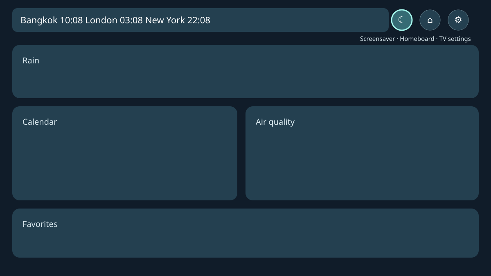
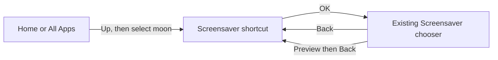

# Screensaver shortcut in the top row

**Replaced (2026‑11‑26)** by [Home's top row: Start screensaver and Homeboard settings](2026-11-26-top-row-start-screensaver.md): the moon gave way to Start screensaver, and holding OK on it opens the Screensaver chooser.

On Home and All Apps, add a moon icon immediately left of Homeboard settings. OK opens the existing Screensaver chooser; hold OK does the same. Back returns to the originating page and focused shortcut. The existing Home settings entry remains available.

## Design review

Applied the [shared Alan Cooper design filter](/home/will/docs/howtos/alan-cooper-design-filter.md). Scope: top row on Home and All Apps; current chooser remains the source of actions and status. Primary profile: a remote user who wants to change an idle display; evidence is Will's request, with discoverability of the icon an assumption. The ordinary scenario is Up, navigate to moon, OK, make or preview a choice, Back to the same page and focus. Variation: an empty Home or later All Apps page. Interruption: Back or preview cancellation returns without changing settings. The current extra trip through Home settings is friction; the shortcut removes it without changing the chooser's setup, permission or Undo behavior. A content description identifies the icon for accessibility; left/right/down navigation and clock space must remain usable. Acceptance: the icon appears on both surfaces, remote focus traverses all header controls in both directions, OK opens the chooser, Back and preview restore origin, and normal widget navigation works. Check English/Thai and narrow device layouts. Disposition: conditional until actual-device focus and layout acceptance; icon meaning is an assumption to validate.

## Verification · 2026-11-23

Container `task check`, `task build` and `task bundle` passed. Version 0.1.118 installed on Cast1 with matching APK hash; the coordinator's subsequent launcher-artwork verification reported `launcher-home-occluded`. Cast1 job `J‑1ef5d70d01d2` completed and its [captures](../testing/2026-11-23-screensaver-shortcut/cast1-final/) show the focused moon, Screensaver chooser, and Back returning focus to the moon. The earlier check opened Favorites due to its starting focus and was not acceptance evidence. All Apps, preview restoration, narrow screens and Thai physical acceptance remain unverified. Pixel installation failed `INSTALL_FAILED_UPDATE_INCOMPATIBLE`; existing app data remains. The tablet install job `J‑111d3cf607eb` is queued pending recovery.
