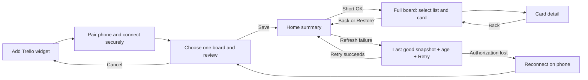

# Trello board widget

**Status: proposed; design and integration decisions need validation before implementation.**

## Goal and scope

Show one selected Trello board on Home so a person can see the state of work at a glance and inspect the board with a TV remote. The first version is **read-only and limited to one board**. Select the board during setup; do not aggregate boards or add pipeline controls. Support the board's actual list names and order, not only `now`, `next`, `later`, `in-review` and `done`. Do not change the default dashboard automatically. Whether multiple independently configured instances are desirable is a later decision; first version has one configured board.

The reference is [wald3n.com/work](https://wald3n.com/work). The local source was inspected; the signed-in page itself was not visually inspected, so appearance and actual user behavior remain unverified. `/work` combines a cross-project `now` queue and live pipeline; the board widget borrows its clear status, card hierarchy and freshness cues, not its multi-project aggregation. The project's individual board view is closer to the intended board scope. The local `src/pages/api/trello.ts` provides lists, ordered cards, due dates, label colors, members and checklist/comment/attachment counts, but is session-gated and accepts an optional board ID under a shared-token trust model. It is not a ready-made TV authentication or least-privilege interface. The queue's derived planned status depends on a Markdown attachment, not label color; do not assert that a card is planned from color alone. Pipeline execution status is separate from board list membership.

## Design review

Apply the shared [Alan Cooper design filter](/home/will/docs/howtos/alan-cooper-design-filter.md). Scope: new Home card, expanded board and setup on Android TV and paired phone. **Primary profile (provisional):** someone familiar with a board wants to see what is happening while passing the TV and inspect a card without reaching for a laptop. Evidence is the request and existing site source; desired density, the particular board and real viewing distance remain assumptions. Secondary needs: shared-room privacy, remote-only viewing, readable English/Thai and recovery after connection loss.

**Scenario:** Add Trello, connect and choose a board from a phone, review the named selection and save. Home shows the board name, useful list counts and a few cards. Short OK opens its lists; directional keys select a list and card, and a detail pane shows the full card information. Back or Restore returns to the exact Home position. If a refresh fails, the last successful snapshot stays visibly dated, with Retry; an invalid connection offers reconnect without claiming the board is empty.

**Findings and response:** (1) Raw board density can block a room-distance glance; prioritize a few legible cards and disclose the rest in full screen. (2) A web login and shared server token do not establish safe unattended TV access; connection scope and revocation are a release gate. (3) List membership and actual pipeline progress are different; show only source-supported states. (4) Shared-screen card text can be sensitive; the owner chooses the board and controls whether cached content appears. The proposed design reduces setup to one selection and remembers it; the person can change or disconnect it explicitly. **Disposition: conditional**, pending authentication/source decision, real-page comparison, usability and physical acceptance.

## Mockups and navigation

Illustrative content only; these are layout proposals, not captures or claims about a real board. Use existing theme, focus ring, TV-safe margins and shared expanded header.

```text
HOME · recommended 3×2                    FULL SCREEN · Trello / Product
┌────────────────────────────┐           ┌──────────────────────────────────────────────────────┐
│ Product board    Updated 2m │           │ Product board              ↻ Refresh  ⚙  Restore dashboard │
│ Now 3  Next 4  Review 1    │           │ Updated 2 min ago · Back returns to dashboard        │
│ NOW                        │           ├──────────────┬──────────────────┬─────────────────────┤
│ • Improve onboarding       │           │ NOW · 3      │ NEXT · 4         │ Improve onboarding  │
│ • Fix search               │           │ ▸ Improve…   │ Add reporting    │ Full description…   │
│ +1 more       OK for board │           │   Fix search │ Polish settings  │ Due · checklist     │
└────────────────────────────┘           │   Add tests  │ …                │ Labels · members    │
                                         └──────────────┴──────────────────┴─────────────────────┘
PHONE SETUP                               ERROR / STALE
┌────────────────────────────┐           ┌────────────────────────────────────┐
│ Connect Trello             │           │ Product board · Updated 2 hours ago│
│ [Connect securely]         │           │ Couldn't refresh · Retry           │
│ Board: [Product        ▾]  │           │ Last saved board remains visible   │
│ [Review and save]          │           └────────────────────────────────────┘
└────────────────────────────┘
```

At 1×1, show board name and a legible summary or setup/status; do not squeeze cards into unreadable text. Wider/taller sizes progressively show list names, counts and card titles. Show list names alongside counts so a count is never ambiguous. Overflow indicators signal more content. In full screen, horizontally navigate lists and vertically navigate cards, with a persistent selected-card pane; adapt columns to available space and keep offscreen lists reachable. Full screen adds all available lists and cards, complete names and description, due state, named labels/members and checklist progress when actually provided; distinguish unavailable details from zero. A selected card's richer detail can load on demand. Back from a nested card or settings returns one level; Back from board and visible **Restore dashboard** restore original page, widget focus, position and saved size, without layout Undo entries. Short OK on Home expands; hold OK uses existing widget actions. Full-screen refresh is explicit, alongside bounded automatic refresh.



## Data, security and behavior

Choose and verify the source before coding. Investigate a direct Trello integration with user-controlled, revocable read-only authorization and a narrowly scoped board snapshot service on wald3n.com. Compare actual authorization scope, refresh/revocation, privacy, maintenance and setup burden; use the simplest option that can meet these requirements. A wald3n service is optional, not a prerequisite for the launcher, and must not merely reuse the browser's admin session or expose its shared Trello token. Existing `/api/trello` is not assumed safe for this purpose. Do not embed household credentials or put secrets in URLs, logs, ordinary phone drafts, exports or screenshots. Use Android-protected credential storage appropriate to the chosen design; explicitly document token scope, revocation and the consequences of disconnecting. Keep a board identifier distinct from its display name and permit re-selection. Do not hard-code a particular household board or depend on undocumented endpoints.

Define a versioned read-only contract with board identity/name, ordered open lists and ordered cards, source timestamps, and explicit partial-data/error indicators. Fetch only fields required for summary/detail. Verify pagination, archived lists/cards, deleted or inaccessible boards, API rate limits and label/member/detail permissions against the chosen source before promising completeness. Respect source ordering; use IDs for selection across refreshes, with a predictable nearby fallback if the selected item disappears. An empty board is a successful empty response, never a failed request. Last-good snapshot is persisted per board with fetch time, marked stale on failure; define a bounded refresh interval and backoff based on provider limits, avoiding concurrent duplicate requests. Provide manual Retry and reconnection; never fabricate current state. Disconnect removes local credentials and cached board contents; changing boards cannot briefly reveal the old board under the new name. Account for app restart, background execution, privacy on a shared screen and no network. Do not add editing, moving cards, planner execution, cross-board views or pipeline administration in v1.

Phone setup should reuse the existing approved pairing and draft/review flow where applicable, but credentials require a separate secure exchange and must not be included in exported drafts or Undo. Saving a board selection and disconnecting must clearly explain their effects; do not imply Undo restores revoked credentials. Provide accessible TV setup guidance and a remote path to Retry/Disconnect; detailed authorization and board selection can be phone-first. Preserve independent widget layout and appearance settings. Localize visible states in English/Thai; support large text, screen readers, reduced motion and non-color status cues.

## Implementation sequence and acceptance

1. Inspect the authenticated reference with permission and confirm the board and desired emphasis. Resolve source, authorization, board choice and privacy model; document the chosen API, scope and limitations. Refresh the mockups and workflow before implementing any changed design.
2. Define snapshot/detail contracts and secure enrollment, then implement a native Java repository with bounded background refresh, explicit errors and last-good data. Reuse launcher persistence and widget patterns where appropriate.
3. Add the widget picker, phone setup, size-aware Home card and expanded board through the existing shared expansion shell. Document configuration, disconnect and source limits.
4. Container checks cover parsing and ordering, pagination, empty/partial responses, stale data, authentication failure, retry/backoff, switching/disconnecting boards, refresh races and selected-card removal. Exercise phone setup, cancellation and credential exclusion. Test English/Thai, long titles, large text, accessibility and remote navigation.
5. Build and deploy following [build](../how-to/build.md) and [Chromecast](../how-to/chromecast.md) procedures. On Cast1, verify a controlled board with multiple lists, long cards and detail; compare compact sizes and full screen, focus movement, refresh, offline/stale and reconnect. Prove Back/Restore returns the original page, focus and saved dimensions, including nested detail and opening interruption. Capture coordinator receipts, screenshots and source/APK version in a testing record; distinguish fixtures from live data. Submit the same numbered working APK to the default fleet under the current deployment policy; coordinator admission governs foreground testing.

**Open decisions:** which board and which source/authentication method; whether descriptions, labels and members are acceptable on the shared TV; freshness target and retained-cache lifetime; exact selected-list priority on compact cards. Do not present these as resolved by this plan. No implementation or deployment has been performed by writing this plan.
