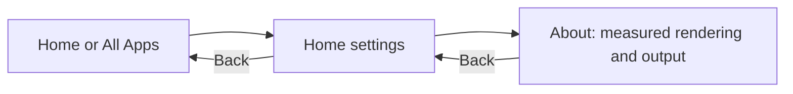

# Rendering resolution in About

## Goal and scope

Will needs to confirm the dashboard's rendering resolution inside the app. Add
measured status to Home settings → About in ordinary Homeboard and the separate
4K Dashboard Test. TV output and dashboard rendering are separate facts. FPS
measurement is assigned to another agent and is outside this change.

## Design review and screen

Apply the [shared Cooper filter](/home/will/docs/howtos/alan-cooper-design-filter.md):
Will is checking sharpness from the sofa, using a remote. Put the answer beside
the app version in the existing About box, with readable labels and no new setup,
mode switch or permanent dashboard badge. Preserve source/license links and Back.
The small-icon All Apps grid and its settings remain unchanged.

[About mockup](2026-11-25-rendering-status.svg). Proposed content:

```text
Homeboard TV                       Version 0.1.<build>
Dashboard rendering   3840 × 2160 (4K)
Rendering surface     3840 × 2160       [explicit proof surface only]
TV output             3840 × 2160 · 60 Hz
Existing description, source/license links and Back
```



## Measurement contract

- Dashboard rendering uses the attached dashboard root's measured pixels. Never
  substitute resource dimensions, the requested surface size or HDMI output.
- The 4K label means measured 3840×2160 (either orientation), not a panel-detail
  or FPS claim. Unknown/unmeasured dimensions display Unavailable.
- For the proof only, show callback-confirmed rendering-surface dimensions; clear
  them on surface destruction. Ordinary Activity rendering has no extra surface row.
- TV output reads the current Display.Mode when About opens. Keep its dimensions
  and refresh rate separate. Missing display/mode reports Unavailable.
- Re-read on reopening About. No global display settings or saved preferences change.
- Constrain About to the measured dashboard viewport and allow vertical scrolling
  so the status, links and Back remain reachable, including on the 4K proof where
  Android resource dimensions can describe the smaller physical Activity window.
- Provide English and Thai strings. Do not add an FPS field with unmeasured data.

## Acceptance and deployment

1. Container tests cover unknown size, exact 4K identification and a 1080p
   dashboard paired with a 4K output without mislabelling the dashboard.
2. Container tests, Android lint and ordinary/proof packaging pass.
3. Coordinator checks on Cast2 show 3840×2160 dashboard/surface in the proof,
   separately from 3840×2160 output. Ordinary Homeboard on the same TV shows its
   measured lower-resolution dashboard alongside the 4K output.
4. Cast1 control shows measured 1920×1080 rendering/output. Review screenshots,
   source links and Back; do not infer formatting success from job completion.
5. Advance deployment numbers. Deploy ordinary Homeboard through task deploy to
   Cast1, Pixel, tablet and Cast2; preserve data. Build/freeze the separate proof
   with a fresh shared deployment number, submit identical bytes to all targets
   through the coordinator, and retain hashes, source inputs and job evidence.
6. Submit install-only jobs independently of foreground checks. Report deferred
   or unavailable targets accurately; no direct-device fallback.

## Status

Implemented and About verified on both ordinary TV paths and the native Cast2
proof. The corrected calendar band is verified on Cast1. See the
[verification and deployment record](../testing/2026-11-25-about-rendering.md).
The requested four-times widget workspace is separate pending work in the
[native dashboard plan](2026-11-23-native-4k-dashboard.md).

The final proof's measurement display is based on the reviewed earlier native
capture and measured sizes. Its extended source-link script had a restored-state
starting mismatch; adaptive follow-up was cancelled for Will's live PM2.5-map
observation. Source-link navigation acceptance remains open, as recorded above.
