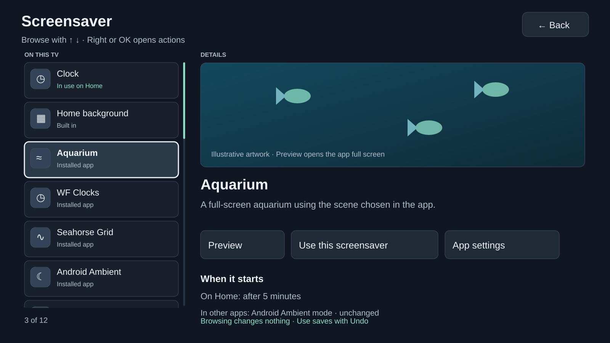
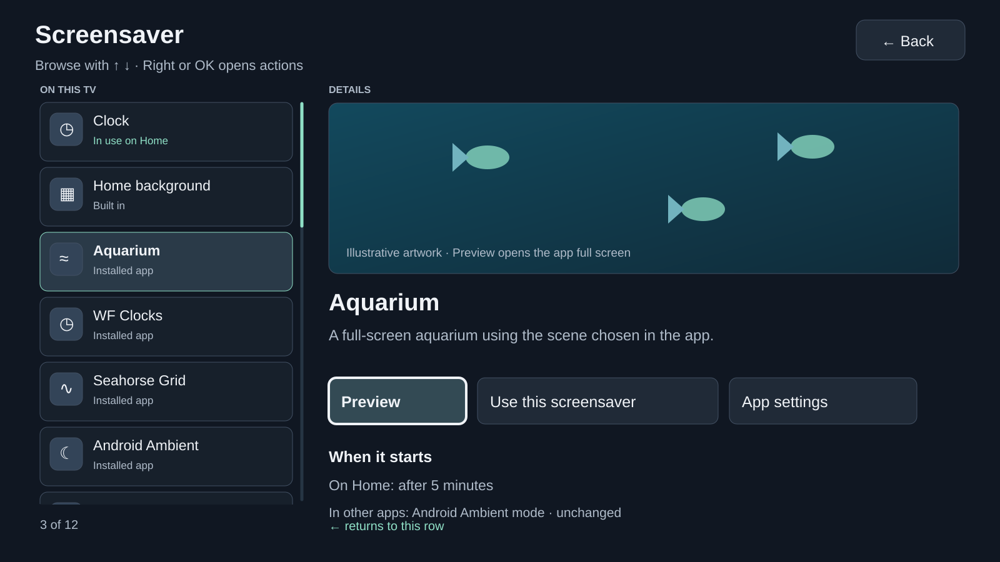
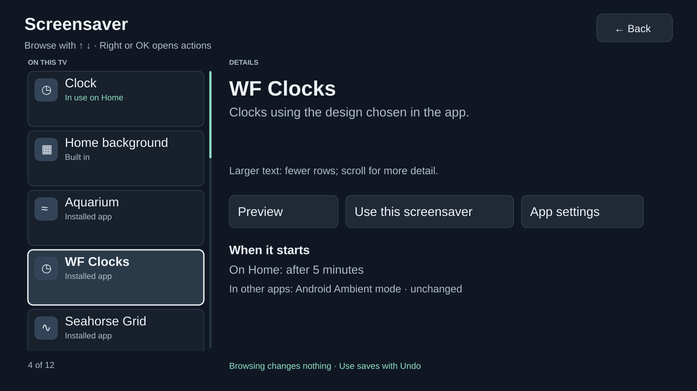
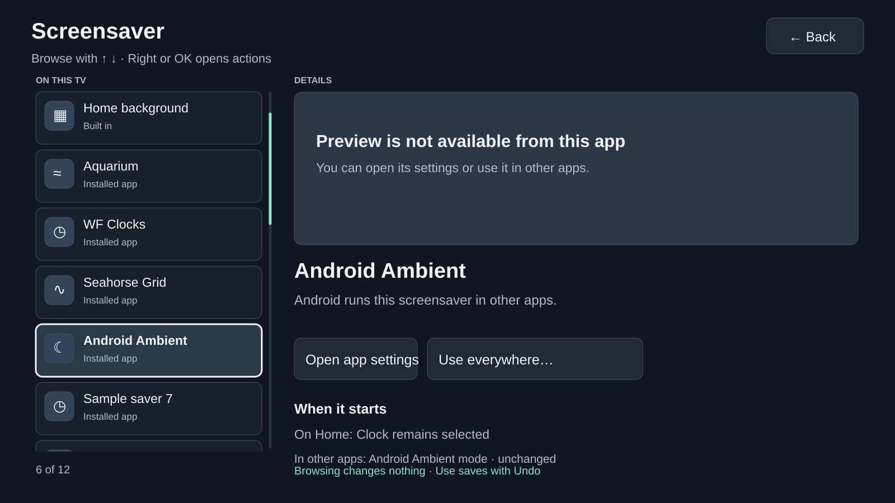
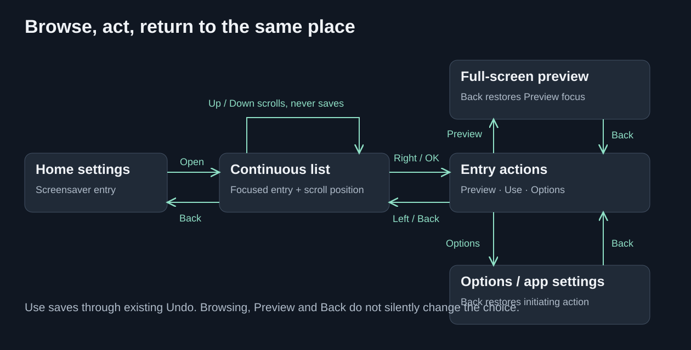
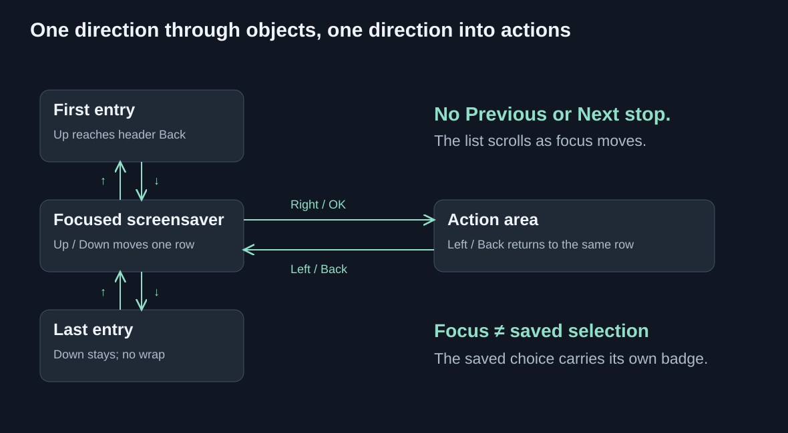

# Browse screensavers without page buttons

**Status: implementation authorized by Will ("do"), 26 November; not yet implemented.**
The documentation sweep precedes the UI change. Will, 26 November: “I hate the
'previous' and 'next' buttons on the screensaver page … there must be a better way.”

**Recommendation:** replace the four-item pages with one continuously scrolling
list. Up and Down move through screensavers themselves. The focused row stays
visible and updates the adjacent detail pane. Right or OK enters that entry's
actions. Browsing never changes the saved screensaver.

**[Open the visual review and keyboard prototype](2026-11-26-screensaver-browsing/review.html)**
— includes four screen mockups, the navigation diagram and the implementation plan.

## Current problem

`MainActivity.drawScreensaver()` uses `SCREENSAVER_PAGE_SIZE = 4`, then adds
Previous and Next buttons. Reaching another screensaver requires leaving the
list to operate its paging controls. Descriptions appear in both the cards and
detail pane, making rows tall and limiting the working set.

The [current Cast2 capture](2026-11-26-screensaver-browsing/current-native-picker.png)
also exposes a separate native-rendering sizing defect: resource/window bounds
can be smaller than the actual embedded dashboard, squeezing the panel and
clipping its controls. That width correction was deployed separately in 0.1.168;
the proposed navigation is still a design only. Removing paging alone would not
fix geometry. The proposed layout fits measured dashboard bounds.

## Proposed screens

The images are proposed UI illustrations, not device acceptance captures. Preview
artwork is illustrative. Do not promise a live embedded preview from another app:
the current companion contract supplies a separate full-screen activity.

## Navigation and state

| Input or event | Result |
|---|---|
| Open Screensaver | Focus the saved entry; scroll it into view. Preserve the actual Home and Android choices. |
| Up / Down in list | Move one entry; scroll only enough to reveal it. Update details, without playing, launching or saving. |
| Hold Up / Down | Ordinary key-repeat browsing; bounded at the ends; no wrap to the other end. |
| Up on the first entry | Move to the header Back button. Down from Back returns to that entry. |
| Down on the last entry | Stay on the last entry. The count and scroll indicator show the end. |
| Right or short OK on a row | Focus that entry's first available action. No implicit selection or app launch. |
| Left from actions | Return to the same row and scroll position. |
| Back from action area | Return to the same list row. Back from the list closes the picker to its originating settings entry. |
| Header Back | Close the whole picker to its origin. |
| Preview, then Back | Restore the same entry, scroll position and Preview action; save nothing. Preserve the existing explicit acceptance behavior of each preview. |
| Use this screensaver | Use the existing save/Undo transaction; update its badge in place. Keep focus on the action. |
| Options / app settings, then Back | Restore the same entry, scroll position and initiating action. |
| Touch / pointer | Scroll naturally; tap a row to inspect it, tap an action to act. No page controls. |

The focus ring means “you are browsing this”; the saved-choice badge means “this
is used.” If Home and Android use different entries, label the badges **On Home**
and **In other apps** with the actual scopes, rather than displaying two ambiguous
“In use” badges. The details retain the existing **When it starts** and Android
handover explanation. Changing scope still uses the existing permission and
confirmation flow.

## Layout

- Use the available dashboard area, with a header and a stable left list/right
  detail arrangement. Calculate bounds from the measured root, not Android's
  lower-resolution window metrics. Keep this UI independent of widget scale.
- List rows show an icon, app/name and at most a short capability/status line.
  Long explanations belong on the right. At normal TV text size, show roughly
  six rows and a partial next row where space permits; the count is not a fixed
  page size or an acceptance requirement.
- A subtle, non-focusable scrollbar plus “3 of 12” communicate position. A partly
  visible next row indicates more content. Neither is an extra navigation stop.
- Keep built-in entries first, then installed apps in stable localized name order.
  Use the existing stable entry/component ID for focus and saved identity. Do not
  expand each app's internal scenes into fake separate screensavers: its own
  settings still choose the tank, clock or scene.
- Right pane: a bounded static illustration/icon, title, short description,
  available actions, and timing/scope. Its content can scroll independently; keep
  actions reachable and do not let long help displace them below the screen.
- Large text shows fewer rows; allow longer names to wrap to two lines and let
  details scroll. Do not shrink the type to retain six rows. On narrow touch
  displays, stack list and detail with the same saved identity and explicit Back
  to list; preserve position. This is a layout adaptation, not a second settings
  model.

## Supported actions and edge states

Built-ins retain Preview, Use this screensaver and Options. Apps declaring a
preview screen retain that app's real Preview, Home selection and app settings.
Android-only apps show “Preview is not available from this app”, their settings
action if provided, and the existing Use everywhere flow. Hide unsupported
actions rather than add a dead-end Preview button.

Two built-ins alone need no scrollbar. A long catalogue uses the same list with
recycled rows. Re-querying installed apps must preserve the browsed ID and first
visible ID/offset; do not snap to item zero. If the focused app disappears, focus
the nearest remaining entry and explain its removal. If it was the saved choice,
show its unavailable state and the existing runtime fallback; do not silently
save a replacement. Permission denial and a failed external launch keep the
entry and initiating action available for retry, using the existing failure UI.

## Cooper design review

Apply the [shared filter](/home/will/docs/howtos/alan-cooper-design-filter.md).
The primary person is Will browsing from the sofa with a D-pad. His stated
objection is the navigation work imposed by page buttons. His goal is to find,
preview and choose a screensaver; page boundaries are an implementation detail.

The design removes those artificial stops, keeps the objects themselves navigable,
distinguishes browsing from a saved choice, and remembers position through Preview,
Options and interruptions. It reuses existing save, scope, permission and Undo
semantics. Descriptions move out of the navigation rail to reduce visual and
remote-control effort. Visible overflow/count, larger-text layouts and explicit
returns make the same interaction discoverable without adding onboarding.

A thumbnail grid was considered: it favors visual comparison, but most installed
Android apps expose neither a thumbnail nor a preview, and it weakens the stable
Right-to-actions relationship. A horizontal carousel keeps much of the same
serial browsing problem. A continuous vertical list best fits the current mixed
catalogue and remote controls. Search and filters are deferred until a real
catalogue demonstrates a need.

## Implementation sequence

1. Verify the separately deployed measured-bounds correction (0.1.168) at 1080p
   and 4K. Keep it separate from this proposed navigation change.
2. Replace `screensaverPage`/`SCREENSAVER_PAGE_SIZE` and the Previous/Next builder
   with a vertical RecyclerView using stable IDs. Bind a row once; focusing it
   updates only the detail pane and positional hint. Do not rebuild the list on
   every focus move.
3. Add explicit cross-pane focus handling and a small picker state containing
   browsed ID, list anchor/offset and last action ID. Restore it after subviews,
   external activities and Activity recreation. Fresh openings start at the
   active choice. Remove the old pagination state; no compatibility layer.
4. Preserve existing ScreensaverRegistry capability checks, Stage 5 companion
   preview contract, timing/scope management, error handling and Undo. Add English
   and Thai strings for new labels and counts.
5. Check in containers, deploy one numbered frozen APK through the coordinator,
   then run the acceptance walkthrough below. Update the user guide and workflow
   diagram to the implemented behavior.

## Acceptance

- Cast1 at 1080p and Cast2 at native 4K: reach every entry using Up/Down alone;
  no Previous/Next buttons and no page reset. Hold a direction across former
  boundaries and verify release stops movement.
- Compare zero external apps, the actual installed set and a controlled 40-entry
  fixture; first/last boundaries and scrollbar/count are correct.
- Right/OK, Left, Back and header Back follow the table. Return from both types
  of Preview, built-in Options and an external settings activity to the exact
  entry, action and list position.
- Merely browsing changes no saved choice or Android setting. Use/Undo restores
  the previous choice and scope. Permission refusal changes neither.
- Test preview-capable, Android-only, settings-less, removed and failed-to-launch
  apps. Unsupported actions are absent and explanations remain readable.
- Larger device text (1.3× and 2×), long Thai names, narrow touch layouts and
  accessibility traversal: rows and actions remain reachable, focus never leaks
  to Home, no clipped action labels, no forced text shrink.
- Pause/recreate and package refresh retain picker state. Scroll does not start
  app activities, decode large artwork or create per-row live players.

This plan changes the chooser only. It preserves the implemented
[top-row Start screensaver button](2026-11-26-top-row-start-screensaver.md), the
[companion contract](2026-11-26-screensaver-companion-contract.md), or who owns
Android's idle behavior.
