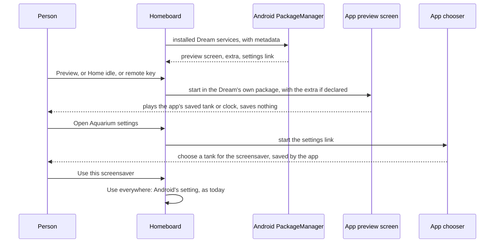

# What a screensaver app must offer Homeboard (Stage 5)

**Status (2026‑11‑26): accepted in a reduced form; nothing is built.** Will's decisions in the
[screensaver integration investigation](../investigations/2026-11-26-screensaver-integration.md)
(decision 1: the app chooses its own tank or clock; decision 2: Homeboard plays installed World
Foundry screensavers on Home and in Preview) remove the earlier provider‑admission section and
the level names. What is left needs no access rights between the apps.

## What each app declares

On its Dream `<service>`, beside the existing `SETTINGS_AUTHORITY`. The key names do not follow the
package name, as in the
[settings provider contract](../../../chromecast-coordinator/docs/settings-provider-contract.md).

| Key (`org.worldfoundry.screensaver.` +) | Aquarium | Clocks | Meaning |
|---|---|---|---|
| `PREVIEW_ACTIVITY` | `org.worldfoundry.screensaver.ScreensaverPreviewActivity` | the same | Full class name in the Dream's own package, never a leading `.` |
| `PREVIEW_EXTRA` (optional) | `org.worldfoundry.screensaver.DREAM` | omitted | Name of a string extra to send |
| `PREVIEW_VALUE` (optional) | `aquarium` | omitted | Its value |

The values match the coordinator registry's `preview_activity`, `preview_extra` and
`preview_value`, so one test in WorldFoundry can hold the manifest and the registry together.

In the Dream's `android.service.dream` XML, **`settingsActivity`** names the app's own "use for
screensaver" chooser (decision 1). It is Android's standard link: Homeboard's existing **Open
‹app› settings** button and a phone's own screensaver picker both open it, with no Homeboard
code. What the chooser looks like belongs to a WorldFoundry plan.

Not needed any more: the `LEVEL_EXTRA` and `LEVEL_SETTING` keys, and any caller other than the
device shell on the settings providers. The certificate‑based admission proposed earlier the same
day was dropped with decision 1.

## What Homeboard does

Homeboard builds the preview component from the Dream's own package, so metadata cannot point it
at another app. An app without these keys behaves as it does today: listed, no Preview.

## Verification

1. WorldFoundry: a test shows the Aquarium and Clocks Dream services declare the keys above with
   the coordinator registry's values, and a `settingsActivity`.
2. WorldFoundry: on Cast1, the settings link opens the chooser, a choice is saved, and the next
   Dream plays it.
3. Homeboard on Cast1: a World Foundry entry previews and plays on Home through the app's preview
   screen; **Open ‹app› settings** opens the chooser; a ringing timer brings Homeboard back while
   the app's screen is in front.
