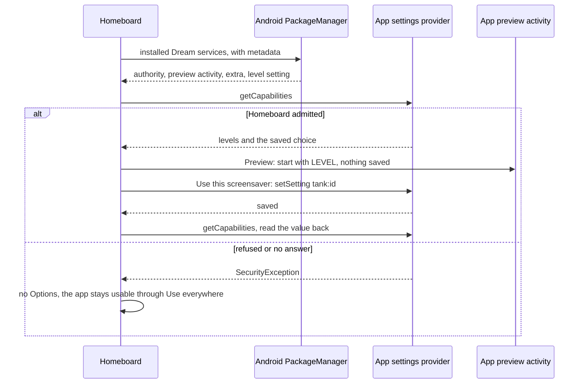

# What a screensaver app must offer Homeboard (Stage 5)

**Status (2026‑11‑26):** contract proposed; neither side is built. Homeboard's half waits for the
two app changes below.

## Why Stage 5 cannot be built yet

Checked in `~/WorldFoundry-wbniv` (branch `2026-new-level`) on 2026‑11‑26. The one‑run
`LEVEL` start it also needs is done.

| Stage 5 control | Needs | Today |
|---|---|---|
| Tank list in Options | `getCapabilities` from the app's settings provider | `TankSettingsProvider` throws `SecurityException` for any caller but the device shell and itself |
| **Use this screensaver** with a tank | `setSetting tank:<id>` | The same refusal |
| **Preview**, Home idle, remote key | The preview activity and extra names, declared by the app | Only `SETTINGS_AUTHORITY` is declared. The other names are in the coordinator's registry, which Homeboard cannot read |

Install, in the wider [screensaver plan](2026-11-20-screensavers.md), also needs a published app,
Stage 2 and Stage 0 questions 10 and 11. It is not covered here.

## 1. Metadata on the Dream service

Beside the existing `SETTINGS_AUTHORITY`. The key names do not follow the package name, as in the
[settings provider contract](../../../chromecast-coordinator/docs/settings-provider-contract.md).

| Key (`org.worldfoundry.screensaver.` +) | Aquarium | Clocks | Meaning |
|---|---|---|---|
| `SETTINGS_AUTHORITY` (exists) | `${applicationId}.settings` | as now | The settings provider |
| `PREVIEW_ACTIVITY` | `org.worldfoundry.screensaver.ScreensaverPreviewActivity` | the same | Full class name, never a leading `.` |
| `PREVIEW_VALUE` (optional) | `aquarium` | omitted | Sent as the `…DREAM` extra |
| `LEVEL_EXTRA` | `org.worldfoundry.screensaver.LEVEL` | the same | Extra that starts one level for one run |
| `LEVEL_SETTING` | `tank` | `clock` | The choice setting that lists the levels |

The values match the coordinator's `preview_value`, `level_launch_extra` and `level_setting_id`,
so one test in WorldFoundry can hold the manifest and the registry together.

## 2. The provider admits Homeboard

**Proposed:** keep the provider exported and, besides the shell and itself, admit a caller only
when both its package name and its signing certificate's SHA‑256 are on a list built into the app.

- Packages: `net.biohack.homeboard`; debug builds of the app also admit `net.biohack.homeboard.debug`.
- Methods: `getCapabilities` and `setSetting`, with the validation the provider already does.
- A signature‑level permission is the simpler alternative, but works only if both apps are signed
  with one key. A package name alone is not enough: anyone can ship that name on a TV without Homeboard.

## 3. What Homeboard then does

Homeboard builds the preview component from the Dream's own package, so metadata cannot point it
at another app. An app without these keys behaves as it does today. The screen is the one in the
WorldFoundry [tank settings mockups](../../../WorldFoundry-wbniv/docs/plans/2026-11-21-aquarium-menu-and-screensaver-launch.md);
this document changes nothing on screen.

## Verification

1. WorldFoundry: a test shows the Aquarium and Clocks Dream services declare the keys above with
   the coordinator registry's values.
2. WorldFoundry: a test shows the provider admits the listed package and certificate, and refuses
   a wrong certificate and an unlisted package.
3. Homeboard, once 1 and 2 are installed on Cast1: the [screensaver plan](2026-11-20-screensavers.md)'s
   step 13, without its Install clause.
