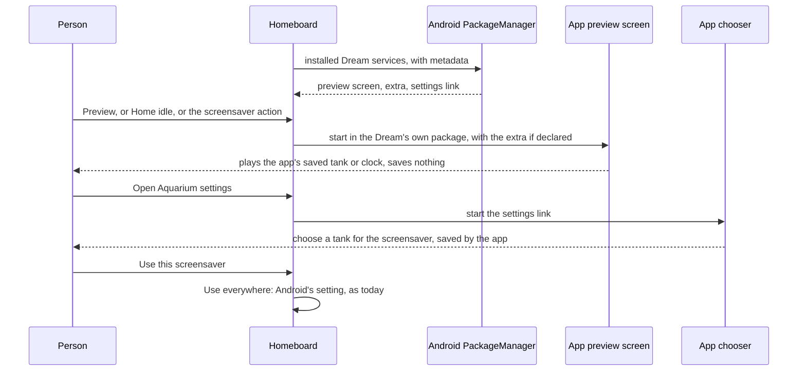

# What a screensaver app must offer Homeboard (Stage 5)

**Status (2026‑11‑26): accepted in a reduced form. The apps' half is built:** WorldFoundry
`5a117e85d` declares the keys below on Aquarium, Clocks and Seahorse Grid (Verification 1). The
APKs installed on Cast1 carry them only after a WorldFoundry rebuild and install. The chooser
(Verification 2) is not built. **Homeboard's half is built (Stage 5, `2395376` on main) and passed
Verification 3 on Cast1 except Open ‹app› settings, which waits for the chooser (2026‑11‑26):** it reads the keys from each Dream service, places the preview activity in the Dream's
own package (refusing a value with a leading `.` or a `/`), and keeps it only when that activity is exported.
Preview, Home idle and the `screensaver` action (a remote button a build maps through `app_keys`; none by default) start it, with the extra when both are declared; such an
entry can be chosen for Home without Use everywhere, which works as before. Home starts the screen in its own task,
so a ringing timer closes it with `finishActivity` and opens the timer screen, with no new permission. An app
without the keys, or whose screen is missing or will not start, gets Homeboard's default screensaver. Will's decisions in the
[screensaver integration investigation](../investigations/2026-11-26-screensaver-integration.md)
(decision 1: the app chooses its own tank or clock; decision 2: Homeboard plays installed World
Foundry screensavers on Home and in Preview) remove the earlier provider‑admission section and
the level names. What is left needs no access rights between the apps.

## What each app declares

On its Dream `<service>`, beside the existing `SETTINGS_AUTHORITY`. The key names do not follow the
package name, as in the
[settings provider contract](../../../chromecast-coordinator/docs/settings-provider-contract.md).

| Key (`org.worldfoundry.screensaver.` +) | Aquarium | Clocks | Seahorse Grid | Meaning |
|---|---|---|---|---|
| `PREVIEW_ACTIVITY` | `org.worldfoundry.screensaver.ScreensaverPreviewActivity` | the same | the same | Full class name in the Dream's own package, never a leading `.` |
| `PREVIEW_EXTRA` (optional) | `org.worldfoundry.screensaver.DREAM` | omitted | `org.worldfoundry.screensaver.DREAM` | Name of a string extra to send |
| `PREVIEW_VALUE` (optional) | `aquarium` | omitted | `seahorse_grid` | Its value |

Seahorse Grid stays its own app (WorldFoundry decision D7) and is a World Foundry screensaver, so
it declares the same keys; the coordinator registry already had its values. Without the extra, or
with `aquarium`, the preview screen plays the app's saved tank or clock; with `seahorse_grid` it
plays the Seahorse Grid level.

The values match the coordinator registry's `preview_activity`, `preview_extra` and
`preview_value`, so one test in WorldFoundry can hold the manifest and the registry together.

In the Dream's `android.service.dream` XML, **`settingsActivity`** names the app's own "use for
screensaver" chooser (decision 1). It is Android's standard link: Homeboard's existing **Open
‹app› settings** button and a phone's own screensaver picker both open it, with no Homeboard
code. What the chooser looks like belongs to a WorldFoundry plan.

Not needed any more: the `LEVEL_EXTRA` and `LEVEL_SETTING` keys, and any caller other than the
device shell on the settings providers. The certificate‑based admission proposed earlier the same
day was dropped with decision 1.

## What Homeboard does



Homeboard builds the preview component from the Dream's own package, so metadata cannot point it
at another app. An app without these keys behaves as it does today: listed, no Preview.

## Verification

1. WorldFoundry: a test shows the Aquarium and Clocks Dream services declare the keys above with
   the coordinator registry's values, and a `settingsActivity`.

    ```
    $ task test-screensaver-preview-metadata     # WorldFoundry 2026-new-level at 2f9f28eb4
    task: [test-screensaver-preview-metadata] python3 -m pytest -q -rs tests/test_screensaver_preview_metadata.py
    ..........                                                               [100%]
    10 passed in 1.23s
    ```

    **PARTIAL (2026‑11‑26):** the keys match the registry for Aquarium, Clocks and Seahorse Grid,
    and the preview activity is exported (`tests/test_screensaver_preview_metadata.py`, 10 cases).
    `settingsActivity` is not declared yet; it arrives with the chooser (WorldFoundry T4 item).
2. WorldFoundry: on Cast1, the settings link opens the chooser, a choice is saved, and the next
   Dream plays it.
3. Homeboard on Cast1: a World Foundry entry previews and plays on Home through the app's preview
   screen; **Open ‹app› settings** opens the chooser; a ringing timer brings Homeboard back while
   the app's screen is in front.

    ```
    $ task chromecast:check DEVICE=chromecast-test-01 APP=homeboard-tv \
        APK=artifacts/deployments/0.1.165/homeboard.apk RECIPE=dev/device/screensaver-stage5-map.json
    Accepted J-f43c1d1151ff: queued; check — waiting: device busy with J-fc9424e67b72
    J-f43c1d1151ff: completed {"error": null, "health": "ready"}
    J-f43c1d1151ff: completed

    Screensaver list, page 2, WF Clocks focused (frame 07):
      Clock   Needs Use everywhere · ☾ Android screensaver app · Android runs it, in every app
      [glyph] No preview: Android gives apps no way to start another app's screensaver.
      Actions: Use everywhere…   (no Preview, no Open Clock settings)
    ```

    ~~**FAIL (2026‑11‑26):** Homeboard 0.1.165 lists WF Clocks as an app without a preview
    screen.~~ Withdrawn the same evening: the row read above is page 2's "Clock", the old release
    Homeboard's `ClockDream` (no preview screen). WF Clocks' Dream is labelled "WF Clocks" and is on
    page 3. Homeboard had no defect; see the record's root‑cause section.

    Rerun on Homeboard 0.1.171 (sha256 `a12f4006…`, with the `kept`/`dropped` diagnostic `a636047`),
    WF Clocks `4ab6bddd…`:

    ```
    $ task chromecast:check DEVICE=chromecast-test-01 APP=homeboard-tv \
        APK=artifacts/deployments/0.1.171/homeboard.apk RECIPE=dev/device/screensaver-stage5-preview.json
    Accepted J-4f2448999362: queued; check
    J-4f2448999362: completed {"error": null, "health": "ready"}
    21:36:52.022 I HomeboardScreensaver: preview screen kept package=org.worldfoundry.game.clocks service=org.worldfoundry.screensaver.ClocksDreamService screen=org.worldfoundry.game.clocks/org.worldfoundry.screensaver.ScreensaverPreviewActivity
    21:37:14.841 I HomeboardScreensaver: screensaver started mode=preview entry=org.worldfoundry.game.clocks/org.worldfoundry.screensaver.ClocksDreamService player=app
    21:37:27.858 I HomeboardScreensaver: screensaver stopped mode=preview entry=org.worldfoundry.game.clocks/org.worldfoundry.screensaver.ClocksDreamService player=app reason=left
      (frame 08: WF Clocks "In use" after Use this screensaver; Undo banner "Screensaver: WF Clocks")

    $ task chromecast:check … RECIPE=dev/device/screensaver-stage5-idle.json
    Accepted J-7aa301eabf78: queued; check
    J-7aa301eabf78: completed {"error": null, "health": "ready"}
      (last key 21:46:53.713, Home timer 1 min)
    21:47:54.098 I HomeboardScreensaver: screensaver started mode=idle entry=org.worldfoundry.game.clocks/org.worldfoundry.screensaver.ClocksDreamService player=app
    21:48:20.039 I HomeboardScreensaver: screensaver stopped mode=idle entry=org.worldfoundry.game.clocks/org.worldfoundry.screensaver.ClocksDreamService player=app reason=left

    $ task chromecast:check … RECIPE=dev/device/screensaver-stage5-alarm.json
    Accepted J-a7f7ee6a393a: queued; check — waiting: device busy with J-3c1f51271fab
    J-a7f7ee6a393a: completed {"error": null, "health": "ready"}
      (OK on "1 Minutes" at 22:00:41.109, then WF Clocks › Preview)
    22:00:55.823 I HomeboardScreensaver: screensaver started mode=preview entry=org.worldfoundry.game.clocks/org.worldfoundry.screensaver.ClocksDreamService player=app
    22:01:42.716 I HomeboardScreensaver: screensaver stopped mode=preview entry=org.worldfoundry.game.clocks/org.worldfoundry.screensaver.ClocksDreamService player=app reason=alarm
      (frame 07, 22:01:5x: Timers & alarms in front)
    ```

    **PARTIAL (2026‑11‑26):** previews through the app's screen **PASS**; plays on Home through it
    on Home idle **PASS**; a ringing timer brings Homeboard back with the timer screen **PASS**
    (checked over Preview, since a 1‑minute kitchen timer always rings before a 1‑minute Home idle).
    **Open ‹app› settings** not testable until WF Clocks declares a `settingsActivity` (the
    WorldFoundry chooser). Frames, jobs and the final Cast1 state are in the
    [Cast1 record](../testing/2026-11-26-screensaver-stage5-cast1.md).
