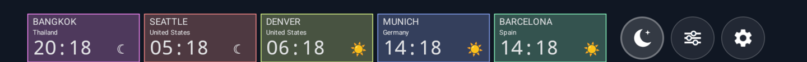
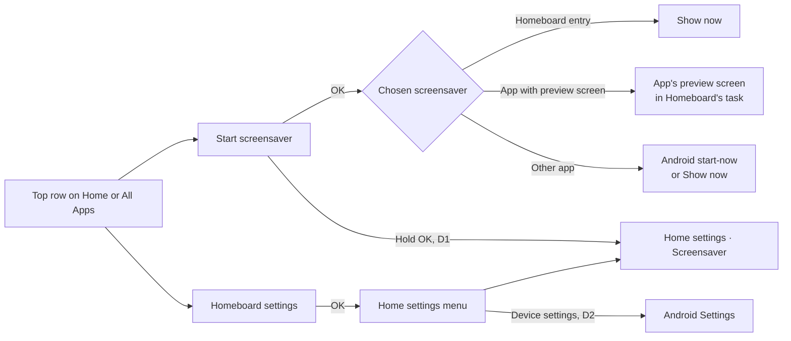
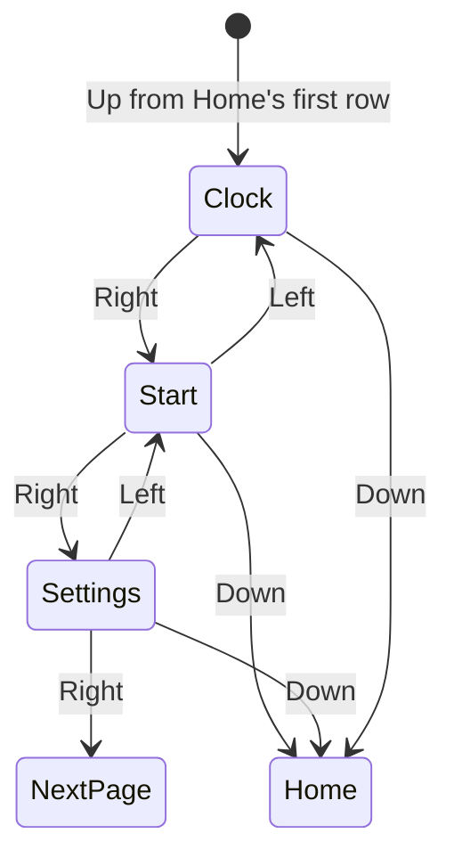
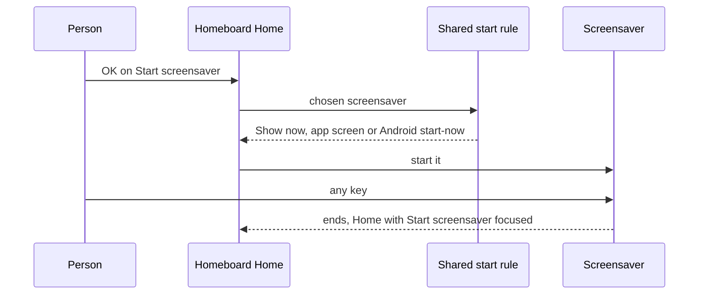
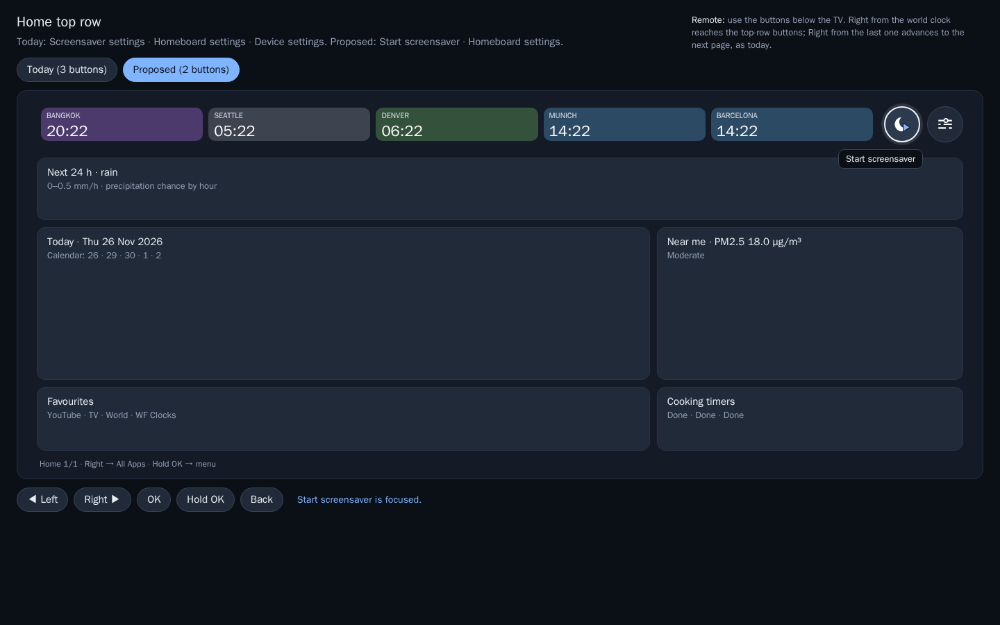
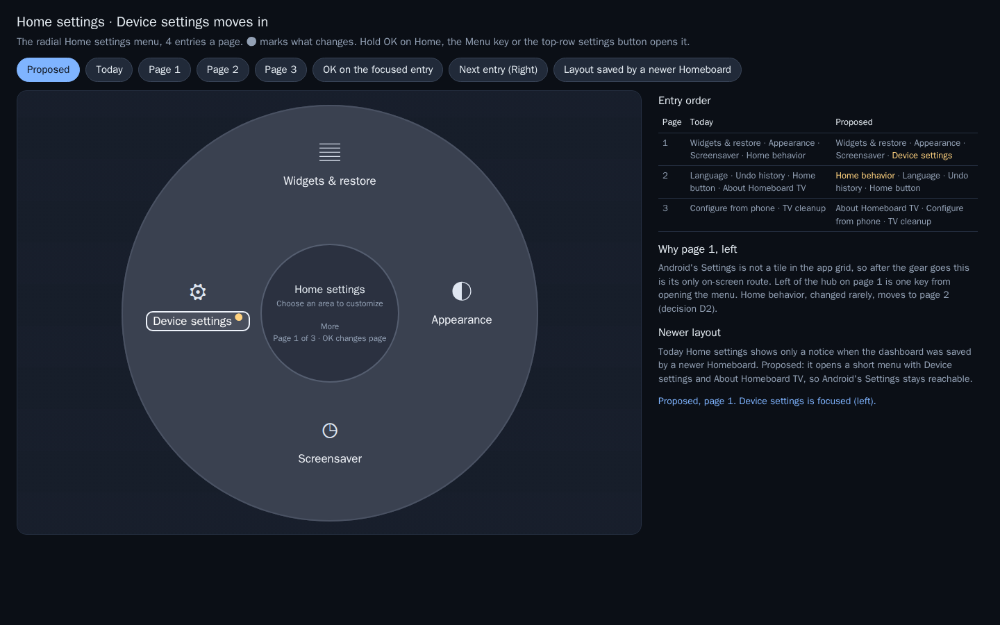
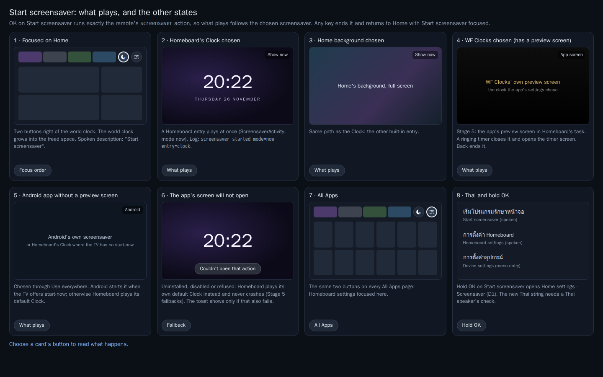

# Home's top row: Start screensaver and Homeboard settings

**Status (2026‑11‑26): proposed, waiting on Will's decisions D1–D3.** Nothing is built.

Will, 2026‑11‑26: "add another button (at the top?) to START the screensaver (something present
in the original google launcher). move system preferences to inside the app preferences. move
screensaver preferences inside the app preferences (leaving only start screensaver and app
preferences)".

## Context

Today the top row of Home and All Apps has three round buttons right of the world clock
(`MainActivity.addTopSettingsButtons`, about line 1213):

| Button | Opens | Since |
|---|---|---|
| Moon (`ic_screensaver`) | Home settings · Screensaver, the chooser (`screensaverShortcut`) | [Screensaver shortcut](2026-11-23-screensaver-shortcut.md), 2026‑11‑23 |
| Sliders (`ic_app_settings`) | Home settings, the radial menu (`homeSettings`) | the widget Home |
| Gear (`ic_settings`) | Android's own Settings (`Settings.ACTION_SETTINGS`) | the widget Home |

Nothing on screen starts the screensaver. Only a remote key mapped to the `screensaver` action
word does (`RemoteKeys`, case `"screensaver"`), which most people never set up. Screensaver is
already an entry in Home settings (page 1, bottom), so the moon is a second route to the same
screen. Android's Settings is not a tile in the app grid (quick start, "The two top-right
buttons are separate"), so the gear is its only on-screen route today.

## Decisions for Will

Each is a recommendation; saying no to any of them leaves that part as described in "If not".

| | Recommendation | What changes | If not |
|---|---|---|---|
| **D1** | **Hold OK on Start screensaver opens Screensaver settings.** | The one-step route to the chooser that the moon gave stays, hidden behind a hold, as Home's tiles already do ("Hold OK → menu"). | Screensaver settings are only in Home settings: two more keys. |
| **D2** | **Device settings goes on page 1 of Home settings, left of the hub; Home behavior moves to page 2.** | Android's Settings stays one key from opening the menu. Anyone used to Home behavior on page 1 finds it on page 2. | Device settings goes last, page 3: two more page turns to reach Android's Settings. |
| **D3** | **A new icon: the moon with a small play mark.** | The button reads as an action, not a settings page. | The plain moon, which until now meant Screensaver settings. |

## Approach

1. **Start screensaver** replaces the moon, left of Homeboard settings, on Home and All Apps.
   OK runs exactly the remote's `screensaver` action, so there is one rule for both:
    - a Homeboard entry (Clock, Home background) plays at once: `ScreensaverActivity`, mode now;
    - an app with a declared preview screen plays it in Homeboard's task (Stage 5,
      `playScreensaver`), so a ringing timer can close it;
    - any other app starts through Android's start-now shortcut, or Homeboard's Show now where
      the firmware lacks it (Google TV has no Somnambulator).

    Move the body of `RemoteKeys`' `"screensaver"` case into one method both call (the button
    calls `playScreensaver` directly for an app screen instead of sending itself an intent). Any
    key ends the screensaver and returns to Home with Start screensaver focused, as Show now does
    today. With D1, hold OK opens Screensaver settings and Back returns to the button.
2. **Device settings moves into Home settings** as a menu entry (D2) that opens
   `Settings.ACTION_SETTINGS` through the existing `open(...)`. The gear and its
    `DEVICE_SETTINGS` key go. When the dashboard was saved by a newer Homeboard,
   `homeSettings()` today only shows a notice; it opens a short menu with Device settings and
   About Homeboard TV instead, so Android's Settings is never unreachable.
3. **Screensaver settings stay where they already are**, Home settings → Screensaver. The moon
   and the shortcut-only return path (`screensaverFromShortcut` in `reopenScreensaver`) go.
4. **Focus:** world clock → Start screensaver → Homeboard settings; Right from the last button
   advances to the next page or All Apps, as today. The two places that fall back to
   `DEVICE_SETTINGS` (`restoreFocus`, about line 1698, and the empty-page path, about line 1742)
   fall back to Homeboard settings. The world clock's right margin shrinks from 234&nbsp;dp to
   174&nbsp;dp to use the freed space.
5. **Strings:** one new string, `hb_ss_start_now`, "Start screensaver" / "เริ่มโปรแกรมรักษาหน้าจอ"
   (spoken description; the Thai needs a Thai speaker's read). The menu entry reuses
   `hb_device_settings`.
6. **Docs:** [screensaver](../how-to/screensaver.md) (start it from Home; the chooser through
   Home settings), [quick start](../how-to/quick-start.md) (the two buttons, Device settings in
   Home settings), [world clock](../how-to/world-clock.md) (what Right selects). The
   [screensaver shortcut plan](2026-11-23-screensaver-shortcut.md) gets a line saying this
   replaces it.

Critical files: `MainActivity.java` (top row, focus, `homeSettings`, Screensaver return path),
`RemoteKeys.java` (the shared start), `res/values{,-th}/` strings, a new
`res/drawable/ic_screensaver_start.xml` (D3).

## Diagrams

What each top-row button does:

Header focus, the order of the remote's Left and Right:

Starting and ending:

## Mockups

The top row, today and proposed, with Left, Right, OK, hold OK and Back:

Home settings with Device settings on page 1, today's order beside it, and the menu for a
dashboard saved by a newer Homeboard:

What Start screensaver plays for each kind of choice, the failure fallback, All Apps, Thai and
hold OK:

## Design review

Applied the [shared Alan Cooper design filter](/home/will/docs/howtos/alan-cooper-design-filter.md).
Primary profile: someone with the TV remote who wants the screensaver now, for example before
leaving the room, and occasionally needs Android's Settings. Evidence: Will's request and the
original Google launcher; that people look for Android's Settings in Home settings is an
assumption to check. Ordinary scenario: Up, Right to Start screensaver, OK; any key brings Home
back with the same focus. Variation: an app chosen as the screensaver (Stage 5 or Android's).
Interruption: a ringing timer ends it and opens the timer screen. The trade: Android's Settings
moves one menu deeper, and the hold on Start screensaver is not discoverable; both are mitigated
(page 1 slot, the chooser still in Home settings). Acceptance is Verification below.

## Out of scope

- The phone controller, which has no top row.
- Remote key mappings: the `screensaver` and `settings` action words stay as they are.
- What any screensaver shows, and Stage 5's own device check.

## Verification

1. `task check` passes, with a unit test that the remote's action and the button use the same
   start rule for a Homeboard entry, an app with a preview screen and an app without one, and a
   test of the Home settings entry order (Device settings on page 1 under D2).
2. Cast1, coordinator `check`: Home's top row shows exactly two buttons right of the world
   clock; Right from the world clock focuses Start screensaver, then Homeboard settings, then
   advances; Left walks back.
3. With Homeboard's Clock chosen, OK on Start screensaver logs
   `screensaver started mode=now entry=clock` and the Clock is in front; one key returns to
   Home with Start screensaver focused and nothing else changed.
4. With WF Clocks chosen (its preview screen declared), OK on Start screensaver brings the app's
   preview screen to the front (`player=app` in the log); Back returns to Home.
5. Hold OK on Start screensaver opens Home settings · Screensaver; Back returns to Home with Start
   screensaver focused (D1).
6. Home settings page 1 shows Device settings; OK opens Android's Settings in front; Back
   returns to Homeboard.
7. All Apps shows the same two buttons and focus order.
8. With Thai selected, the spoken descriptions and the Device settings entry are in Thai.
