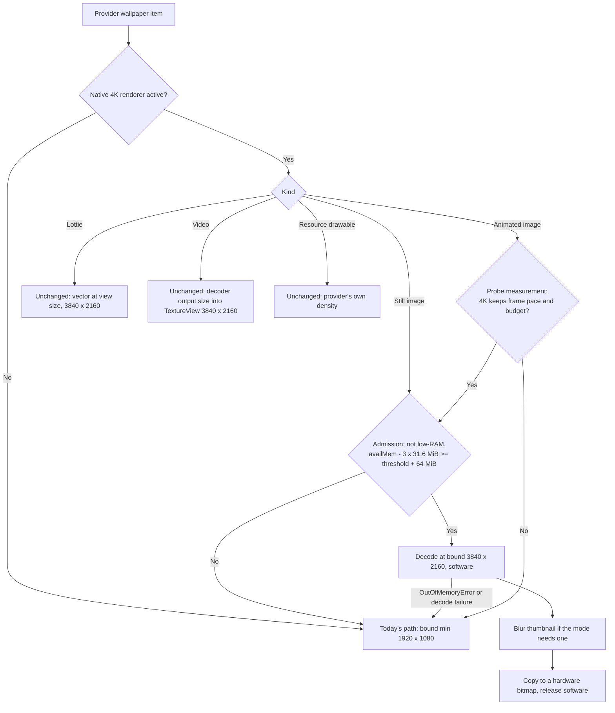
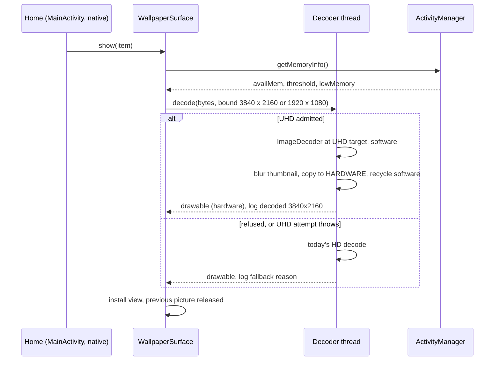
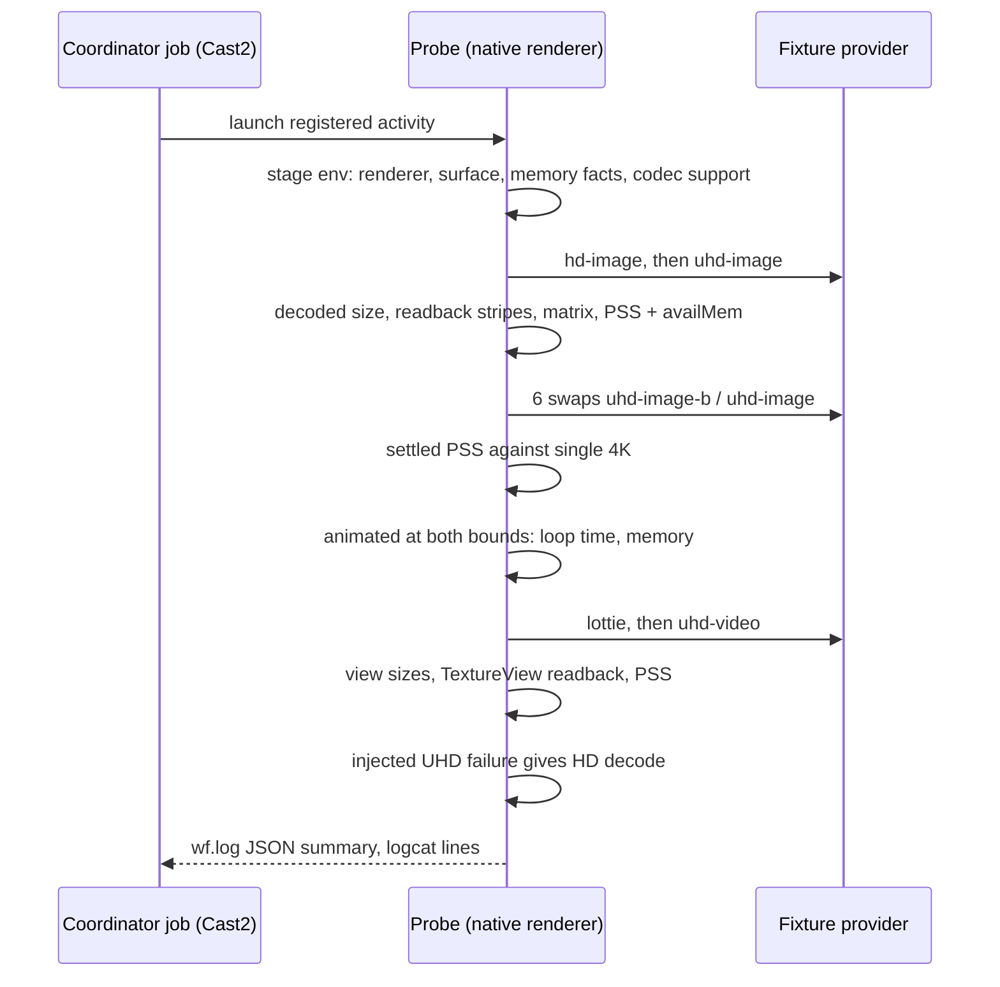

# 4K wallpapers and video

TODO entry: **4K wallpapers and video** (T4), split from engineering gate 4 of the
[native 4K dashboard](2026-11-23-native-4k-dashboard.md) by Will on 2026‑11‑27.

**Goal:** when the native 4K renderer is active (Cast2 today), show provider wallpapers at
3840 × 2160 instead of a 1920 × 1080 decode stretched over the 4K surface, within a measured
memory budget, and prove what resolution video wallpapers actually reach. Everywhere else,
including Cast1 and every ordinary-renderer device, the decode stays exactly as it is.

Gate 4, verbatim: "remove the current provider-image 1080p target only for a verified native
4K path, with bounded memory and real-device measurements. Test static images, animated
assets and video separately; prove actual video output rather than assume TextureView is 4K."

**Mockups:** none. Nothing on screen changes except the wallpaper's pixel density; no new
setting, label or flow.

## Current decode paths

All live provider media goes through `WallpaperSurface`: Home (`MainActivity.java:309`) and
the screensaver backdrop (`HomeBackdrop.java:19`, used by `BackgroundScene` in
`ScreensaverActivity` and the dream).

| Kind | Projectivy type | Code | Resolution today |
| --- | --- | --- | --- |
| Still image (https, content) | 0 | `WallpaperSurface.java:100-101` bound `min(1920, metrics)` × `min(1080, metrics)`; `:123-129` `ImageDecoder` fit-inside target, software allocator | ≤ 1920 × 1080, then scaled by `ImageView` to the view |
| Still image, Android 8 | 0 | `:130-139` `BitmapFactory` power-of-two sampling | ≤ 2× the bound; never on the native path (it needs API 30) |
| Animated image (GIF, WebP) | 0 | same `ImageDecoder` call returns an `AnimatedImageDrawable` at the same target | ≤ 1920 × 1080 |
| Provider resource drawable | 1, 2 | `:111-117` the provider's own `Resources.getDrawable` | the provider's density bucket; no target of ours |
| Lottie | 3 | `:120-122`, `:160-164` | vector, drawn at the view's size |
| Video | 4 | `:220-295` `MediaPlayer` into a `TextureView` | the decoder's output size, drawn into the view |

`NativeDashboardHost.java:34-41` builds native `Resources` with 3840 × 2160 metrics, but on
Cast2 the wallpaper view still reads **1920 × 1080** from `getDisplayMetrics()` (first probe run,
`J‑3013ac80ec0f`: `source 3840x2160 bound 1920x1080`). The native surface is fixed at
3840 × 2160, so the UHD bound uses those constants rather than the metrics; the HD bound keeps
using the metrics exactly as before. `WallpaperPlayer.java:301-332` and `WallpaperSize`
also decode at screen size, but nothing constructs a `WallpaperPlayer` any more (upstream
theme-folder code); they are not on a live path and are left alone.

## Memory budget, from measured Cast2 limits

Cast2 (`chromecast-test-02`, Amlogic S905D3, Android 14, 32-bit user space), coordinator
inspection on 2026‑11‑21 (`docs/diagnostics/home-button-2026-11-21/cast2-inspect/`):
MemTotal 1,982,996 kB, MemAvailable 639,932 kB, swap 484 MiB with 92 MiB free. Homeboard on
the native renderer: total PSS 68,277 KiB including 12,320 KiB GL mtrack
(`J‑d55b317ebcd5` `meminfo.txt`). Widget hosting on the same renderer added 8.6 MiB for four
live views (74,709 → 83,450 KiB, `J‑4fa6f903aca7`).

| Picture | Bytes (ARGB_8888) | Today's HD path | UHD path planned |
| --- | --- | --- | --- |
| 1920 × 1080 | 7.9 MiB | software bitmap + HWUI texture ≈ 15.8 MiB | — |
| 3840 × 2160 | 31.6 MiB | — | one hardware bitmap ≈ 31.6 MiB steady; software + hardware + outgoing picture ≈ 95 MiB peak |

Budget: steady-state PSS no more than **32 MiB** above the HD path for a still 4K wallpaper;
no growth after repeated wallpaper changes (six 4K swaps settle within **8 MiB** of a
single 4K wallpaper); a transient peak under **100 MiB**. Admission rule, checked before each
4K decode: not a low-RAM device and `availMem − 3 × 31.6 MiB ≥ threshold + 64 MiB`, using
`ActivityManager.MemoryInfo`. With Cast2's ~625 MiB available that admits; a stressed device
decodes at 1080p instead. PSS on Cast2 includes GL mtrack, but gralloc buffers may sit outside
it, so the probe also records the system's `availMem` change.

## Approach, by kind



* **Still images.** A pure `WallpaperTarget` class holds the bound selection, the existing
  fit-inside arithmetic (moved verbatim, so the HD branch is the same expression), the byte
  cost and the admission rule; JVM tests cover each. `WallpaperSurface` learns whether the
  native renderer is active from its context
  (`NativeDashboardActivity.nativeDashboardRendering()`), so Home inherits it and the
  screensaver activity and dream, which are ordinary activities, stay at 1080p. On the UHD
  branch the blur thumbnail (display modes 3 and 5) is drawn from the software bitmap on the
  decoder thread, then the picture is copied to `Bitmap.Config.HARDWARE` and the software
  copy recycled: one GPU copy instead of a 31.6 MiB software bitmap plus its 31.6 MiB
  texture. If the copy is refused the software bitmap is kept. Any `OutOfMemoryError` or
  exception in the UHD attempt reruns today's HD decode in the same task. Each decode logs one
  `HomeboardWallpaper` line: source size, bound, decoded size, hardware or not, fallback.
* **Animated images.** Every frame of an `AnimatedImageDrawable` is decoded on the CPU, four
  times the work at 4K. The probe decodes the 4K animated fixture at both bounds and times
  three loops against their nominal length, with memory. Animated sources stay at the HD bound
  (`ImageDecoder.ImageInfo.isAnimated()` in the header callback, `ANIMATED_UHD = false`).
  **Measured:** at 4K the animation used about 156 MiB more PSS than at 1080p (321,330 against
  161,928 KiB) and still ran 2.4× slower than its nominal pace, so it fails the budget; see step 4.
* **Lottie.** Vector content; on the native renderer its view is 3840 × 2160 and draws into
  the 4K surface. No change; the probe confirms the view size and hardware acceleration.
* **Video.** Our code sets no decode size: the codec writes frames at the stream's size into
  the `TextureView`'s `SurfaceTexture`, which draws into the 4K embedded surface. No change
  is expected; what is needed is proof. The probe plays a 4K HEVC fixture whose frames carry
  one-pixel stripes, reads the texture back with `TextureView.getBitmap()` at 3840 × 2160 and
  measures stripe contrast. A 1080p decoder output or a scaled draw turns the stripes grey.
  It also logs `MediaPlayer`'s video size, the view transform and `MediaCodecList` support
  for HEVC at 3840 × 2160. If Cast2 cannot output 4K video this way, that is recorded with the
  evidence and video is proposed as deferred rather than forced.

Rejected: choosing 4K from display metrics alone (any 3840-wide UI). That also switches
devices whose ordinary UI is already 4K, and tablets above 1920 px, none of which has been
measured; the brief limits the change to the native renderer. Also rejected: keeping the
software allocator at 4K, which doubles steady memory (≈ 63 MiB) for no visible gain.



## Proof without a 4K screenshot

Coordinator captures are 1920 × 1080, so they cannot show one-pixel detail. The evidence is
read back on the device instead, by a debug-only `WallpaperResolutionProbeActivity` that
extends `NativeDashboardActivity` (the real embedded renderer), hosts the real
`WallpaperSurface` and drives the debug wallpaper fixture provider. It never reads or writes
the household layout. Fixtures come from `dev/generate-wallpaper-4k-fixtures.py`: two
3840 × 2160 PNGs, a 12-frame 3840 × 2160 animated WebP and a 1-second 3840 × 2160 HEVC clip,
each with a band of one-pixel vertical stripes and a block of one-pixel horizontal stripes.
"Crisp" means at least 95% of adjacent pixel pairs in a stripe run differ by 128 or more
(90% for video). A host check shows the method discriminates: the fixtures score 1.000, a
1080p round trip of the same picture 0.000.



## Verification

Runs on 2026‑11‑28. Device runs used frozen **0.1.185** (SHA‑256 `5cc735a3…0957`), built by
`task deploy DEVICE=chromecast-test-02` from the working tree (which also holds the concurrent,
uncommitted Trello work). Its background install was refused (`install-over-foreground`,
`J‑ca14547c331e`) because Homeboard was on screen; each probe job installed the identical APK
itself. An earlier 0.1.184 run (`J‑3013ac80ec0f`) found two defects, fixed before 0.1.185: the
UHD bound came out 1920 × 1080 (see current decode paths), and the probe's animation callback
re-entered on `stop()` and scrambled its stage order. Raw evidence is kept locally in
`docs/diagnostics/2026-11-28-wallpaper-4k-probe-184/`, `…-185/` and `…-185-cast1/`.

1. JVM tests for `WallpaperTarget`: HD bound and target size equal the old expressions for
   1080p, 720p, 4K and odd sources; UHD bound only with the native renderer; admission rule
   at, above and below its limit and on a low-RAM device. Full `task check` (tests and lint)
   passes on the staged version.

    Staged-only tree (a worktree at `HEAD` plus exactly the committed files), container
    `./gradlew :app:testDebugUnitTest :app:lintDebug`:

    ```text
    BUILD SUCCESSFUL in 2m 46s
    tests 754 skipped 0 failures 0 errors 0
    WallpaperTargetTest: tests="6" skipped="0" failures="0" errors="0"
    ```

    The full `task check` inside both `task deploy` runs (working tree) also passed. **PASS**

2. Fixtures are reproducible: `dev/generate-wallpaper-4k-fixtures.py` regenerates them and
   the host stripe check scores the fixtures crisp and a 1080p round trip not crisp.

    ```text
    uhd_stripes.png: 31,249 bytes   uhd_stripes_b.png: 31,263 bytes
    uhd_animated.webp: 43,994 bytes uhd_video.mp4: 130,010 bytes (hevc Main 3840x2160 30/1, 30 frames)
    f.png (frame 15 of the video) h-crisp 1.000 v-crisp 1.000
    uhd_stripes.png h-crisp 1.000 v-crisp 1.000
    1080p round trip h-crisp 0.000
    ```

    A second run reproduced identical PNG and video sizes. **PASS**

3. Cast2, still image: on the native renderer the probe's HD control decodes the 4K fixture
   at 1920 × 1080 (stripes not crisp) and the production path decodes it at 3840 × 2160 as a
   hardware bitmap, with crisp stripes on both axes in the readback, an identity image matrix
   and a 3840 × 2160 view in a 3840 × 2160 surface.

    Cast2 `J‑6adff9a23f88`, `wf.log` and `logcat.txt`:

    ```text
    environment {"renderer":"native","surface":"3840x2160","root":"3840x2160","output":"3840x2160@60","homeboardVersion":"0.1.185",...}
    HomeboardNative: dashboard=3840x2160 surface=3840x2160 hardware=true
    hd-control {"view":"3840x2160","identityMatrix":false,"decoded":"1920x1080","config":"ARGB_8888","hardware":false,"stripesH":0,"stripesV":0}
    HomeboardWallpaper: source 3840x2160 bound 3840x2160 decoded 3840x2160 hardware=true
    uhd-image {"view":"3840x2160","identityMatrix":true,"decoded":"3840x2160","config":"HARDWARE","hardware":true,"bytes":33177600,"stripesH":1,"stripesV":1}
    ```

    **PASS.** The readback is of the decoded bitmap, drawn 1:1 (identity matrix) into a
    3840 × 2160 view in the 3840 × 2160 embedded surface. The panel's own one-pixel detail is
    still the native 4K item's Watch entry (Will at the LG).

4. Cast2, animated image: loop timing and memory at both bounds are recorded, and the
   production decision for animated sources matches the measurement.

    ```text
    animated-hd  {"decoded":"1920x1080","loopsMs":18108,"nominalMs":3600,"paceRatio":5.03,"stripesH":0}  pss 161928 KiB, graphics 64508, native 60360, avail 540 MiB
    animated-uhd {"decoded":"3840x2160","loopsMs":8692,"nominalMs":3600,"paceRatio":2.41,"stripesH":1}   pss 321330 KiB, graphics 147092, native 137180, avail 446 MiB
    animated-production {"decoded":"1920x1080","animatedUhdPolicy":false,"animated":true}
    HomeboardWallpaper: source 3840x2160 bound 3840x2160 decoded 1920x1080 animated hardware=false
    ```

    **PASS.** Neither bound keeps the fixture's 10 frames/s; the 1080p target is slower still,
    because each 4K frame is decoded and then scaled. At 4K the animation costs about
    156 MiB more PSS, five times the budget, so animated sources keep the 1080p target.
    Finding, not a change: a 4K animated source already costs about 97 MiB over a bare
    dashboard at 1080p and plays at a fifth of its speed on Cast2 (Cast1: 6.7×), today.

5. Cast2, Lottie: the animation view is 3840 × 2160 and hardware accelerated in the native root.

    ```text
    lottie {"view":"3840x2160","hardwareAccelerated":true,"renderMode":"HARDWARE"}
    ```

    **PASS.** Lottie draws its vectors in hardware at the view's 3840 × 2160 size.

6. Cast2, video: HEVC 3840 × 2160 decoder support reported, `MediaPlayer` video size
   3840 × 2160, an identity view transform, and the `TextureView` readback crisp; or a
   recorded platform limit with evidence and a deferral proposal.

    ```text
    hevcDecoders [{"name":"c2.amlogic.hevc.decoder","hardware":true,"uhd30":true,"maxWidth":4096,"maxHeight":4096}, c2.android/OMX.google software decoders max 2048]
    HomeboardWallpaper: video 3840x2160 view 3840x2160
    uhd-video {"view":"3840x2160","identityTransform":true,"readback":"3840x2160","stripesH":1,"stripesV":1}
    ```

    **PASS.** The frame `TextureView.getBitmap()` reads back at 3840 × 2160 keeps every
    one-pixel stripe on both axes, so the decoder output and the texture are full 4K and the
    view draws them 1:1. No code change was needed for video. While a 4K video plays, the
    system's available memory falls by about 200 MiB (528 → 329 MiB against the 1080p clip)
    without showing in Homeboard's PSS: the codec's buffers are outside the process.

7. Cast2, memory: PSS and `availMem` for a solid background, the HD image, the 4K image,
   after six 4K swaps and with 4K video, against the budget above and the widget numbers.

    Self-measured with `Debug.getMemoryInfo` after a forced GC at the end of each 20 s stage:

    | Stage | PSS KiB | Graphics KiB | Native heap KiB | availMem MiB |
    | --- | --- | --- | --- | --- |
    | Solid background | 62,182 | 5,732 | 6,824 | 659 |
    | HD control (today's path) | 77,307 | 14,572 | 14,452 | 635 |
    | 4K still (new path) | 87,992 | 38,476 | 7,008 | 595 |
    | After six 4K swaps | 87,374 | 38,568 | 7,104 | 592 |
    | 1080p video | 92,135 | 48,520 | 7,784 | 528 |
    | 4K video | 87,921 | 48,668 | 7,812 | 329 |
    | Back to solid, end | 95,809 | 56,648 | 7,576 | 594 |

    The coordinator's own `meminfo.txt` at the end read **99,147 KiB** total PSS (Graphics
    56,632), close to the probe's last figure. **PASS** against the budget: the 4K still costs
    **+10.4 MiB** PSS over today's path (budget 32 MiB) and 40 MiB of `availMem`; the shape
    matches the design (graphics +23.3 MiB for one 31.6 MiB hardware buffer, native heap
    −7.3 MiB as the software copy goes). Six swaps settle **0.6 MiB lower** (budget 8 MiB).
    For scale: four live widgets added 8.6 MiB on this renderer (`J‑4fa6f903aca7`). Limits:
    on Cast1 two identical 1080p stages differed by 9.4 MiB, so single-stage deltas carry
    roughly ±10 MiB of drift; the transient peak during a change was not sampled; and the
    graphics figure left after the animated, Lottie and video stages (56.6 against 5.7 MiB
    at the start) is HWUI cache that the rotation stage does not show for 4K stills.

8. Fallback: an injected failure of the UHD attempt yields an HD decode and a shown wallpaper,
   not an error.

    ```text
    HomeboardWallpaper: 4K decode failed; decoding at 1920x1080
    java.lang.OutOfMemoryError: Debug probe: injected 4K decode failure
    fallback {"identityMatrix":false,"decoded":"1920x1080","config":"ARGB_8888","hardware":false,"injected":true,"flagConsumed":true}
    ```

    **PASS.** Admission refusal shares the same HD path and is covered by the JVM tests;
    a real low-memory refusal was not provoked on the device.

9. Ordinary renderer control (Cast1, or recorded 1080p evidence if Cast1 is reserved): the
   probe reports the ordinary renderer, no UHD, and the 4K fixture decoded at 1920 × 1080.

    Cast1 (idle, unreserved) `J‑5d1813cdb96a`, ended `succeeded`, `health: ready`:

    ```text
    environment {"renderer":"ordinary","surface":"none","root":"1920x1080","output":"1920x1080@60",...}
    hd-control {"view":"1920x1080","identityMatrix":true,"decoded":"1920x1080","config":"ARGB_8888","hardware":false,...}
    uhd-image  {"view":"1920x1080","identityMatrix":true,"decoded":"1920x1080","config":"ARGB_8888","hardware":false,...}
    animated-production {"decoded":"1920x1080",...}   lottie {"view":"1920x1080",...}
    uhd-video {"unavailable":"Video playback is unavailable"}   (c2.amlogic.hevc.decoder max 1920; unchanged behaviour)
    status pass, no HomeboardWallpaper lines
    ```

    **PASS.** The production surface on the ordinary renderer decodes exactly as the HD
    control, in software, with no 4K log line. Cast1 cannot play the 4K clip at all; that is
    the existing behaviour for any 4K video on a Chromecast HD.

10. The `homeboard-tv` catalog entry is restored to `com.gathin.tvhome.MainActivity` after
    each probe run and read back.

    ```text
    "activity": "net.biohack.homeboard.debug/com.gathin.tvhome.MainActivity",   (after J‑3013ac80ec0f, J‑6adff9a23f88, J‑5d1813cdb96a)
    ```

    **PASS.**

11. The final build is deployed with `task deploy` and its installed hash verified.

    0.1.185 was built and frozen by `task deploy`; installed hash `5cc735a3a136c500…` verified
    on Cast2 (`J‑6adff9a23f88`), Cast1 (`J‑5d1813cdb96a`) and the Pixel (`J‑2f28e33be00b`,
    identical frozen APK). The tablet is offline (`device-not-found-on-network`). **PASS**,
    tablet pending. Two Cast2 jobs ended `recovery-required` because the coordinator could not
    put Homeboard back in front right after replacing its APK; its recovery jobs
    (`J‑082699142eb6`, `J‑e4eabdd42930`) restored `MainActivity` and ended `health: ready`. The
    Pixel install also needed recovery (`J‑40265972b69d`, completed).
