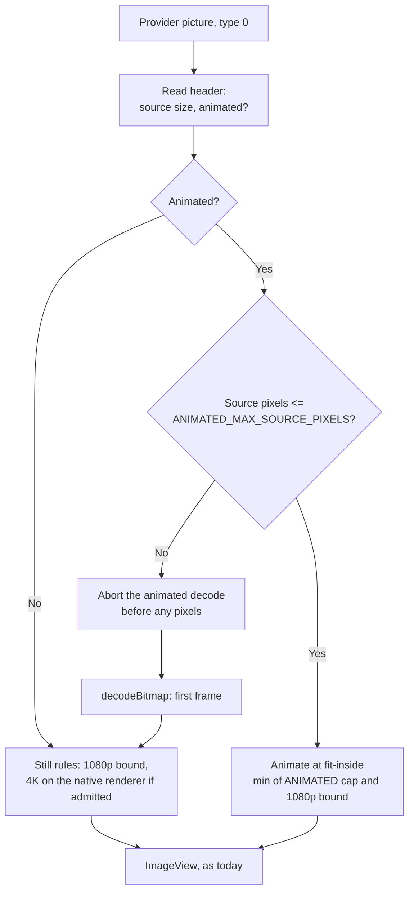
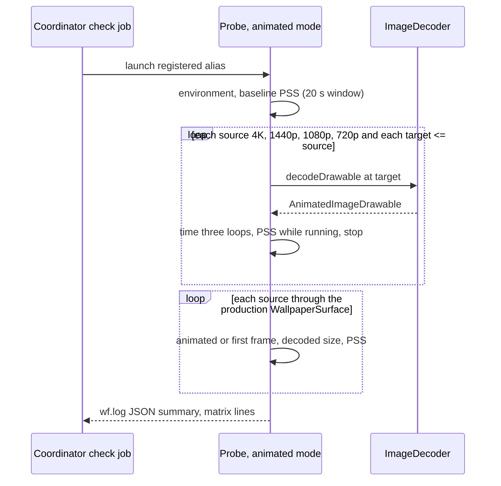

# Animated wallpapers from large sources

TODO entry: **Animated wallpapers from large sources** (T3), split from
[4K wallpapers and video](2026-11-28-4k-wallpapers-and-video.md) by Will on 2026‑11‑28.

**Goal (Will, 2026‑11‑28):** cap animated wallpaper sources lower, or show only the first frame,
so a large animated source does not make the dashboard slow and heavy. Decide by measurement.

**What the user sees:** an animated wallpaper within the budget still animates, at most at the
measured decode size; one over the budget shows its first frame as a still picture. No notice,
setting or new text, so no mockups (see the question at the end).

## Problem, measured

From step 4 of the 4K plan (Cast2 `J‑6adff9a23f88`, Cast1 `J‑5d1813cdb96a`), a 12-frame
3840 × 2160 animated WebP at 10 frames/s (nominal loop 1.2 s):

| Device, decode target | Three loops | Pace (1.0 = designed speed) | PSS | Over the plain dashboard |
| --- | --- | --- | --- | --- |
| Cast2, 1920 × 1080 (today's production path) | 18,108 ms | 5.03× slow | 161,928 KiB | ≈ 97 MiB |
| Cast2, 3840 × 2160 | 8,692 ms | 2.41× slow | 321,330 KiB | ≈ 253 MiB |
| Cast1, 1920 × 1080 (today's production path) | — | 6.7× slow | — | — |

Two things follow. Every frame is decoded on the CPU at the **source** size, so the cost grows
with the source's pixels. And decoding to a smaller target is not cheaper: at 1080p the 4K
source ran **slower** than at 4K, because each frame is decoded in full and then scaled. So a
lower decode target alone (960 × 540, 1280 × 720) may save memory but is not expected to restore
the pace of a 4K source; that is the hypothesis the measurement below tests, not an assumption
the code bakes in.

## Options

1. **Lower decode target for animated sources** (960 × 540 or 1280 × 720). Cheap to apply; saves
   output-buffer memory. The 4K numbers above suggest it does not fix pace for large sources.
2. **Source-size budget, first frame above it.** The header (`ImageDecoder.ImageInfo`) gives the
   source size and whether it is animated before any pixel is decoded. Above a source-pixel budget
   the first frame is decoded as a still (`ImageDecoder.decodeBitmap` returns frame 0 of an
   animated source), which then follows the ordinary still-image rules, including 4K on Cast2's
   native renderer.
3. **Runtime frame-rate watchdog**, falling back to a still when frames lag. Rejected: the header
   carries no frame count or duration, so lag can only be seen after the expensive decoder is
   running; it needs a counting wrapper around the drawable, flips from moving to still in front
   of the viewer, and the 4K numbers show the decision is already predictable from the source size.

**Chosen: 2 with 1's target as a tuned constant.** Two constants in the pure `WallpaperTarget`
class, both set from the measurement matrix below:

* `ANIMATED_MAX_SOURCE_PIXELS`: the largest source that animates. Provisional value until the
  device runs: **1920 × 1080 = 2,073,600 pixels** (a 4K source shows its first frame).
* `ANIMATED_WIDTH × ANIMATED_HEIGHT`: the animated decode cap, also capped by today's metric
  bound. Provisional: **1920 × 1080**, today's behaviour. `ANIMATED_UHD` goes away; animated
  sources never use the 4K bound, as measured.

Budget a measured (source, target) pair must meet to animate: **pace ≤ 1.15** (three loops within
15% of the designed time) on Cast1, the slower device, **and** PSS no more than **40 MiB** above
the probe's plain baseline on both Cast1 and Cast2 (Cast1's stage-to-stage drift is about
±10 MiB, so smaller differences are noise). Decision rule:
`ANIMATED_MAX_SOURCE_PIXELS` is the largest measured source with any target inside the budget,
and the animated cap is the largest target inside the budget for that source (if the cap
then lands below a smaller source's size, that source is decoded at the cap too; the matrix
covers each such pair). If even the 1280 × 720 source fails, that goes to Will rather than turning
every animated wallpaper into a still.



Mechanics in `WallpaperSurface`: both the HD decode and the 4K still decode go through one
`decodePicture` step. Its header callback asks `WallpaperTarget.animates(width, height)`; if
not, it throws a private `FirstFrameOnly` marker, which aborts the decode before pixels are
read (the callback runs inside `ImageDecoder.decodeDrawable` before any allocation), and the
step reruns as `decodeBitmap` at the still bound from a fresh source over the same bytes. The
4K path then makes its hardware copy as for any still. Every animated source logs one
`HomeboardWallpaper` line: source size, and either `animated WxH` or `first frame WxH`.
Reduced motion and the Android 8 `BitmapFactory` path (already first frame only) are unchanged.

## Measurement

The device runs use the existing debug oracle, `WallpaperResolutionProbeActivity` (the real
native renderer on Cast2), in a new `animated` mode selected by a manifest alias,
`.AnimatedWallpaperProbe`, the way the widget probes pick their modes. Fixtures: the existing
3840 × 2160 animated WebP plus 2560 × 1440, 1920 × 1080 and 1280 × 720 versions of the same
12 frames (`dev/generate-wallpaper-4k-fixtures.py`, every frame repainting the whole canvas, the
worst case).



Targets per source: the source's own size, 1920 × 1080, 1280 × 720 and 960 × 540, keeping only
those no larger than the source (13 pairs). Each pair records `loopsMs`, `paceRatio` and PSS
(after a forced GC while it runs). The production stages check that each fixture lands where the
current constants say. Recipe: `dev/device/wallpaper-animated-probe.json` (420 s check job).

**Device constraint, 2026‑11‑28:** the 24-hour exposure run LX‑837191 holds the global
`homeboard-tv` registration and Cast1. The probe needs both a registration swap and the new APK,
so steps 4–9 wait until that run has ended. Steps 1–3 are host-only.

## Verification

1. JVM tests for the animated rules in `WallpaperTarget`: a source at the budget animates and one
   pixel over shows its first frame; portrait and landscape of equal pixels decide alike; the
   animated target is fit-inside `min(ANIMATED cap, 1080p bound)` and never the 4K bound; stills
   are untouched (existing tests). `./gradlew :app:testDebugUnitTest :app:lintDebug` passes on the
   staged version.

    Staged-only tree (a worktree at `HEAD` plus exactly the committed files), container
    `./gradlew --no-daemon :app:testDebugUnitTest :app:lintDebug :app:assembleDebug`, 2026‑11‑29:

    ```text
    BUILD SUCCESSFUL in 2m 16s
    WallpaperTargetTest tests=9 skipped=0 failures=0 errors=0
    tests 758 skipped 0 failures 0 errors 0
    ```

    **PASS.**

2. Fixtures are reproducible: `dev/generate-wallpaper-4k-fixtures.py` writes the three new
   animated WebPs at their sizes, and the four existing fixtures come out byte-identical
   (`git status` shows no change to them).

    ```text
    uhd_stripes.png: 31,249 bytes
    uhd_stripes_b.png: 31,263 bytes
    uhd_animated.webp: 43,994 bytes
    animated_1440.webp: 32,770 bytes
    animated_1080.webp: 24,502 bytes
    animated_720.webp: 20,024 bytes
    uhd_video.mp4: 130,010 bytes
    sha256 before/after diff: only the three new animated_*.webp lines added
    git status launcher/wallpaper-fixture: ?? animated_1080.webp, animated_1440.webp, animated_720.webp
    ```

    **PASS.**

3. The debug build carries the alias: `./gradlew :app:assembleDebug` succeeds and the merged
   manifest lists `.AnimatedWallpaperProbe` with `mode=animated`.

    ```text
    <activity-alias android:name="com.gathin.tvhome.AnimatedWallpaperProbe" android:exported="true" android:targetActivity="com.gathin.tvhome.WallpaperResolutionProbeActivity" > <meta-data android:name="mode" android:value="animated" /> </activity-alias>
    ```

    **PASS** (same build as step 1).
4. *(After LX‑837191.)* Cast2: register `com.gathin.tvhome.AnimatedWallpaperProbe` as
   `homeboard-tv`'s activity, run `dev/device/wallpaper-animated-probe.json`; record the 13-pair
   matrix (pace, PSS) and the baseline.
5. *(After LX‑837191.)* Cast1: the same probe and recipe; record the matrix.
6. Set `ANIMATED_MAX_SOURCE_PIXELS` and the animated cap from steps 4–5 by the decision rule,
   update the JVM tests to the chosen values, and record the reasoning here.
7. *(After LX‑837191.)* Rerun the probe on Cast2 and Cast1 with the chosen constants: every
   production stage matches the policy (an over-budget source shows a still at the still bound,
   3840 × 2160 hardware on Cast2's native renderer and 1920 × 1080 on Cast1; an in-budget source
   animates at the chosen target), and the in-budget production animation keeps pace ≤ 1.15.
8. The `homeboard-tv` registration is restored to `com.gathin.tvhome.MainActivity` after each
   probe run and read back.
9. The final build is deployed with `task deploy` and its installed hash verified on Cast2 and
   Cast1.

## Question for Will

Is a still first frame, with no notice, acceptable for an animated wallpaper that is too large to
play smoothly? The alternative is a status line in the phone editor ("Too large to animate on
this TV; showing the first frame"), which would add mockups and strings in both languages.
