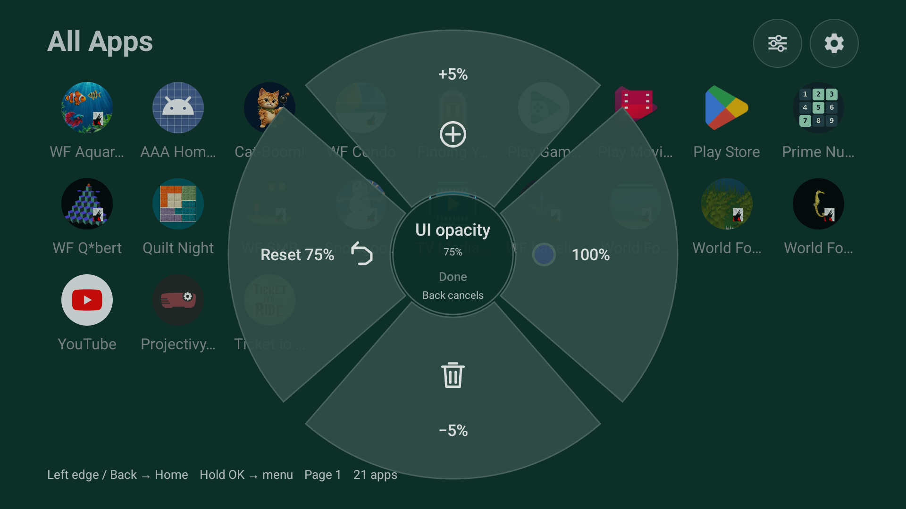
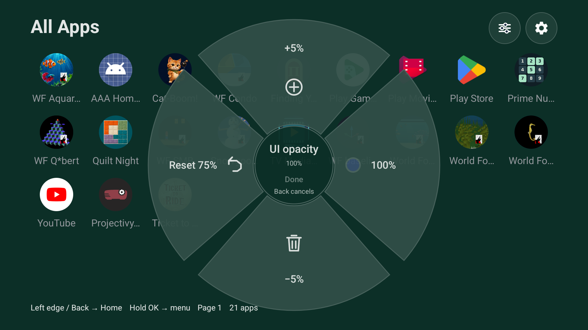

# Projectivy wallpaper host validation

Branch: `feature/projectivy-wallpaper-host` in `/home/will/homeboard-tv-projectivy`.

- [x] Final suite: 360 JVM tests, zero failures/errors/skips, passed in the container.
- [x] Debug lint passed and final minified 0.1.11 release APK packaged in the container.
- [x] Original API sources match pinned upstream SHA-256 hashes.
- [x] Debug 0.1.9 installed on Cast1 in J‑fb03bd528d6a, data preserved and health ready.
- [x] Offline probe J‑c26380f3365d displayed ALL CHECKS PASSED: API/parcel fields, preferences, all six media paths, focus/idle and hung-provider timeout. OCR oracle passed and its impossible-text negative check failed as expected.
- [x] J‑849cc7af5234: nine-column All Apps with all 21 installed apps on one page; Icons contains Circular icon mask; opacity 75% → preview 100% → cancel → save 70% → Undo restored 75%.
- [ ] Unmodified Overflight rendering: J‑6c39e99903f6 completed but its final screenshot showed All Apps rather than the probe. No real-plugin rendering pass is claimed.

The final deployment version, coordinator job IDs, evidence and actual results
will be added after completion. Prior build success does not establish device behavior.

## Cast1 evidence

The offline probe checks successful renderer preparation/attachment for all six
types, not frame pacing or visual parity with Projectivy. The All Apps fixture
opens the actual launcher surface; the device has 21 apps, so the 36-slot grid is
partly filled. JVM geometry tests cover the full four-row capacity.

## Final build and coordinator interruption

The final 0.1.10 minified release build also passed. A provider-options Back-navigation review found an obsolete menu callback could
remain after discarding its preview draft. The final source replaces that options
subtree when returning to provider details. Build **0.1.10** passed 357 JVM tests
and debug lint and was frozen for deployment, SHA-256
`56c4f9d93a4480978e7ca37be5331e443ff2a8ede581335dbda2d87be7b20a0f`.

Deployment job **J‑4594d0afb464** reached installer-session commit before the
coordinator socket disappeared. After the service returned, watch and evidence confirmed a successful installation and cleanup with health ready.
Do not reuse 0.1.10 for a new build. The unchanged frozen APK may be used to finish
verification once the coordinator returns. No direct-device fallback was used.
The earlier verified deployment was 0.1.9, SHA-256
`2396809ac2fff4935bfb67d913597cb14aafb52f8e26ee62aecd4201118eaf39`.

Overflight 1.20's APK hash is
`949b27eed4cc2a213d68d39e499cc1037c972dfa8a8cbdd9f659fe28f58daa4b`.
Job J‑0844aa47d74b verified the installation; its automatic launcher verification
failed because the coordinator did not find a supported raster artwork reference.
Automatic readd restored device readiness before later jobs. The provider was
installed without changing its preferences or the default Home app.

The first offline probe attempt J‑1136a3284db3 failed in the coordinator input
helper on a capture-only score; J‑c26380f3365d replaced it with a passive timed
check and passed. Catalog registrations are sequential under APP=homeboard-tv,
not aliases for the same package. The final deployment restored the normal
MainActivity catalog entry before the socket interruption.

Remaining device work:

- [x] Read the final receipt and export evidence for J‑4594d0afb464: succeeded, health ready.
- [x] J‑70428b927d44, frozen 0.1.10: provider preview ready, rotation options, Back returns to provider list, re-preview/apply changes the background, and Undo restores the prior palette.
- [x] Retry Overflight without remote input: J‑e8f6417e8abe reached the explicit 50-second no-usable-media failure. The coordinator completed safely; media compatibility has not passed.
- [x] Restore APP=homeboard-tv to com.gathin.tvhome.MainActivity after probe checks.

The current media/display-mode and event limitations are listed in the how-to.
Long-run frame pacing, all display modes on each media type, Android 8 animation
behavior and provider package-removal/replacement recovery are not established by
these Cast1 checks.

## Background selection on build 0.1.10

## Secure media URL correction in build 0.1.11

The actual launcher preview in J‑af8f06a83e9e identified Overflight's rejection:
its video URIs were plain HTTP. This was a scheme-policy failure before media
playback, not evidence of a failed Binder contract. The public default feed has
109 entries and URLs on sylvan.apple.com / a1.phobos.apple.com.

Build 0.1.11 upgrades HTTP media URIs to HTTPS, preserves encoded paths, query
parameters and fragments, and removes an explicit default HTTP port of 80. It
never downgrades TLS failures to plaintext. URL-policy tests bring the suite to
360 tests, all passing. Deployment J‑5f02d3e4aa20 succeeded on Cast1 with health
ready, SHA-256
`b3d35a588a8cc5b2355bb407d87827c08c55d4eecb93fdab955f56e73782744b`.
