# Projectivy wallpaper host validation

Merged from `feature/projectivy-wallpaper-host` into `main` at `2e37f02`.
The source worktree remains at `/home/will/homeboard-tv-projectivy`.

**0.1.14 correction:** UI opacity now adjusts colored backdrop and panel fills
only. Text, artwork and focus retain their normal opacity. See the correction
record at the end of this document and its six-screen comparison. Earlier
0.1.9–0.1.13 opacity checks below describe the superseded whole-container behavior.

- [x] Combined source with main bed1ea1: 373 JVM tests, zero failures/errors/skips, debug lint and minified release packaging passed in the container.
- [x] Debug lint passed and minified 0.1.12 release APK packaged in the container.
- [x] Original API sources match pinned upstream SHA-256 hashes.
- [x] Debug 0.1.9 installed on Cast1 in J‑fb03bd528d6a, data preserved and health ready.
- [x] Offline probe J‑c26380f3365d displayed ALL CHECKS PASSED: API/parcel fields, preferences, all six media paths, focus/idle and hung-provider timeout. OCR oracle passed and its impossible-text negative check failed as expected.
- [x] J‑849cc7af5234: nine-column All Apps with all 21 installed apps on one page; Icons contains Circular icon mask; opacity 75% → preview 100% → cancel → save 70% → Undo restored 75%.
- [x] Unmodified Overflight rendering passed in J‑f9b793cee5cc on 0.1.12, including an actual first video frame. Original 4K/HDR preferences restored and visually verified in J‑02433595f75d.

## Combined main deployment · 0.1.13

- [x] `task deploy DEVICE=chromecast-test-01` passed 373 JVM tests, lint and debug packaging from merged main.
- [x] J‑5125d95ff359 installed and briefly launched 0.1.13, with installed SHA-256 verified and device health ready. App data and default Home were preserved.
- [x] J‑d7b647dfdb7e displayed ALL CHECKS PASSED on 0.1.13; the OCR oracle independently passed. This includes actual video first-frame readiness, all six media types and hung-provider timeout.

Frozen APK: `artifacts/deployments/0.1.13/homeboard.apk`, SHA-256
`ca1ec267c35690edfc73a31c68c89d8b169bb889073e895e9fee75d6c8eb89fd`.
Source: `2e37f02` plus the deployment version bump to 13. It includes main's Home
favorite sizes and separate font-aware icon/banner grids. The machine-readable
[deployment record](2026-11-16-projectivy-plugin-host/deployment-0.1.13.json)
links the build and probe results.

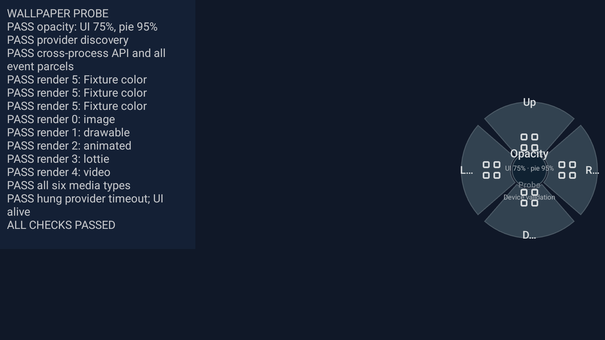

The first Home recipe J‑3b46f1711798 was cancelled before scripted input because
the saved Home already used banners, contrary to that recipe's Small-icons
precondition. Cleanup returned ready health. A recipe for the actual starting
state replaces it; the cancelled job is not acceptance evidence.

## Cast1 evidence

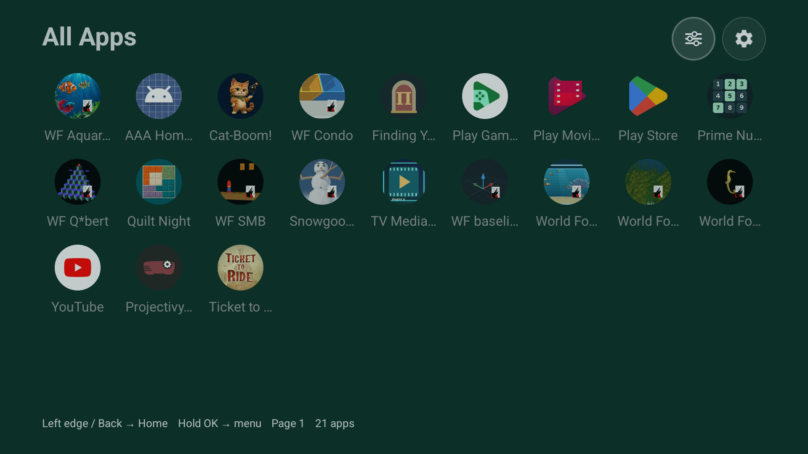

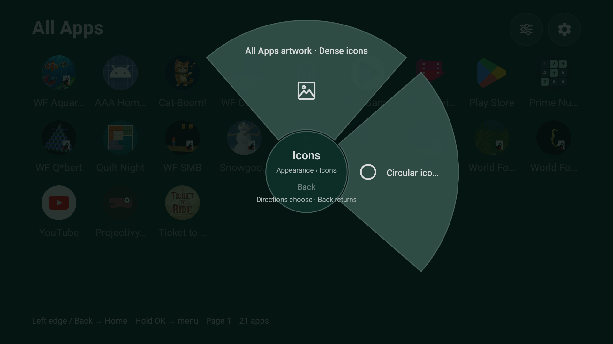

The offline probe checks successful renderer preparation/attachment for all six
types, not frame pacing or visual parity with Projectivy. The All Apps fixture
opens the actual launcher surface; the device has 21 apps, so the 36-slot grid is
partly filled. JVM geometry tests cover the full four-row capacity.

## Final build and coordinator interruption

The final 0.1.10 minified release build also passed. A provider-options Back-navigation review found an obsolete menu callback could
remain after discarding its preview draft. The final source replaces that options
subtree when returning to provider details. Build **0.1.10** passed 357 JVM tests
and debug lint and was frozen for deployment, SHA-256
`56c4f9d93a4480978e7ca37be5331e443ff2a8ede581335dbda2d87be7b20a0f`.

Deployment job **J‑4594d0afb464** reached installer-session commit before the
coordinator socket disappeared. After the service returned, watch and evidence confirmed a successful installation and cleanup with health ready.
Do not reuse 0.1.10 for a new build. The unchanged frozen APK may be used to finish
verification once the coordinator returns. No direct-device fallback was used.
The earlier verified deployment was 0.1.9, SHA-256
`2396809ac2fff4935bfb67d913597cb14aafb52f8e26ee62aecd4201118eaf39`.

Overflight 1.20's APK hash is
`949b27eed4cc2a213d68d39e499cc1037c972dfa8a8cbdd9f659fe28f58daa4b`.
Job J‑0844aa47d74b verified the installation; its automatic launcher verification
failed because the coordinator did not find a supported raster artwork reference.
Automatic readd restored device readiness before later jobs. The provider was
installed without changing its preferences or the default Home app.

The first offline probe attempt J‑1136a3284db3 failed in the coordinator input
helper on a capture-only score; J‑c26380f3365d replaced it with a passive timed
check and passed. Catalog registrations are sequential under APP=homeboard-tv,
not aliases for the same package. The final deployment restored the normal
MainActivity catalog entry before the socket interruption.

Remaining device work:

- [x] Read the final receipt and export evidence for J‑4594d0afb464: succeeded, health ready.
- [x] J‑70428b927d44, frozen 0.1.10: provider preview ready, rotation options, Back returns to provider list, re-preview/apply changes the background, and Undo restores the prior palette.
- [x] Retry Overflight without remote input: J‑e8f6417e8abe reached the explicit 50-second no-usable-media failure. The coordinator completed safely; media compatibility has not passed.
- [x] Restore APP=homeboard-tv to com.gathin.tvhome.MainActivity after probe checks.

The current media/display-mode and event limitations are listed in the how-to.
Long-run frame pacing, all display modes on each media type, Android 8 animation
behavior and provider package-removal/replacement recovery are not established by
these Cast1 checks.

## Background selection on build 0.1.10

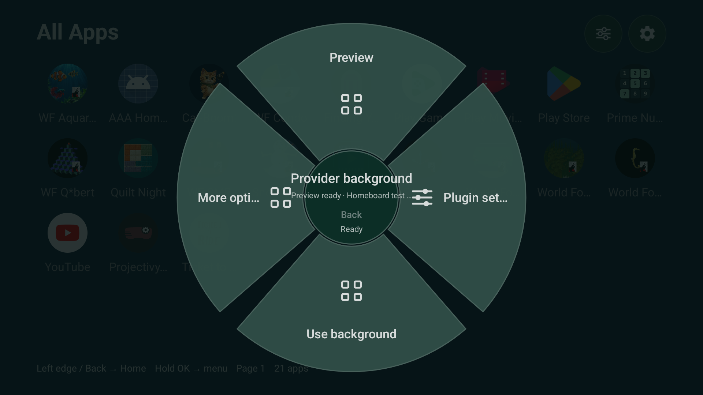

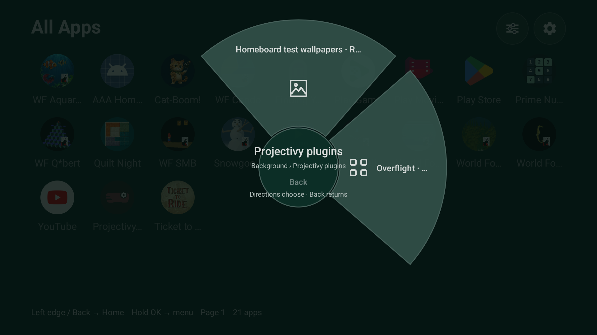

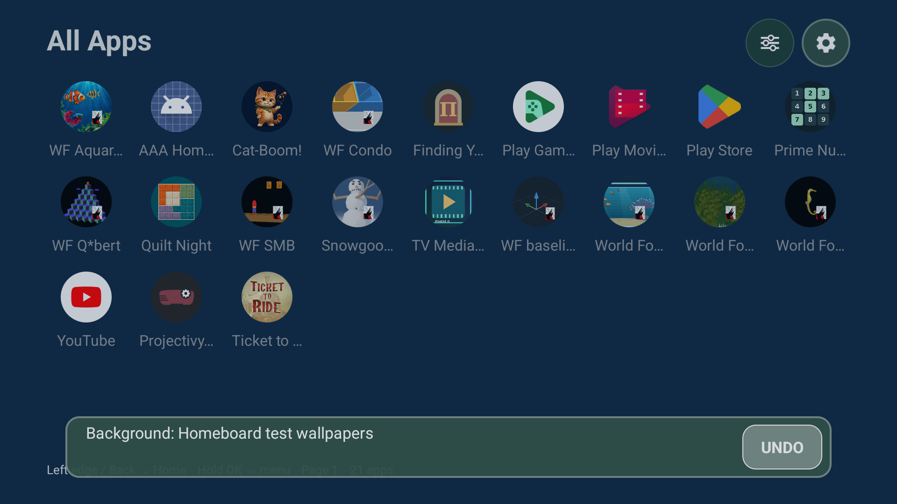

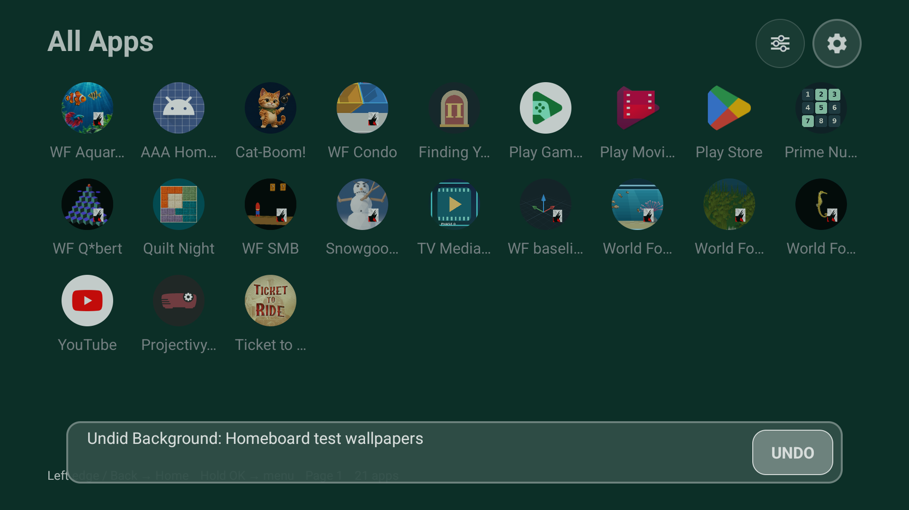

## Secure media URL correction in build 0.1.11

The actual launcher preview in J‑af8f06a83e9e identified Overflight's rejection:
its video URIs were plain HTTP. This was a scheme-policy failure before media
playback, not evidence of a failed Binder contract. The public default feed has
109 entries and URLs on sylvan.apple.com / a1.phobos.apple.com.

Build 0.1.11 upgrades HTTP media URIs to HTTPS, preserves encoded paths, query
parameters and fragments, and removes an explicit default HTTP port of 80. It
never downgrades TLS failures to plaintext. URL-policy tests bring the suite to
360 tests, all passing. Deployment J‑5f02d3e4aa20 succeeded on Cast1 with health
ready, SHA-256
`b3d35a588a8cc5b2355bb407d87827c08c55d4eecb93fdab955f56e73782744b`.

## Real Overflight success on build 0.1.12

Job **J‑f9b793cee5cc** passed with the unmodified official Overflight 1.20 APK.
The first video frame was rendered and the captured screen shows the Mountains
video playing. Overflight was temporarily set to HD/SDR for the Chromecast HD;
its original 4K/HDR selections are restored after this test. This resolves the
older no-media results above. The scoped Apple HTTP policy, rather than a broad
cleartext allowance, is required by the published feed.

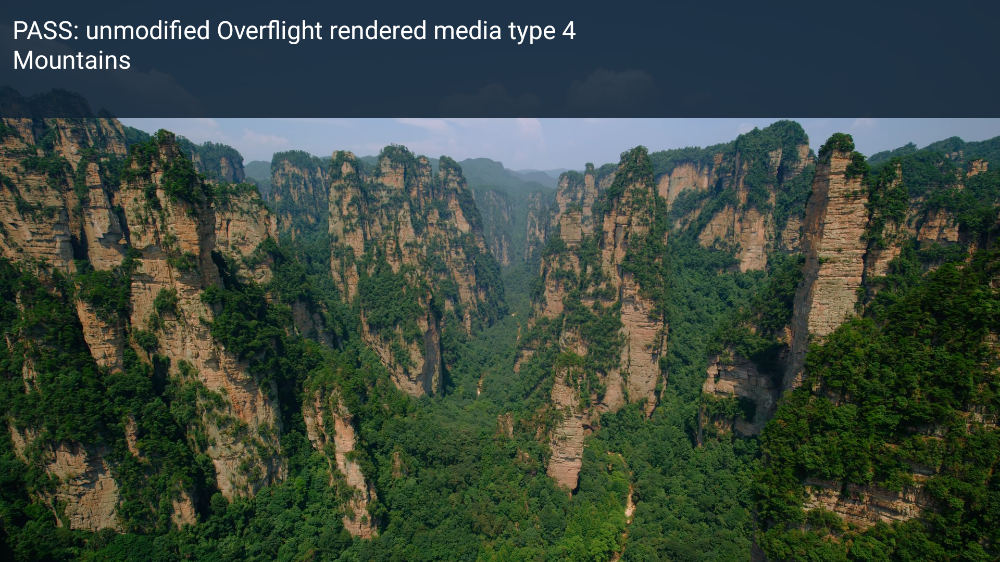

## Combined Appearance check · 0.1.13

J‑861c0dbe9aae passed the complete remote-driven Appearance recipe with ready
health. The captured All Apps screen has ten icon columns and all 21 installed
apps on one page. Icons contains independent Home favorites and All Apps choices,
plus Circular icon mask. UI opacity starts at 75%, previews 100%, cancels back to
75%, saves 70% and returns to 75% through Undo. Pie alpha remains independent.

The earlier attempt J‑dcbe2e196bce encountered an Android no-focused-window ANR
during launch; the input helper then exited 137. Automatic readd J‑ce7707e21fbe
restored ready health. The identical frozen APK passed the retry. This does not
establish reliable cold-start latency; that launch timeout remains a limitation.

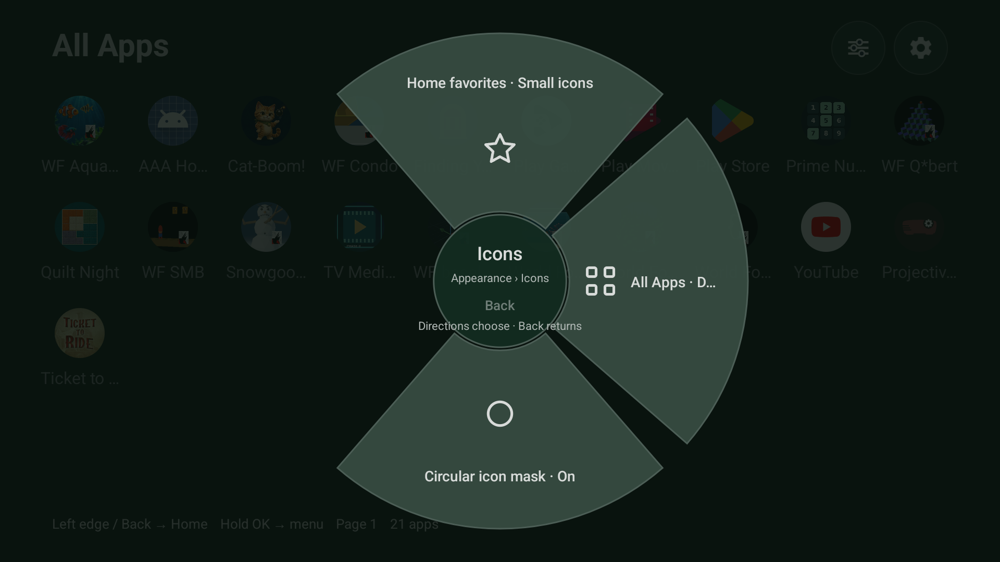

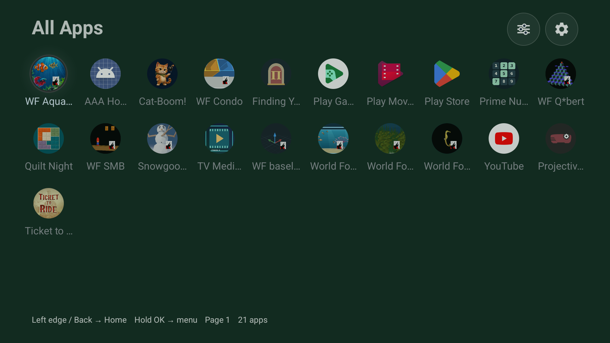

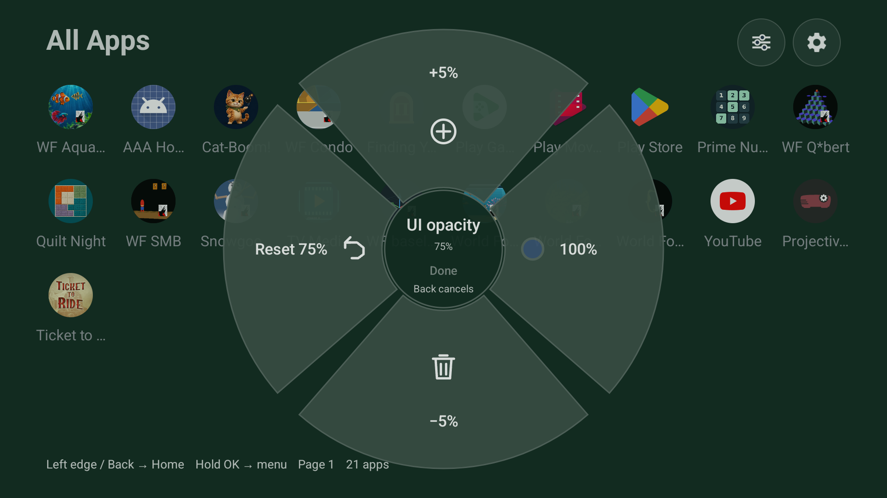

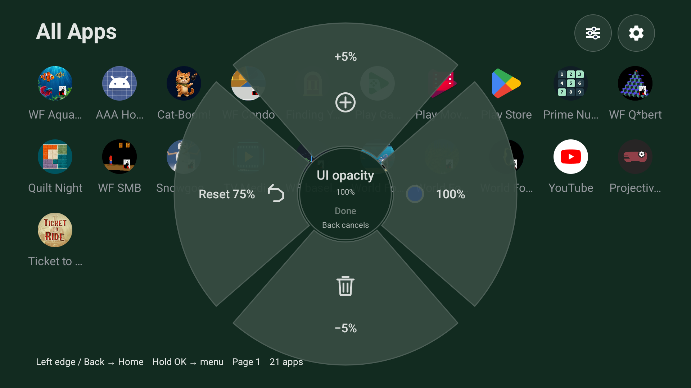

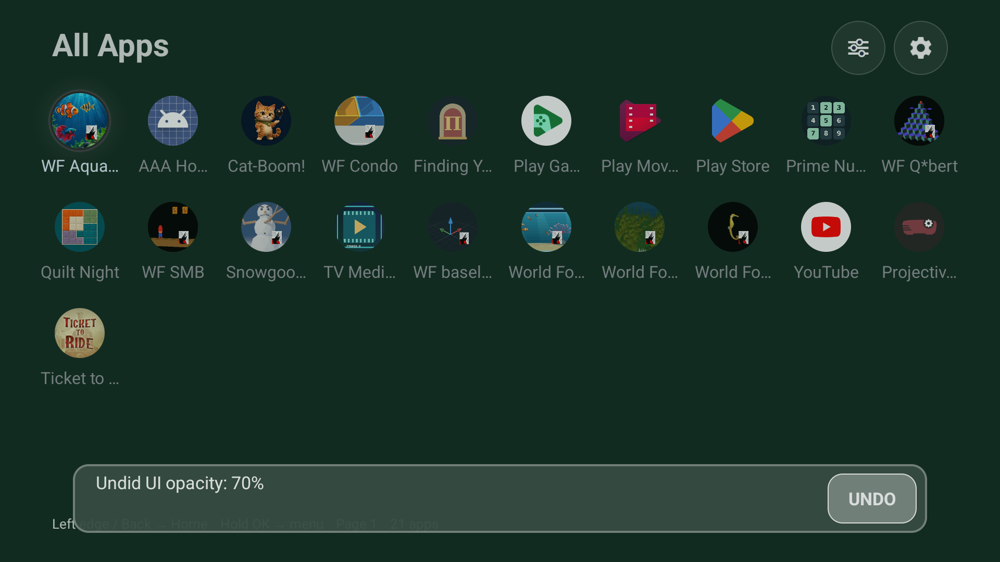

## Combined Home styles · 0.1.13

J‑b4cb7b34139c completed with ready health. The actual captures show Home using
Small icons, then Undo restoring Banners and the prior placement. Both AirBKK
widgets and all nine favorites remain. The first capture labeled “banners before”
actually shows All Apps; that label is not used as Home acceptance evidence.
The final registration was restored to `com.gathin.tvhome.MainActivity`.

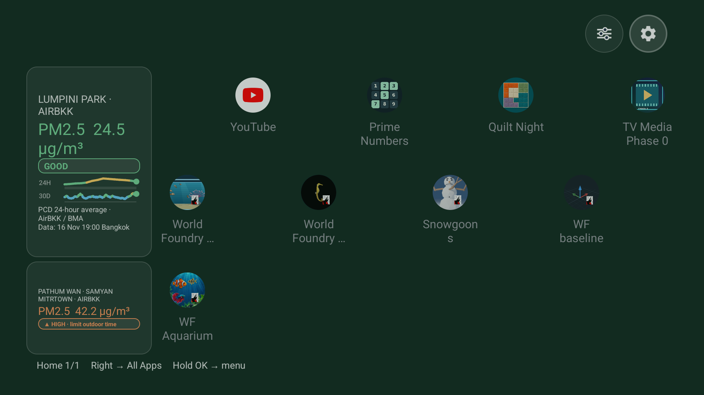

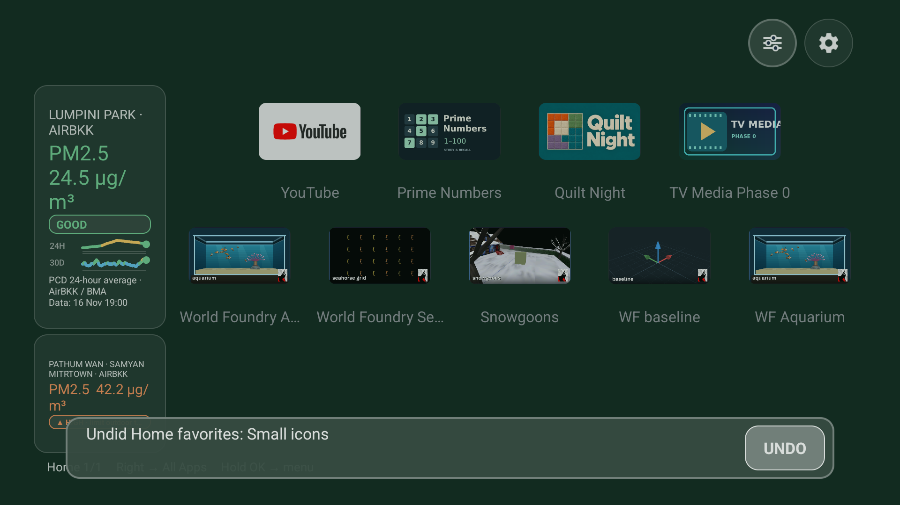

## Background-fill opacity correction · 0.1.14

Will clarified that opacity controls the colored backgrounds under UI content.
Implementation `eec2d09` removes container alpha, adds the full-screen palette
backdrop above wallpaper, and updates panel/button/badge fills without fading
labels, app artwork, readings, borders or focus. Pie fills remain 95%; their text
and icons now keep normal opacity. Existing saved percentages and preview,
Done/Back/Undo behavior are retained.

- [x] 373 JVM tests, debug lint and minified release packaging passed in the container.
- [x] J‑f61d778733eb verified installation of 0.1.14, SHA-256 `8c4c3450879dd246d6062e1dee6cbbdf2ee074f69bac2df1009aa54b09b97ad4`. Its brief launch check lost the foreground; the coordinator returned ready health.
- [x] The same frozen APK passed J‑e7f342ed6d0b, health ready. The actual Home and All Apps were each drawn at 0%, 75% and 100% over an offline image. Pixel assertions verify uncovered wallpaper, the 75% blend and complete coverage at 100%. Foreground alpha, panel alpha, focus borders, inactive focus state and unchanged saved layout also passed.
- [x] The exported assertion screenshot passed the independent OCR oracle.
- [x] Normal MainActivity catalog registration restored after the debug probe. J‑cab4995b0d08 subsequently launch-verified the identical 0.1.14 APK successfully, with ready health.

The [machine-readable record](2026-11-16-projectivy-plugin-host/deployment-0.1.14.json)
keeps the installation and first launch failure separate from the passing probe.
No data was cleared and the default Home app was unchanged. Video rendering and
media compatibility are unchanged by this correction; this probe uses a still
image to check compositing deterministically.

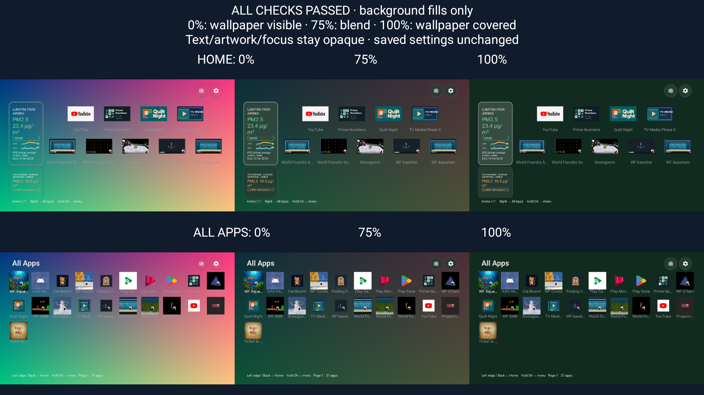

## Background actions and About links · 0.1.19

The combined source at `2215f73` includes the Background/About repairs and the
English/Thai language setting. Only the deployment version changed before the
frozen APK was built. The [machine-readable record](2026-11-16-projectivy-plugin-host/deployment-0.1.19.json)
identifies the APK hash and coordinator evidence directories.

- [x] 380 JVM tests, debug lint and the structural translation gate passed in the container. Four tests independently decode the bundled About QR images to the exact intended URLs.
- [x] J‑fa2912d4e7a1 installed 0.1.19 on Cast1, verified the frozen SHA-256 and completed with ready health.
- [x] J‑cc2c28ed312a passed all 53 assertions through the actual Activity key dispatch and native view focus. The exported report passed the independent OCR oracle.
- [x] Home and All Apps: Solid color opens the picker, palette preview persists, Back retains its parent and Undo restores the original color.
- [x] Details shows the real source, palette/hex, opacity and provider status/credits. Its color/provider buttons and Back work. Provider preview, rotation, dimming cancellation, Apply, Retry, source changes and grouped Undo passed.
- [x] Every About card opens through remote OK; all four panels display the correct full URL and QR resource, fit the TV viewport and return to About. Browser capability controls the optional TV action. About returns to the same Home settings page.
- [x] The probe uses private layout/air-quality preferences and an offline provider fixture. Real layout preferences and the app language are asserted unchanged. Normal MainActivity catalog registration was restored afterward.

Earlier 0.1.15 and 0.1.16 probe attempts failed because the harness sent a second
native action before Android laid out its newly opened panel. The actions now
wait across frames. A separate 0.1.16 cold launch lost the foreground; it is not
counted as acceptance. The successful 0.1.19 result above includes the complete
suite, rather than relying on coordinator completion alone.

The TV browser branch verifies the resolved HTTPS/BROWSABLE intent without
leaving the isolated probe. External browser rendering and full English/Thai
linguistic/device acceptance are outside this result. Existing wallpaper media
and long-run compatibility limits remain as recorded above.

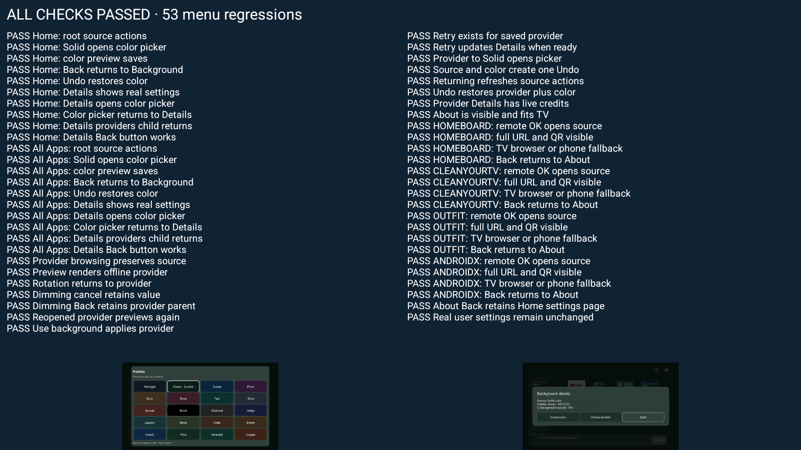
