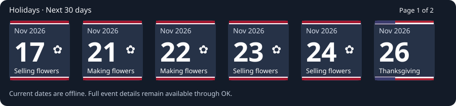
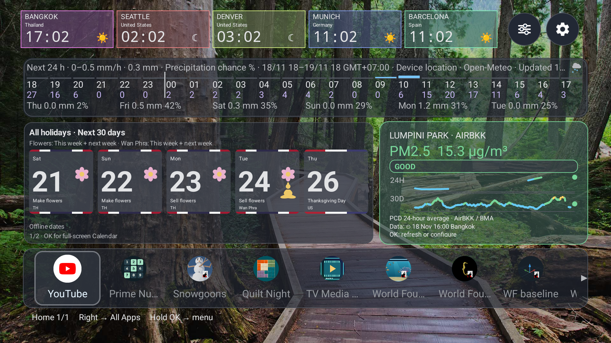
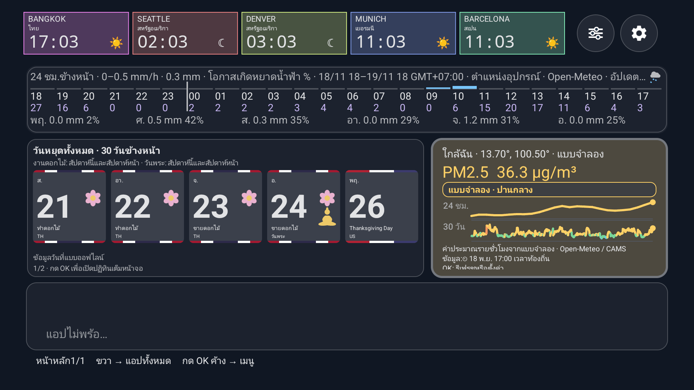
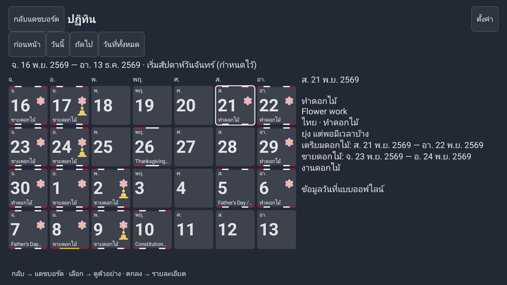

# Calendar weekday labels and card contrast

The shared date-card renderer now shows the localized abbreviated weekday above
its large day number, replacing month/year in both Home and the full-screen grid.
English and Thai use the effective app language; full dates in details retain the
shared CE/BE policy. Cards use a stronger palette-derived fill and full-contrast
labels, while retaining widget-background opacity and flag/icon treatments.

The [one-row mockup](../plans/2026-11-17-calendar-one-row.svg) and
[Calendar guide](../how-to/calendar.md) reflect the change.

## Local checks

`task check` passed after the combined weekday/contrast edits: 478 JVM tests with
zero failures or errors, Android lint, six calendar pipeline tests, two deployment
helper tests and parity of 636 English/Thai resources. No TV screenshot is implied
by those checks.

## Deployment and screenshots

New deployment target: **0.1.62**, based on `a4aa25c` plus the Calendar edits.
Both TVs receive the same frozen APK through `task deploy`, preserving app data.
Cast1 is the foreground screenshot target. Cast2 admission and installed-hash
proof are tracked separately. Verification jobs and reviewed screenshots will be
recorded below when available.

Cast1 launch/install job **J‑9f2b717c763b** succeeded and verified APK SHA-256
`9b6436400c90d028ed3c0df17f9cbb993c19a2c899a17102c747cd7855612d71`.
The [English dashboard screenshot](2026-11-18-calendar-weekdays-and-contrast/dashboard-en.png)
shows Sat/Sun/Mon/Tue/Thu above the date numbers and stronger card fills over the
user's saved wallpaper, with existing favorites and settings retained.

Thai dashboard job **J‑5c83f846feb6** succeeded with a native pass report for
0.1.62, an effective Thai locale, 65% isolated fresh defaults, BE date formatting,
localized durations and unchanged household preferences/saved language.
[Thai dashboard screenshot](2026-11-18-calendar-weekdays-and-contrast/dashboard-th.png).

Thai expanded Calendar job **J‑61fd9b4b3b83** also succeeded with the version-matched
native pass report. The [full-screen screenshot](2026-11-18-calendar-weekdays-and-contrast/calendar-th.png)
shows Thai weekday abbreviations, stronger card fills, visible date selection and
BE year **2569** in the range and selected-day details. Both Thai probes used
isolated preferences; the native reports confirm the saved household preferences
and language were unchanged. The normal MainActivity catalog registration was
restored after these checks.

The initial background attempts were declined: Cast1 **J‑55051730838d** with
`install-over-foreground`, Cast2 **J‑45aaa3f9baa5** with `personal-install-in-use`.
Cast1 subsequently installed through the successful foreground job above. Cast2
is reachable again, but installation is not confirmed; a matching foreground
check is deferred during personal use.

Cast2 replacement check **J‑f092d5411da9** is accepted and held by personal use;
this queue entry is not installation proof. Temporary deferred job **J‑dd3f5bc6c5d2**
was cancelled while the catalog was pinned to Cast1 probes, then replaced after
MainActivity registration was restored.

## Operation-policy correction · 18 November 2026

Installation remains independent of foreground verification. Cast2 install-only
retry **J‑564b0cee277f** was accepted and granted during personal use, then failed
execution with `personal-install-in-use`; its installation record is `unverified`.
This is not a reservation/admission denial and does not make ending personal use
an installation prerequisite. Private evidence is retained under
`artifacts/deployments/0.1.62/cast2-install-retry/`. Foreground check
**J‑f092d5411da9** is a separate held job, not a pending independent installation.
The earlier conversational description that implied otherwise is superseded by
the [operation-specific policy](../how-to/chromecast.md#personal-use-and-reservations-operation-specific-policy).
