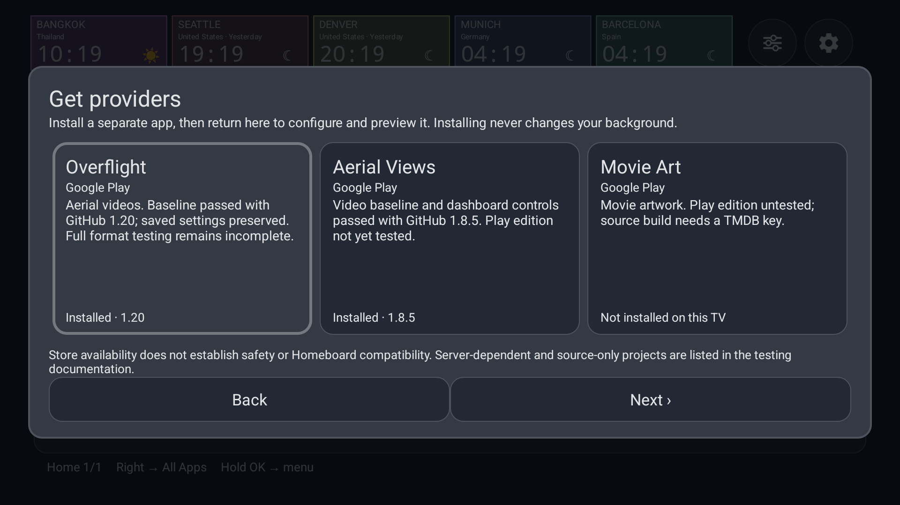

# Provider directory implementation and screenshot proof

Implementation build **0.1.59**, APK SHA-256
`0e4fcdf2faecd0056a4ae755da2d9d7690200e5c0d64d576eb83e67e4a2dc431`.
All frozen launcher source hashes match the working files used for verification.
Cast1 installation and launch verification: `J‑70a593f6f0c4`, succeeded.
Cast2: identical APK submitted as `J‑39c23fd4710c`, waiting for coordinator
connectivity. It is not claimed installed or visually verified there.

The [plan](../plans/2026-11-18-provider-testing-spike-and-installation.md)
requires screenshots as proof. The [mockup](../plans/2026-11-18-provider-installation-mockup.svg)
is an expected design, not evidence of implementation.

Container validation passed: **472 JVM tests**, zero failures/errors, Android lint
with zero errors, debug assembly, and parity for **632 English/Thai resources**.
`task phone:check` passed Chromium and WebKit UI/model checks plus the existing
world-clock regressions. APKs and provider installation are coordinator-owned;
no host Gradle, raw device control, installer bypass or third-party APK bundling.

## Phone screenshots

These are real browser renders of the shipped phone assets using a controlled
JSON API fixture, not a live paired TV or Google Play account. The fixture covers
an absent Play provider, an installed community provider and excluded Weather.
Thai captures use the production Thai resource descriptions. They verify layout,
selected TV name, link destination/target/rel, no Weather link, no redundant install
link for installed providers, no Apply footer, and unchanged dashboard draft/revision.
They do not prove remote Play installation or TV-side detection after an actual install.

| Browser | English | Thai |
|---|---|---|
| Chromium / Pixel 7 profile | [Screenshot](2026-11-18-provider-directory/phone-chromium-en.png) | [Screenshot](2026-11-18-provider-directory/phone-chromium-th.png) |
| WebKit / iPhone 13 profile | [Screenshot](2026-11-18-provider-directory/phone-webkit-en.png) | [Screenshot](2026-11-18-provider-directory/phone-webkit-th.png) |

Phone renders were inspected for readable cards, clear routes, unclipped text and
absence of the empty fixed footer. The directory uses normal phone page scrolling;
the TV uses page wedges and no scrollbar.

## Cast1 screenshot proof

`dev/provider-directory-proof.py --version 0.1.59` submits complete coordinator
jobs for the production native views. Each runs the same directory assertions
with isolated Homeboard preferences, then leaves a specified real screen visible
for the coordinator's final capture. No external store is launched by the probe.
The unavailable-store check deliberately throws ActivityNotFoundException; it is
failure-path evidence, not an actual Google Play round trip.

Each native report requires paging to the next card set, remote focus, Weather
without a store action, missing-provider phone fallback after a rejected store
launch, no wallpaper activation, and unchanged household preferences. The screenshot
itself is reviewed separately; a coordinator success alone is insufficient.

All seven Cast1 jobs completed with native assertions passed; every capture was
visually reviewed. Results and hashes are recorded below. Isolated default
Home screenshots prove dashboard restoration in the probe, not the household's
saved dashboard. The coordinator receipt independently records foreground cleanup.

## Visual acceptance

All three native pages were visually reviewed: readable text, a clear focused card,
correct installed/missing labels, and page wedges with no scrollbar. The Weather
detail capture shows only refresh and Back, with its exclusion explanation; no
install, publisher or QR action is present. The Movie Art capture has readable store/phone actions and its actual QR decodes
to the exact verified Play URL ([QR result](2026-11-18-provider-directory/qr-check.json)).
Daily Photos shows installed version 1.10, Configure and Preview, without a redundant
install action. The final capture restores the fresh default dashboard with all
four widgets, fixed clock and Rain focus. All four browser images fit their phone
widths and show the selected TV, route/status separation and no empty fixed footer.

## Core Motion baseline screenshot

The final retry `J‑eaf00a2dbd46` on **0.1.59** passed: five renders, two timer
deliveries, initial/resume/refresh success, hidden motion resources released and
pixel differences between animation samples. Household preferences were unchanged.
The [actual capture](2026-11-18-provider-directory/baseline-core-motion.png) shows
the returned animated loop and native result. This was visually reviewed; it does
not prove every feed/format, cache expiry, faults, settings or extended playback.
The prior foreground failure remains in the compatibility record.

## Remaining checks

Actual Google Play launch/install/cancel/return and restricted-account/region
behavior remain unverified: the available `check` supervisor requires the target
package in foreground; no store-round-trip workflow is advertised. Phone fixture
links and injected intent failure do not substitute for that evidence.
Package state refresh on return and package broadcasts is implemented, but an
actual store-driven install round trip still needs supported device verification.
Cast2 captures remain deferred while unavailable/in personal use. Provider-wide
cache expiry, network faults, external actions, full format matrices and extended
soaks remain listed in the [dispositions](2026-11-18-provider-dispositions.json).

The first attempt on 0.1.58, `J‑061f412abf5e`, exited before capture and has no
screenshot/native report. Coordinator diagnostics `J‑5a2dace2bc7d` identified
`Widget identity unreadable` during the first dashboard save. The missing saved
layout is now treated as an empty prior dashboard; malformed saved layouts still
report errors. A dedicated JVM regression and newly numbered deployment cover the
fix. This failure is retained, rather than replaced by a mockup.

<!-- TV-SCREENSHOTS -->

| Screen | Cast1 job | Actual capture | Result |
|---|---|---|---|
| Page0 | `J‑1af746d716eb` | [Screenshot](2026-11-18-provider-directory/tv-page0.png) | Native assertions passed; visual review passed |
| Page1 | `J‑f827d1b82482` | [Screenshot](2026-11-18-provider-directory/tv-page1.png) | Native assertions passed; visual review passed |
| Page2 | `J‑0f14425fac00` | [Screenshot](2026-11-18-provider-directory/tv-page2.png) | Native assertions passed; visual review passed |
| Weather | `J‑24b965103275` | [Screenshot](2026-11-18-provider-directory/tv-weather.png) | Native assertions passed; visual review passed |
| Movie | `J‑f17871f803c2` | [Screenshot](2026-11-18-provider-directory/tv-movie.png) | Native assertions passed; visual review passed |
| Daily | `J‑4d2deef3cfdb` | [Screenshot](2026-11-18-provider-directory/tv-daily.png) | Native assertions passed; visual review passed |
| Dashboard | `J‑c669be87900c` | [Screenshot](2026-11-18-provider-directory/tv-dashboard.png) | Native assertions passed; visual review passed |

[Capture metadata and hashes](2026-11-18-provider-directory/manifest.json).
