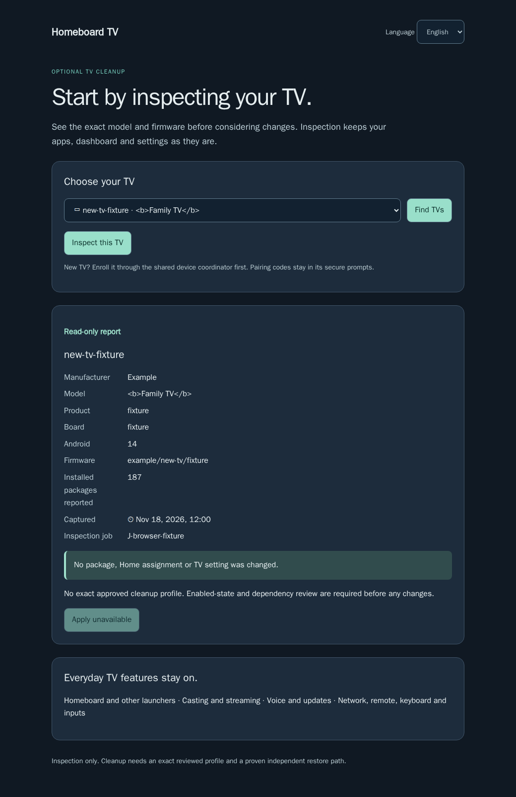
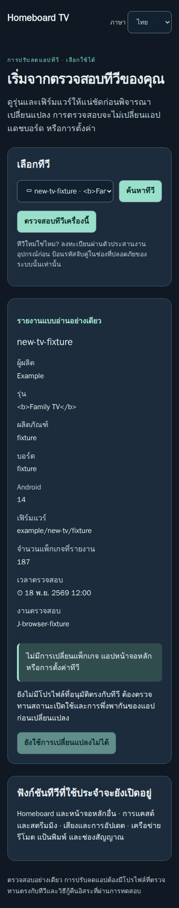
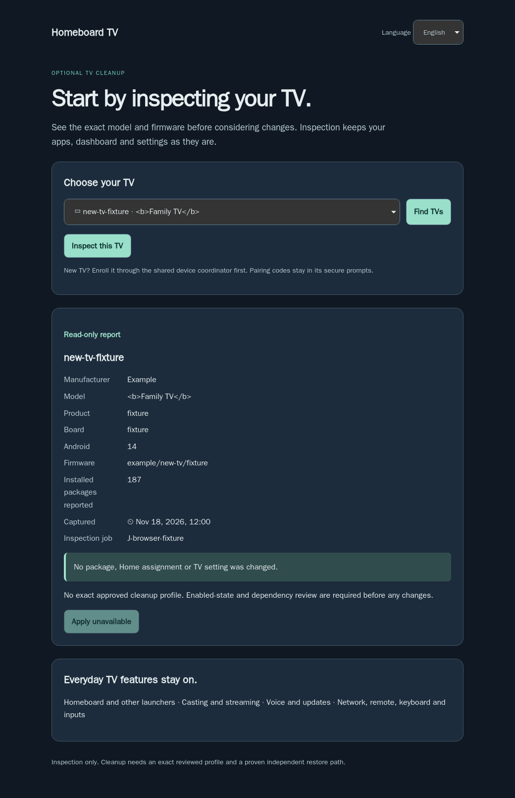
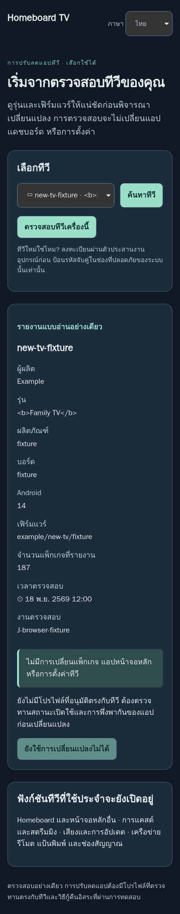
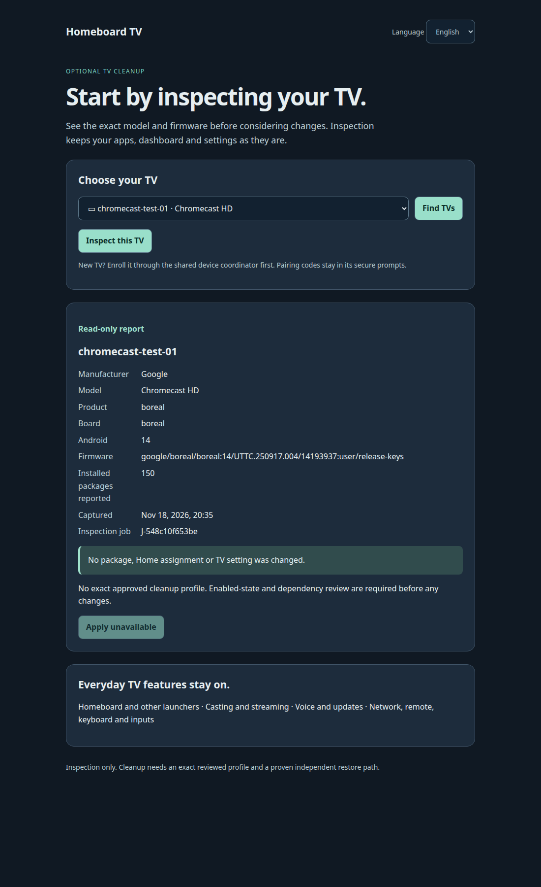
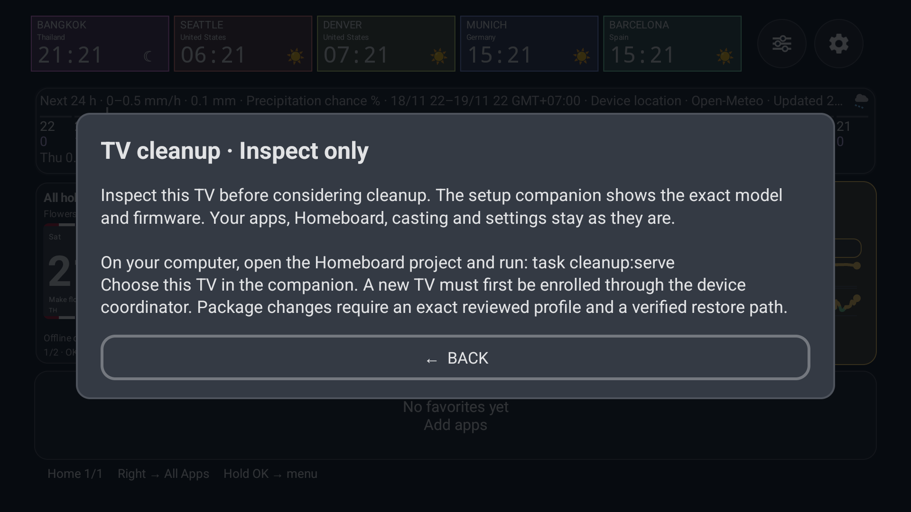
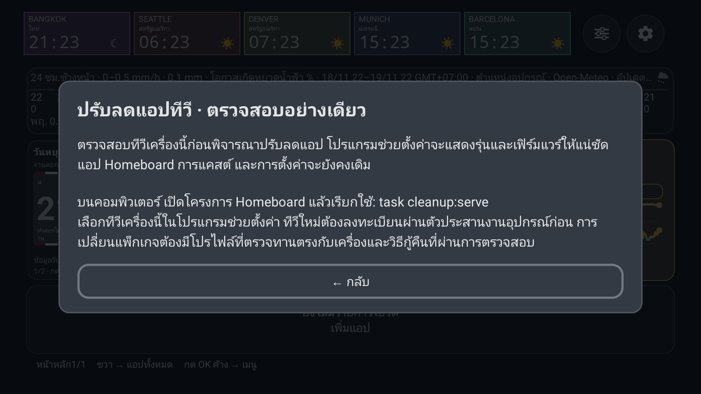

# TV cleanup inspection and recovery foundation

Verified APK: **0.1.64**. Build 0.1.63 was the initial installed candidate; the
native test harness was corrected before the follow-up build. This is the inspection milestone of the
[cleanup plan](../plans/2026-11-18-tv-cleanup-and-restore.md), not completion of the
real-device cleanup/restore workflow.

## Reuse and behavior

CleanYourTV source is pinned to `3ece7766ad5d6af79a2c4dd73e77b4b9623dfeca`, with
unchanged copied files, license and per-file hashes in
`vendor/cleanyourtv-cleanup/provenance.json`. Original fake-TV recovery tests run
alongside new tests. Homeboard adds a stricter policy/journal adapter around
selected upstream primitives; it has not imported an entire cleanup application.
The upstream blanket-enable fallback and direct transport are not exposed.

The shipped TV entry and companion only inspect. No real execution profile is
approved, no mutation HTTP endpoint exists, and the existing hardware inspector
is not described as a complete enabled-state/dependency snapshot. The strict
policy/session code is exercised only through injected fake-TV executors. Real
coordinator apply/restore integration, fixture rehearsal, package-list approval
and physical cleanup/restoration are still open.

## Container and browser checks

52 tests passed: 34 original upstream recovery tests, plus 18 Homeboard policy,
journal/fault and HTTP security cases. The suite verifies file hashes, unknown or
ambiguous profiles, unselected defaults, protected/shared-UID packages, failed
recovery storage, exact default/enabled restoration, interrupted acknowledgements,
restart, cancellation, changed firmware/package/Home state, missing/corrupt records,
CSRF, rebinding and the absence of mutation endpoints.

The same deployment passed 478 JVM tests, Android lint and parity checks for
639 English/Thai Homeboard resources. All tests/builds ran in containers.

Actual HTTP companion checks passed in Chromium and WebKit, including English,
Thai BE timestamps, HTML escaping, disabled Apply and mobile layout without
horizontal overflow. Browser fixture captures below are not physical-device proof.

| Browser | English fixture | Thai fixture |
|---|---|---|
| Chromium |  |  |
| WebKit |  |  |

The `<b>Family TV</b>` label is intentional escaping input and must render as text.

## Real-device acceptance

The real companion's Cast1 inspection, APK installation and native Settings-action/
Back captures are recorded separately below. A queued job is not an install or
screenshot pass. No real package was selected or disabled for this milestone.

### Live Cast1 companion inspection

The real companion submitted and completed **J‑548c10f653be** through its HTTP
API. The matching successful receipt and hardware report identify Cast1 as
Chromecast HD, Android 14, boreal, with 150 reported packages. The native report
states the foreground was unchanged.
[Actual companion result](2026-11-18-tv-cleanup/companion-cast1-live.png).
The live result remained scan-only with zero candidates and Apply unavailable.

The host-browser render used the actual completed companion state. The first
container live-browser attempt could not reach host loopback under rootless
Docker, so it is not counted as a pass. Controlled full browser-interaction tests
ran with the HTTP server inside the browser container; the live host API and host
Chrome result were verified separately.

### Initial deployment and harness correction

0.1.63 installed and launch-verified on Cast1 in **J‑9d2e35f2f828**. Its independent
Cast2 install **J‑170dd7df8f1d** was admitted but failed `personal-install-in-use`;
no Cast2 installation is claimed. The initial native probe **J‑3cbdf1b84845** left
foreground before producing proof. Retry **J‑527c412a94f1** completed but its native
report failed; Thai **J‑962226e3b49d** reported the same failure.

The probe invoked a menu callback directly, bypassing `selectMenuChoice` and its
menu-stack bookkeeping. Its synthetic Back test therefore had no parent menu.
The corrected probe uses the production selection handler and dispatches a short
Back key. This is a test-harness correction, not proof of a production Back bug.
A fresh APK/version is used for the corrected probe; failed captures are not passes.

### Verified 0.1.64 deployment and native screenshots

The frozen APK SHA-256 is
`6f1174cf94649bc585036ff62d38df5a11a083a1f9eaf844c250ffc3aa5edfe0`.
It contains the cleanup changes on top of base commit `127fdfe`, with the local
source manifest retained privately alongside the APK.

| Target/stage | Completed result |
|---|---|
| Cast1 install/launch | **J‑d3dea4df4c0d**, succeeded; matching frozen APK installed and launcher verified. |
| Cast2 independent install | **J‑d6f5259332fa**, admitted/granted, then failed `personal-install-in-use`. Installation remains unconfirmed; no foreground acceptance claimed. |
| Cast1 English instructions | **J‑5520e2fe4010**, coordinator succeeded and native assertions passed on 0.1.64. . |
| Cast1 Thai instructions | **J‑f900a455e565**, coordinator succeeded and native assertions passed on 0.1.64. . |

The probes select the actual Settings action through the normal menu handler,
verify both instruction paragraphs, dispatch short Back and assert a return to
Settings. They compare household preferences and saved language before/after.
Both screenshots were visually reviewed: title, full instructions and focused
Back button fit without clipping. The probes use isolated dashboard fixtures;
their dashboard backgrounds are not evidence of the household's saved layout.
The app catalog was restored to MainActivity after each completed session.

[Machine-readable verification and screenshot hashes](2026-11-18-tv-cleanup/verification.json).

### Remaining gates

No real package has been disabled or restored. The inspected hardware report
does not prove dependency isolation or exact enabled settings. A separately
reviewed coordinator apply/restore workflow, disposable-package rehearsal,
concrete device-specific package review and independent recovery acceptance are
required before enabling cleanup. Public companion packaging and retained-function
checks remain open. The prospective new TV must be enrolled and inspected first;
neither Chromecast's results imply support for it.
