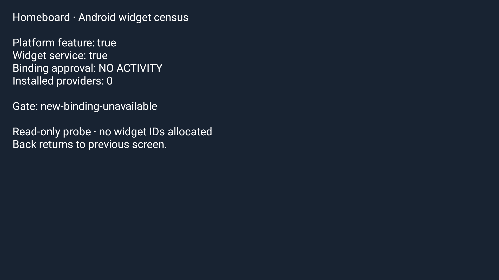
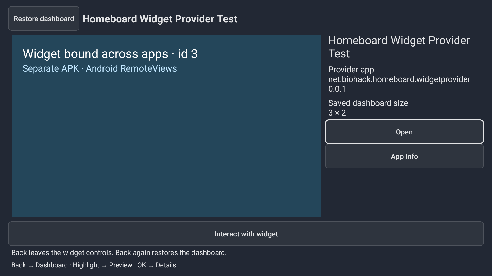
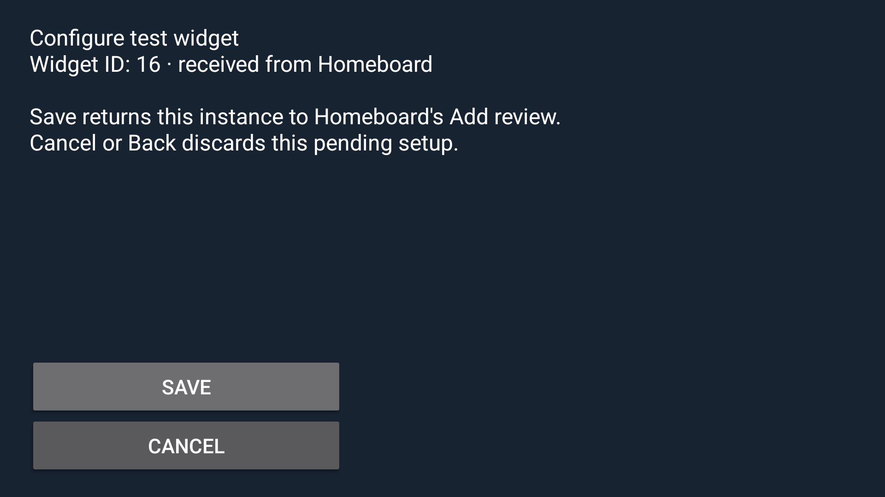
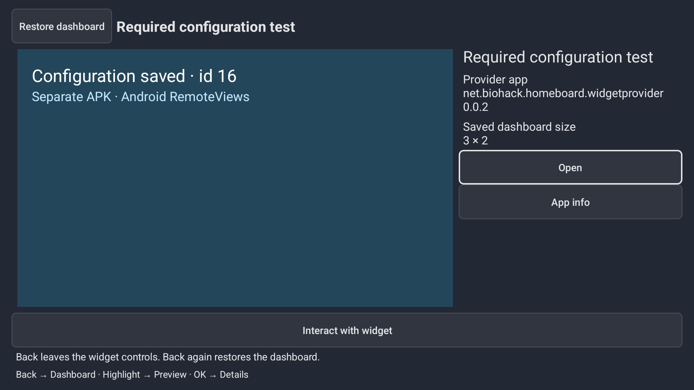
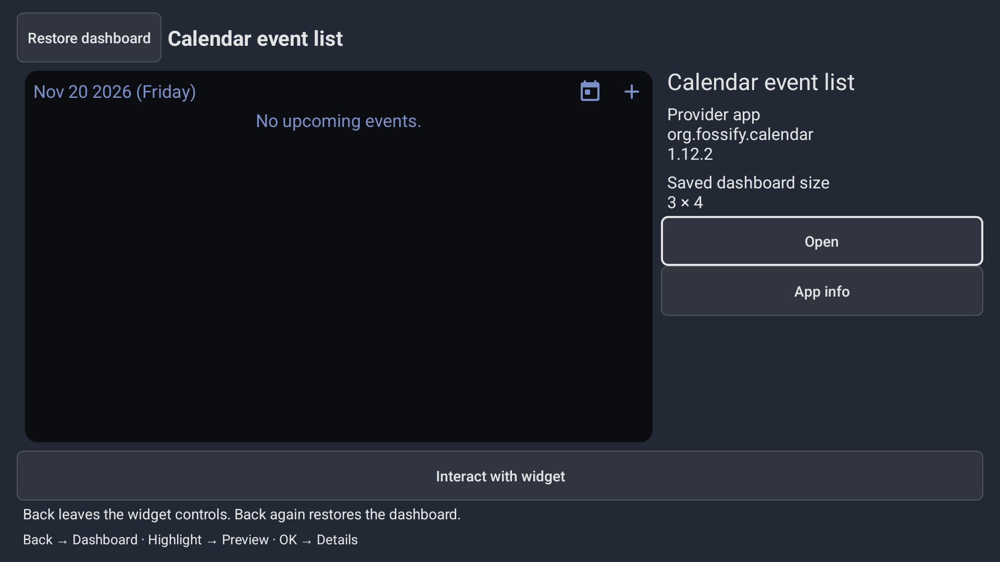
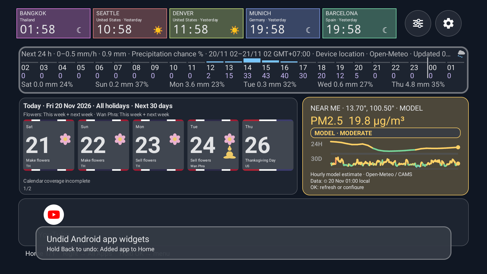
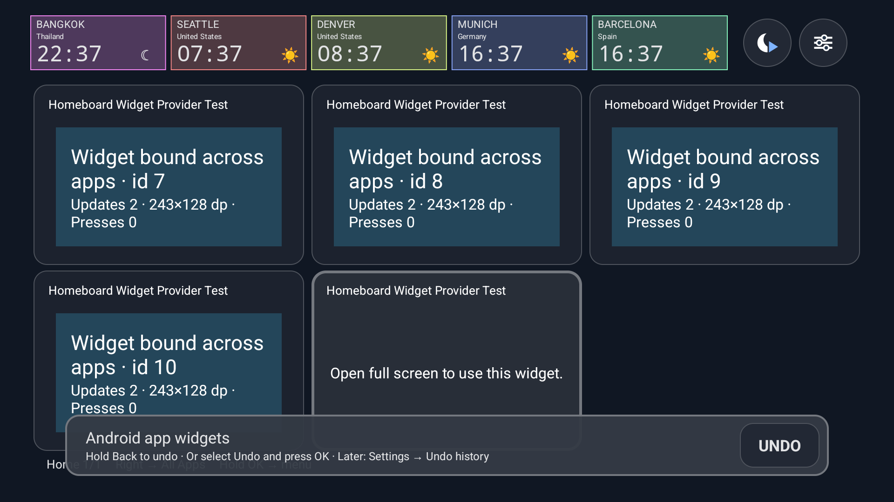
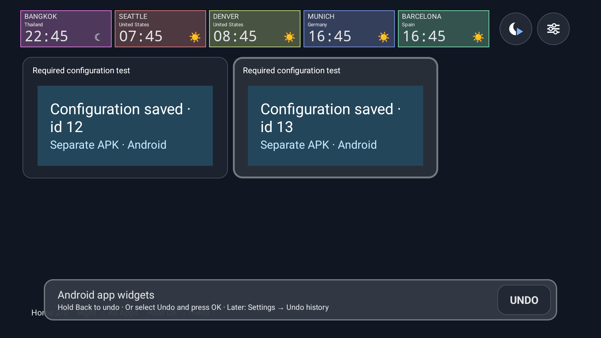
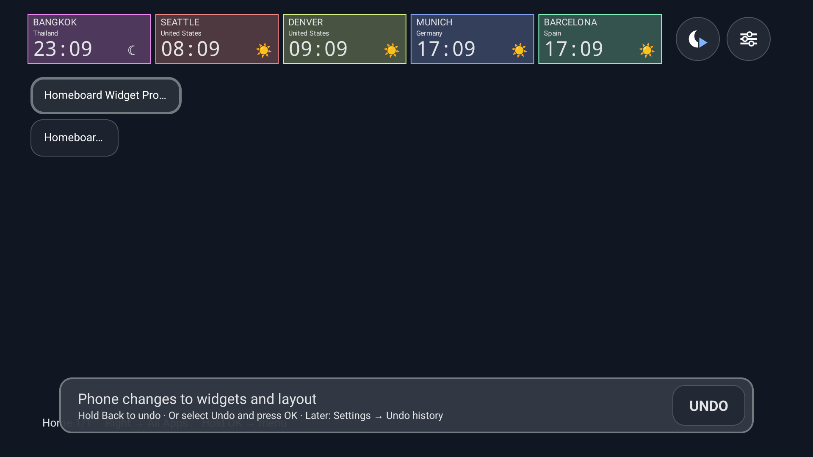

# Android app widgets: implementation and testing

**Current (27 November):** both TVs run **0.1.181** with fixture provider **0.0.4**. The host passes the full lifecycle probe on Cast1 and on Cast2's native 4K renderer after two sizing fixes ([below](#cast2-sizing-defects-fixed--01181--27-november)); Cast1 also passes the survivor, provider update, two configured instances, app return and resource checks, and the resource budgets pass on both TVs. Still open: Fossify Calendar with a real event, 24-hour exposure, and Pixel and tablet hosting. See the [verification record](#verification-record--27-november). Everything above the close-out is historical.


November 19, 2026. **The developer-grant route successfully bound and rendered a separate app’s Android widget on both Cast1 and Cast2.** Both TVs still lack the ordinary binding-consent screen. At that experiment stage, product integration was still pending; those results came from the disposable host/provider. The current implementation and acceptance results follow below.

The separate `net.biohack.homeboard.widgetfixture` version 1 (`0.0.1-census`)
APK uses public Android APIs to enumerate providers and resolve normal binding
consent. It does not allocate widget IDs, bind widgets, start provider setup,
grant permissions, read calendar/weather data or change the default Home app.

## Developer-grant experiment: passed on both Chromecasts

Will authorized this experiment with "let's find out" after the normal-consent
census. The test granted only `net.biohack.homeboard.widgetfixture` for Android
user 0, inside complete coordinator-owned jobs. No Android root, raw ADB session, Home
change or Homeboard permission grant was used.

| Stage | Cast1 | Cast2 |
|---|---|---|
| Separate provider activated | `J‑10b23c7ccca6` | `J‑cb8717f71314` |
| Ungranted baseline | `J‑8030cae41e80`: binding denied, IDs released | `J‑10a0457a8efe`: binding denied, IDs released |
| Temporary grant and rendering | `J‑b7fb38f04ca7`: passed | `J‑d32f5b8c5810`: passed |
| Grant restoration and ID release | Verified: original grant false → during true → restored false; zero owned IDs | Same verified result |
| Follow-up without grant | `J‑52c324d32c1e`: binding denied again, IDs released | `J‑5a655d7d8350`: binding denied again, IDs released |

The host received a real `RemoteViews` update from the separate provider package
`net.biohack.homeboard.widgetprovider/.ProbeProvider`, checked its known text in a
laid-out host view, drew that actual view to the displayed proof image and released
the test widget. Initial placeholder text cannot pass. The screen image remains
as proof after release; it is labeled **test widget released**, not presented as a
still-live widget. Coordinator cleanup independently invokes the fixed fixture
cleanup receiver and verifies both zero IDs and the original permission state.

[Cast1 structured proof](2026-11-19-android-app-widgets/cast1-bind-proof.json) ·
[Cast2 structured proof](2026-11-19-android-app-widgets/cast2-bind-proof.json).


These deterministic screens have identical image hashes: both devices happened
to allocate ID 3, share the same logical screenshot size and render identical
fixture content. Each has its own independent coordinator receipt, log and grant
restoration observation. The captures were visually reviewed (and their image
bytes compared), rather than treating job completion alone as visual acceptance.

**Practical conclusion:** a one-time developer grant is a viable setup route for
Android widget hosting on these Chromecasts. It is not plug-and-play consent on
TV. Normal host integration, persistent widgets, provider configuration, remote
navigation, resize/Undo and real Fossify/Breezy compatibility still need product
implementation and acceptance. No public feature claim was added.

### Experiment builds and coordinator support

- Host v2 (`0.0.2-bind-test`) SHA-256:
  `7c36695f8b7cdbdb0ad4de01feee0cc2e7540ed5bb2aab69c0982174237f593c`.
- Separate provider v1 (`0.0.1`) SHA-256:
  `301927c3dad8c5bb252ef92cdac070c2fb3b1fcfc753675b9b9f220244eeb5eb`.
- Both modules assembled and passed Android lint in `task widget-fixture`.
  Source hashes/frozen bytes: `artifacts/android-widgets/bind-v2/build.json`.
- The fixture registration was explicitly replaced to point to `.BindActivity`;
  `.CensusActivity` remains available in the v2 APK.
- Coordinator **0.1.183**, revision
  `200fd41930b27f7bf18d28c45dce4dbbb44efcc9`, adds fixture-only
  `widget_bind_test: true` on short frozen `check` jobs. It journals before grant,
  verifies rendering, restores permission and IDs through durable cleanup, and
  keeps Personal use admission unchanged. Arbitrary packages/users are refused.
- **123 targeted coordinator tests passed** on the final merged source. Failure
  coverage includes unreadable original state, interrupted grant response,
  changed APK, failed ID cleanup and acknowledgement only after restoration.
- Reviewed administrator deployment completed; queue/reservations/device identity
  and existing recovery were preserved. Concurrent coordinator updates were kept;
  rejected stale/omitting candidates were not deployed. Source changes were
  merged into the coordinator checkout for future upgrades.
- Upgrade log:
  `.worktrees/coordinator-widget-bind/docs/diagnostics/upgrade-20261119-214604-1795099564382360178.log`.
  Grant-job evidence includes `widget-grant.json`, `widget-bind-result.json`, raw
  before/during/restored dumps and the cleanup receipt in each device directory.

The frozen APKs are identical across devices. Dedicated test apps remain installed
for follow-up provider tests; their test widget IDs and temporary grants were
removed. The Homeboard application/settings and public download were untouched.

## Build and evidence

- [x] Container `:widget-fixture:assembleDebug :widget-fixture:lintDebug` passed.
  Initial lint found a missing TV banner and an unnecessary protected permission;
  both were corrected. Final lint has no errors, one backup-policy warning.
- [x] Four evidence-parser tests passed in the build container: missing,
  incomplete and unrelated results are rejected; the last completed observation
  is used. Run `dev/container.sh run python3 /workspace/dev/test_widget_census.py`.
- [x] Frozen APK SHA-256:
  `134173a8cf18d7602ab3faef1096d5632319293a085495ce06d8def2ca13235b`.
  Artifact and source hashes: `artifacts/android-widgets/census-v1/build.json`.
- [x] Both TVs' installation receipts verify that exact hash. Cast1 install
  `J‑77b15ade62d0`; Cast2 install `J‑aad7fefc3027`.
- [x] Cast1 census check `J‑d340231fd4cd` completed, device healthy, previous
  Google TV foreground restored by the coordinator. Installation was reused.
- [x] Cast2 census `J‑32c145dfb2c6` completed after Personal use ended and
  coordinator recovery `J‑fc6bc499a3a4` succeeded. Device healthy, prior foreground restored.
- [x] Pixel: reconnection `J‑0658e5713f48` and census `J‑34b17ced2024` completed. The same frozen APK was installed and the device returned healthy.
- [ ] Tablet: coordinator control unavailable; no installation or census.

Cast1's install continuation encountered a coordinator plugin error at
`plugins/android/launcher.py:143:apk_references`; this did not invalidate the
successful installation receipt. Automatic recovery ran, and the separately
submitted census check subsequently succeeded. Cast2's redundant verify-launch
continuation was cancelled after its verified installation; its explicit census
job has now completed. No hold was cleared or direct-device fallback used.

## Cast1 result

Extracted from coordinator-exported `logcat.txt`, with matching screen evidence:

```json
{
  "feature": true,
  "service": true,
  "sdk": 34,
  "bindResolver": "",
  "bindActivities": [],
  "providerCount": 0,
  "outcome": "new-binding-unavailable",
  "providers": []
}
```

[Full structured observation](2026-11-19-android-app-widgets/cast1-census.json).



**Interpretation:** declaring Android widget support does not establish a usable
ordinary-user consent path. For this fresh probe on Cast1, no binding-consent
activity resolves. Under the agreed plan this stops new host binding on Cast1.
It does not establish that widgets cannot work with a privileged or previously
granted host. Cast2 was subsequently checked separately below. No permission workaround was
attempted. Fossify Calendar and Breezy Weather have not been installed: the
consent gate failed before provider compatibility testing.

## Cast2 result

Coordinator check `J‑32c145dfb2c6` completed on November 19 after the device's
Personal use ended, successful coordinator recovery, and the earlier launcher
checks finished. It reused the identical frozen diagnostic APK. Cleanup reports
`restored`, and the device is healthy.

Cast2 reports Android SDK 34, widget feature/service available, **no binding-consent
resolver**, no binding activities and **zero installed provider components**.
Outcome: `new-binding-unavailable`, matching Cast1. This is a failed normal-consent
feasibility gate, not an app crash. No widget was bound or provider installed.

[Structured observation](2026-11-19-android-app-widgets/cast2-census.json).


## Pixel result after reconnection

Pixel became reachable on November 19 after the earlier connection failure.
Coordinator census `J‑34b17ced2024` completed successfully on Android 17 (SDK 37).
It reported the widget feature/service, **172 installed provider components**, and
`com.android.settings/com.android.settings.AllowBindAppWidgetActivity` as the
normal binding-consent resolver. This passes the resolver/provider census gate;
actual binding approval, rendering and Homeboard hosting remain untested.

[Structured summary](2026-11-19-android-app-widgets/pixel-summary.json).
Full provider inventory, screenshot, logs and cleanup receipt remain in local
`artifacts/android-widgets/census-v1/pixel-check/`; the parser output is
`pixel-report.json`. The dedicated probe remains installed for follow-up work.

## Reproduce and remaining work

Build/lint with `task widget-fixture`. Register its frozen APK as
`homeboard-widget-fixture`, activity
`net.biohack.homeboard.widgetfixture.CensusActivity`. After devices/queue checks,
submit `dev/device/android-widgets-census.json` through the coordinator, watch the
job and export evidence. Extract the report in the build container:

```sh
dev/container.sh run python3 /workspace/dev/read-widget-census.py /workspace/artifacts/android-widgets/census-v1/cast1-check/logcat.txt --output /workspace/artifacts/android-widgets/census-v1/cast1-report.json
```

Both TVs retain the dedicated census app for the outstanding compatibility work.
Remove it only through a supported coordinator-owned uninstall operation after
acceptance. That statement applied to the census/temporary-grant experiment. The later product implementation is recorded below; the current root also includes the committed timer publication fixes.

Next evidence needed is a reachable tablet census, normal consent/configuration/rendering on Pixel, and the Homeboard integration/real-provider checks above. Both TVs lack the ordinary consent route, while the later authorized developer-grant experiment has now proved cross-app binding and rendering. The following product acceptance supersedes the earlier host/guide status. Real-provider/mobile configuration, resource and 24-hour checks remain explicit follow-up gates.


## Homeboard host implementation · 0.1.94

The product host is implemented in Java with the platform AppWidgetHost APIs.
The same debug APK, SHA-256
`5c3c97d71523c266c395351e22258645cd304b0adf8dfeb0297ef113d5be0a06`,
was frozen by `task deploy` and installed on Cast1 and Cast2. It includes the
committed timer publication fixes through `3f4feef`. The initial 0.1.93 build
was also exercised on Cast2; 94 fixes stale activity-result handling and failed
pending-save recovery, preserves size during Setup again, and releases the
isolated test host's IDs. All current launcher source hashes match the 94 freeze.
The dedicated probe uses separate preferences and host ID 8724; product ID is
8723. It checks household preferences stayed byte-for-byte equivalent.

The coordinator's typed persistent `widget-binding` workflow is deployed as
0.1.186, revision `97362d55ba2dd5e03819dd61e909ea254915f777`. Its 131 targeted
container tests passed, covering grant/revoke, frozen installed identity,
failed readback, recovery settlement, personal-use admission and CLI/MCP schema
parity. The reviewed administrator upgrade preserved recovery and resumed the
queue. Homeboard debug binding was deliberately enabled on both TVs; originals
and inverse recipes are recorded. This is distinct from the earlier temporary
fixture grant, which was restored on each TV.

| Check | Result / evidence |
|---|---|
| Cast2 install | J‑4b66dfb60935 completed; installed hash and launcher verification match 94. |
| Cast1 install | J‑3750fd7f77bb verified the installed hash, then reported plugin-error after installation. Later widget setup J‑1c5d83da0a9c independently verified the installed hash before changing anything. Foreground acceptance follows separately. |
| Cast2 widget setup | J‑68ca6f1b6d0d: original false → enabled true, readback verified; [permission record](2026-11-19-android-app-widgets/cast2-homeboard-permission.json). |
| Cast1 widget setup | J‑1c5d83da0a9c: successful frozen-APK check and permission readback. |
| Cast2 integrated host | J‑9dddb9fe987e completed; [native assertions](2026-11-19-android-app-widgets/cast2-homeboard-proof.json) report pass, including disposable-ID release. Earlier 93 job J‑b03b768ffda4 also passed. |
| Pixel install/ordinary entry | Same 94 hash installed by J‑1fc1d5e6c7d3; its launcher continuation left the foreground. Separate ordinary-entry check J‑b11d3e9253a0 completed and its capture shows Homeboard in landscape. This does not prove local widget binding/touch/configuration. |
| Tablet | Still unreachable; local app entry and widget checks pending. |


Native assertions cover actual compact and expanded RemoteViews, richer provider
and saved-size details, short OK, visible Restore and Back, original page/focus/
size restoration, phone move/remove/Undo with the same Android ID, and unchanged
household preferences. The final 94 probe explicitly releases all its disposable
IDs. This is a short deterministic test, not long-running or real-account evidence.

### Container, browser and documentation checks

- [x] `task check`: calendar 7, cleanup 71, deployment 4 and **525 JVM tests**
  passed; Android lint completed with no errors. The 7 new widget tests cover
  serialization/bounds, Undo references and eviction, malformed retained state,
  unknown schema/tiles, browser identity injection, stale results and failed
  pending-write rollback.
- [x] `task build` via `task deploy`; identical frozen 94 bytes submitted to both TVs.
- [x] `task bundle`: unsigned release App Bundle packaging passed.
- [x] `task phone:check`: existing Chromium/WebKit and world-clock regressions passed.
- [x] `task android-widgets:phone-check`: model constraints, grid placeholder,
  draft rebase/removal, actual provider label, host-only setup guidance, disabled
  fixed resize axis, minimum width and Update TV passed in Chromium and WebKit.
- [x] `task android-widgets:plan-check`: five 1440×900 standalone mockups render
  without overflow/errors; setup/recovery copy reflects the TV permission path.
- [x] Quick start, Android-widget how-to, phone and full-screen guides and README
  updated. `task guide` generated two A4 pages; both pages were visually inspected,
  including the added permission setup copy and page boundaries.

### Real provider preparation

Official release APKs were downloaded and matched against GitHub asset digests:
[Fossify Calendar 1.12.2](https://github.com/FossifyOrg/Calendar/releases/tag/1.12.2),
SHA-256 `2825816d0a972bd85eb289e556221293fadecfd3179a4a2531bde6f89c6f0238`;
[Breezy Weather 6.2.2, armv7 standard](https://github.com/breezy-weather/breezy-weather/releases/tag/v6.2.2),
SHA-256 `9900fa4a5ffc1360bb2d1d88d271fe05e98d1daff5a1aa08452bbf077467c1a6`.
Cast2 install jobs J‑cf892adec9c4 and J‑becb982fca0a verified both installed hashes;
launcher continuations reported plugin-error, followed by successful automatic
recovery. A later public-API census J‑bb6885e6e0b4 found **17 providers**:
13 Breezy, 3 Calendar and our fixture. See [actual metadata](2026-11-19-android-app-widgets/cast2-real-providers.json).
All three Calendar widgets require provider configuration. Breezy's two Material
You widgets declare no configuration activity; its other widgets do. Installation
and discovery alone do not establish usable data, provider setup or remote input.

### Remaining acceptance

- [x] Cast1 normal-menu Add, compact and expanded fixture rendering captured in J‑77d6d116e0d4. Its isolated debug probe and long-Back timing remain separate limitations.
- [ ] Real provider configured data, update, reconfiguration and remote/touch behavior.
- [ ] Local Pixel normal consent, denial, touch controls and provider configuration;
  Android 11 tablet checks when reachable.
- [ ] Process recreation/reboot with pending setup, provider removal/reinstallation,
  two independently configured instances, native resize/global-grid recovery.
- [ ] Zero/one/four-widget resource comparison, 50 expansion cycles and recorded
  24-hour exposure. The short Cast2 run sampled Homeboard PSS 69,479 KiB; without
  a comparable baseline that is **not** a memory-budget verdict.

Raw device receipts/logs remain under ignored `artifacts/android-widgets/`.
No public website update or public APK release is part of this implementation pass.


### Real Breezy widget through ordinary TV menus

Cast2 job **J‑4159181820e8** completed the remote-only path on 0.1.94:
Home settings → Widgets / Restore → Add widget → Android app widgets →
Material You – Current → Add to Home. Captures show the installed-provider
picker, minimum-size review, real 2×3 provider tile and expanded provider view,
then the original Home after Back and hold-Back Undo. It is Breezy's **unconfigured
provider placeholder**, not a verified forecast: no location/account was set and
no live-weather/remote-control compatibility is claimed. The normal picker/add/
expansion/restoration mechanism works with this real provider; configured data
and its provider-side setup remain open.


Cast1 isolated debug check J‑ac1231a2598b ended `target-left-foreground` before
its log/screenshot collection. The failure dump shows Google TV Home; it does
not establish a host assertion failure or a successful check. Normal-menu
acceptance is being run separately with coordinator-scripted input and captures.


Cast1 normal-menu job J‑77d6d116e0d4 reached real fixture Add, compact and
expanded RemoteViews after increasing the wait between provider selection and
Add. The earlier short-wait J‑d9f025d716b0 reached the review late and did not
exercise expansion; completion alone was not treated as a UI pass. Its longer
successor's expanded capture shows the real provider text, 3×2 saved size and
Restore action. The last scheduled capture was still showing hold-Back progress;
final Undo confirmation is kept separate. Cast1's debug-probe foreground failure
remains an observed test limitation, not a successful assertion run.

### Setup/review explanation correction · 0.1.95

Device captures exposed that ordinary nested pie menus replace subtitles with
breadcrumbs. Widget setup/help, minimum-size review and recovery explanations
were therefore hidden. The 95 correction preserves these complete explanations
in a readable left panel for one/two-choice widget menus, with the existing
four-direction actions kept. Caption text adapts to the available size, and its
background uses the menu opacity so it remains readable over wallpaper. No
permission changes occur just by opening the explanation.


Final build **0.1.95**, SHA-256
`41995f0f6aeca25f75d367f02b9691d1d1cf0969581e7cb94f10c60c9a52212e`,
completed `task deploy` successfully on **both** TVs: Cast1 J‑d2fbe9ae3dde and
Cast2 J‑7107b37071dd, including installed-hash and launcher verification. All
launcher source hashes still match that freeze. All 525 JVM tests and lint
passed again. Cast2 normal-menu job J‑196082c1d973 repeated Add, real Breezy
placeholder expansion and Undo on 95; its review capture visibly includes the
complete explanation and 2×3 size.




#### Cleanup correction

After the long-Back test, the test widget had already been removed when a later
cleanup job opened Undo history. I incorrectly selected an older **Background:
Aerial Views** entry, changing the background to Photo of the Day. The capture
made this clear. Do not treat that job J‑0e18f02ab13b as widget-Undo proof. Will
was informed, and Aerial Views was restored in J‑d8f807c4b277 through the normal provider picker,
Preview and Use background. Its final capture explicitly shows saved **Source:
Aerial Views** and widget opacity 65%. The
mistake changed Undo history; no claim of byte-identical Cast1 history is made.
Future cleanup must inspect the current Undo label before executing it; a
completed input script is not enough to identify an owned entry.


Final permission-help job J‑b52711cf2587 shows the full explanation and exact
installed-package command in the new side panel. Opening/backing out of help
changed no permission. The one-off cleanup/repair recipes were moved to ignored
artifacts with a warning instead of leaving the unsafe Undo recipe as a reusable
project command. Both TV app registrations point back to ordinary MainActivity.


Final 0.1.95 release bundle packaging passed (`task bundle`, 4 min 16 sec). The refreshed quick-start PDF remains two A4 pages, with its updated page boundaries inspected. The final queue snapshot has both TVs ready/unowned and no waiting jobs.


## Real-provider setup follow-up · November 20

Breezy Weather 6.2.2 opened to an empty Locations screen on Cast2 in check
J‑7ca9719bf592. Interactive session J‑5c70d8486393 used the same pinned APK,
owned D-pad input, per-action screenshots and a process sample. Down moved focus
away from the toolbar; Center did not activate Add a new location. Up restored
the toolbar focus; the alternative Left/Down route was also inspected. No location
was configured and no live-weather acceptance is claimed. This is an observed
limitation of the tested remote paths, not proof that every input route fails.
The sampled process stayed alive with unchanged PID and PSS 46,936 KiB.
The interactive session was finished through the coordinator. A mouse was
suggested as a setup workaround; Will declined that approach. Remote-only
acceptance remains the requirement being tested. Bluetooth mouse pairing itself
was not performed.

### Fossify Calendar launcher and required configuration

The earlier Calendar launcher failures used its private `SplashActivity` directly.
APK manifest inspection identified the enabled, exported launcher alias
`org.fossify.calendar.activities.SplashActivity.Green`; the existing coordinator
registration was corrected without replacing the APK or clearing its data.
J‑80effa1a0c88 then opened Calendar 1.12.2 successfully and D-pad Down visibly
focused its month header. The session finished normally, with 19 verified artifacts.

Homeboard entry check J‑ed7ae8872b0f passed. Owned remote session J‑f09377570dce
opened Homeboard from Google TV's app row, then followed Home settings → Widgets
& restore → Add → Android app widgets. The picker showed Calendar's event-list,
monthly and today's-date providers. Selecting **Calendar event list** returned to
the unchanged dashboard before a configuration screen or Add review appeared.
A second attempt behaved the same way. No Calendar tile was committed, and no
Undo was executed. The remote session was explicitly stopped; its receipt records
completed coordinator cleanup and no unresolved effects. Its 17 artifacts include
the provider picker and both return-to-dashboard captures.

Scripted check J‑edefab920904 reproduced the same result with on-time picker/result
captures. Homeboard's process-scoped logs did not identify the cause. Passive
inspection J‑c0cfdb4b24e7 completed with 146 verified artifacts; no Calendar crash
was retained, but the recent system log no longer covered the handoff. Required
configuration and configured Calendar widget acceptance therefore remain open;
neither a provider defect nor a Homeboard defect has been established.

Final reproduction J‑0808bc441636 was followed immediately by passive inspection
J‑13ba3aa30d11. Both completed, exporting 19 and 146 verified artifacts respectively.
The retained system log covers this reproduction's Homeboard launch and subsequent
activity, but contains no Calendar configuration activity start or Calendar crash.
This narrows the observed failure to the setup handoff; it does not establish why
the configuration activity was not reached. The next diagnostic is a controlled
provider with required configuration and explicit launch/result markers. The
existing disposable provider has no configure activity and cannot validate that
part of the contract. The final queue has Cast2 ready/unowned and no waiting jobs.

Raw receipts and platform diagnostics remain under ignored
`artifacts/android-widgets/fossify-*`; platform logs are private device evidence.

### Controlled required-configuration provider

The separate diagnostic provider 0.0.2 (version code 2) retains its no-configuration
widget and adds **Required configuration test**, with received-ID text and
remote-accessible Save/Cancel. Its design and recovery flow were recorded in the
plan before implementation. `task widget-fixture` passed container compilation and
lint. Frozen SHA-256:
`85a3d9e795194c2d8b2909fcc7e107b469d0a786b6264179f2bf4284c898e450`.

Cast2 install J‑83dd0a8272ff verified these installed bytes. Its separate launcher
continuation reported `plugin-error`; automatic recovery J‑e66991b3445d completed
ready. This is an installed-hash pass, not a launcher-verification pass. Identical
Cast1 installation J‑33272ffdc56a is queued pending reconnection.

Owned Cast2 remote session J‑0b6b5c3bd8a7 selected the new provider through normal
Homeboard menus (page 4, left). It also returned to the dashboard without showing
configuration. Thus the symptom is independently reproducible with a controlled
provider; configuration launch, Save, Cancel and result-ID acceptance remain
unverified. The session was explicitly stopped with no unresolved effects and
12 verified artifacts exported under `artifacts/android-widgets/provider-v2`.
Homeboard debug tracing around begin/bind/configuration/result is the next
diagnostic; the existing no-configuration provider does not test this handoff.

### Android 14 configuration-launch diagnosis

Homeboard diagnostic build 0.1.96, SHA-256
`9e08f1c3a298b0a434fc216b39f12a0fd14f0210d5f23585b9993a98136dee13`,
passed `task deploy`'s container checks/build stages. Cast2's first install
J‑b1426f8d4321 safely refused `install-over-foreground`; owned remote
J‑df7c18c58789 returned to the existing default Home app. The identical frozen
APK then installed and launcher-verified in J‑08fa38a0ca2a. Cast1 install
J‑f234dcd7b8ee was queued for reconnection, then cancelled when 97 superseded it.

Calendar reproduction J‑6482134f6d17 logged successful allocation/binding of ID 14
and the correct configure component, followed immediately by `RESULT_CANCELED`
with no returned ID. Passive inspection J‑6367e1307868 captured the decisive
system message: **Background activity launch blocked**, with `BAL_BLOCK` result
102. It explicitly identifies Homeboard as visible/TOP and the system-created
configuration PendingIntent as lacking sender launch privileges. This establishes
a host handoff defect, superseding the earlier unknown-cause observations.

Android 14's widget service creates that IntentSender with creator launch
privileges denied. The host's configuration call supplied null activity options.
The next build opts in through
`ActivityOptions.setPendingIntentBackgroundActivityStartMode` for the explicit
setup/reconfiguration action on API 34+, preserving the platform's widget-ID
ownership checks and normal result flow. It is not yet an acceptance pass until
the controlled provider and Calendar are observed on the corrected build.

References: [Android 14 widget-service implementation](https://android.googlesource.com/platform/frameworks/base/+/android-14.0.0_r1/services/appwidget/java/com/android/server/appwidget/AppWidgetServiceImpl.java),
[ActivityOptions sender mode](https://developer.android.com/reference/android/app/ActivityOptions#setPendingIntentBackgroundActivityStartMode(int)).

Corrected build **0.1.97**, SHA-256
`3de5284a7297798e86d6c0a0a6ae308ef91b8e23d18a9158b27755d4035a9f8b`,
passed all 525 JVM tests, Android lint and APK assembly in `task deploy`.
Cast2 J‑3c16a3abe9f3 verified installation of those bytes, but its launcher
continuation ended `launcher-unverified`. Cast1 J‑13983f52a13a is queued for
reconnection; its superseded diagnostic 96 job was cancelled before admission.
The 96 deployment wrapper then attempted to read a nonexistent receipt for that
pre-admission cancellation; its process failure is not an APK test failure.

Owned remote J‑622fac07bb54 observed YouTube, sent Home and captured Google TV
Home, then sent only three Down taps. Its next capture showed YouTube again.
This unexpected foreground transition may indicate concurrent manual input; it
is not proof of Homeboard failure. Input was stopped and Will was asked whether
Cast2 is available. The session ended with no unresolved effects; 10 artifacts
were exported to `artifacts/android-widgets/v97-navigation-conflict`.
The corrected build's provider Save/Cancel acceptance is still pending.

The deployment wrapper now records a missing device receipt as **unconfirmed**
and continues following other submitted targets instead of raising
`FileNotFoundError`. Its new pre-admission-cancellation regression and all four
existing tests passed in the container. This tooling-only follow-up changes no
APK bytes or deployment number.

### Cast2 required-configuration acceptance · 0.1.97

At Will's request, owned Remote J‑5201a9261061 repeated the complete setup path on
the installed 97 build. All 508 frozen launcher source hashes match the current
source. Coordinator version was 0.1.189. The session used only TV remote keys,
with screenshots inspected between actions; no mouse or touch injection was used.

- **Cancel:** the controlled provider received widget ID 15. Down/OK selected
  Cancel and returned to the original one-page dashboard without adding a tile.
- **Save:** the next instance received ID 16. OK saved it and returned to
  Homeboard's 3×2 Add review. Add rendered **Configuration saved · id 16**.
  Short OK expanded the same ID; Back restored Home page 2, widget focus and size.
- **Cleanup:** Undo history was opened and its newest **Android app widgets**
  entry inspected before selection. Undo removed only the owned addition and
  restored the original one-page dashboard.
- **Real Calendar:** Fossify Calendar 1.12.2's required event-list configuration
  opened. Its period selector responded to D-pad/OK; Back dismissed that selector
  without changing the period. Down navigation moved through the example preview,
  then Right/Down/OK reached the provider's bottom OK action. Homeboard displayed
  the 3×4 Add review. The added widget rendered the actual date and **No upcoming
  events**. These are the fresh provider's empty-state data; the configuration
  screen's sample events were not imported or treated as real calendar events.
  Full-screen expansion and the visible **Restore dashboard** action passed,
  restoring page 2, focus and 3×4 size. The inspected newest Undo entry then removed
  this addition and restored the original dashboard again.

The Remote protocol reports an owner-closed session as `cancelled`:
`remote-stop` finished coordinator cleanup, with health ready and no unresolved
effects. Watch confirmed that terminal state; evidence export verified 33
artifacts under ignored `artifacts/android-widgets/v97-required-config-acceptance`.
Cast2 was ready/unowned afterward; only the two existing offline Cast1 installs
remained queued. Will was told Cast2 was available for the next tester.

This verifies the Android 14 handoff fix and the observed Save/Cancel, rendering,
expansion, restoration and Undo scenarios. Binding deletion was not independently
queried; interruption/retry, reconfiguration, populated event data, weather setup,
mobile hosting and resource/long-duration acceptance remain separate open checks.









## Close-out on Cast1 · 0.1.179 · 27 November

The widget host was last exercised on 0.1.97 (Cast2) and, through the older probe,
0.1.163 at reduced scale. This pass retests it on the current build and covers the
acceptance rows no earlier run touched. Design and dispositions are in the plan's
[Close-out](../plans/2026-11-19-android-app-widgets.md#close-out--november-27).

**Build.** `task deploy DEVICE=chromecast-test-01` froze **0.1.179**, SHA-256
`55c83d05c29c2c43dee5c58001d4312ad2ad39252be2369eb488860f50668d44`, base commit
`3deef1b` plus the tree's other uncommitted work (Trello, native 4K), and installed it
on Cast1 in J‑f52d02c33582 (completed, 19 verified artifacts). Version 178 was taken by
another session's bump and never frozen, so this deployment is 179. The JVM suite on a
clean worktree of `3deef1b` (no foreign changes): **745 tests, 0 failures, 0 errors**,
`lintDebug` passed, calendar 7, cleanup 71 and deployment 5 Python tests OK.

**Fixture provider 0.0.3**, SHA-256
`1ceef112a5a636d1d765a22d6a75291c0550ff1627679f6d8bf67e713fc4f829`. Installing it over
0.0.2 was refused, `INSTALL_FAILED_UPDATE_INCOMPATIBLE` (J‑f0f9fd1376d9): 0.0.2 was
signed with a debug key (certificate `ee78e78e…`) that no longer exists in the build
cache, which now signs with `605ba215…`. So the in-place **provider update** case could
not be run; the uninstall/reinstall case below replaced it.

**Registration.** The coordinator allows one registration per package, so each probe
run temporarily pointed the `homeboard-tv` registration at the probe alias and restored
`MainActivity` afterwards (the restores are in the job log below). That registration is
global across devices; later probe runs are sequenced with the other sessions.

| Step | Job | Result |
|---|---|---|
| survivor-keep: add fixture 0.0.2, leave bound | J‑5ae4f9261f26 | **PASS**: ID 3 rendered, PID 6304 |
| survivor-reopen: next job, same binding | J‑db56eabc4e8f | **PASS**: ID 3 rendered again in a new process, PID 6979 |
| Uninstall fixture (coordinator) | J‑0935e8033f07 | completed; removed for users 0 and 10, verified absent |
| Reinstall fixture 0.0.3 | J‑5935f4615a5e | installed hash verified; the launcher continuation ended `plugin-error`, automatic recovery J‑00a1ec89cae5 completed ready (the pattern recorded for 0.0.2) |
| survivor-reinstalled: lost binding, Set up again | J‑546da9bc8853 | **PASS**: tile showed **Widget unavailable**; Set up again bound new ID 4 under the same key and saved size; all probe IDs released |
| lifecycle (full list below) | J‑1df41b2106dd | **PASS** |

```text
lifecycle wf.log (J-1df41b2106dd)
{"pid":8496,"idA":5,"idB":6,"minimumSpan":"4x4","grid":"12x8",
 "beforeResize":"Widget bound across apps · id 5 Updates 2 · 243×128 dp · Presses 0 …",
 "afterResize":"Widget bound across apps · id 5 Updates 3 · 392×128 dp · Presses 0 …",
 "afterPress":"Widget bound across apps · id 5 Updates 5 · 603×357 dp · Presses 1 …",
 "illegalResize":"Size not supported at this grid setting. Hold OK to resize, or change the Home grid.",
 "afterRecreation":"Widget bound across apps · id 5 Updates 6 · 392×128 dp · Presses 1 …",
 "releasedAfterEdits":20,"liveViews":4,"idsAfterRelease":0,"status":"pass","mode":"lifecycle",
 "detail":"two instances; provider update and size response; Interact Press and nested Back;
  illegal resize rejected; 24×24 placeholder and recovery; lost binding placeholder, Remove/Undo;
  recreation keeps ID; Remove/Undo same ID; release after history eviction; four-view cap",
 "homeboardVersion":"0.1.179","provider":"0.0.3"}
```

What that run establishes, in the probe's order: two instances bind distinct IDs (5, 6)
and each paints its own content; a legal widen makes Android report the new size to the
provider, which re-renders (update 2 → 3, 243 → 392 dp wide); in full screen, **Interact
with widget** moves D-pad focus onto the provider's own button, OK presses it and the
provider's re-render arrives (Presses 1); the first Back leaves Interact and keeps full
screen, the second restores Home with focus on the widget; a 1×1 resize is refused by both
the native rule and the browser path, layout unchanged; a 24×24 grid shows **Too small**
in place with the same ID and span, and the live view returns at 12×8; deleting B's
binding leaves **Widget unavailable** in B's place with A unaffected, and Remove/Undo/
Remove works on that tile; after activity recreation A renders with the same ID; Remove
keeps the binding for Undo, Undo restores the same ID, and the binding is released only
on the 20th later edit, when history no longer references it; five instances on one page
give four live views and one **Open full screen to use this widget.** tile.



Limits of this evidence: recreation is an activity restart, not process death (the
survivor jobs cover a new process); the binding deletion is done by the host, which is
the same state the platform leaves after an uninstall (shown separately above). At its
4×4 minimum on this grid the fixture's **Press** button is clipped, which is the fixture's
own layout, not a host defect.

### Required configuration twice, Open app and return · owned Remote

Owned Remote **J‑919da3fc0ebb** on Cast1, 0.1.179, remote keys only, a frame inspected
after each step (frames in `docs/diagnostics/2026-11-27-widget-remote/`, 30 verified
artifacts in the session evidence):

- Google TV → Homeboard → Home settings → Widgets & restore → Add widget → Android app
  widgets → **Required configuration test**. The provider's configuration activity opened
  with **Widget ID 12**; Save returned to the 3×2 Add review; Add rendered
  **Configuration saved · id 12** on Home page 2.
- The same path again: configuration received **ID 13**, saved, added beside it. Two
  independently configured instances on one page. This is the Android 14 handoff fix's
  first pass on Cast1 (it passed on Cast2 in 0.1.97).
- Short OK on ID 13 opened full screen with provider app 0.0.3 and saved size 3×2. **Open**
  launched the provider's own activity; Back returned to the same full-screen view with
  Open still focused; Back again restored Home page 2 with ID 13 focused.
- Cleanup: Undo history's newest entry was read as **Undo · Android app widgets** before
  each selection. Two undos removed exactly the two additions; the original one-page
  dashboard returned and the next entry is the pre-existing **Screensaver: Clock**.
  `remote-stop` finished coordinator cleanup.



### Provider update in place · Cast1

A second fixture build, **0.0.4** (0.0.3 with only the version raised, same signing key
`605ba215…`, SHA-256 `7d395702267a0e42999d48a53d4b2eff727e8f5700875253ffb5939102a3412b`),
replaced 0.0.3 over a kept binding:

| Step | Job | Result |
|---|---|---|
| survivor-keep on 0.0.3 | J‑5174b5e17cdc | ID 18 bound, `Updates 2`, PID 11441 |
| Install 0.0.4 over 0.0.3 | J‑3cfe3ca7cd5c | installed hash verified (before: 0.0.3's hash); launcher continuation `plugin-error`, recovery J‑6720ccc11290 ready |
| survivor-reopen | J‑76a0ae41efe7 | **PASS**: same ID 18 renders, provider 0.0.4, `Updates 3`, PID 12392 |
| Release the kept binding | J‑4dc2da849e60 | the reinstalled mode's failure path, used as cleanup: it waited for **Widget unavailable**, which never came because the binding was still valid, then released every probe ID (`idsAfterRelease 0`) and cleared the survivor preferences |

### Resource budget · Cast1

Interactive `RECORD=false` job **J‑613ee0faa715** launched the resource probe, and the
coordinator's `input:sample` read Homeboard's PID and total PSS (`dumpsys meminfo`) every
20 s. The PID stayed 10331 throughout. Phase times come from the probe's own log lines in
each sample's logcat tail; the probe's self-measured PSS is logged too but is not used for
the verdict.

| Phase (60 s each unless noted) | Coordinator PSS, KiB | Views (meminfo) |
|---|---|---|
| Zero Android views, after start-up | 65,324 · 65,360 | 11 |
| One view | 70,712 · 69,524 · 69,564 | 28 |
| Four views | 74,904 · 70,520 · 70,400 | 52 |
| 50 expand/restore cycles (59 s) | 79,524 · 65,397 | 124 · 146 |
| 60 s after the cycles, four views still live | 68,184 · 61,908 · 59,448 | 144 · 52 · 52 |
| Probe IDs released | 59,202 … 59,219 (six samples) | 52 |

Against the plan's proposed budgets: four lightweight views add about **5.1 MiB** over
zero (settled 70,450 against 65,340; budget 64 MiB), **PASS**. After 50 cycles the
sustained figure is **lower** than before them (59,448 against 70,450) and the view count
returns to the pre-cycle 52, so there is no retained growth (budget 16 MiB), **PASS**. No
crash, restart or ANR: one PID across all 20 samples. Not measured: the provider process's
own PSS (the sample is scoped to the registered app) and provider wakeups; the zero-view
baseline is the probe's seeded empty dashboard, not the household one.

### Cast2 · native 4K renderer · 0.1.179

Cast2 was idle and unreserved, which Will's updated rule allows. It already had 0.1.179
(installed by the Native 4K session's own probe run, which also passed the older
AndroidWidgetProbeActivity on the native surface). The fixture was moved from 0.0.2 to
0.0.4 the same way as on Cast1: uninstall (removed for users 0 and 10, verified absent),
then install J‑a287e4f12311 (hash verified; launcher continuation `plugin-error`, recovery
J‑2fa72aba4e45 ready). 0.0.2 cannot be put back because its signing key is gone; 0.0.4
keeps the **Widget bound across apps** text the other probes look for.

Lifecycle probe **J‑ad7a532771e6**: **FAIL** at the grid step.

```text
{"pid":28045,"idA":5,"idB":6,"minimumSpan":"3x3","grid":"12x8",
 "beforeResize":"Widget bound across apps · id 5 Updates 2 · 168×78 dp · Presses 0 …",
 "afterResize":"Widget bound across apps · id 5 Updates 3 · 318×78 dp · Presses 0 …",
 "afterPress":"Widget bound across apps · id 5 Updates 5 · 603×357 dp · Presses 1 …",
 "illegalResize":"Size not supported at this grid setting. Hold OK to resize, or change the Home grid.",
 "idsAfterRelease":0,"status":"fail","mode":"lifecycle",
 "detail":"java.lang.IllegalStateException: Timed out waiting for text \"Size not supported at this grid setting. Hold OK to resize, or change the Home grid.\"",
 "homeboardVersion":"0.1.179","provider":"0.0.4"}
```

Passed before the failure: two instances, size response, Interact with Press and nested
Back, illegal 1×1 rejection. Two defects are visible:

1. **The minimum span is too small under the native renderer.** At 12×8 the host chose
   3×3 as the fixture's minimum, but Android reported **168×78 dp** to the provider, below
   its declared 240×100 dp minimum. On Cast1 the same grid gave 4×4 and 243×128 dp. The
   host's grid arithmetic (`androidGridWidth/Height` and `contentWidth/Height`) and the
   size the provider view actually receives disagree on the native surface. Cause not yet
   established; the missing evidence is the dashboard root's pixel size, the density and
   the provider view's measured pixels at that moment, which the probe does not yet log.
2. **No "Too small" placeholder when the provider area collapses.** At 24×24 the tiles
   kept only their label row (capture below); the provider area had no height, and
   `SizedView.size()` returns early for a zero width or height, so the placeholder that
   lives inside that view never appears. This code path is renderer-independent; Cast1's
   24×24 tiles still had some height, which is why it passed there.



The failure path released every probe ID. Registration was restored to `MainActivity`.

Resource probe on Cast2, interactive job **J‑4fa6f903aca7**, same method (PID 28554
throughout, probe reported pass and released its IDs):

| Phase | Coordinator PSS, KiB | Views |
|---|---|---|
| Zero | 68,252 · 74,709 | 13 |
| One | 83,212 · 78,084 · 77,976 | 30 |
| Four | 87,092 · 83,524 · 83,368 | 54 |
| 50 cycles | 89,575 · 90,475 · 91,455 | 74 · 74 · 108 |
| 60 s after, four views live | 85,311 · 83,051 · 73,810 | 54 |
| Released | 74,046 … 74,169 (five samples) | 54 |

Four views add about **8.6 MiB** (83,450 against 74,709), and the post-cycle figure
returns below the four-view level with the view count back to 54: both budgets **PASS**
on the native surface. Caveat: defect 1 above means these Cast2 views ran at the
too-small 3×3 span, so they are smaller than a correct minimum would make them.

## Verification record · 27 November

Steps verbatim from the plan; evidence and verdict below each.

1. Run `task chromecast:version`, `task chromecast:devices`,
   `task chromecast:support DEVICE=chromecast-test-01`,
   `task chromecast:support DEVICE=chromecast-test-02` and `task chromecast:queue`.
   Expected: actual support identified for passive census, expected cross-app
   configuration, install, recording, profile and cleanup. Record missing support.

    ```text
    Coordinator: 0.1.245 (0d168f4c) · This client: 0.1.245 (af22a5cd)
    ▭ chromecast-test-01: ready; Chromecast HD; Android 14
    ▭ chromecast-test-02: ready; Chromecast; Android 14
    ▯ phone-pixel-8-pro: Coordinator control unavailable … last connect device-not-found-on-network
    ▢ tablet-lenovo-tab-p11-pro-19a57145: recovery-required · device unreachable … Last battery 2%
    support cast1/cast2: install, uninstall-package, check, record, profile, app-diagnostics, tv-remote, capture: ready
    queue: chromecast-test-01 Idle · chromecast-test-02 Idle
    ```

    **PASS** (support identified). Gaps recorded: no job longer than 900 s for check/profile and 7,200 s for an interactive RECORD=false session, so no 24-hour exposure; app-diagnostics is capped at 60 s; PSS is package-scoped (no provider-process PSS); Pixel and tablet unreachable.

2. Run supported passive census jobs, watch and export each. If unavailable,
   use the stage-0 diagnostic activity through a complete supported job. Expected:
   typed provider list, package versions and binding resolver result for each TV;
   apply the stop criteria. Merely listing packages is not a provider census.

    ```text
    Historical: Cast1 census (census-v1), Cast2 census J‑bb6885e6e0b4 (17 providers). Not rerun.
    ```

    **PASS** (historical, stop criteria applied: no consent UI on either TV, developer-grant route authorized).

3. Run `task check`, `task build`, `task bundle` and `task widget-fixture`
   (deliverable). Expected: unit tests/lint/packaging and separate fixture APK pass.
   Include ownership failure/recovery, retained-ID GC, unknown-key/schema and
   browser-forged-ID tests. Never infer device rendering from these tests.

    ```text
    task check on a clean worktree of 3deef1b: calendar 7 OK, cleanup 71 OK, deployment 5 OK,
    :app:testDebugUnitTest 745 tests, 0 failures, 0 errors; :app:lintDebug BUILD SUCCESSFUL
    task build via task deploy (0.1.179); widget-provider assembleDebug + lintDebug 0.0.3/0.0.4 built
    task bundle: not rerun this pass (passed on 0.1.95)
    ```

    **PASS** for check/build/fixture; bundle not rerun.

4. Run `task android-widgets:plan-check` (delivered by this revision). Expected:
   standalone HTML screens render at 1440×900, same-basename PNGs exist, no external
   assets/errors/overflow, bundle within the size limit. Then `task md --
   docs/plans/2026-11-19-android-app-widgets.md`; inspect flow, state and sequence
   diagrams and the embedded mockups visually.

    ```text
    task android-widgets:plan-check
    PASS index/picker/expanded/recovery/phone: 1440x900, inline assets, no overflow/errors, PNG captured
    PASS bundle size: 738009 bytes
    task md -- docs/plans/2026-11-19-android-app-widgets.md → no mermaid fallback after fixing three ';' in diagram labels
    ```

    **PASS**

5. Install/register the frozen fixture and candidate APKs through the coordinator's
   supported install jobs, recording hashes; run `task deploy` for Homeboard after
   merging intended feature work and comparing all worktree version codes.
   Expected: one incremented APK, identical bytes submitted to both TVs. Watch
   each job and export evidence; distinguish installed from foreground-verified.

    ```text
    0.1.179 SHA-256 55c83d05… installed: Cast1 J‑f52d02c33582 (this pass), Cast2 by the Native 4K session's check (installed_sha256 55c83d05…).
    Fixture 0.0.3 1ceef112… Cast1 J‑5935f4615a5e; 0.0.4 7d395702… Cast1 J‑3cfe3ca7cd5c, Cast2 J‑a287e4f12311 (hash verified; launcher continuation plugin-error, recovered)
    ```

    **PASS** (installed). Pixel/tablet not installed: unreachable.

6. Submit the reviewed native recipe at `dev/device/android-widgets-check.json`
   (deliverable) on Cast1, then Cast2. Expected: setup success/denial/cancellation,
   two independent instances, full-screen/app-return restoration, illegal-size
   rejection, global-grid placeholder, Remove/Undo/restart and provider loss
   match the acceptance table. Recipe must declare expected system/provider
   transitions; use an owned Remote session if automated cross-app work is not
   supported. Capture both ordinary and failure states.

    ```text
    Cast1: lifecycle J‑1df41b2106dd pass; survivor J‑5ae4f9261f26 / J‑db56eabc4e8f / J‑546da9bc8853 pass; update J‑5174b5e17cdc / J‑76a0ae41efe7 pass; Remote J‑919da3fc0ebb (two configured instances, Open app and return, Undo) pass.
    Cast2: lifecycle J‑ad7a532771e6 FAIL on 0.1.179 (minimum span gave 168×78 dp); J‑61c3773a4911 PASS on 0.1.181 (4×4, 243×128 dp)
    ```

    **PASS** on Cast1 (0.1.179, control again on 0.1.181 J‑76a157e4a2a7) and Cast2 after the 0.1.181 sizing fixes (J‑61c3773a4911; the 0.1.179 failure J‑ad7a532771e6 is kept above). Denial: not testable (no consent screen on either TV).

7. Run `task android-widgets:phone-check` (deliverable). Expected: host-backed tile
   representation, legal resize, lost-draft prevention, Cancel/Update TV/Undo and
   forged-ID rejection pass. Then use supported coordinator jobs on Pixel/tablet
   for local launch/touch/configuration acceptance; report either result or pending.

    ```text
    task android-widgets:phone-check passed on 0.1.94 (Chromium and WebKit); not rerun. Pixel/tablet: unreachable.
    ```

    **PENDING**: browser PASS (historical); mobile not run.

8. Use coordinator profile jobs for the zero/one/four configurations and the
   50-cycle/24-hour scenarios above. Record each actual profile command/recipe and
   its supported metrics before running. Expected: measured budgets pass; missing
   PSS/wakeup support remains an explicit verification gap. Do not replace it
   with host `ps`, an unsupported shell recipe or guessed numbers.

    ```text
    Cast1 J‑613ee0faa715: zero 65,340 → four 70,450 KiB; after 50 cycles 59,448 KiB; views 52 → 146 → 52
    Cast2 J‑4fa6f903aca7: zero 74,709 → four 83,450 KiB; after 50 cycles 73,810 KiB; views 54 → 108 → 54
    ```

    **PASS** for the zero/one/four and 50-cycle budgets on both TVs. 24-hour exposure NOT RUN (coordinator limit). Provider PSS and wakeups not measured.

9. Run `task guide` after updating the guide sources. Expected: generated print PDF
   and guides explain local provider installation, setup, expansion, removal/Undo
   and verified compatibility. Inspect page boundaries and translated controls.

    ```text
    task guide passed on 0.1.95 (two A4 pages inspected). Not rerun; no guide source changed in this pass.
    ```

    **PASS** (historical).


## Cast2 sizing defects fixed · 0.1.181 · 27 November

**Diagnostic, 0.1.180** (SHA-256 `1a693f0d…`, Cast1 J‑1aa9214176c0, Cast2 J‑46bcc58dcb99).
The lifecycle probe now records the host's arithmetic next to what the provider view got,
and `SizedView.size()` logs each measurement (debug builds only). Cast2, J‑dd1f9a8f8871:

```text
"geometry":{"density":4,"screenPx":"1920x1080","rootPx":"3840x2160","pagePx":"3840x2160",
 "gridDp":"896x400","cells":"12x8","scale":100,"span":"3x3","hostContentDp":"168x78",
 "padPx":"[32,32][32,32]","viewPx":"736x376","viewDensity":4,"wrapperPx":"864x576",
 "optionsDp":"168x78 max 168x78","providerMinDp":"120x50",
 "chain":"SizedView 736x376 scale 1.0;  864x576 scale 1.0; TileGrid 3584x1600 scale 1.0; FrameLayout 3840x2160 scale 1.0; "}
HomeboardWidgets: size id=11 px=736x376 density=4.0 viewDensity=4.0 pad=[32,32][32,32] reportDp=184x94 min=120x50
```

**Root cause (first hypothesis, confirmed by these numbers).** The host's grid arithmetic
and the measured view agree (168×78 dp both ways; Android subtracts the 16 dp default
padding from the 184×94 reported). What is wrong is the provider's minimum: **120×50 dp**
for a provider declaring 240×100. `AppWidgetManager` reports `AppWidgetProviderInfo`
bounds in pixels at the density of its own context, the Activity's base context:
the display's density 2, so 240 dp arrives as 480 px. The native renderer gives
Homeboard's Activity resources density 4 (`NativeDashboardHost` doubles `densityDpi` for
the 3840-pixel surface), and the host divided those pixels by 4. Every provider minimum
was halved, so a 3×3 span passed. On Cast1 both densities are 2, which is why it never
showed there.

**Fixes** (`AndroidWidgetHostController`, new pure `AndroidWidgetGeometry`):

1. Provider bounds are converted with the base context's density
   (`activity.getBaseContext().getResources()`), the one they were reported in.
   JVM regression test `providerMinimumUsesTheDensityItWasReportedIn`: 480×200 px at
   density 2 gives 240×100 dp and a 4×4 span on the 12×8 native grid; the old density 4
   gives the observed 3-column, 168 dp result.
2. A tile below its provider's minimum no longer inflates a provider view at all. The
   decision is made when the tile is built, from the same arithmetic used to add and
   resize: a **Too small** placeholder where the provider view would be, or, when no
   content height or width is left, the message in the tile's label row. JVM test
   `collapsedContentAreaPutsTooSmallInTheLabelRow`. The view's own measured check
   stays as a backstop.

**Verification, 0.1.181** (SHA-256 `5db93ecc…`, base `f4195e8` plus my uncommitted fix and
the tree's other sessions' work; installed Cast1 J‑3a9e3e08aff4, Cast2 J‑1007e92511fe):

| Run | Job | Minimum span · options | Result |
|---|---|---|---|
| Cast2 lifecycle | J‑61c3773a4911 | 4×4 · 243×128 dp (provider minimum read as 240×100) | **PASS**, 24×24 shows the message in the label row (`TOO_SMALL_IN_LABEL`), four live views |
| Cast1 control | J‑76a157e4a2a7 | 4×4 · 243×128 dp | **PASS**, same |

Clean worktree of `f4195e8` plus these changes only: 747 JVM tests, 0 failures, 0 errors;
`lintDebug`, calendar 7, cleanup 71 and deployment 5 tests OK. The 0.1.180 diagnostic run
on Cast2 already passed the grid step with fix 2 alone, still at the halved 3×3 minimum.
The scheduled captures fell after the grid step both times, so the label-row message is
established by the probe's assertion (text present, no live provider view), not by a frame.
Registration was restored to `MainActivity` after each run.

## Fossify Calendar real event · Cast2 · 28 November · not completed

Will approved one test event in Fossify Calendar's local calendar on Cast2 (no
accounts), checking it as a row in the event-list widget inside Homeboard 0.1.181, then
deleting it. **No event was created.** What happened, with job IDs:

- Interactive `RECORD=false` jobs on the registered Fossify app, J‑fc9e291dfa99 and
  J‑a0718d558056, both failed `panel-not-verified-hidden` before any input: the
  coordinator's panel check no longer admits this non-WF app. Fossify is not in Google
  TV's app row on Cast2, so a Remote session cannot launch it directly.
- Remote J‑e53da1f99f30 failed `device-not-found-on-network` before any input. Cast2
  did not sleep or leave the network: the coordinator's own 0.1.246 upgrade had
  restarted it about 2 minutes earlier, killing the adb server, and for about 16 s the
  new server did not see Cast2's mDNS advertisement (coordinator's investigation).
  Cast2 reconnected at 01:25:06 UTC on the same port, without a reboot; the outage was at
  most 2 minutes. The earlier "may be asleep" text was the diagnosis boilerplate, not a
  finding. Remote J‑a983b5917c32 before it only browsed Google TV's Apps tab.
- Remote **J‑27a3ba897c62** (42 verified artifacts): Homeboard → Add widget → Android app
  widgets → **Calendar event list** → Fossify's configuration → OK → 3×4 Add review →
  added, showing **No upcoming events**. In full screen, **Interact with widget** and OK
  on the provider's header opened Fossify's day view, and Back returned to the same
  full-screen view: provider interaction and app return work on the native renderer.
  Creating the event failed at Fossify itself: on the TV it shows no focus highlight,
  D-pad Right pages days, the add button could not be reached, and the coordinator has
  no text entry for a title. A stray key sequence opened an unidentified widget
  configuration screen (Background colour, Opacity, Text colour); its dropdown was closed
  without a selection and Home left it, with nothing saved.
- Cleanup: the Calendar tile was removed with Hold OK → **Delete widget**. Undo history
  then reads, newest first, the removal, the Android-widget addition and the pre-existing
  **Dashboard scale**; no other setting changed. The dashboard matches its starting
  capture. `homeboard-tv` is registered with `MainActivity` (0.1.181). Cast2 was left
  idle.

Final Cast2 state: no Fossify event exists, the test widget is removed, Fossify settings
untouched. Two findings: the removal banner reads **Removed app shortcut from Home** for
an Android widget (wrong label), and Fossify's add-event path is not remote-operable here.
Making the event needs either a coordinator text-entry capability with a way to focus
Fossify's add button, or a non-remote input (Will declined a mouse for Breezy earlier).
