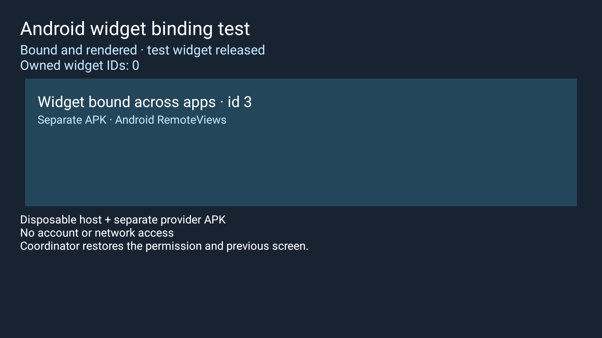
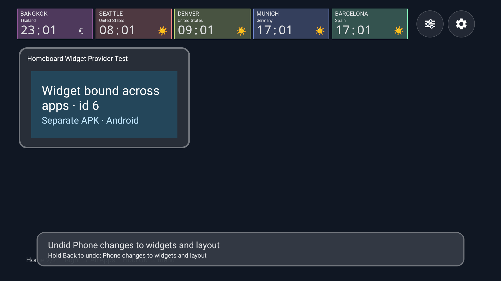
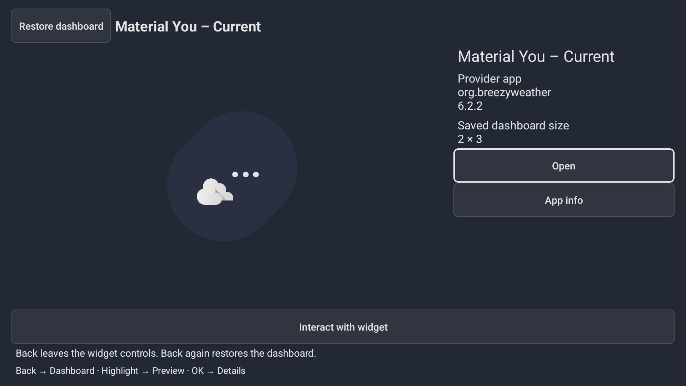
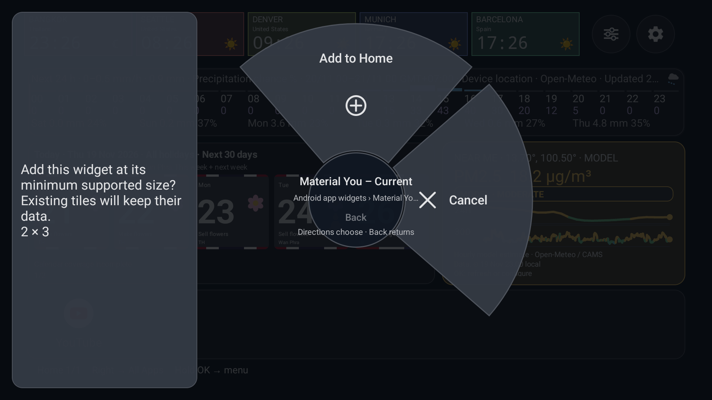
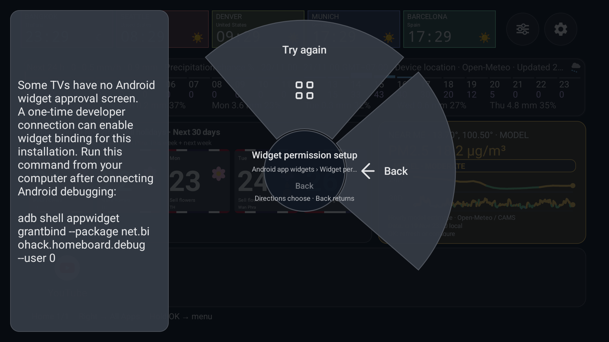

# Android app widgets: implementation and testing

**Current:** development build **0.1.95** is installed and hash-verified on Cast1
and Cast2, with one-time widget binding enabled through the coordinator. Cast1
normal menus rendered/expanded the fixture; Cast2 passed isolated host assertions
and ordinary-menu Breezy placeholder Add/expand/Undo. All 525 JVM tests, lint and
Chromium/WebKit checks passed. The final setup/review explanations are visually
verified. Pixel 94 ordinary entry passed; local mobile widgets, configured real
provider data, resource budgets and 24-hour exposure remain open. Earlier census
and experiment results below are historical stages, not the current feature status.


November 19, 2026. **The developer-grant route successfully bound and rendered a separate app’s Android widget on both Cast1 and Cast2.** Both TVs still lack the ordinary binding-consent screen. At that experiment stage, product integration was still pending; those results came from the disposable host/provider. The current implementation and acceptance results follow below.

The separate `net.biohack.homeboard.widgetfixture` version 1 (`0.0.1-census`)
APK uses public Android APIs to enumerate providers and resolve normal binding
consent. It does not allocate widget IDs, bind widgets, start provider setup,
grant permissions, read calendar/weather data or change the default Home app.

## Developer-grant experiment: passed on both Chromecasts

Will authorized this experiment with "let's find out" after the normal-consent
census. The test granted only `net.biohack.homeboard.widgetfixture` for Android
user 0, inside complete coordinator-owned jobs. No Android root, raw ADB session, Home
change or Homeboard permission grant was used.

| Stage | Cast1 | Cast2 |
|---|---|---|
| Separate provider activated | `J‑10b23c7ccca6` | `J‑cb8717f71314` |
| Ungranted baseline | `J‑8030cae41e80`: binding denied, IDs released | `J‑10a0457a8efe`: binding denied, IDs released |
| Temporary grant and rendering | `J‑b7fb38f04ca7`: passed | `J‑d32f5b8c5810`: passed |
| Grant restoration and ID release | Verified: original grant false → during true → restored false; zero owned IDs | Same verified result |
| Follow-up without grant | `J‑52c324d32c1e`: binding denied again, IDs released | `J‑5a655d7d8350`: binding denied again, IDs released |

The host received a real `RemoteViews` update from the separate provider package
`net.biohack.homeboard.widgetprovider/.ProbeProvider`, checked its known text in a
laid-out host view, drew that actual view to the displayed proof image and released
the test widget. Initial placeholder text cannot pass. The screen image remains
as proof after release; it is labeled **test widget released**, not presented as a
still-live widget. Coordinator cleanup independently invokes the fixed fixture
cleanup receiver and verifies both zero IDs and the original permission state.

[Cast1 structured proof](2026-11-19-android-app-widgets/cast1-bind-proof.json) ·
[Cast2 structured proof](2026-11-19-android-app-widgets/cast2-bind-proof.json).




These deterministic screens have identical image hashes: both devices happened
to allocate ID 3, share the same logical screenshot size and render identical
fixture content. Each has its own independent coordinator receipt, log and grant
restoration observation. The captures were visually reviewed (and their image
bytes compared), rather than treating job completion alone as visual acceptance.

**Practical conclusion:** a one-time developer grant is a viable setup route for
Android widget hosting on these Chromecasts. It is not plug-and-play consent on
TV. Normal host integration, persistent widgets, provider configuration, remote
navigation, resize/Undo and real Fossify/Breezy compatibility still need product
implementation and acceptance. No public feature claim was added.

### Experiment builds and coordinator support

- Host v2 (`0.0.2-bind-test`) SHA-256:
  `7c36695f8b7cdbdb0ad4de01feee0cc2e7540ed5bb2aab69c0982174237f593c`.
- Separate provider v1 (`0.0.1`) SHA-256:
  `301927c3dad8c5bb252ef92cdac070c2fb3b1fcfc753675b9b9f220244eeb5eb`.
- Both modules assembled and passed Android lint in `task widget-fixture`.
  Source hashes/frozen bytes: `artifacts/android-widgets/bind-v2/build.json`.
- The fixture registration was explicitly replaced to point to `.BindActivity`;
  `.CensusActivity` remains available in the v2 APK.
- Coordinator **0.1.183**, revision
  `200fd41930b27f7bf18d28c45dce4dbbb44efcc9`, adds fixture-only
  `widget_bind_test: true` on short frozen `check` jobs. It journals before grant,
  verifies rendering, restores permission and IDs through durable cleanup, and
  keeps Personal use admission unchanged. Arbitrary packages/users are refused.
- **123 targeted coordinator tests passed** on the final merged source. Failure
  coverage includes unreadable original state, interrupted grant response,
  changed APK, failed ID cleanup and acknowledgement only after restoration.
- Reviewed administrator deployment completed; queue/reservations/device identity
  and existing recovery were preserved. Concurrent coordinator updates were kept;
  rejected stale/omitting candidates were not deployed. Source changes were
  merged into the coordinator checkout for future upgrades.
- Upgrade log:
  `.worktrees/coordinator-widget-bind/docs/diagnostics/upgrade-20261119-214604-1795099564382360178.log`.
  Grant-job evidence includes `widget-grant.json`, `widget-bind-result.json`, raw
  before/during/restored dumps and the cleanup receipt in each device directory.

The frozen APKs are identical across devices. Dedicated test apps remain installed
for follow-up provider tests; their test widget IDs and temporary grants were
removed. The Homeboard application/settings and public download were untouched.

## Build and evidence

- [x] Container `:widget-fixture:assembleDebug :widget-fixture:lintDebug` passed.
  Initial lint found a missing TV banner and an unnecessary protected permission;
  both were corrected. Final lint has no errors, one backup-policy warning.
- [x] Four evidence-parser tests passed in the build container: missing,
  incomplete and unrelated results are rejected; the last completed observation
  is used. Run `dev/container.sh run python3 /workspace/dev/test_widget_census.py`.
- [x] Frozen APK SHA-256:
  `134173a8cf18d7602ab3faef1096d5632319293a085495ce06d8def2ca13235b`.
  Artifact and source hashes: `artifacts/android-widgets/census-v1/build.json`.
- [x] Both TVs' installation receipts verify that exact hash. Cast1 install
  `J‑77b15ade62d0`; Cast2 install `J‑aad7fefc3027`.
- [x] Cast1 census check `J‑d340231fd4cd` completed, device healthy, previous
  Google TV foreground restored by the coordinator. Installation was reused.
- [x] Cast2 census `J‑32c145dfb2c6` completed after Personal use ended and
  coordinator recovery `J‑fc6bc499a3a4` succeeded. Device healthy, prior foreground restored.
- [x] Pixel: reconnection `J‑0658e5713f48` and census `J‑34b17ced2024` completed. The same frozen APK was installed and the device returned healthy.
- [ ] Tablet: coordinator control unavailable; no installation or census.

Cast1's install continuation encountered a coordinator plugin error at
`plugins/android/launcher.py:143:apk_references`; this did not invalidate the
successful installation receipt. Automatic recovery ran, and the separately
submitted census check subsequently succeeded. Cast2's redundant verify-launch
continuation was cancelled after its verified installation; its explicit census
job has now completed. No hold was cleared or direct-device fallback used.

## Cast1 result

Extracted from coordinator-exported `logcat.txt`, with matching screen evidence:

```json
{
  "feature": true,
  "service": true,
  "sdk": 34,
  "bindResolver": "",
  "bindActivities": [],
  "providerCount": 0,
  "outcome": "new-binding-unavailable",
  "providers": []
}
```

[Full structured observation](2026-11-19-android-app-widgets/cast1-census.json).


**Interpretation:** declaring Android widget support does not establish a usable
ordinary-user consent path. For this fresh probe on Cast1, no binding-consent
activity resolves. Under the agreed plan this stops new host binding on Cast1.
It does not establish that widgets cannot work with a privileged or previously
granted host. Cast2 was subsequently checked separately below. No permission workaround was
attempted. Fossify Calendar and Breezy Weather have not been installed: the
consent gate failed before provider compatibility testing.

## Cast2 result

Coordinator check `J‑32c145dfb2c6` completed on November 19 after the device's
Personal use ended, successful coordinator recovery, and the earlier launcher
checks finished. It reused the identical frozen diagnostic APK. Cleanup reports
`restored`, and the device is healthy.

Cast2 reports Android SDK 34, widget feature/service available, **no binding-consent
resolver**, no binding activities and **zero installed provider components**.
Outcome: `new-binding-unavailable`, matching Cast1. This is a failed normal-consent
feasibility gate, not an app crash. No widget was bound or provider installed.

[Structured observation](2026-11-19-android-app-widgets/cast2-census.json).


## Pixel result after reconnection

Pixel became reachable on November 19 after the earlier connection failure.
Coordinator census `J‑34b17ced2024` completed successfully on Android 17 (SDK 37).
It reported the widget feature/service, **172 installed provider components**, and
`com.android.settings/com.android.settings.AllowBindAppWidgetActivity` as the
normal binding-consent resolver. This passes the resolver/provider census gate;
actual binding approval, rendering and Homeboard hosting remain untested.

[Structured summary](2026-11-19-android-app-widgets/pixel-summary.json).
Full provider inventory, screenshot, logs and cleanup receipt remain in local
`artifacts/android-widgets/census-v1/pixel-check/`; the parser output is
`pixel-report.json`. The dedicated probe remains installed for follow-up work.

## Reproduce and remaining work

Build/lint with `task widget-fixture`. Register its frozen APK as
`homeboard-widget-fixture`, activity
`net.biohack.homeboard.widgetfixture.CensusActivity`. After devices/queue checks,
submit `dev/device/android-widgets-census.json` through the coordinator, watch the
job and export evidence. Extract the report in the build container:

```sh
dev/container.sh run python3 /workspace/dev/read-widget-census.py /workspace/artifacts/android-widgets/census-v1/cast1-check/logcat.txt --output /workspace/artifacts/android-widgets/census-v1/cast1-report.json
```

Both TVs retain the dedicated census app for the outstanding compatibility work.
Remove it only through a supported coordinator-owned uninstall operation after
acceptance. That statement applied to the census/temporary-grant experiment. The later product implementation is recorded below; the current root also includes the committed timer publication fixes.

Next evidence needed is a reachable tablet census, normal consent/configuration/rendering on Pixel, and the Homeboard integration/real-provider checks above. Both TVs lack the ordinary consent route, while the later authorized developer-grant experiment has now proved cross-app binding and rendering. The following product acceptance supersedes the earlier host/guide status. Real-provider/mobile configuration, resource and 24-hour checks remain explicit follow-up gates.


## Homeboard host implementation · 0.1.94

The product host is implemented in Java with the platform AppWidgetHost APIs.
The same debug APK, SHA-256
`5c3c97d71523c266c395351e22258645cd304b0adf8dfeb0297ef113d5be0a06`,
was frozen by `task deploy` and installed on Cast1 and Cast2. It includes the
committed timer publication fixes through `3f4feef`. The initial 0.1.93 build
was also exercised on Cast2; 94 fixes stale activity-result handling and failed
pending-save recovery, preserves size during Setup again, and releases the
isolated test host's IDs. All current launcher source hashes match the 94 freeze.
The dedicated probe uses separate preferences and host ID 8724; product ID is
8723. It checks household preferences stayed byte-for-byte equivalent.

The coordinator's typed persistent `widget-binding` workflow is deployed as
0.1.186, revision `97362d55ba2dd5e03819dd61e909ea254915f777`. Its 131 targeted
container tests passed, covering grant/revoke, frozen installed identity,
failed readback, recovery settlement, personal-use admission and CLI/MCP schema
parity. The reviewed administrator upgrade preserved recovery and resumed the
queue. Homeboard debug binding was deliberately enabled on both TVs; originals
and inverse recipes are recorded. This is distinct from the earlier temporary
fixture grant, which was restored on each TV.

| Check | Result / evidence |
|---|---|
| Cast2 install | J‑4b66dfb60935 completed; installed hash and launcher verification match 94. |
| Cast1 install | J‑3750fd7f77bb verified the installed hash, then reported plugin-error after installation. Later widget setup J‑1c5d83da0a9c independently verified the installed hash before changing anything. Foreground acceptance follows separately. |
| Cast2 widget setup | J‑68ca6f1b6d0d: original false → enabled true, readback verified; [permission record](2026-11-19-android-app-widgets/cast2-homeboard-permission.json). |
| Cast1 widget setup | J‑1c5d83da0a9c: successful frozen-APK check and permission readback. |
| Cast2 integrated host | J‑9dddb9fe987e completed; [native assertions](2026-11-19-android-app-widgets/cast2-homeboard-proof.json) report pass, including disposable-ID release. Earlier 93 job J‑b03b768ffda4 also passed. |
| Pixel install/ordinary entry | Same 94 hash installed by J‑1fc1d5e6c7d3; its launcher continuation left the foreground. Separate ordinary-entry check J‑b11d3e9253a0 completed and its capture shows Homeboard in landscape. This does not prove local widget binding/touch/configuration. |
| Tablet | Still unreachable; local app entry and widget checks pending. |



Native assertions cover actual compact and expanded RemoteViews, richer provider
and saved-size details, short OK, visible Restore and Back, original page/focus/
size restoration, phone move/remove/Undo with the same Android ID, and unchanged
household preferences. The final 94 probe explicitly releases all its disposable
IDs. This is a short deterministic test, not long-running or real-account evidence.

### Container, browser and documentation checks

- [x] `task check`: calendar 7, cleanup 71, deployment 4 and **525 JVM tests**
  passed; Android lint completed with no errors. The 7 new widget tests cover
  serialization/bounds, Undo references and eviction, malformed retained state,
  unknown schema/tiles, browser identity injection, stale results and failed
  pending-write rollback.
- [x] `task build` via `task deploy`; identical frozen 94 bytes submitted to both TVs.
- [x] `task bundle`: unsigned release App Bundle packaging passed.
- [x] `task phone:check`: existing Chromium/WebKit and world-clock regressions passed.
- [x] `task android-widgets:phone-check`: model constraints, grid placeholder,
  draft rebase/removal, actual provider label, host-only setup guidance, disabled
  fixed resize axis, minimum width and Update TV passed in Chromium and WebKit.
- [x] `task android-widgets:plan-check`: five 1440×900 standalone mockups render
  without overflow/errors; setup/recovery copy reflects the TV permission path.
- [x] Quick start, Android-widget how-to, phone and full-screen guides and README
  updated. `task guide` generated two A4 pages; both pages were visually inspected,
  including the added permission setup copy and page boundaries.

### Real provider preparation

Official release APKs were downloaded and matched against GitHub asset digests:
[Fossify Calendar 1.12.2](https://github.com/FossifyOrg/Calendar/releases/tag/1.12.2),
SHA-256 `2825816d0a972bd85eb289e556221293fadecfd3179a4a2531bde6f89c6f0238`;
[Breezy Weather 6.2.2, armv7 standard](https://github.com/breezy-weather/breezy-weather/releases/tag/v6.2.2),
SHA-256 `9900fa4a5ffc1360bb2d1d88d271fe05e98d1daff5a1aa08452bbf077467c1a6`.
Cast2 install jobs J‑cf892adec9c4 and J‑becb982fca0a verified both installed hashes;
launcher continuations reported plugin-error, followed by successful automatic
recovery. A later public-API census J‑bb6885e6e0b4 found **17 providers**:
13 Breezy, 3 Calendar and our fixture. See [actual metadata](2026-11-19-android-app-widgets/cast2-real-providers.json).
All three Calendar widgets require provider configuration. Breezy's two Material
You widgets declare no configuration activity; its other widgets do. Installation
and discovery alone do not establish usable data, provider setup or remote input.

### Remaining acceptance

- [x] Cast1 normal-menu Add, compact and expanded fixture rendering captured in J‑77d6d116e0d4. Its isolated debug probe and long-Back timing remain separate limitations.
- [ ] Real provider configured data, update, reconfiguration and remote/touch behavior.
- [ ] Local Pixel normal consent, denial, touch controls and provider configuration;
  Android 11 tablet checks when reachable.
- [ ] Process recreation/reboot with pending setup, provider removal/reinstallation,
  two independently configured instances, native resize/global-grid recovery.
- [ ] Zero/one/four-widget resource comparison, 50 expansion cycles and recorded
  24-hour exposure. The short Cast2 run sampled Homeboard PSS 69,479 KiB; without
  a comparable baseline that is **not** a memory-budget verdict.

Raw device receipts/logs remain under ignored `artifacts/android-widgets/`.
No public website update or public APK release is part of this implementation pass.


### Real Breezy widget through ordinary TV menus

Cast2 job **J‑4159181820e8** completed the remote-only path on 0.1.94:
Home settings → Widgets / Restore → Add widget → Android app widgets →
Material You – Current → Add to Home. Captures show the installed-provider
picker, minimum-size review, real 2×3 provider tile and expanded provider view,
then the original Home after Back and hold-Back Undo. It is Breezy's **unconfigured
provider placeholder**, not a verified forecast: no location/account was set and
no live-weather/remote-control compatibility is claimed. The normal picker/add/
expansion/restoration mechanism works with this real provider; configured data
and its provider-side setup remain open.




Cast1 isolated debug check J‑ac1231a2598b ended `target-left-foreground` before
its log/screenshot collection. The failure dump shows Google TV Home; it does
not establish a host assertion failure or a successful check. Normal-menu
acceptance is being run separately with coordinator-scripted input and captures.


Cast1 normal-menu job J‑77d6d116e0d4 reached real fixture Add, compact and
expanded RemoteViews after increasing the wait between provider selection and
Add. The earlier short-wait J‑d9f025d716b0 reached the review late and did not
exercise expansion; completion alone was not treated as a UI pass. Its longer
successor's expanded capture shows the real provider text, 3×2 saved size and
Restore action. The last scheduled capture was still showing hold-Back progress;
final Undo confirmation is kept separate. Cast1's debug-probe foreground failure
remains an observed test limitation, not a successful assertion run.

### Setup/review explanation correction · 0.1.95

Device captures exposed that ordinary nested pie menus replace subtitles with
breadcrumbs. Widget setup/help, minimum-size review and recovery explanations
were therefore hidden. The 95 correction preserves these complete explanations
in a readable left panel for one/two-choice widget menus, with the existing
four-direction actions kept. Caption text adapts to the available size, and its
background uses the menu opacity so it remains readable over wallpaper. No
permission changes occur just by opening the explanation.


Final build **0.1.95**, SHA-256
`41995f0f6aeca25f75d367f02b9691d1d1cf0969581e7cb94f10c60c9a52212e`,
completed `task deploy` successfully on **both** TVs: Cast1 J‑d2fbe9ae3dde and
Cast2 J‑7107b37071dd, including installed-hash and launcher verification. All
launcher source hashes still match that freeze. All 525 JVM tests and lint
passed again. Cast2 normal-menu job J‑196082c1d973 repeated Add, real Breezy
placeholder expansion and Undo on 95; its review capture visibly includes the
complete explanation and 2×3 size.




#### Cleanup correction

After the long-Back test, the test widget had already been removed when a later
cleanup job opened Undo history. I incorrectly selected an older **Background:
Aerial Views** entry, changing the background to Photo of the Day. The capture
made this clear. Do not treat that job J‑0e18f02ab13b as widget-Undo proof. Will
was informed, and Aerial Views was restored in J‑d8f807c4b277 through the normal provider picker,
Preview and Use background. Its final capture explicitly shows saved **Source:
Aerial Views** and widget opacity 65%. The
mistake changed Undo history; no claim of byte-identical Cast1 history is made.
Future cleanup must inspect the current Undo label before executing it; a
completed input script is not enough to identify an owned entry.


Final permission-help job J‑b52711cf2587 shows the full explanation and exact
installed-package command in the new side panel. Opening/backing out of help
changed no permission. The one-off cleanup/repair recipes were moved to ignored
artifacts with a warning instead of leaving the unsafe Undo recipe as a reusable
project command. Both TV app registrations point back to ordinary MainActivity.



Final 0.1.95 release bundle packaging passed (`task bundle`, 4 min 16 sec). The refreshed quick-start PDF remains two A4 pages, with its updated page boundaries inspected. The final queue snapshot has both TVs ready/unowned and no waiting jobs.
