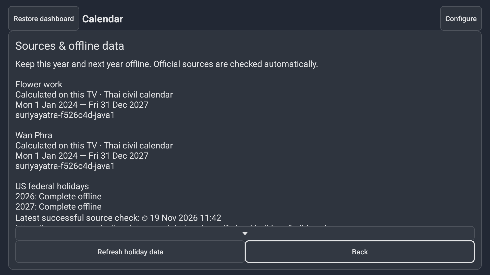
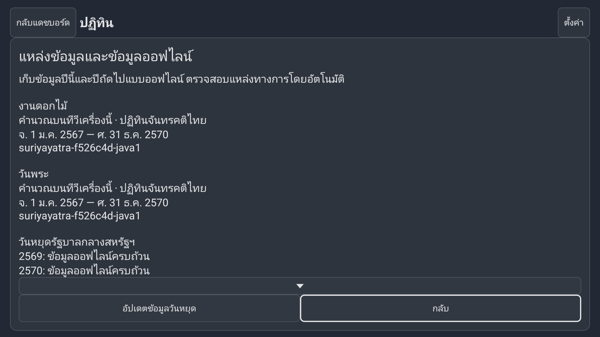
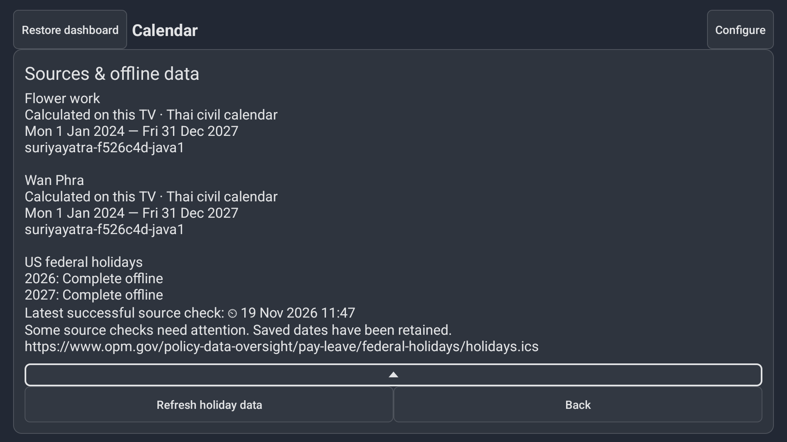
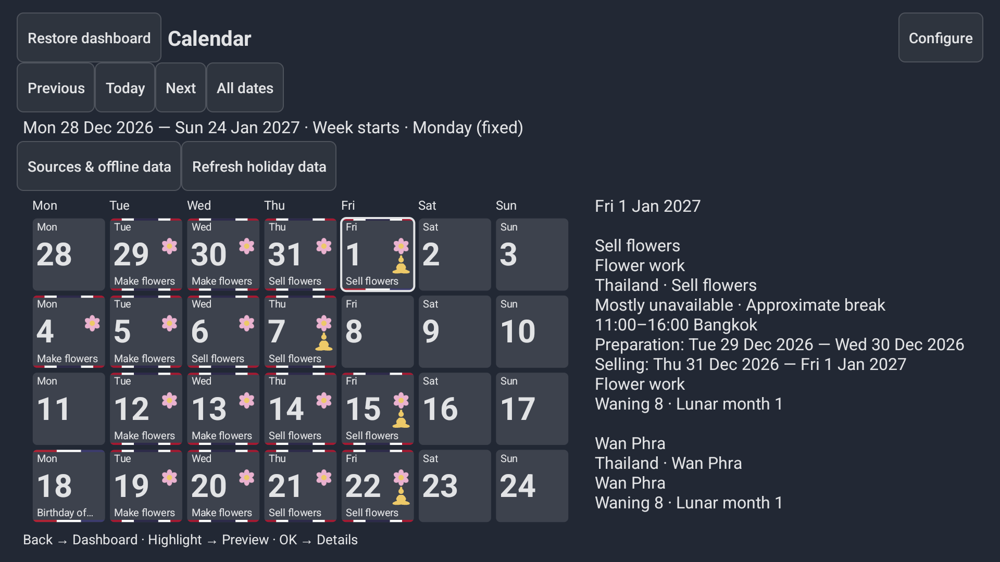
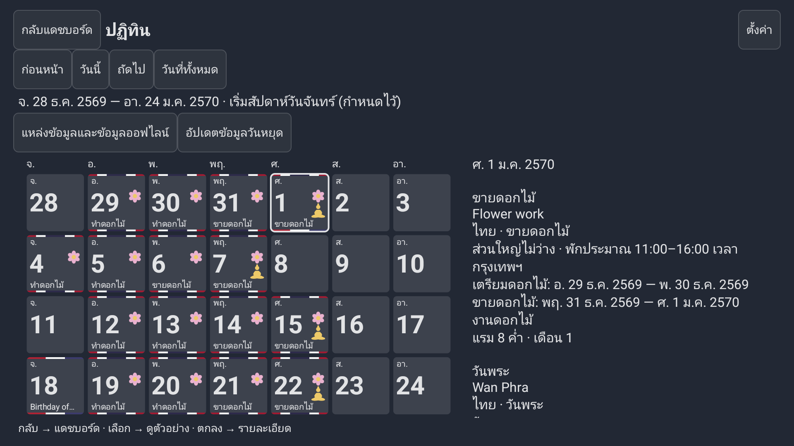
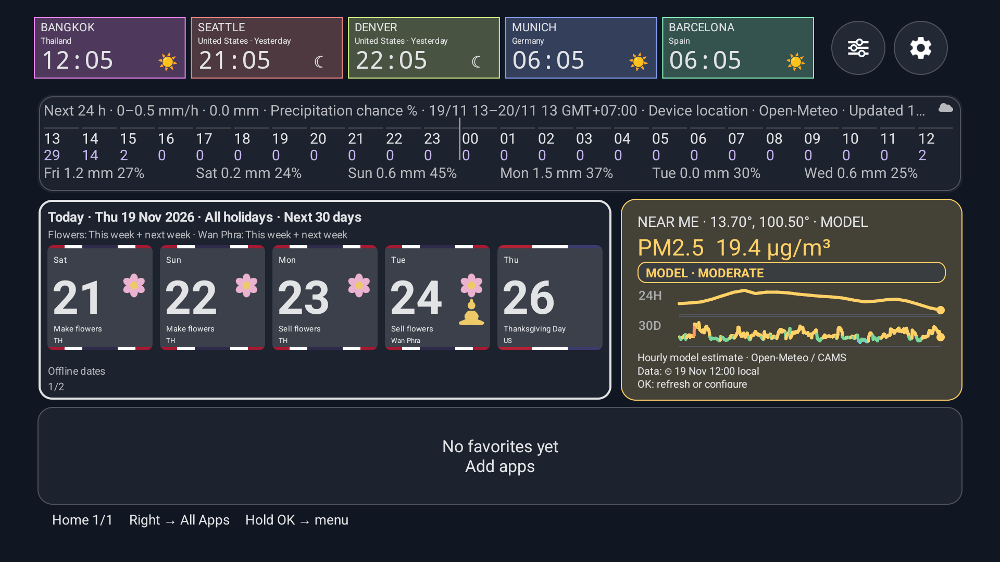
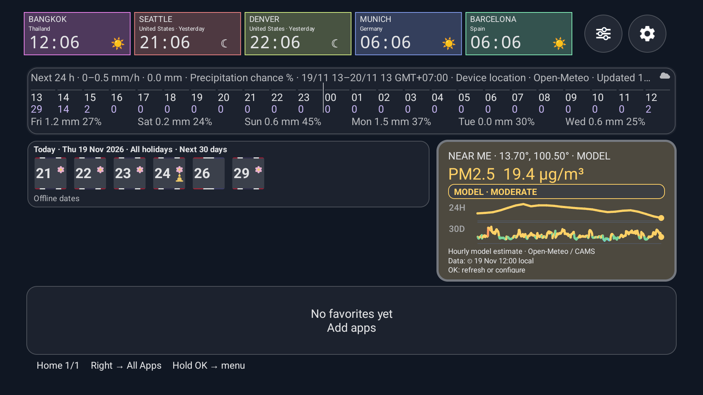

# Client-side Calendar and offline holiday updates

**0.1.69** is installed and launch-verified on Cast1. Seven reviewed Cast1 captures
cover source status, failure retention, compact/full-screen views and both return paths.
This record distinguishes independent date fixtures, captured-publication replay,
real HTTPS updates and native UI fixtures.

## Calculation proof

`ThaiCivilCalendar` adapts the pinned pythaidate civil-calendar arithmetic. Its
year/month/day results match reference-generated SHA-256 values for every day of
1900–2100. Wan Phra selection agrees exactly with independently published annual
lists for 2024, 2025, 2026 and 2027. The 2026 fixture has 49 dates, including
3/9/17/24 November and the repeated month 8. The supported observance interval is
2024–2027. Flower anchors beyond the validated interval report incomplete coverage.

Original MIT reference files and hashes are in `vendor/pythaidate/`; the runtime is
Java, with the original license packaged in the APK. Python reference files are
test tooling only. No Buddhist/flower event arrays remain in the production asset.

## Source and storage proof

The same Java modules run on Android and through `task calendar:replay` in the
build container. Tests exercise exact observed-day anchors, China working-day
classification, Catalunya/Tivissa scope filtering, unknown formats, two-year
retention, safe rollover pruning, atomic-write failures, previous-revision recovery,
conditional/not-modified responses, retries and unsuccessful-check metadata.

Real container HTTPS runs completed for:

- China 2026 and 2027: official annual notices retrieved, parsed, reconciled and
  persisted, with success metadata. The optional 2028 discovery did not find a
  unique annual publication and left the required years intact.
- Spain 2026 and 2027 national/Catalunya calendars and Tivissa 2026: official
  documents/data retrieved and saved. The official Tivissa 2027 query returned no
  records; it was rejected as incomplete, preserving the previous data. Optional
  2028 discovery remained unresolved.

The live CLI runs used an injected scheduling clock of `2026-11-19T04:30:00Z`;
HTTPS retrieval was real, while the selected year/window and stored check time
were controlled. These timestamps are not wall-clock retrieval evidence.

Private captures/state are under `artifacts/calendar-live/`. Source replay fixtures
and independent date lists are under `launcher/app/src/test/resources/calendar/`.
These checks are not TV-network acceptance or evidence of every future publication
format. Native UI captures use a controlled source transport and isolated settings.

OPM requests from this development network returned HTTP 403. Thai annual-source
requests returned HTTP 403, and the configured official announcement feed did not
resolve. These are unresolved live-source limits, not successful update checks.
The app retains its reviewed seed and reports attention/coverage gaps. Unknown
Thai cancellation or jurisdiction wording is not applied by guessing.

Replay a captured official format without a device or publisher request:

```sh
task calendar:replay -- parse boe 2027 \
  https://www.boe.es/diario_boe/xml.php?id=BOE-A-2026-21254 \
  launcher/app/src/test/resources/calendar/sources/boe-2027.xml \
  artifacts/calendar-cli/boe-2027-parsed.json
```

The parser, year, canonical publisher URL, input capture and output path are
explicit arguments. `task calendar:replay -- refresh` uses the seed path, private
state directory, comma-separated source IDs and an explicit ISO scheduling instant;
it performs real HTTPS requests and records individual source failures.

## Native acceptance

The debug probe uses production Calendar, source panel and repository code, with
an explicitly synthetic OPM transport. It checks successful refresh persistence,
failed-refresh retention without advancing success time, next-year data after
repository reopen, 29 December preparation for 1 January Wan Phra, and restoration
to the original Calendar focus. Household layout/language preferences are compared
before and after; shared Wi-Fi/clock settings are never changed.

The first boundary fixture used an incorrectly nested state Bundle; its initial
November image is excluded from year-boundary proof. Subsequent 0.1.68 remote
navigation captures really show 1 January. Its Restore probe also asserted state
before Android dispatched the asynchronous dismiss callback. Candidate 0.1.69
corrects only those debug-probe issues and its version number; production Calendar
code is unchanged from 0.1.68. The corrected probe waits for dismissal and verifies
both visible Restore and short Back before reporting success.

Physical captures below use fixture transport, not live OPM retrieval. Successful
checks demonstrate Android persistence/coalescing and native UI behavior; they do
not resolve the publisher access failures above. Source summaries include only
the sources selected in the isolated fixture. Missing Thai/Spanish scopes remain
covered by parser/store tests and the production coverage status, rather than a
claim of a physical missing-publication screenshot pass.

Long-running daily/twice-daily background execution, process death during a write,
and persistence of a pre-existing runtime revision across a real APK upgrade
were not separately observed on TV. Store fault/retention tests and native
repository reopen cover those mechanisms; physical scheduling endurance remains
follow-up work.

## Reviewed screenshots

All seven cases have successful coordinator receipts and native assertions. The
source/failure captures use 0.1.68; final boundary/return/compact captures use
0.1.69. Frozen source manifests confirm identical production code in both builds.
The [machine-readable evidence manifest](2026-11-19-calendar-data/verification.json)
records versions, screenshot hashes, receipt hashes, assertions and APK provenance.
Full receipts/logs remain in private `artifacts/calendar-data/<version>/` folders.

| Capture | Version / coordinator job | Reviewed result |
|---|---|---|
| sources-en<br> | 0.1.68 · J‑3e7570aeccd9 | Two complete US years, calculator interval/revision, successful-check time and clear overflow wedge. |
| sources-th<br> | 0.1.68 · J‑990563b83d70 | Buddhist Era coverage/check dates and readable Thai source controls. |
| failed-refresh<br> | 0.1.68 · J‑c579c8613c18 | Previous successful-check time retained; failure warning visible after paging with the wedge. |
| offline-boundary-en<br> | 0.1.69 · J‑dc2f4d4c8840 | Reopened cache with retrieval disabled; 29 December preparation and 1 January Wan Phra with lunar details. |
| offline-boundary-th<br> | 0.1.69 · J‑c9ac0ccefb79 | The same December/January boundary in BE 2569/2570, localized lunar labels and Wan Phra marker. |
| restore<br> | 0.1.69 · J‑182634641ade | Visible Restore and short Back each restore Calendar focus, page and size; household preferences unchanged. |
| compact<br> | 0.1.69 · J‑654ffa0f6541 | 5×1 Calendar retains readable date cards and calculated religious/flower markers. |


## Build/deployment record

The final candidate passed 500 JVM tests, 7 calendar pipeline tests, 52 cleanup/
recovery tests, deployment-helper tests, Android lint and 661 English/Thai resource
checks, all in containers.

Frozen APK SHA-256:
`313dbc7a02c5bd667c85177549c71cba03dec0474ed8cf1ff8269aab4b452415`.
Cast1 **J‑89ced3c080a3** succeeded with installed-hash/launcher verification.
Cast2's identical independent install **J‑728048b4fabc** was granted and then failed
`personal-install-in-use`; installation there remains unconfirmed.

Initial 0.1.66 functional source/failure probes passed, but visual review found
the small text-based wedge clipped. A vector-drawn native control fixes that.
The 0.1.67 attempt failed lint before producing/deploying an APK; its version was
consumed. The corrected native View passes lint in 0.1.68. Failed/older visual
captures are not final screenshot acceptance.

After the isolated probes, **J‑a5850090b7f8** successfully launched the normal
MainActivity on Cast1. The app catalog points to MainActivity and the same frozen
0.1.69 APK. Household settings were retained; its final capture stays private.
