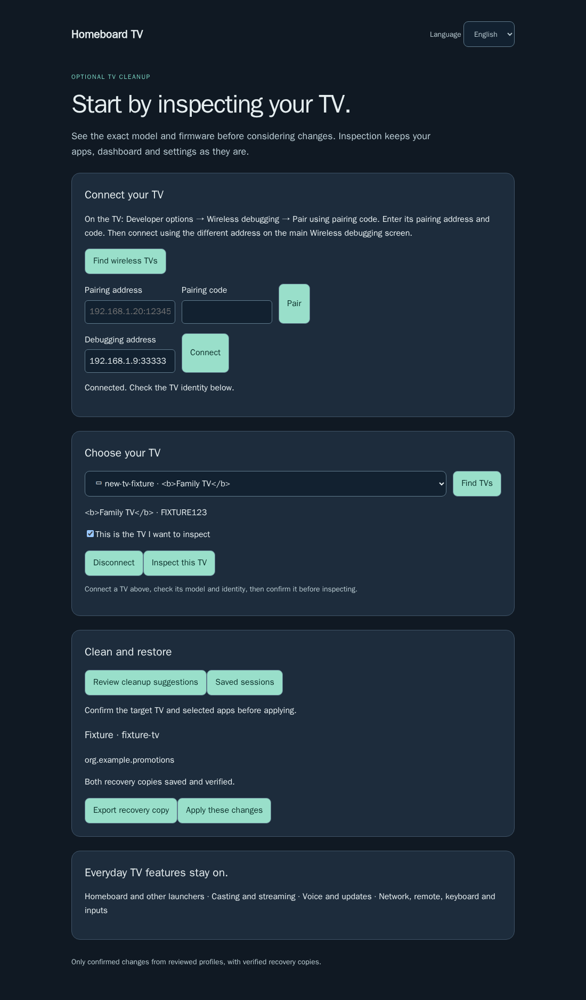
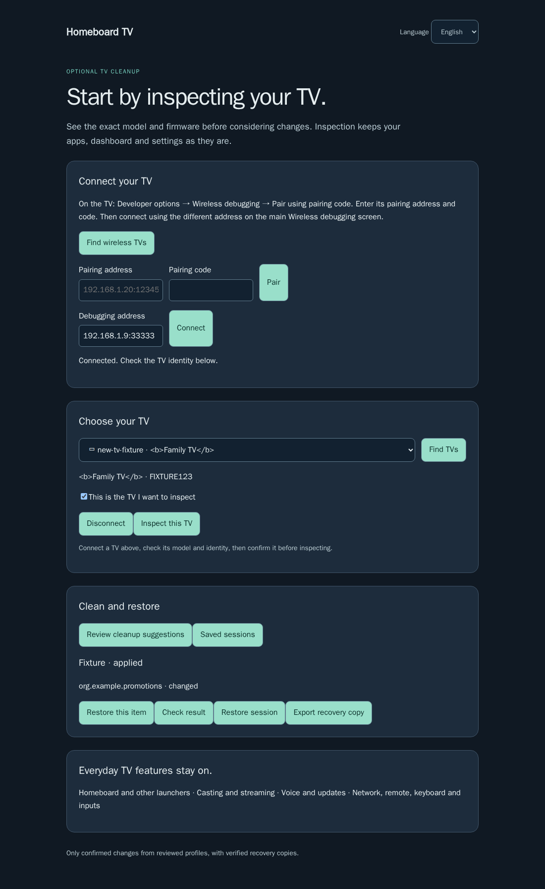
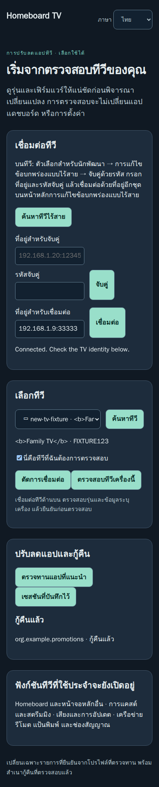
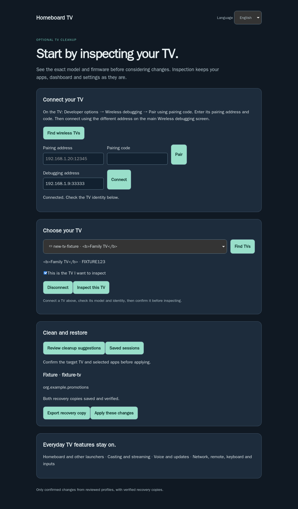
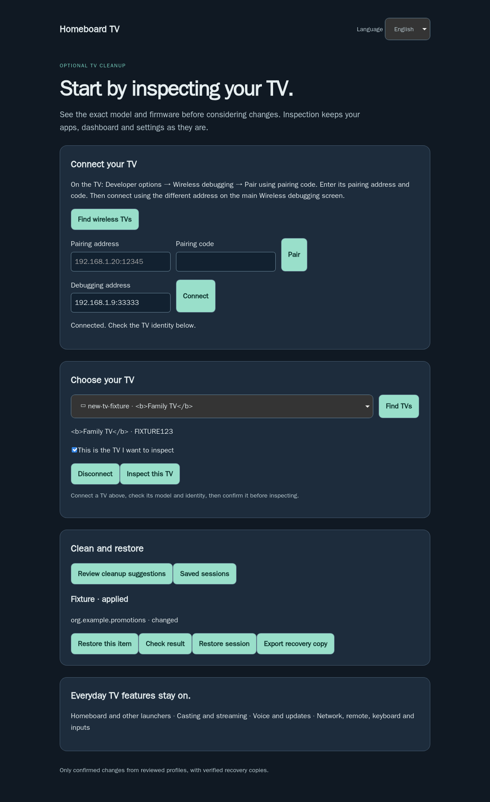
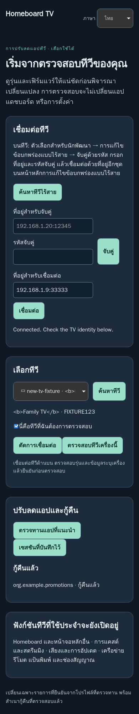

# Cleanup execution verification

The standalone companion implements full user-0 inventory, reviewed profile
selection, unselected recommendations, exact confirmation, Apply/Stop, saved
sessions, result reconciliation, individual/full Restore and recovery export.
No approved physical-TV profiles are supplied. No real package was disabled.

## Container proof

70 cleanup/recovery tests pass. These cover strict installed-package and User 0
state parsing, missing/duplicate facts, active/Home protection, identity/user
mismatch, reviewed profile protection, stale confirmation, authenticated execution
HTTP routes, two verified recovery copies, lost replies, Stop, restart and exact
original-state restoration. Pairing/connection tests remain included.

The inventory collector uses bounded read-only commands and validates identity
before/after collection. Dependencies are unknown until an exact reviewed
profile grants version-specific eligibility. The physical Android report format
has not yet been accepted on the new TVs; unknown formats fail closed.

## Browser proof

Chromium and WebKit exercised the actual local HTTP server with a controlled fake
TV. Both passed unselected review, selection, exact confirmation, verified copies
before Apply, actual recovery-file download, Apply, saved sessions, Check result
and Restore. Thai mobile restoration was captured with no horizontal overflow.
These are fixture screenshots, not native-TV execution proof.

| Browser | Confirmation | Saved session | Thai restore result |
|---|---|---|---|
| Chromium |  |  |  |
| WebKit |  |  |  |

[Capture hashes](2026-11-19-cleanup-execution/verification.json).

## Physical rehearsal dependency

Coordinator 0.1.180 support was checked on November 19. Cast1 advertises inspect
and reactivate-package, but no cleanup apply/restore workflow. Configure permits
only named device settings, not package disabling. No raw-device fallback was
used. The requested disposable-package rehearsal has therefore not run.
A reviewed coordinator execution workflow is still required, followed by owned
job submission, terminal watch and exported before/after/restored evidence.

Standalone physical pairing, physical inventory format, real-TV profiles and
retained TV function acceptance remain unverified. The computer companion keeps
recovery independent of the TV dashboard; loss of both host recovery directories
requires separately verified recovery import tooling before restoration.

See the [execution plan](../plans/2026-11-19-cleanup-execution.md) and
[setup instructions](../how-to/tv-cleanup.md).
