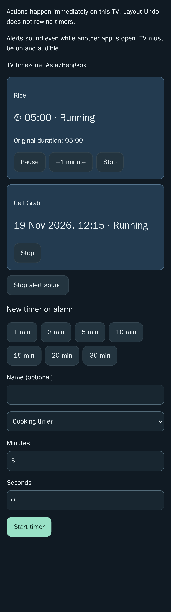
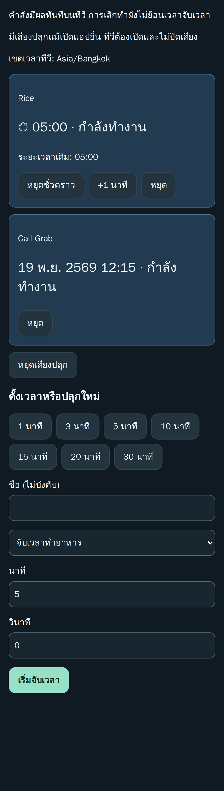

# Cooking timers and event alarms acceptance

Scope: named concurrent cooking durations, one-off event alarms, compact and
expanded TV views and paired phone live controls. See the
[plan and mockups](../plans/2026-11-19-cooking-timers.md) and
[user guide](../how-to/timers-and-alarms.md).

## Container and browser checks

`task check` passed before the device proof was added: seven new domain tests,
existing JVM suite, lint, resource parity and the existing pipeline/cleanup/deploy
checks. The numbered deployment repeats these checks with the final debug probes.
Attempt 0.1.82 stopped before packaging: Android's Files API has no writeString;
the debug probe now uses the same Files.write pattern as existing probes.
Attempt 0.1.83 also stopped before packaging: lint required the named
LinearLayout.VERTICAL constant in the new sound-test activity. Both consumed
version numbers remain consumed; neither APK was installed.

`task phone:check` passed for the existing editor, layout models and world clock.
`dev/timer-phone-check.cjs` passed on Chromium/Pixel 7 and WebKit/iPhone 13 profiles.
It checks custom cooking entry, immediate +1 minute against the correct dish,
one-off events using the TV zone while the phone is in New York, a response-lost
retry preserving operation identity across re-render, no horizontal overflow, and
English/Thai rendering including Buddhist Era event dates.

These are actual browser captures with deterministic API fixtures, not physical
phone/LAN acceptance and not TV screenshots.

## Device proof procedure

`python3 dev/timer-device-proof.py --version 0.1.NUMBER` runs a coordinator-owned
Cast1 session against the identical frozen deployment APK. The debug UI fixture
isolates both layout and runtime preferences, seeds paused/finished demonstration
timers, and never schedules or sounds them. It captures 2×1, 1×1 and 4×2 sizes,
expanded details and restoration to originating page/focus. The coordinator captures
the real TV screen at those stages. Verify the app's `wf.log` and version as well
as the coordinator receipt; completion alone is not a pass. Catalog registration
returns to MainActivity in the script's finally block.

`--sound` uses a separate debug activity and refuses if household timers exist.
It needs Alarms & reminders access. It starts one five-second test timer, opens
Android Settings, then checks that the exact callback marked the timer Done and
that the media player started. It stops the sound and restores the empty runtime.
Coordinator captures should show Settings both before and during the alarm.
A media-player start proves the audio API path, not physical speaker audibility.
A blocked permission result is not a pass; use the TV's normal permission UI and
repeat within a coordinator session. No raw ADB or permission bypass is used.

## Remaining checks

- Record final numbered install receipts for Cast1 and Cast2 independently.
- Attach and inspect native screenshot evidence and both probe outcomes.
- Physical speaker audibility, sound routing with playing media, and manufacturer
  power-management behavior require observation; no screenshot proves them.
- Physical handset pairing/reconnection, native Thai/enlarged-font review, actual
  device reboot/revoked-permission scenarios, and a second real date/time event
  are additional hardware acceptance beyond the model tests.
