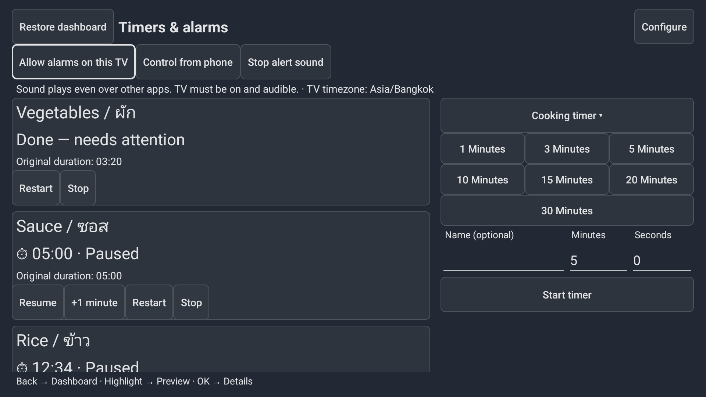
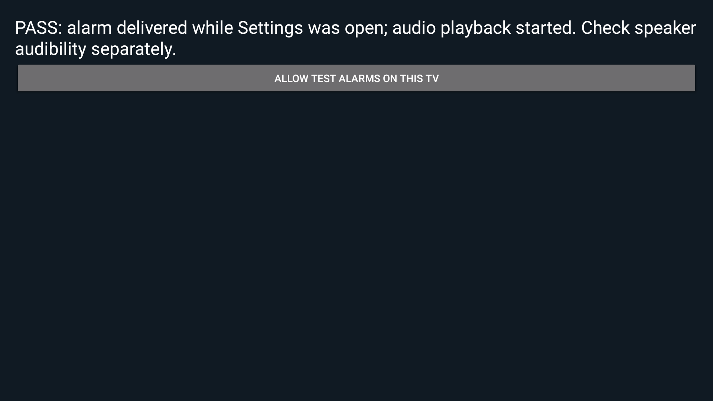
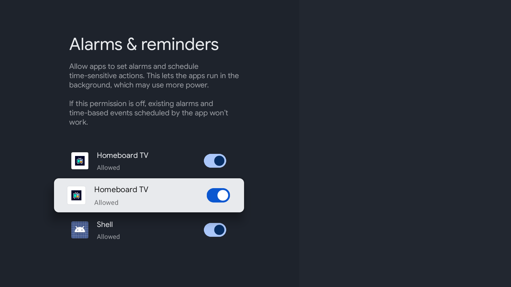

# Cooking timers and event alarms acceptance

Scope: named concurrent cooking durations, one-off event alarms, compact and
expanded TV views and paired phone live controls. See the
[plan and mockups](../plans/2026-11-19-cooking-timers.md) and
[user guide](../how-to/timers-and-alarms.md).

## Container and browser checks

`task check` passed before the device proof was added: seven new domain tests,
existing JVM suite, lint, resource parity and the existing pipeline/cleanup/deploy
checks. The numbered deployment repeats these checks with the final debug probes.
Attempt 0.1.82 stopped before packaging: Android's Files API has no writeString;
the debug probe now uses the same Files.write pattern as existing probes.
Attempt 0.1.83 also stopped before packaging: lint required the named
LinearLayout.VERTICAL constant in the new sound-test activity. Both consumed
version numbers remain consumed; neither APK was installed.

`task phone:check` passed for the existing editor, layout models and world clock.
`dev/timer-phone-check.cjs` passed on Chromium/Pixel 7 and WebKit/iPhone 13 profiles.
It checks custom cooking entry, immediate +1 minute against the correct dish,
one-off events using the TV zone while the phone is in New York, a response-lost
retry preserving operation identity across re-render, no horizontal overflow, and
English/Thai rendering including Buddhist Era event dates.

These are actual browser captures with deterministic API fixtures, not physical
phone/LAN acceptance and not TV screenshots.

## Device proof procedure

`python3 dev/timer-device-proof.py --version 0.1.NUMBER` runs a coordinator-owned
Cast1 session against the identical frozen deployment APK. The debug UI fixture
isolates both layout and runtime preferences, seeds paused/finished demonstration
timers, and never schedules or sounds them. It captures 2×1, 1×1 and 4×2 sizes,
expanded details and restoration to originating page/focus. The coordinator captures
the real TV screen at those stages. Verify the app's `wf.log` and version as well
as the coordinator receipt; completion alone is not a pass. Catalog registration
returns to MainActivity in the script's finally block.

`--sound` uses a separate debug activity and refuses if household timers exist.
It needs Alarms & reminders access. It starts one twenty-second test timer, opens
Android Settings, then checks that the exact callback marked the timer Done and
that the media player started. It stops the sound and restores the empty runtime.
The probe leaves Android Settings on screen during the deadline, then returns
to its result screen before the coordinator captures it. Lifecycle logs support
the background interval; the final screenshot alone does not show that interval.
A media-player start proves the audio API path, not physical speaker audibility.
A blocked permission result is not a pass; use the TV's normal permission UI and
repeat within a coordinator session. No raw ADB or permission bypass is used.

## Remaining checks

- Physical speaker audibility, sound routing with playing media, and manufacturer
  power-management behavior require observation; no screenshot proves them.
- Physical handset pairing/reconnection, native Thai/enlarged-font review, actual
  device reboot/revoked-permission scenarios, and a second real date/time event
  are additional hardware acceptance beyond the model tests.

## Native results and findings

Cast1 UI proof **passed** on 0.1.88, coordinator `J‑42254c7a45f1`. The native
probe rendered requested sizes, expanded content and restored the originating
page/focus. The stable final capture below was inspected: the list is beside the
entry form, with additional dishes available by scrolling; TV scrollbars are hidden.

The first actual background sound scenario on 0.1.88 (`J‑30508dc06472`) found a
real failure: the timer reached Done over Android Settings, but the device's
system default alarm URI could not create a playable media source. The service
now uses the original, deterministic two-second PCM alert bundled in the APK,
generated by `dev/generate-alarm-tone.py`. It retains alarm audio attributes,
audio focus, device volume and the monotonic one-minute bound. The repeat sound acceptance below passed with the bundled tone.

Build notes: 0.1.87 reached a transient SocketException in an existing HTTP unit
test; the focused HTTP suite passed on recheck, and 0.1.88 passed the full suite.
An earlier attempt stopped before bump because the shared Gradle journal was
locked. 0.1.89 was deliberately stopped before packaging/deployment after the
hardware sound failure was found. Assigned deployment numbers remain consumed.

## Final release and background sound acceptance

- **0.1.91 bundled-tone proof passed on Cast2:** `J‑c5f986a7c5b3`. The timer
  reached Done while Android Settings was foreground and MediaPlayer started.
  This verifies background delivery and the audio API path, not physical speaker
  audibility. The final result screenshot was inspected.
- Alarm access was enabled for both installed Homeboard builds through Android's
  normal Settings UI, inside coordinator Remote session `J‑be8b1e94e063`. Its
  cleanup completed with no unresolved effects and restored the prior screen.
- **Public 0.1.92 installed on Cast2:** `J‑ec65d6ca2741`, succeeded.
- **Public 0.1.92 Cast1 install submitted:** `J‑edd8bd12e247`, queued after
  wireless debugging stopped advertising. The user confirmed power/Wi-Fi had not
  changed. Coordinator readd attempts `J‑185353f5346c` and `J‑dd48d6207383`
  failed `device-not-found-on-network`; no direct transport fallback was used.
  The blocked sound-test retry `J‑84842bbe4e55` was canceled before using Cast2.
- Debug 0.1.91 previously installed successfully on both TVs. Public 0.1.86 and
  debug 0.1.88 also installed on both. These earlier successes do not establish
  installation of public 0.1.92 on Cast1.
- Final container checks: **518 JVM tests, zero failures**, Android debug and
  release lint, signed APK verification, pipeline/cleanup/deploy checks. The
  original PCM tone is packaged byte-for-byte in debug 0.1.91 and public 0.1.92.
- Public APK SHA-256: `462409bdd10c8b141861b17af1e4ac30b61546f1c4210810a1f8b1606a2165de`.

0.1.90 encountered the same early-close race in the existing HTTP test. The test
now sends an oversized Content-Length without sending a rejected half-megabyte
body, retaining the 413 assertion and additionally checking rejection from headers.
Subsequent full checks passed. This changes the test client, not server limits.

[Live website and download verification](2026-11-19-timers-publication.md).
The coordinator socket later became unavailable during Cast1 evidence collection;
its public 0.1.92 installation remains submitted/unverified in this record.
